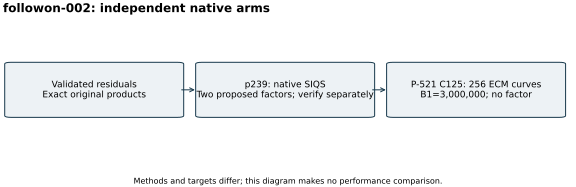

# SIQS and a reduced-cofactor ECM follow-on

Run `followon-002`, 26 October 2026. Command:
`NIST_FACTOR_OUT=<fresh runs/followon-002> sh run_followon.sh`.
The S3 gate passed, native input preparation rechecked target products and
prime/composite flags, and a checkpoint captured the new inputs before work.

One-thread Msieve SIQS on p239 index 2491's 71-digit residual returned two
proposed factors, of 31 and 40 decimal digits, exit 0. Saved relations,
native logs and output are retained. Msieve source is pinned to
`c8727d91305bdbe0972d160ef0ce61dd02ce9193`.
The p239 proof is a separate `p239-proof-002` record.

A simultaneous GMP-ECM arm completed all 256 requested curves on the reduced
P-521 C125, B1=3,000,000, exit 0, without another divisor. Each arm had a
1,800-second watchdog. GMP-ECM sigmas are in raw output; no prescribed seed
was set. The remaining composite was not admitted as a prime.

The arms use different methods and targets, so the visual is an execution
diagram instead of a timing comparison. Raw evidence:
[follow-on records (archive manifest)](../../evidence/.artifacts.json). Exact commands, tool hashes,
local four-core/16-GiB configuration and outputs are bound by the
[run index](../../results/run-index.json). Backend time diagnostics are not
a benchmark or an ECDLP cost measurement. A checkpoint followed completion.
