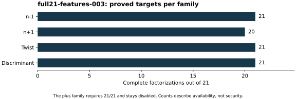

# Full-cohort feature admission after three proofs

Run `full21-features-003`, 26 October 2026. The unchanged native
`extend_features.cpp` read the 21 historical rows, original base feature
tables and 83 complete factor records. It rechecked prime factors and exact
target products. The S3 gate passed before execution; stdout, stderr and all
83 admitted inputs are retained in [raw records (archive manifest)](../../evidence/.artifacts.json).

All 21 minus, twist and discriminant targets are complete. Twenty plus
targets are complete; P-521 plus is not. Consequently the complete plus
feature family is disabled across the entire cohort. There are 1,118
features per row, all 21 controls remain, and no unknown is a numeric label.
The counts are exact finite-census values, not a sampled estimate.

Native library versions, exact inputs and source baseline are in the
[run index](../../results/run-index.json). This local check claims no
performance isolation tier or speed result. The next native search reads
these tables without changing its rule family or calibration contract.
After execution the outputs were checkpointed. This is feature availability,
not a vulnerability result or a historical selection mechanism.
