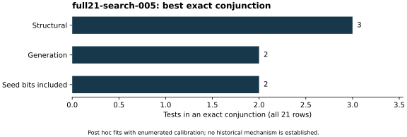

# Replayed all-21 short-rule search

Run `full21-search-005`, 26 October 2026. The unchanged native `search.cpp`
read the new 1,118-feature tables for all 21 curves after a successful S3
gate. It searched the same structural, generation and seed-bit families and
enumerated all 4,480 label assignments preserving published counts within
each of the six streams. Raw predicate masks, calibration tables and three
summaries are in [the search directory (archive manifest)](../../evidence/.artifacts.json).

The best single test has three errors in each family. Exact conjunctions
use three structural tests or two tests when generation or seed bits enter.
Unique predicate-mask counts are 3,444, 5,234 and 5,540 respectively. The
three-test structural rule and two-test generation rule match the prior
fits; factor completion did not simplify the structural separator.

The structural minimum-clause histogram is `[0,1041,3439,0]` for one, two,
three and over-three clauses. Its as-good count 4,480 compares against the
observed three-clause rule, not a two-clause threshold. Generation admits
1,930 exact fits with at most two clauses, seed-bit search 2,117. These
are exact enumerated finite-search counts; the exchangeability assumption
does not establish a probability of a vulnerability or historical use.

No genuine new historical labels were tested. Complete plus features stayed
disabled, all controls stayed included, and the old 19-row search was not
silently promoted. [The run index](../../results/run-index.json) binds source
and native environment. No performance isolation tier or runtime comparison
is claimed. Search output was checkpointed after completion.
