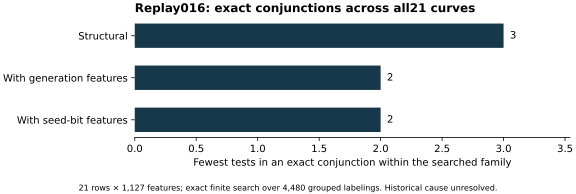

# Replay016: all84 factorizations, all21 controls

26 October 2026. Native controls, feature extraction, factor summary and
three-family search/calibration all exited zero. The replay completed at
17:53:12 UTC. Counts below are decimal and exact for this finite cohort.

The [frozen protocol](../../FULL84_REPLAY_PROTOCOL.md) uses all 21 historical
rows, the 83 prior admitted factorizations and the newly proved P-521 `n+1`
record. The native extractor, search and summarizer were compiled with
C++17 `-O2 -Wall -Wextra -Werror`, PARI 2.17.3 and the recorded OpenSSL
dependencies. The pre-existing search self-test passed before extraction.
The source state was `a7114968c980bcb3ee37db071657b758585d47ed`; the run
freezes exact executed sources, inputs and binaries separately.

All 84 factor records passed repeated prime/product checks. Each of the
four complete-factor families has 21 proved records. The same native
extractor emitted 1,127 features for each of 21 rows and admitted complete
`n+1` features globally. No row was removed and no unknown was substituted
numerically. The previous 83-record raw round remains unchanged.

Three requested search families completed over all 4,480 permitted
within-stream count-preserving label assignments. The structural family
has best single-test error count 3 and a shortest exact conjunction of
three tests; generation and seed-bit families also have single-test error
count 3 and exact two-test conjunctions. Structural minimum-clause counts
are `[0,1094,3386,0]`; generation counts are `[1,1972,2507,0]`; seed-bit
counts are `[1,2156,2323,0]`. Bins mean one, two, three and more than three
tests. The recorded as-good calibration counts are respectively
4,480, 1,973 and 2,157 against each observed complexity. The structural
4,480 compares with a three-test fit, not a two-test fit.

The [main report](../../REPORT.md) links the canonical summaries and compares
the initial and intermediate rounds. These are visible-label exploratory
fits and finite enumeration under an exchangeability model, not evidence
of a historical selector or an applicable DLP attack. No new family,
statistical claim, held-out historical label or performance result is added.

The local host had four configured CPU cores and 16 GiB memory. No
performance isolation tier, timing comparison, independent-host replay or
Lean formalization is claimed. All checkpoint gates succeeded. Native
stdout, stderr, exact stage statuses, source/binary/input hashes and all
outputs reside in `runs/full84-replay-016/` after hydrating the
[final archive](../../evidence/.artifacts.json). The
[manifest](../../evidence/final-manifest-003.json) and
[full remote readback](../../evidence/final-native-003-delivery.json)
bind all surviving run records.
