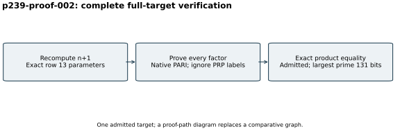

# Proof of the p239 index 2491 n+1 factorization

Run `p239-proof-002`, 26 October 2026. Following the successful checkpoint
gate, the native refinement helper read the Msieve divisor messages and
preserved the full proposed target product. The pre-existing independent
verifier recomputed `n+1` from row 13 of the exact historical table, proved
all four factors and verified their exact product, exit 0.

The canonical [proof record](../../results/curve-13-plus.json) records a
131-bit largest prime and four prime factors counting multiplicity.
[The hex listing](../../results/completed-targets-hex.md) includes the full
integer and every factor. No factor was accepted merely because Msieve
printed PRP. Raw hint, verifier output, errors and status are in
[the proof directory (archive manifest)](../../evidence/.artifacts.json).

There is one factorization admission, so a diagram replaces a comparative
graph. Native PARI 2.17.3 ran on the same configured four-core/16-GiB host.
This is a separate same-session checker with no performance isolation tier,
independent-host replay or Lean formalization. Exact input and backend
identities are in the [run index](../../results/run-index.json). No DLP
experiment or performance comparison was made. A checkpoint followed proof.
