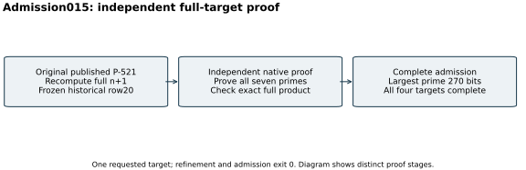

# Admission015: full P-521 n+1 proof

26 October 2026. One original-target admission was requested and completed
with exit zero. Refinement also exited zero. Counts and bit lengths below
are decimal; exact integer factors are in the hexadecimal listing.

The immutable `run_plus_admission.sh` copy froze the historical parameter
table, existing partial hint, backend stdout, native refinement/verifier
sources and binaries. `refine_factor.cpp` used the two divisors proposed by
GNFS014 to split the residual. It did not certify primality. The separate
pre-existing `verify_factor_hint.cpp` recomputed the full original `n+1`
from row20 of the frozen table, proved every prime using native PARI
`isprime`, and checked equality of the complete product to that target.
Both invocations and every exit/status/stdout/stderr are preserved in
`runs/p521-plus-proof-015/` after archive hydration.

The [canonical admission record](../../results/curve-20-plus.json) contains
seven distinct prime factors and nine factors counting multiplicity.
The two new primes have 145 and 270 bits; the largest full-target prime is
270 bits. The square-part root is 15. The full
[hexadecimal factorization](../../results/completed-targets-hex.md) includes
the exact target, every factor and exponent. The earlier partial record
remains frozen as history and is not the current completeness label.

No factorization search or DLP run was added in this admission. This is a
same-session independent implementation check, without an independent host
or Lean formalization. The host had a four-core quota and 16 GiB memory
limit; no performance isolation tier, timing comparison or attack cost is
claimed. The first gate and end checkpoints succeeded. Source state before
admission was `a7114968c980bcb3ee37db071657b758585d47ed`; executed source,
input and binary hashes are preserved in the run.

The [final manifest](../../evidence/final-manifest-003.json) and
[readback receipt](../../evidence/final-native-003-delivery.json) bind the
proof, source snapshots and outputs. Every listed archive file verified
after a full remote GET. The independent proof does not require the final
GNFS matrix scratch, whose backend deletion is explicitly disclosed in
[the cleanup audit](../../evidence/success-cleanup-audit.json).
