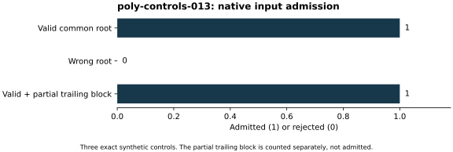

# Native polynomial input-check controls

Run `poly-controls-013`, 26 October 2026. Native C++17/PARI input checker,
strict `-O2 -Wall -Wextra -Werror` build, same local host. The S3 gate passed
before execution. This is an input-consistency control on the public
synthetic integer 15, not a named curve, a historical label or a DLP trial.

The complete polynomial `x^5-1` and rational polynomial `x-1` share root 1
modulo 15 and were admitted, exit 0. Changing the constant term to minus 2
produced the expected wrong-root rejection, exit 1, with no success JSON.
A third fixture kept the valid block and appended an incomplete trailing
block: it admitted one complete block and explicitly counted one discarded
partial block, exit 0. The source file with that partial block remains
unchanged. The checker rejects an incomplete interior block rather than
silently treating it as usable progress.

[Raw fixtures, source/binary hashes, outputs and statuses (archive manifest)](../../evidence/.artifacts.json)
are retained. These exact three control outcomes have no sampling interval
or performance comparison. Four-core and 16-GiB local configured limits
establish no performance isolation tier. The source is
[check_polynomials.cpp](../../check_polynomials.cpp). A checkpoint followed
the controls. The named residual is separately checked in run 012; these
small controls do not certify a historical selection rule or a factorization.
