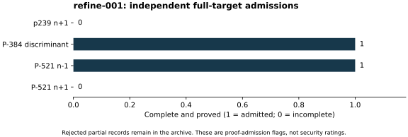

# Independent checks of the first ECM splits

Run `refine-001`, 26 October 2026. The native refinement helper split the
proposed factor pairs using recorded ECM divisors and checked that their
product was preserved. The unchanged independent C++ prime/product verifier
then read the exact historical input row and full refined factorization.
Its binary and source hashes, command inputs and separate exit/stdout/stderr
records are retained. The S3 gate passed before the checks.

P-384 discriminant and P-521 minus each passed, exit 0: every factor proved
prime under native PARI `isprime`, with exact equality to the recomputed
original target. p239 plus and P-521 plus were rejected as incomplete, exit
1. Their empty success-output files are preserved alongside rejection
diagnostics. An ECM prime or PRP label was never sufficient for admission.

This checks all four requested targets, without dropping failed arms. It is
separate same-session verification, not independent-host replay or a formal
proof in Lean. Native libraries and local configured resource limits are
listed in the [run index](../../results/run-index.json); no performance
isolation or timing comparison is claimed. Raw evidence:
[refinement records (archive manifest)](../../evidence/.artifacts.json). The binary complete flags in
the graph are exact checker outcomes, without a statistical interval.
