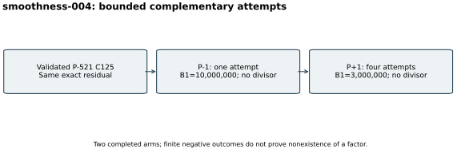

# P-1 and P+1 checks on the remaining P-521 cofactor

Run `smoothness-004`, 26 October 2026. After a successful S3 gate, native
GMP-ECM received the same validated 125-digit composite residual in each
arm. One P-1 attempt used B1=10,000,000. Four P+1 attempts used B1=3,000,000.
Each arm had a 300-second watchdog and saved stdout, stderr and exit status.
Recorded P+1 bases are in raw output; no prescribed seed was set.

Both arms completed, exit 0, without a divisor. These bounded negative
outcomes leave the composite unresolved. They neither prove that no factor
is accessible by these methods nor certify any prime factor. The
[raw records (archive manifest)](../../evidence/.artifacts.json) retain exact commands/parameters
and output. The [run index](../../results/run-index.json) binds the local
PARI/GMP-ECM environment and four-core/16-GiB configured resource limits.

These are complementary methods without a matched common timing quantity,
so the visual is an execution diagram. There is no speed comparison,
performance isolation claim or measured DLP result. A checkpoint followed
the attempts. Independent prime/product admission remains mandatory for any
future divisor.
