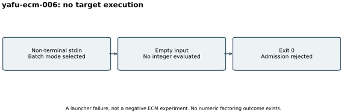

# Failed YAFU ECM input admission

Attempt `yafu-ecm-006`, 26 October 2026. The S3 gate passed and the YAFU
command returned exit 0, but the target was never evaluated. Native YAFU
selects batch processing when stdin is non-terminal; this invocation gave
it empty stdin. Output reports no variable indicator and end of file.

The intended algorithm parameters did not execute and are not counted as
ECM work. [Original launcher source, output and admission.json (archive manifest)](../../evidence/.artifacts.json)
remain unchanged. The pinned YAFU source is
`c7d90283972820f99b3b4920bfc1eff05c1f6342`. Corrected attempt 008 separately
uses the `ecm(@,1024)` template and explicit validated integer stdin.

There is no factoring result or timing comparison to graph, so this report
shows the execution failure path. The local host's configured four-core and
16-GiB limits establish no performance isolation tier. No prime, security
or DLP conclusion follows from exit 0. [Run index](../../results/run-index.json).
