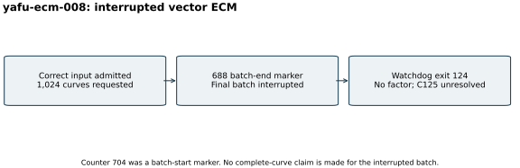

# Vector ECM stopped by its watchdog

Attempt `yafu-ecm-008`, 26 October 2026. After the checkpoint gate, corrected
YAFU evaluated the exact validated C125 with `ecm(@,1024)` and explicit
integer stdin. Parameters: two threads, B1=11,000,000, default
B2=1,100,000,000, seed 20,261,026, saved B1 residues and a 1,800-second
watchdog. YAFU source is pinned to
`c7d90283972820f99b3b4920bfc1eff05c1f6342`.

The watchdog returned 124 with no factor printed. The preceding 688 batch
end marker is present; counter 704 appears only as the start of an
interrupted batch. The upstream vector loop prints a counter both before
and after work. Therefore 704 must not be reported as completed curves,
and all 1,024 requested curves were not completed. The original launch
snapshot is preserved; the accounting correction is explicit in
[the protocol](../../FACTORING_PROTOCOL.md).

[Raw stdout, saved stage-one residues, source snapshot and admission (archive manifest)](../../evidence/.artifacts.json)
remain available. Input admission passed; factor completion did not. A
fresh continuation uses its own seed and bound and does not rewrite this
attempt. One interrupted attempt supplies no matched performance comparison,
so the visual is a workflow diagram. The local four-core quota and 16 GiB
memory limit are configuration, not measured accounting or an isolation tier.
The attempt's start and end were checkpointed. No DLP was attempted.
