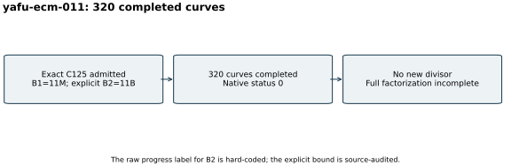

# Completed vector ECM continuation

Run `yafu-ecm-011`, 26 October 2026. A successful S3 gate preceded native
`ecm(@,320)` on the exact validated C125, two threads, B1=11,000,000,
B2=11,000,000,000, seed 20,261,028 and a 3,600-second watchdog.
The native YAFU source is pinned to
`c7d90283972820f99b3b4920bfc1eff05c1f6342`.

All 320 curves completed, exit 0, without a new divisor. The output retains
the composite C125. YAFU's progress text hard-codes `B2=100*B1`; its actual
argument and factor log record the 11-billion bound, and the audited source
passes that explicit value to `STAGE2_MAX`. Neither a zero exit nor the
printed composite is a complete prime factorization.

Saved stage-one residues, source/protocol snapshots, parameters and raw
outputs are in archive member `runs/yafu-ecm-011/` under the
[evidence manifest](../../evidence/.artifacts.json). The
[run index](../../results/run-index.json) records the outcome. The four-core
quota and 16-GiB limit are configuration; no performance isolation tier,
matched timing comparison or DLP result is claimed. The single-method
outcome is shown as a diagram. Its raw timing diagnostics are preserved.
A checkpoint followed the completed attempt.
