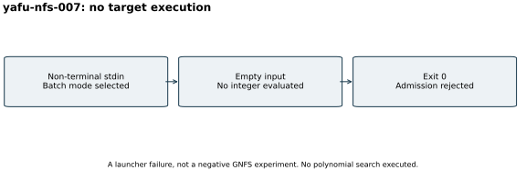

# Failed YAFU GNFS input admission

Attempt `yafu-nfs-007`, 26 October 2026. The checkpoint gate passed but the
YAFU invocation read empty stdin in batch mode. It returned exit 0 without
evaluating the C125 target. No polynomial search, relation collection or
factorization is attributed to this attempt.

[Original launcher source, raw output and explicit failed admission (archive manifest)](../../evidence/.artifacts.json)
are retained. Corrected attempt 009 has its own records and uses `nfs(@)`
with the exact validated residual on stdin. The backend is pinned YAFU
`c7d90283972820f99b3b4920bfc1eff05c1f6342`; local resource configuration and
binary hashes are bound by [the run index](../../results/run-index.json).

No numeric factoring outcome exists, so the visual is an execution diagram.
This launcher failure is neither mathematical evidence of difficulty nor
a successful negative experiment. No performance isolation, speed result,
prime proof or DLP experiment is claimed.
