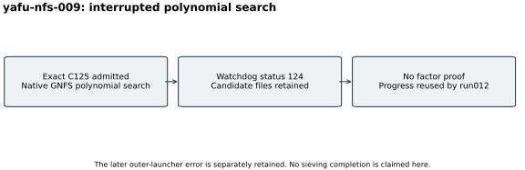

# GNFS polynomial search stopped by its watchdog

Attempt `yafu-nfs-009`, 26 October 2026. The successful S3 gate preceded
native YAFU's `nfs(@)` with explicit validated C125 stdin, two configured
threads, seed 20,261,027 and a 3,600-second watchdog. The polynomial phase
reported one outer worker; the backend owns its internal threading.
YAFU is pinned to `c7d90283972820f99b3b4920bfc1eff05c1f6342`.

The native process ended under the watchdog, status 124, during polynomial
selection. Its candidate file, input and original launcher snapshot were
retained. No lattice sieving or factor completion is attributed to this
attempt. A later independent native input check admitted 361 complete saved
candidates with a common modular root over the exact 414-bit composite;
that check belongs to continuation 012.

After saving the backend status and checkpoint, the outer launcher reported
an unterminated-quote error. Its file had been edited while the shell waited.
The outer exit status was not separately captured and remains unknown.
The actual outer log and this failure are retained; exit 124 is the native
timeout status, not a successful whole-launcher outcome. Future continuations
execute immutable script copies. [Raw records (archive manifest)](../../evidence/.artifacts.json),
[protocol correction](../../FACTORING_PROTOCOL.md),
[run index](../../results/run-index.json).

This one bounded attempt has no comparable performance result, so the visual
shows execution stages. Four-core quota and 16 GiB memory are configuration,
not measured consumption or an isolation tier. No factor, prime or DLP result
is certified by this attempt. Saved progress is reused rather than erased.
