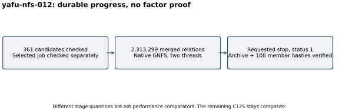

# GNFS progress saved for continuation

Run `yafu-nfs-012`, 26 October 2026. After the S3 gate, a native C++/PARI
checker validated 361 saved complete common-root candidates modulo the exact
414-bit composite. No trailing incomplete block was discarded. The native
polynomial finalization phase returned 0 and selected a job. A separate
native check verified that selected job's common root and exact input.

YAFU/GGNFS then collected 2,313,299 merged relations with two threads and
seed 20,261,029. The configured target was 24,200,000 relations and the
watchdog was 10,800 seconds. The run was deliberately stopped to reallocate
four threads and try adaptive filtering; it did not reach the watchdog or
complete a factorization. Its native exit 1 is a requested stop.

The waiting master ignored one SIGINT during `system()`. The pinned source
documents that behavior. After command/parent identity checks, one SIGINT
to its own GGNFS child returned native code 2 (shell status 512), set
`NFS_ABORT` and saved progress. The stop records retain the exact PIDs and
observed commands. Sandbox denial prevented `/proc` cwd/exe readlinks;
command, parent and process-start metadata supplied the process identity.

Raw member `runs/yafu-nfs-012/` and the selected-job check are in
[backend-progress-001](../../evidence/backend-progress-001-delivery.json).
Full S3 GET and all 108 archive members passed hash checks. This preserves
the job, factor base, relations and completed-q ranges for continuation.
The local four-core/16-GiB configuration is not measured consumption or a
performance isolation tier. No speed comparison, prime proof or DLP result
is claimed. Counts are exact recorded progress, not a factorization verdict.
