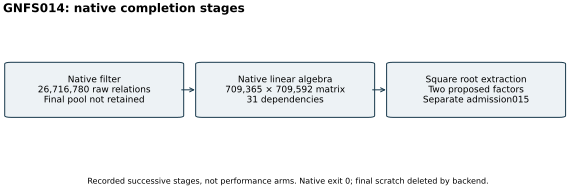

# GNFS014: native completion and retention limit

26 October 2026. Closed native run014, started at 14:24:58 UTC and
completed at 17:32:47 UTC with exit zero. All counters below are decimal.
The original running-snapshot reports remain unchanged.

The immutable `run_nfs_continue.sh` copy ran YAFU `nfs(@) -R` on the
independently admitted 125-digit, 414-bit residual of published P-521
`n+1`. It reused run012's exact polynomial and 2,313,299 merged relations.
The command used four threads, seed 20,261,030, a 14,400-second watchdog,
an initial minimum-relations flag of 1,000,000 and adaptive 50-percent
threshold bumps. The host had a four-core quota and 16 GiB memory limit.
No performance isolation tier or independent-host replay is claimed.

One continuation was requested and one completed. Native filtering reported
26,716,780 raw relations; the reduced matrix had 709,365 rows and 709,592
columns. Lanczos reported 31 dependencies. Square root extraction proposed
two prime factors of 145 and 270 bits. These are successive native stages,
not comparison arms or an estimate of full campaign cost. Previous attempts,
relations and concurrent local work prevent treating this resumed interval
as a cold performance measurement. No speed comparison is admitted.

The independent original-target prime/product proof is a separate
[admission015](../run-p521-plus-proof-015/REPORT.md). A native exit or printed
PRP label alone was never admitted as completion of the full factorization.
Input, source and binary hashes, exact parameters, native stdout/stderr,
status and the outer launcher log are in `runs/yafu-nfs-014/` after
hydrating [the final archive](../../evidence/.artifacts.json).
Its [manifest](../../evidence/final-manifest-003.json) and
[full readback receipt](../../evidence/final-native-003-delivery.json)
bind the surviving records. The manifest records source state
`a7114968c980bcb3ee37db071657b758585d47ed` before the final admission/replay;
the executed launcher has its own frozen source hash.

The pinned YAFU success path deleted final relation/matrix scratch before
the launcher regained control. The [source audit](../../evidence/success-cleanup-audit.json)
identifies `NFS_STATE_CLEANUP` and the deleted paths. The final 26.7-million
pool and matrix are not retained, and no full GNFS replay is claimed.
The last fully retained pool is the unchanged
[17,831,805-relation snapshot002](../../evidence/backend-progress-002-delivery.json).
The complete mathematical factorization instead rests on the independent
primality proofs and full original-target equality. The S3 gates and final
checkpoint succeeded; no factor worker received upload credentials.
