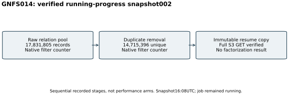

# GNFS014: verified running-progress snapshot002

26 October 2026,16:08UTC. This is a saved copy of an active factorization
attempt, without a final native exit status or factorization result.
All counts in this report are decimal. Native filtering had reported
17,831,805 raw relations and14,715,396 unique relations after duplicate
removal. These are sequential exact counters, not independent arms,
a timing comparison or a sampling estimate.

The unchanged native command is YAFU `nfs(@) -R`, four threads,
seed20,261,030, minimum-relations flag1,000,000 and50percent adaptive
threshold bumps, under the original14,400-second watchdog. It reuses the
exact C125 input and the independently admitted polynomial. Full original
P521 n+1 prime/product verification remains required for completion.

The copy was taken during filtering, after verifying that the native
process group had no active GGNFS siever children. Only that verified group
was paused from16:08:13 to16:08:14UTC while the resume files and logs were
copied. It then resumed. The snapshot omits incomplete filter scratch files;
it preserves the relation pool, completed-q ranges, polynomial/job, factor
base and source/protocol records needed to restart native filtering.
This is progress custody, not a completed run or a usable-matrix claim.

[The manifest](../../evidence/backend-manifest-002.json) binds every saved
file. The current job differs from its admitted original by exactly one
additional final LF; both exact forms and the strict byte-equivalence
record are preserved. All original polynomial/input bytes are unchanged.
The [delivery receipt](../../evidence/backend-progress-002-delivery.json)
confirms a full S3 download, exact archive hash, byte-equal internal
manifest and every listed file-member hash. The artifact pointer is in
[the manifest index](../../evidence/.artifacts.json).

The first xz packaging attempt was stopped and its partial bytes were
retained outside Git, with [failure metadata](../../evidence/backend-progress-002-packaging.json).
Its first stop guard failed because xz had an intervening shell parent; an
early rename left that partial writer active until the verified grandparent
chain was checked and the xz child stopped. The in-flight digest was never
admitted. A complete tar.zst of the immutable source copy was uploaded and
fully read back instead. No scientific raw file was changed or discarded.

The local four-core quota and16GiB memory limit are configured resources.
No isolation tier, speed result or completion forecast is claimed. The
active raw014 directory remains visible to checkpoints. The original14:30
snapshot stays unchanged; a final run report is still required on closure.
