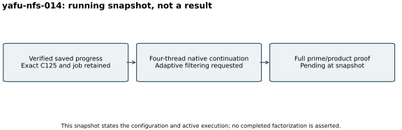

# Four-thread GNFS continuation: running snapshot

Snapshot 26 October 2026, 14:30 UTC, run `yafu-nfs-014`. This is an active
attempt, without a final factorization result or exit status. It follows a
successful S3 gate and full remote read-back of the closed predecessor's
archive. An immutable launcher copy records its PID before the start
checkpoint and copies the exact selected job, factor base, saved relations
and completed-q ranges.

Native YAFU `nfs(@) -R` uses four threads, seed 20,261,030, a 14,400-second
watchdog, `-minrels 1000000` and `-filt_bump 50`. The early filter threshold
is an internal adaptive parameter: inadequate relations require further
sieving. It does not reduce the full original-target completion criterion.
The exact residual and selected job must match the independently checked
predecessor. No printed prime or successful process exit is sufficient.

The [launcher](../../run_nfs_continue.sh) and
[protocol](../../FACTORING_PROTOCOL.md) fix those settings. Active raw files
stay unignored for checkpoint capture; they will receive their own immutable
archive on closure. The last fully verified durable pool is
[backend-progress-001](../../evidence/backend-progress-001-delivery.json).
Native backend timing diagnostics are not a performance comparison.
The four-core quota and 16-GiB limit are configured resources; no isolation
tier, speed improvement, completion-time forecast or DLP result is claimed.
The final run report must be separate from this running snapshot.
