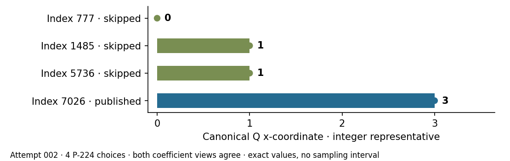
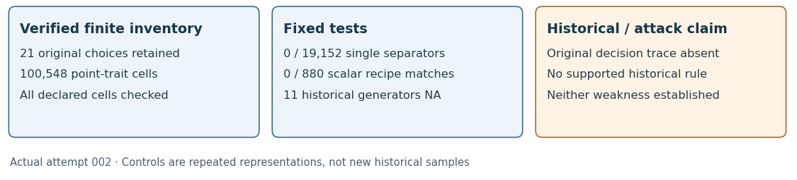

# Generator–coefficient comparison: all 21 curves

**29 October 2026.** The declared finite comparison completed on ten published
and eleven omitted curves across all six field sizes, including P-384 and
P-521. The separate native verifier checked every declared row. None of the
19,152 single published-envelope tests separates all labels, and none of the
880 fixed public-scalar checks matches a standardized generator. These
negative results exclude only the stated families. The historical skip
criterion and both weakness hypotheses remain unresolved.

## Verified observations

| Recorded quantity | Actual result, attempt 002 |
| --- | --- |
| Original choices | 21: ten published, eleven omitted; zero excluded |
| Repeated representations | Two coefficient views; fourteen point rules; 588 point rows |
| Point/coefficient traits | 171 per point; 100,548 cells independently checked |
| Fixed single envelopes | 19,152 checked; zero exact separators |
| Same-field differences | 119,700 point-trait cells plus 28,175 inherited-feature cells |
| Known-scalar equality checks | 880 checked; zero matches |
| Historical generators of omitted curves | All eleven remain literal NA |

Sources: [native summary](results/summary.json),
[separate verification](results/verification.json),
[display data](results/figure-data.json) and [canonical export](export.json).
These are deterministic counts on a fixed census, with no sampling interval
or inferential p-value. Repeated representations are controls on the same
curves, not additional historical samples.

## A trait that stands out in P-224

For Q chosen by the user's first-x, smaller-y rule, the three omitted P-224
curves have x=0, 1, 1 at indices 777, 1485, 5736. The published index 7026
has x=3. Both explicit coefficient views give those values. Q is an assigned
canonical point; this does not say that the standardized published G has x=3.
All seventeen non-P-224 canonical x values are zero in both label groups.

The predeclared per-field lower envelope for `x:bits`, k=1, sign=+1 keeps
all ten publications and rejects the three P-224 omissions, but retains eight
other omissions: p192 indices 2198/5405, p239 indices
36/1562/2491/2682/2863, and p256 index 876. Thus this narrow pattern is not a
full-cohort criterion. Selecting it for discussion after viewing the results
does not establish historical use, statistical significance or vulnerability.

<!-- pagebreak -->

## What connects a point to b

For a=−3, an on-curve point satisfies `b = y² − x³ + 3x (mod p)`.
Consequently x=0 implies y²=b and x=1 implies y²=b−2. These explain the
close G–b relations of the four user-supplied assigned points. Conditional
on the generator equation `c*b²=−27`, they also give `c*y⁴=−27` at x=0
and `c*(y²+2)²=−27` at x=1. These are defining-equation consequences.
The five previously checked conditional Lean theorems and their precise
assumptions are in the [proof map](../generator_b_20261029/lean/PROOF_MAP.md).
They are not formal proofs of historical selection or the full isomorphism.

The inherited feature records have square b for 9/10 publications and
9/11 omissions. All seventeen non-P-224 b values are square: under the
reference convention p≡7 mod8 and `b=R^((p+1)/4)`, the exponent is even.
That construction forces the canonical search to start at x=0 for both
labels. P-224 index 777 is square; indices 1485, 5736 and published 7026
are nonsquare. These b-character counts reuse the earlier proved-factor
study and are not newly recomputed factor families.

## Matched controls and the tested family

The historical-b view and smaller-b P-224 view retain exact model identities.
For P-224, b→−b is transported by `(x,y)→(−x,i*y)`, i²=−1 in Fp.
Native checks validate the actual transported points and orders. This
same-order identification is not applied to p≡3 mod4 twists. The four
user-supplied canonical points are checked exactly in their stated views.

Each view evaluates ±[k]Q for k in {1,2,3,5,7,11,17}. The 171 traits
include coordinate bit lengths, Hamming weights, modular distances,
quadratic characters, small residues and a fixed polynomial-equality
catalog. For each trait and point rule, global and per-field tight upper
and lower envelopes retain every published control. Every same-field
published/omitted pair is retained. No new conjunction was fitted here.
The inherited 1,127 features are hash-bound copies from the complete
84-factor-record study: their pairwise differences are independently checked,
but their original factorizations are not rerun in this addition.

The 22 fixed scalar recipes use b, nearby powers/offsets, seed/hash values,
bit slices, trace, index/run and small constants. Ten known standardized
generators × two views × 22 recipes × two directions give 880 checks:
`G=±[s]Q` and `Q=±[s]G`. Signs are included inside each equality; these
tests use Q, not every multiple control. The exact recipe definitions and
encodings are in the [frozen family](../generator_b_20261029/PROTOCOL.md)
and native source. A known-scalar test is not DLP recovery.

Earlier reconstruction already links six May-1997 published base points
to the FreeLIP RNG stream. The present zero matches do not refute that
different, previously reported relation. See the
[FreeLIP source discussion](../freelip_replay_20261027/REPORT.md).

<!-- pagebreak -->

## Execution, failures and admission

The primary computation uses native C++/PARI; a separately implemented GMP
affine verifier recomputes the group/trait operations, cutoffs, differences,
recipes and summary. Both share GMP integer primitives and OpenSSL SHA.
The earlier tiny-fixture integration and nine corruption refusals remain
development evidence, not historical-curve measurements.

| Flow | Actual phases and outcome |
| --- | --- |
| Attempt 001, frozen protocol 1 | Three planned; two attempted; one completed; production timed out (124); verification not attempted; none excluded |
| Resource diagnostics | Four primitive invocations and one all-input invocation; two timeouts and three successes; no point-trait comparison |
| Attempt 002, frozen protocol 2 | Three planned, attempted and completed; all statuses zero; no interruption, resume or exclusion |

Attempt 001 wrote zero point-trait rows before its 300-second timeout.
Diagnostics localized the stall to proof of the fixed known P-192 field
prime under a 768 MiB virtual-address ceiling. The exact original diagnostic
binary succeeds at 1,536 MiB; all 21 known p/n pairs, covering six field
sizes, then pass the separate resource check. An APRCL diagnostic at the
smaller ceiling also timed out; it was not substituted into production.

Protocol 2 explicitly raises only the uniform address ceiling to 1,536 MiB.
It preserves the original binaries, prover, all inputs and comparisons,
and 30/300/300-second phase limits. It was frozen and committed before
attempt 002. This is an execution repair, not evidence of weak curves.
The freeze digest is `090d27110aa85eac1309733bdb9521244a7e4bb6ad9d624cd4d34fcc94eb9e85`;
the actual launch source is `1b18bec823d730ef8f30ef0761595cac633c411e`.
Frozen plan 2 retains two stale descriptive path strings; the actual bound
launcher is run-v2.sh. The [additive correction](evidence/plan-v2-path-observation.json)
preserves both the discrepancy and the executed script without rewriting it.

The canonical experiment-protocol tool at revision
`8c5db250d4fff65eb40fffede9c8391de403897f` admits version 2 with file
verification and zero findings. Version 1's partial export is refused with
four findings because verification never ran. Its adapter's flow describes
the two existing rows; the actual planned count remains three. No cancelled
verification attempt or complete census was manufactured. The
[export limitation](../../../problems/experiment-export-unattempted-phase.md)
remains explicit and does not invalidate the complete version-2 execution.

Execution used the declared local exact-analysis fallback. The portable EKS
request contract could not express this native job; no EKS MCP was available
and CodeBuild project inspection was denied. No paid job or administrative
policy change was substituted. Previously authorized access authenticated
and uploaded the required checkpoint before each run. The earlier restored
runtime access block was corrected, not retained as the current status.
No performance clock or isolation level is claimed for the actual comparison.

Run reports and PDFs: [001](reports/attempt-001/REPORT.md),
[002](reports/attempt-002/REPORT.md),
[diagnostics](reports/diagnostics/REPORT.md),
[synthetic preflight](reports/preflight/REPORT.md).

<!-- pagebreak -->

## Requested work and remaining uncertainty

| User request | Status and evidence |
| --- | --- |
| Original four ICV1/DiSSECT assessments | Previously delivered in the [original study](../../curve_candidates_dissect_20261021/README.md) |
| Complete four unresolved factorizations and compare | Verified complete: [84/84 proved records on all 21 curves](../factor_followup_20261026/REPORT.md); no unknown factor values used as labels or silently omitted |
| Wider differences and G–b tests | Verified complete for this declared finite family; 100,548 point-trait cells and all 147,875 difference cells checked |
| Explain the historical skips | Unresolved; no original caller, acceptance or visitation records; no independent historical holdout |
| Weak published or weak skipped curves | Neither established; an applicable attack construction and validation remain missing |
| PDF and PR | This current PDF and [existing PR 2666](https://github.com/isogeny-labs/crypto/pull/2666) |

Earlier structural conjunctions remain post-hoc fits; zero single separators
in this different point-trait family does not erase those fits. This is not
an exhaustive search over mathematical functions or all historical programs.
Eligible stream indices do not prove that the historical program visited
and rejected each curve. The user has no original decision logs. Distinguishing
the two weakness hypotheses still requires a specified attack contract,
applicable construction and independently checked outcome. Trait differences
alone supply none of these. No DLP, security proof or security break is claimed.
Modern input prime checks do not repair the twelve indeterminate legacy ECPP
certificate rows. They remain unknown in their own study.

## Custody, reproduction and sources

The preparation archive, both actual attempts, synthetic planning outputs
and all resource diagnostics are retained. Full remote GET, byte/SHA checks
and internal member checks passed for all four final native archives; the
preparation has its own verified receipt. The full raw bundle is
`evidence/full-raw-002.tar.xz`, 935,468 bytes, SHA-256
`d15967a549fea14af11733b5685cad6abed9291f3c1a78820e21e3c15a2aa909`,
with 106 regular members. The receipt is
[final-native-delivery.json](evidence/final-native-delivery.json).
[REPRODUCE.md](REPRODUCE.md) explains hydration and the canonical file check.
Native libraries are pinned, not bundled. Credentials are excluded.

Primary methods reviewed before implementation: [SEC 1 v2 §3.1.3.2](https://www.secg.org/sec1-v2.pdf)
describes seed/hash point generation; [RFC 5639 A.2](https://www.rfc-editor.org/rfc/rfc5639.html#appendix-A.2)
provides a public scalar multiple of a smallest-x point. These motivate
comparison families, not attribution to the 1997 caller. Published generators
come from [std-curves revision 77fe6e3585ca2c2225b59d7df24b7c775437276f](https://github.com/J08nY/std-curves/tree/77fe6e3585ca2c2225b59d7df24b7c775437276f).
The [PARI arithmetic documentation](https://pari.math.u-bordeaux.fr/dochtml/html-stable/Arithmetic_functions.html#isprime)
informs the known-prime proof diagnostics; no probable-prime substitution was
made. The [curve-origin account](https://www.anthropic.com/research/ecdsa-curve-origins),
[source recheck](../source_check_20261027/REPORT.md),
[FreeLIP trial](../freelip_replay_20261027/REPORT.md) and
[proved-factor study](../factor_followup_20261026/REPORT.md) bound novelty and
the remaining historical gap. No original acceptance log was found or supplied.

The new canonical-x graph and execution diagram supersede the preparation's
unrun status additively. Its old figures remain frozen planning evidence.
Factor, embedding, FreeLIP and ECPP-work graphs retain their earlier values.
IC leaderboard, progress timeline and performance-gain charts are unchanged:
this study measures coverage and exact traits, not an IC improvement. Synthetic
planning times have browsing copies outside the admitted benchmark table;
they lack performance validation and a matched rho reference. Cargo,
Conductor and lean4checker are unavailable; no whole-repository pass is claimed.
