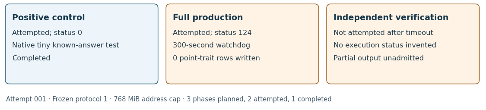

# Actual attempt 001 — preserved timeout

29 October 2026; frozen protocol version 1. Source at launch:
0ba78f69f66f682072a206b32f467347d7879ab8. Native local exact analysis on the
shared AMD EPYC 9V74/Linux 6.18.55 host; no performance isolation or clock is
admitted. The complete 21-choice input bundle and fixed trait family were
required, with zero row exclusions. A successful uploaded checkpoint preceded
the run.

Three phases were planned. Two actually started. The positive native control
completed with status 0. Production timed out with status 124 at its fixed
300-second watchdog under 768 MiB virtual address space. Verification was
not attempted after that stop. Flow: planned 3, attempted 2, completed 1,
failed 1, not-attempted 1, interrupted 0, resumed 0, excluded 0. Zero point-trait
rows were written. Partial inherited-feature files and four supplied-point
checks remain unadmitted as a completed comparison.

The diagram shows statuses rather than comparable scientific measurements:
there is no verified point-trait comparison to plot. The timeout is not a
weak/composite/rejected-curve label. The fixed P-192 field-prime diagnostic
and explicit larger-ceiling amendment are recorded separately; attempt 001
is never overwritten or relabeled as successful.

Raw source: `runs/attempt-001/`, hydrated from
`evidence/full-raw-002.tar.xz`; original 114,516-byte archive also retained at
`evidence/attempt-001/raw.tar.xz`, SHA-256
f6da23e570e6972f65896cbb96ed045ea5312c7ed0899ae57cfecac8cf6a8051.
See [observation](../../evidence/attempt-001/observation.json),
[protocol](../../protocol.json), [partial export](../../export-v1.partial.json)
and [checker refusal](../../evidence/export-v1-refusal.txt).
The canonical checker reports four inventory findings. The exporter has only
two real rows; its row-flow planned value2 does not replace the frozen plan3.
No fake cancelled-verifier row is added to pass admission.

