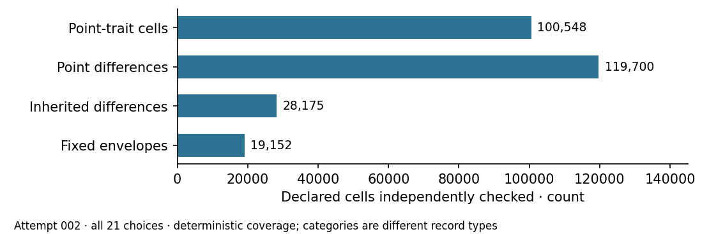

# Actual attempt 002 — verified full comparison

29 October 2026; frozen protocol version 2. Actual launch source:
1b18bec823d730ef8f30ef0761595cac633c411e. The protocol was frozen and committed
before this invocation, following the separately preserved first timeout.
The original PARI producer and GMP affine verifier, prover, input hashes and
finite family were unchanged. All phases used a uniform 1,536 MiB virtual
address ceiling with 30/300/300-second watchdogs. An uploaded checkpoint
passed before execution.

All three planned phases actually ran and completed with status 0: positive,
production and verification. Flow: planned 3, attempted 3, completed 3,
not-completed 0, interrupted 0, resumed 0, excluded 0. All 21 original choices
(ten published, eleven omitted, six field sizes) remain present. Two
coefficient views and fourteen point rules produce 588 point rows; these are
controls, not 588 independent curves.

The separate verifier checked 100,548 trait cells, 19,152 fixed envelopes,
119,700 point differences, 28,175 inherited-feature differences and 880 fixed
scalar checks, including the headline summary. There were zero exact single
separators and zero scalar matches. All eleven historical omitted generators
remain textual NA. The 1,127 inherited features were copied with member
hashes, and their differences checked; their factorization computations were
not rerun here. GMP integer primitives and OpenSSL SHA are shared.

Source: [summary](../../results/summary.json),
[verification](../../results/verification.json),
[admitted export](../../export.json) and
[raw GET/member receipt](../../evidence/final-native-delivery.json).
Individual raw tables and executed binaries are in the 106-member full raw
archive. Canonical file verification reports zero findings.

Execution was local exact analysis on a shared AMD EPYC 9V74/Linux 6.18.55
host, following the recorded unsupported EKS-contract fallback. No wall/CPU
metric, performance isolation tier, statistical interval, DLP or historical
attribution is admitted. The graph displays deterministic verified coverage
counts, not a security score or performance comparison.

