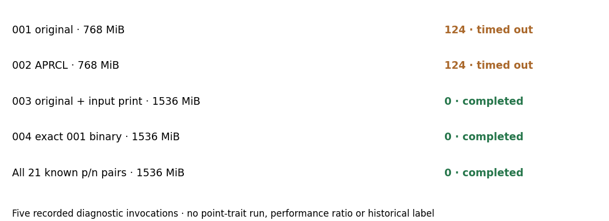

# Resource diagnostics — original prover retained

29 October 2026. These development invocations investigate the known P-192
prime-proof stall after actual attempt 001. They do not run the point-trait
comparison or fit historical labels. Commands, exact source, logs, status
files and binaries are retained in `evidence/diagnostics/raw.tar.xz`;
SHA-256 002543ff44ebdd811219810d9709961e8473c365ea403b3dc880e8c18b3b40e3,
14,888 bytes. The [observation](../../evidence/diagnostics/observation.json)
records every result. All ran on the same shared local host; no performance
clock is admitted.

Five invocations were planned, attempted and recorded: two timeouts, three
completed, none resumed or excluded. Primitive 001 uses the original generic
prime proof at 768 MiB, 15 seconds: status 124, stopping after the pre-primality
stage marker. Primitive 002 uses APRCL at 768 MiB, 15 seconds: status 124.
Primitive 003 confirms the integer representation and known 192-bit input,
then completes the original prime/group/bit primitives at 1536 MiB: status 0.
Primitive 004 runs the exact unchanged 001 binary at 1536 MiB: status 0.
The fifth native invocation proves all 21 known p/n pairs across six sizes
at 1536 MiB with a 60-second watchdog: status 0. Physical container allowance
was 16 GiB; virtual address limits are different resource quantities.

The same-binary resource observation justifies an explicit protocol amendment
for execution. It does not establish a general PARI memory threshold, a weak
curve, original resource policy or historical rejection. The production
algorithm and its prover are unchanged; the timed-out APRCL diagnostic was
not adopted. See the official [PARI isprime documentation](https://pari.math.u-bordeaux.fr/dochtml/html-stable/Arithmetic_functions.html#isprime)
and the [amendment](../../PROTOCOL-v2.md). No probable-prime replacement was
used and no partial trait matrix was admitted.

The figure shows the five invocation outcomes, not performance ratios. The
frozen version 1 timeout remains a separate failure. Version 2 was frozen and
committed before the successful full run; this report does not retrospectively
alter its limits or discard a curve.

