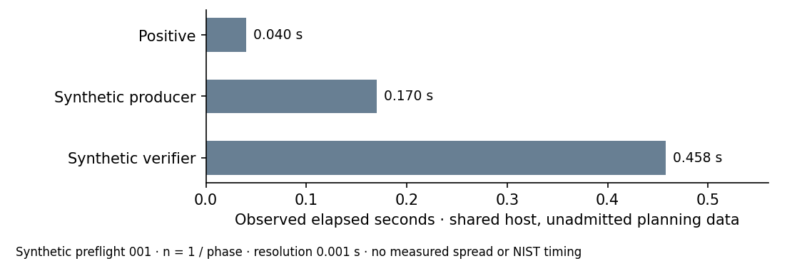

# Synthetic planning observations — unadmitted timing

29 October 2026. The canonical freeze refused a null runtime estimate. After
a successful uploaded checkpoint, one synthetic planning invocation ran three
sequential phases on an AMD EPYC 9V74/Linux 6.18.55 shared local host. This was
not a timed NIST-cohort run or an admitted performance benchmark. There was
no quiet-core/reservation evidence, A/A spread or matched external reference.

Recorded elapsed observations: positive 0.040 seconds, synthetic producer
0.170 seconds and synthetic verifier 0.458 seconds. There is one observation
per phase, resolution 0.001 seconds; no spread or confidence interval was
measured. Flow: three phases planned, attempted and completed, statuses 0;
zero failures, interruptions, resumes or exclusions. These different tasks
are not competing implementations of the same computation, so no speedup or
fastest-tool claim is calculated.

The fixture repeats six tiny fields into 21 parser rows, with dummy 1,127
inherited features and planted G=[b]Q equalities. No actual cohort was read.
The planning model `0.040 + 512*(0.170+0.458) = 321.576 seconds` is a
heuristic allowance, not a measured cryptographic-size runtime, statistical
estimate or mathematical upper bound. Actual phase limits remained
30/300/300 seconds. Only this synthetic planning record has elapsed values;
no performance clock is admitted for actual attempts 001/002.

Source: [literal observations and model](../../evidence/preflight-runtime.json),
`runs/synthetic-preflight/` in the full raw bundle and the separate
230,404-byte `evidence/preflight/preflight-001.tar.xz`, SHA-256
806b24e1ec5cdbaf502e54e3319939ef0c195bf1d641232ca9b33524965e2f5f.
The canonical freeze refusal remains in the protocol evidence.

Browsing copies of this report/PDF, graph SVG and 150-dpi PNG are regenerated
under benchmarks/20261029-generator-preflight/. They remain outside the
admitted benchmark table: there is no independent timing replay, matched
rho reference or VALIDATION.json. This follows the admission gate rather
than fabricating evidence to create an admitted row. The benchmark index
links the documentary record in prose.

