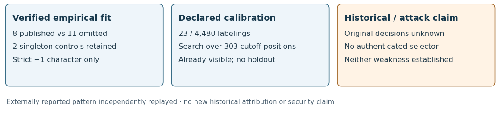

# A verified empirical separator for the skipped curves

**29 October 2026.** A concrete criterion now matches all 8 published and
11 omitted curves in the four fields with both labels: **published curves
have fewer strictly split small primes up to 691 than every omitted curve
in the same field**. The two additional published P-384/P-521 controls are
retained, with no same-field omissions available to test discrimination.
This independently reproduces an externally reported pattern. Historical
use and either vulnerability hypothesis remain unproved.

## The criterion and measured values

Counts, degree cutoffs and rule thresholds below are decimal.

Define `t=p+1−n`, `Delta=t²−4p`, and
`E691 = #{odd primes ell≤691 : (Delta/ell)=+1}`. Accept a candidate in
the compared fields when E691≤60 for P-192, ≤50 for P-224, ≤57 for P-239
or ≤57 for P-256. These per-field bounds describe the observed published
envelopes; they are not authenticated original acceptance constants.

| Field | Verified published / omitted counts |
| --- | --- |
| P-192 | Published 60,57,58; omitted 61,62 |
| P-224 | Published 50; omitted 53,56,59 |
| P-239 | Published 42,57,57; omitted 71,67,63,61,66 |
| P-256 | Published 57; omitted 58 |
| P-384 | Published 54; no omitted same-field control |
| P-521 | Published 52; no omitted same-field control |

Every count is independently checked in the [21-row table](results/at691.tsv).
The values are exact on this census, with no sampling interval. The criterion
uses separate field envelopes. A global threshold cannot work: P-192's
published count 60 exceeds P-224's omitted count 53.

<!-- pagebreak -->

## What was searched and what the calibration means

The [asanso post of 17 October](https://teapaw.org/asanso/status/2111511837866893580)
reported this pattern before this study. We read the authored text through
that mirror; the direct X endpoint returned 403. The reported outcome and
all labels were visible before freeze, so this is neither a new discovery
nor an independent historical holdout.

The native programs retain every one of 303 prime cutoff positions through
2,000. The boundary at 2 contributes zero; its character is explicitly
`NA_ell2`. Only the 302 odd primes contribute characters. All 6,342 odd-prime
character cells for the 21 curves are recomputed. For each cutoff, the fixed
lower-count direction must separate every same-field published/omitted pair.
The four successful cutoffs are **691, 701, 709 and 769**. No different
direction or later chosen feature is silently included.

All 4,480 label assignments preserving published counts in each original
stream are enumerated. Exactly **23/4,480** admit some separating cutoff
in the stated strict-count family, matching the externally reported count.
Exactly one labeling separates at the fixed value 691, but that cutoff was
selected retrospectively in the earlier work. The smaller fixed-cutoff
fraction must not be presented as a new confirmatory result. The 303-position
enumeration accounts for that cutoff search only. It does not account for
every other trait family, direction or hypothesis previously investigated,
and does not establish exchangeability of historical selection decisions.

The earlier complete-factor study already has empirical two-test and
three-test fits. This structured count criterion is another empirical fit,
with the stated narrower search calibration, not proof of original use or
of deliberate selection. No independent acceptance/visit trace or original
generation program has been found or supplied; the user has none.

## Ramification changes the answer

The statistic deliberately counts character +1, excluding zero. Its name
here is **strict splitting count**. Some uses of “Elkies prime” also include
ramified primes; these conventions must remain separate. A positive
discriminant character gives distinct Frobenius eigenvalues modulo an odd
prime and stable cyclic subgroups; ramified cases are not a lack of rational
isogenies and are not simply discarded as mathematically invalid.

At 691, P-192 index 139 has strict count 60 and three ramified primes, making
its inclusive count 63. Omitted index 2198 has inclusive count 61 and index 5405
has 62. Thus an inclusive upper envelope accepting every publication also
keeps these omissions. **The cutoff-691 separation fails under that broader
definition.** The separate inclusive cutoff-search family has 20 successful
labelings; it is a sensitivity result, not a replacement chosen to strengthen
the strict-family claim.

The old native snapshots included ramification and stopped their fixed
count snapshots at 499. The older product-coverage proxy, which multiplied
eligible primes until a Hasse threshold was exceeded, is another quantity.
Its earlier counterexamples remain correct; this result does not overwrite
those records or change their definition after observing an outcome.

<!-- pagebreak -->

## Independent verification and actual execution

The GMP producer enumerates quadratic residues for trial-divided small
primes, computes every count and scans the full stream-matched label space.
The separate PARI verifier uses its prime routine and Kronecker symbols,
direct same-field pair comparisons and recursive label combinations. It
reconstructs and compares all six output files, including the complete
headline summary. Underlying GMP integer primitives may be shared; this
is not a claim of fully independent underlying big-integer libraries.
Input orders are reused from the earlier certified cohort; there is no new
point count or input-primality proof in this replay.

Actual source at launch was
`077c41e7d414cf72faf20bf9b474b7c35dae7bd8`. The canonical protocol was
frozen and committed before real computation, with digest
`eeb7482bcda69477a360a7c28749b7f737d377dbe3298bec94346e4efbcdbbb7`.
The exact source/binaries come from preparation commit
`043a568661ebf1c40a4ead333889d814c32d045c`. All 21 inputs, six streams,
both singleton published controls and the exceptional character at 2 remain.

| Execution flow | Observed outcome |
| --- | --- |
| Six phases planned / attempted / completed | 6 / 6 / 6; no resume, interruption or exclusion |
| Positive control | Native exit 0; residue catalogs, planted separator, nonseparator and toy label count pass |
| Production and independent verification | Native exits 0 and 0; all 21 rows, 6,342 characters, 303 cutoff positions and 4,480 assignments checked |
| Corrupted character, calibration and summary | Native exits 1,1,1 as required; each reports the intended mismatching file |
| Canonical export admission | File verification passes with zero findings |

The three negative exits are correct refusals, not successful verification
of corrupted data. Their original outputs and actual exit 1 files are retained.
The positive limit was 30 seconds; production/verifier 120 seconds each; each
refusal 30 seconds; all native phases used 1536 MiB virtual address space. The
uploaded checkpoint gate passed before the run. No automatic retry occurred.

The run uses the declared local exact-analysis fallback: no EKS MCP is
installed; the unchanged portable request validator only accepts ecbench,
and existing CodeBuild project inspection was denied. No paid job or policy
change was substituted. Actual computation admits no performance clock,
isolation tier or speedup. The source-controlled planning self-test observations
are separate. Their first attempt failed before a control ran because
`/usr/bin/time` was unavailable; the second used Bash's time keyword and
passed. Both attempts remain preserved.

See [canonical export](export.json), [verification](results/verification.json),
[run report](reports/attempt-001/REPORT.md) and
[planning report](reports/preflight/REPORT.md). Raw custody and hydration
are documented in [REPRODUCE.md](REPRODUCE.md).

<!-- pagebreak -->

## Connection to the base point and b

This statistic depends on p and the certified order n, through the trace.
It does not depend on choosing a different generator on the same curve.
The two P-224 coefficient representatives used earlier preserve that order,
so this profile also avoids the coordinate/root-convention dependence of
some earlier fitted rules. This is a structural difference in the measured
curves, not a recovered relation between unknown historical skipped base
points and b. All eleven such historical base points remain unavailable.

The [earlier G–b census](../generator_b_execution_20261029/REPORT.md)
retains 100,548 verified point-trait cells and 147,875 same-field difference
cells. Its 19,152 single-envelope tests and 880 scalar tests have zero
complete separators or scalar matches. Those outcomes remain unchanged.
The assigned x=0/x=1 point relations y²=b/y²=b−2 are forced by the equation.
The earlier FreeLIP RNG relation to six published base points is separate
prior work; this new profile neither reconstructs nor refutes it.

## Status against the full request

| Requirement | Evidence and remaining gap |
| --- | --- |
| Complete four unresolved factorizations | Previously proved complete in the 84-record full-21 follow-up |
| Find a criterion matching the skips | Verified empirical strict-count envelope matches all 11 omissions against all 8 paired publications; two singleton publications retained |
| Establish the historical explanation | Unresolved: no authenticated caller/decision trace or independent historical predictions |
| Measure curve differences | Complete for the stated inherited, point-trait and strict-character families; not an enumeration of all possible mathematical functions |
| Explain G versus b | Defining-equation relations and fixed scalar recipes checked; historical omitted generators remain unknown |
| Assess weak selected / weak skipped | Neither vulnerability is established; no DLP or applicable attack construction |
| PDF and PR | This current PDF, supporting reports, and existing PR 2666 |

There are unboundedly many functions of curve parameters; “all possible
differences” is not a finite measurement specification. This report retains
the wider request as open beyond the declared families. The new observed
separator is concrete and reproducible. Establishing why the original
program made those decisions still requires an authenticated mechanism or
independent historical predictions. More strict splitting primes alone
do not establish weaker ECDLP security or a useful attack route.

Methods and limitations were reviewed against
[Shparlinski–Sutherland, arXiv1112.3390v2](https://arxiv.org/pdf/1112.3390),
especially the odd-prime definition and averaged distribution scope, the
[externally reported profile](https://teapaw.org/asanso/status/2111511837866893580),
the [older SEA replay](../sea_replay_20261026/REPORT.md),
the [complete-factor study](../factor_followup_20261026/REPORT.md), and
the [historical-source audit](../source_check_20261027/REPORT.md).
No explicit isogeny map or new algebraic identity is claimed; the result is
the independently checked finite integer census. Existing factor, embedding,
G–b and IC/performance graphs retain their earlier values. The new count
graph and diagram show the added evidence without promoting an attack,
security or historical-use claim.
