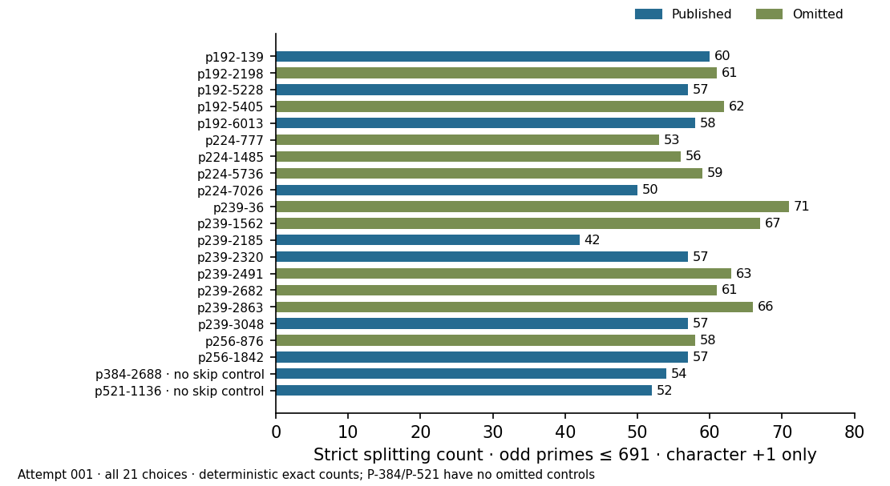

# Strict splitting replay — actual attempt001

29 October 2026. Frozen protocol1, digest
eeb7482bcda69477a360a7c28749b7f737d377dbe3298bec94346e4efbcdbbb7;
actual launch source 077c41e7d414cf72faf20bf9b474b7c35dae7bd8.
The successful uploaded checkpoint and source/input/binary checks preceded
all actual-cohort phases. The run retained all 21 original choices, ten
published and eleven omitted, six streams. P384/P521 remain in the data,
with no skipped same-field controls.

Six phases were planned, attempted and completed; no failure of an expected
outcome, interruption, resume or exclusion. Positive, production and separate
verification have actual native exits 0,0,0. Three deliberately corrupted
character/calibration/summary copies have actual exits 1,1,1, the required
refusals. The verifier identifies the intended file in each case. They do
not count as verified corrupted results. Every actual status and output is
retained in the raw bundle.

The GMP producer and separate PARI verifier agree on all 6,342 odd-prime
characters, 303 cutoff positions,4480 stream-matched label assignments and
all six output files. The fixed 691 criterion separates the paired labels.
Successful strict cutoffs are 691,701,709,769; the search-family count is
23/4,480; the fixed 691 count is 1/4,480. These are exact finite calibration
counts under the declared label model. Earlier external selection of 691,
visible labels, other investigated families and absent original decisions
prevent a confirmatory historical significance claim.

The unchanged native programs share the GMP integer-primitive family but
compute the characters and label enumeration by separate implementations.
No new point count, input primality proof, DLP, isogeny map or performance
comparison ran. Input orders are reused from the certified cohort.
The shared local exact-analysis fallback is explicit. Limits were
30/120/120/30/30/30seconds and 1536 MiB virtual address space. No clock or
isolation tier is admitted.

Sources: [summary](../../results/summary.json),
[all 21 counts](../../results/at691.tsv),
[verification](../../results/verification.json),
[export](../../export.json) and [protocol](../../protocol.json).
The graph uses exact recorded counts with no sampling interval.

