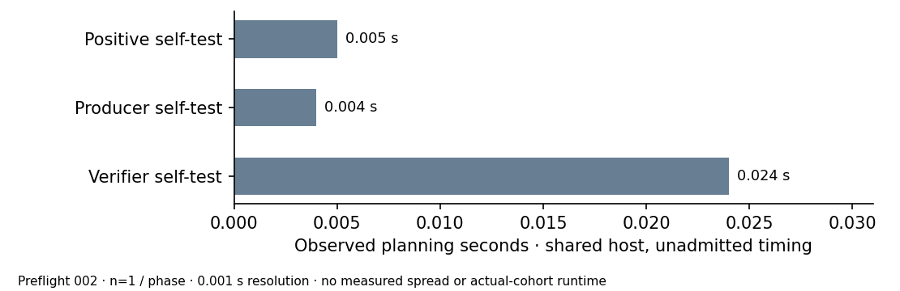

# Self-test planning observations — not a performance result

29 October 2026. After an uploaded checkpoint, preflight 001 failed before a
control executed: external `/usr/bin/time` was absent, exit 127. The fresh
preflight 002 uses Bash's time keyword. It ran the producer self-test twice
under the positive/production planning labels, and the verifier self-test
once. All three actual planning calls exit 0. No real-cohort input was read.

Observed elapsed values were 0.005, 0.004 and 0.024 seconds respectively, one
observation per phase, resolution 0.001 seconds. The exact controls check small
residue tables, planted separation/nonseparation, six toy label assignments
and PARI positive/negative/zero symbols. These different control calls do not
compare algorithms on the same computation. No spread, confidence interval,
speedup, fastest-tool comparison or isolation tier is admitted.

The explicit planning model 512*(positive+production+4*verification) gives
53.76seconds. This is a heuristic allowance, not measured NIST runtime or
a mathematical upper bound. Actual limits remain30/120/120/30/30/30seconds.
Actual-cohort phases have no admitted performance clock.

The host is the shared local environment used for exact analysis; no quiet
core or reservation receipt exists. Source:
[preflight-runtime.json](../../evidence/preflight-runtime.json), preserved
001/002 directories in the preparation and full raw archives. Both attempts
remain separate. Raw control timings are documentary planning observations,
not new benchmark admission. Browsing copies of this PDF/SVG/150-dpi PNG
are regenerated in benchmarks/20261029-strict-elkies-preflight/ and remain
outside its admitted-results table because no timing validation or matched
rho reference exists.

