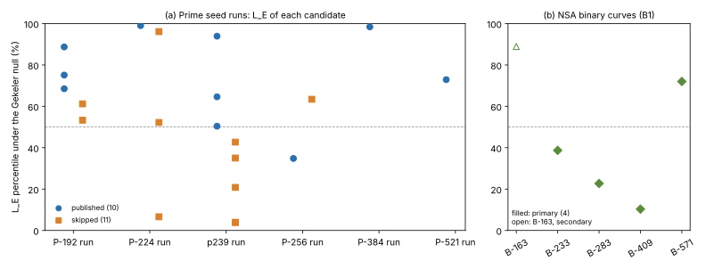

# NIST seed skip rule: holdout and mechanism checks (2026-10-26)

**Status.** Exploratory. Measured negative or uninformative on every frozen test. No
claim about the historical skip rule, and no bearing on ECDLP hardness. The atlas lead
`LEAD-STR-curve-generation-provenance-seeds` (exhausted_at_scale) is unchanged.

**Question.** The 2026-10-25 criterion search (PR 2378, branch
`codex/nist-skip-criterion-20261025`) found post-hoc rules that separate the 10 published
from the 11 skipped valid seed candidates. Do those rules hold out of sample? Is there a
mechanism with independent predictions?

**Protocol.** [`PROTOCOL.md`](PROTOCOL.md). The holdout prediction was frozen before any
rule value was computed on the holdout curves. Addendum B was frozen and pushed in
`6a14c3d` before any native computation. Inputs: `inputs/historical.tsv` (sha256
`f425dc7c…`, source commit in `inputs/historical.SOURCE`) and `inputs/binary.tsv`
(OpenSSL 3.0.13 B-curve orders).



*Figure: (a) For each of the 21 prime candidates, the percentile of its Elkies bound L_E
under the Gekeler-model null for its field (20,000 draws per field, seed 20261026). Blue =
published, orange = skipped. (b) The NSA binary curves (B1). Data: `out/curves.tsv`,
`out/binary.tsv`; drawn by `plot_mechanism.py`.*

## Definitions

`t = p + 1 − #E`, `D = t² − 4p`. A prime `l` is Elkies if `kronecker(D, l) ≠ −1`.
`L_E` is the smallest `l` at which the product of the odd Elkies primes up to `l` exceeds
`4√p`. The **within-stream null** enumerates all 4,480 label assignments that keep each
seed run's published count (3/5, 1/4, 3/8, 1/2, 1/1, 1/1). The **Gekeler null** treats
Frobenius mod `l` as a uniform matrix in `GL₂(F_l)` with determinant `q`, independent over
`l`, conditioned on `l ∤ #E`.

## Results

| Test | Frozen prediction | Measured | Verdict |
|---|---|---|---|
| R2/R3 on SEC 2 seeded curves | all 4 primary curves accepted | all 4 rejected | excluded: SECG/Certicom curves (the seeds contain "MinghuaQu"), so they cannot test the NSA generator |
| Schoof special branches (`t ≡ 0`, `l ∣ D`, `l ≤ 23`) | the `t mod 13 ≠ 6` clause is a branch | the 2 curves it removes hit no branch | ruled out (exploratory) |
| A/H2: skipped curves have a larger L_E | P(≥ obs) small | **P(≥ obs) = 0.9998**; reverse tail P(≤ obs) = 0.00112 | falsified in the predicted direction |
| A/H4: published curves have `t > 0` | P small | P = 0.50 | null |
| B0: native port of A | GP matches Python | exact match on every value | passed |
| B1: NSA binary curves, mean L_E percentile > 50 | P small | mean 35.9, Irwin–Hall P = 0.83 | null |
| B2: an Elkies-failure covering set S, `l ≤ 100` | S covers all 11 skipped curves | S_max = ∅; 0 of 4,480 assignments admit a cover | falsified; **the test had no power** |

Post hoc (Python, then reproduced in GP): mean Gekeler-null percentile of L_E is 74.6 for
published curves (n = 10) and 39.9 for skipped curves (n = 11). Split at `l < 200`: the
count of primes dividing the twist order gives P = 0.62 / 0.41 (no effect). The count of the
other Elkies primes gives P(≥ obs) = 0.032 for the published direction.

## Interpretation and limits

- **Not new evidence.** The 2026-10-16 study already preregistered L_E (H1, "Elkies
  coverage") and recorded a "slight lean to fewer Elkies primes among published (best
  p = 0.008, Bonferroni bound 0.004)". The within-stream null used here fixes each run's
  published count and gives p ≈ 0.001 on the same 21 curves. A different null on the same
  data does not replicate the effect, and I learned of the earlier result only after Addendum A.
- **No outside data supports it.** The only same-organization curves outside the 21 are
  the NSA binary curves. Each was its run's first accepted candidate, and they show no shift
  (B1). That fits either no filter at all or a filter in the prime pipeline only.
- **B2 was mis-designed.** With 10 published curves, every `l` is Elkies for some
  published curve (probability about `1 − 2⁻¹⁰` per `l`). So a covering set can never exist,
  under any labelling. A probabilistic version, where the SEA failed with some probability
  per Elkies prime, is not tested.
- **Gekeler null not validated.** The planned check against exact point counts
  (`control_null.gp`, 64- and 80-bit fields) was blocked: the repository's checkpoint gate
  needs an S3 upload credential that this container lacks. The percentiles in the figure
  and the B1 result depend on that model. The within-stream permutation results (A, B0, B2)
  do not.
- **No new labels exist publicly.** SEC 2 and the X9.62 binary seeds are Certicom's. The
  NSA binary runs have no skips. B-163's seed is unexplained. A confirmatory test needs the
  generator's code or logs, or genuinely new labelled candidates.

## Reproduce

```
cd research/nist_skip_mechanism_20261026
gp -q mechanism.gp          # about 21 s; writes out/curves.tsv, out/binary.tsv, out/b2_cover.tsv, out/summary.txt
gp -q control_null.gp       # validation; blocked here by the checkpoint gate
python3 plot_mechanism.py   # renders mechanism.svg / mechanism.png from out/*.tsv
typst compile report.typ report.pdf
```

PARI/GP 2.15.4. Records: `out/summary.txt` (all test statistics), `out/curves.tsv`,
`out/binary.tsv`, `out/b2_cover.tsv`.
