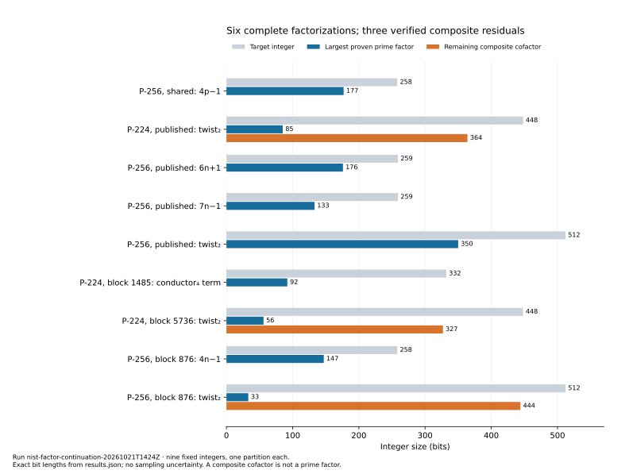

# Continue the DiSSECT factorizations

Run `nist-factor-continuation-20261021T1424Z`, 2026-10-21.
**Six of nine distinct target integers have complete proven-prime
factorizations. Three retain composite cofactors.** This resolves eleven
of fourteen timeout-valued fields across seven of the ten affected rows
in the original 438-case upstream run. The original output remains intact.

Read the [report](reports/run-20261021T1424Z/REPORT.md),
[inspected PDF](reports/run-20261021T1424Z/report.pdf),
[full factors and cofactors](FACTORIZATIONS.md),
[machine-readable results](results.json), and
[field-by-field supplement](resolved-fields.json).



## Scope and method

The unchanged [input fixture](../../../backlog/XP-20261021-nist-skipped-curves/curves.json)
contains the P-224 stream's blocks 777, 1485 and 5736, the P-256 stream's
block 876, and published P-224/P-256 controls. Stream coordinates and
imported fixture keys identify the exact models. This continuation factors
integers derived from those inputs; it does not register new curve models
or substitute the opposite-`b` models in PR #2333.

The frozen [protocol](PROTOCOL.md), [field-count correction](PROTOCOL-ERRATUM.md),
[ECM escalation](PROTOCOL-ESCALATION.md), and
[final ECM stage](PROTOCOL-ESCALATION-3M.md) describe the executed search.
PARI/GP 2.17.2 used exact algebraic splits, untrusted FactorDB hints and up
to 600 seconds of native factorization per target. Residuals received up to
100 ECM curves at B1=100000, 200 at B1=1000000 and 100 at B1=3000000,
following smaller cofactors within each allocation. At most two workers
ran concurrently; each ECM cofactor attempt had a 600-second limit and a
1024 MB stage-2 memory cap. No remote machines were launched.

Let `t=p+1-n`. [targets.gp](targets.gp) reconstructs the nine integers
directly from hexadecimal parameters: `(p-1)^2+t^2`,
`abs(t*(t^2-2*p))`, `4n-1`, `6n+1`, `7n-1`, and the shared `4p-1`.
The upstream trait named `square_4p1` actually uses **minus one** for both
inputs. The two P-256 `4p-1` requests and the skipped P-256 `4n-1` duplicate
other requests. Three largest-factor-bit-length fields duplicate underlying
factorization timeouts. Thus ten rows mean fourteen fields and nine integers.

## Replay from the archive

Native requirements: Bash, jq, ripgrep, GNU coreutils, tar/xz, PARI/GP
2.17.2; GMP-ECM 7.0.6 is needed only for another search. Large integers in
new JSON are decimal strings. Never round-trip them through JSON numbers.

From this directory, verify and extract the deterministic raw archive:

```bash
sha256sum -c runs.tar.xz.sha256
tar -xJf runs.tar.xz
bash replay_results.sh runs /tmp/nist-factor-replay-01
```

Set `GP_BIN` to a single executable path if needed. The output directory
must be fresh. The replay reconstructs targets from the committed hex
fixture, checks equality with [targets.jsonl](targets.jsonl), validates every
saved PARI prime certificate, separately calls `isprime`, rejects composite
residuals incorrectly labeled prime, checks positive exponents, and verifies
the full product exactly. This is a separate native verification process,
using PARI as the arithmetic implementation. The three partial partitions
also replay; successful replay does not make them complete.

The archive contains all PARI attempts, ECM parameters/residues/logs,
FactorDB responses, intermediate partitions, final certificates under
`runs/final/<target>/certs-final/`, failed controls, and verification logs.
Its absolute paths record the original workspace; `replay_results.sh`
builds fresh descriptors for the extracted location. No committed evidence
tree was moved. The earlier 932-file external run/source bundle remains
unchanged at [inputs/upstream-dissect.zip](inputs/upstream-dissect.zip).

Repack byte-for-byte with:

```bash
tar --sort=name --mtime='2026-10-21 00:00:00Z' --owner=0 --group=0 \
  --numeric-owner --mode='u+rwX,go+rX,go-w' --format=gnu -cf - runs \
  | xz -6 -T1 > /tmp/nist-runs-repacked.tar.xz
cmp runs.tar.xz /tmp/nist-runs-repacked.tar.xz
```

## Formal product checks and identity records

[ProductIdentities.lean](ProductIdentities.lean) proves the exact nine
partition products over `Nat` using `by decide`, including the three
explicit composite cofactors. Lean 4.35.0 is pinned. The repository proof
gate audited nine theorems, zero failing and zero trusted native proofs;
`#print axioms` reports `[]` for every theorem. `lean4checker` was not
available. **Lean proves the products, not primality.** PARI's retained
prime certificates establish the separate primality claims.

From the repository root, with the pinned Lean executables on `PATH`:

```bash
bash tools/lean/proof-gate.sh \
  research/nist_skipped_curve_dissection_20261021/factorization/ProductIdentities.lean
```

The [proof map](proof-map.md) links every target, theorem and
`identity.certificate/v1` record. Those records check constant-expression
identities over `2^61-1` and point to the Lean source; the kernel proof is
what establishes equality over the integers. Native [identity_records.rs](identity_records.rs)
issues or checks the records. Build/check it from the repository root:

```bash
cargo build --release --lib
study=research/nist_skipped_curve_dissection_20261021/factorization
crypto_rlib=$(rg --files target/release/deps | rg '/libcrypto_lib-[^/]+\.rlib$' | head -1)
json_rlib=$(rg --files target/release/deps | rg '/libserde_json-[^/]+\.rlib$' | head -1)
rustc --edition 2021 "$study/identity_records.rs" -L dependency=target/release/deps \
  --extern "crypto_lib=$crypto_rlib" --extern "serde_json=$json_rlib" \
  -o /tmp/nist-identity-records
/tmp/nist-identity-records check "$study/results.json" "$study/identity-certificates"
```

Use artifacts from the same fresh Cargo build if the dependency directory
contains several incompatible historical variants.

## Limits and follow-up

The remaining [327-, 364- and 444-bit composite cofactors](../../../problems/nist-extension-twist-composite-cofactors.md)
are an open factorization problem. No smallest-prime-factor lower bound
follows from the exhausted ECM allocations. The original forty
generator-dependent null cases and upstream torsion/degree-2 trace defects
remain outside this factorization supplement. Nothing here establishes a
historical skip reason or a new discrete-logarithm attack.

This is a completion search on fixed instances, not a speed comparison.
No sampling intervals or performance claims apply. The graph plots exact
native-verifier bit lengths. Existing IC scoreboards/timeline, curve
diagrams, performance-gains figures and seed-study visuals were checked
for affected factorization claims; none represents these results, so they
remain unchanged. The new local graph and all rendered copies agree.

Conductor was unavailable (`command not found`); the documented
[fallback](../../../docs/CONDUCTOR.md) was used. Validation and failed
attempts are detailed in the report. The original
[manual jobs](../../../backlog/XP-20261021-nist-skipped-curves/README.md)
remain a separate reproducible launch path.
