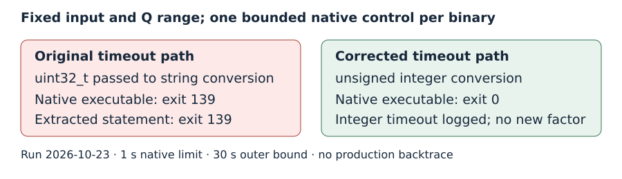

# Native timeout diagnostic: original 139, patched 0

Two fresh bounded full-tool controls reproduce a timeout formatting defect
in pinned YAFU c7d90283972820f99b3b4920bfc1eff05c1f6342. The original exits
139; the patched executable exits 0 and logs its integer timeout. Both use
the exact R05 444-bit residual and selected polynomial. This diagnoses the
failure mechanism without claiming a production backtrace or a new factor.

## Recorded controls

| Control | Observed result |
|---|---|
| Original sieving printf, format-as-error compile | rejected: uint32_t passed to string conversion |
| Original second timeout printf, format-as-error compile | rejected: uint32_t passed to floating conversion |
| Original extracted sieving statement, one run | exit 139 |
| Both corrected extracted statements | compile and run successfully |
| Original full native NFS, one bounded control | exit 139 |
| Patched full native NFS, one bounded control | exit 0; integer timeout message logged |
| Checked resume, prepare only | installed validated binary; native arithmetic replay passes |
| Wrong binary or active native lock | both rejected |

The raw [native summary](../../native-control-summary.json) binds the
actual executable hashes. The original matches the production R05 binary.
The [patch](../../timeout-printf.patch) changes two timeout messages only:
the sieving message's `%1.4sec` parses as a string conversion `%1.4s`, and
the other message's `%1.4f` expects a double. Both incorrectly receive a
uint32_t. Corrected messages use `%u` with an unsigned cast. Historical
build warnings already identify both defects.

## Inputs, bounds and evidence

The [protocol](../../PROTOCOL.md) limits extracted controls to five seconds
each with core dumps disabled. The [separate full-tool protocol](../../NATIVE-VALIDATION-PROTOCOL.md)
allows two fresh native controls, two threads, seed 20261022, native limit
one second, Q range 2935000 to 2935500, sieving phase only, outer bound
30 seconds plus five-second kill grace, 4 GiB address space and 64 MiB per
output file. The compatible local host has four CPUs and 16 GiB RAM, L0.
There is one control per native arm, no replicate interval and no timing
comparison; the diagram shows recorded outcomes, not performance.

The original R05 relations and checkpoint were never imported or modified.
Each control uses its own selected job, parameters, output and native
executable. Both complete within the outer bound. The patched tool's final
`C134` label repeats the unchanged input and is not a proper factor.
The first separate build attempt fails to autodetect GMP's multiarch
headers; the second explicitly sets the include path and succeeds. Raw
build errors, commands, compiler versions, sources/hashes, diagnostics,
output/state and wrapper controls are retained in the sibling raw archive.

The [checked wrapper](../../resume_with_checked_tool.sh) installs only a
binary matching a passing control summary, under both existing locks, with
the previous executable retained. Its copied executable is rehashed before
installation. Prepare-only replay verifies the unchanged original target
and prime certificates. The R04 compact checkpoint is used only for this
non-search preparation control; the actual later card binds the newer R05
relation checkpoint after required artifact-store publication.

## Scope and remaining work

The formatting defect and its corrected bounded native behavior are
verified. The exact R05 production instruction pointer remains unobserved.
No longer production allocation was run. Eight of nine integers remain
fully factored, with the 444-bit residual still composite. This diagnostic
adds no algebraic identity or Lean theorem; existing partition proofs and
native prime certificates remain applicable. Existing mathematical and
performance graphs have no changed result and remain unchanged.

The backlog card now requires the checked tool and the R05 relation
archive, but remains draft and unqueued pending actual store publication,
a merged source pin and selected lab. No paid resource, task or lease was
created. The next production run must preserve all relation state and
independently certify any proper factor it returns.
