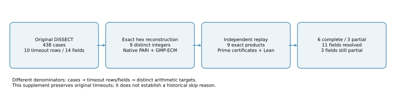

# Native continuation of skipped-NIST DiSSECT factorizations

Run `nist-factor-continuation-20261021T1424Z`, 2026-10-21.

## Result and denominator

Six of nine distinct target integers are fully factored into proven primes.
Three remain partially factored with explicitly composite residuals. This
resolves eleven of fourteen timeout-valued fields across seven of the ten
affected rows in the original 438-case upstream DiSSECT run. Counts describe
these fixed instances, not a sampled population or a statistical hypothesis.

The targets were seen before this continuation. The [frozen protocol](../../PROTOCOL.md)
does not preregister unseen curve properties. Its original eleven-field
count omitted three derived bit-length timeout copies; the additive
[erratum](../../PROTOCOL-ERRATUM.md) preserves that correction. Source
inspection also matters: `square_4p1` actually factors `4p-1` and `4n-1`.

## Inputs and native checks

The [exact hex fixture](../../../../../backlog/XP-20261021-nist-skipped-curves/curves.json)
has four skipped candidates and two published controls. Imported names and
stream coordinates identify the exact models; no opposite-`b` model was
substituted. With `t=p+1-n`, native [targets.gp](../../targets.gp) reconstructs
the degree-2 extension-twist orders `(p-1)^2+t^2`, the degree-4 conductor-
ratio term `abs(t*(t^2-2*p))`, and the required `kn±1` and `4p-1` integers.
This term is the upstream factorization target, not a claim that its value
alone is the endomorphism-ring conductor.

PARI/GP 2.17.2 used trial division, exact algebraic partitioning, FactorDB
hints and 600-second native factorization attempts. Hints were read-only,
saved verbatim and checked by exact division; service labels were not
accepted as primality proofs. The initial PARI stage completed six targets.
GMP-ECM 7.0.6 then split each remaining lineage further. All final known
prime factors have saved PARI certificates, checked with `primecertisvalid`
and a separate `isprime` call. A new process independently checks the expected
target, exponents, prime certificates, composite status of every residual
and exact product. It uses the same PARI arithmetic implementation.

The original external bundle is [upstream-dissect.zip](../../inputs/upstream-dissect.zip):
932 unchanged files, including source, 438 cases, logs and audit. Its pinned
upstream revision is `8edc3030fb91411a55aa6c07d050507d840c5e55`.
This continuation does not rerun the manual GitHub workflow or modify those
historical outputs. New big integers are JSON strings, never floating-point
numbers. [Input/runtime hashes](../../provenance.json) bind the sources.

## Exact sizes and completed entries

| Target | Target bits | Largest proven prime bits | Residual bits | Status |
|---|---:|---:|---:|---|
| shared P-256 `4p-1` | 258 | 177 | 0 | complete |
| published P-224 extension-twist order | 448 | 85 | 364 | partial |
| published P-256 `6n+1` | 259 | 176 | 0 | complete |
| published P-256 `7n-1` | 259 | 133 | 0 | complete |
| published P-256 extension-twist order | 512 | 350 | 0 | complete |
| P-224 block 1485 conductor-ratio term | 332 | 92 | 0 | complete |
| P-224 block 5736 extension-twist order | 448 | 56 | 327 | partial |
| P-256 block 876 `4n-1` | 258 | 147 | 0 | complete |
| P-256 block 876 extension-twist order | 512 | 33 | 444 | partial |

These are exact derived bit lengths serialized by the native verifier;
there is one final partition per integer, so no sampling interval applies.
The full decimal factors and residuals are in [FACTORIZATIONS.md](../../FACTORIZATIONS.md)
and [results.json](../../results.json). Both P-256 `4p-1` square-part roots,
and the skipped P-256 `4n-1` square-part root, equal 1. The newly resolved
largest-factor-bit-length fields are 147, 176 and 133 respectively for
skipped `4n-1`, published `6n+1` and published `7n-1`.

## Search attempts and controls

Each residual lineage received 100 attempted ECM curves at B1=100000,
200 at B1=1000000 and 100 at B1=3000000. After a split, only the remaining
allocation continued on its smaller cofactor. Count `Using B1=` records,
including a curve that finds a factor before stage 2. The final 300 curves
completed with no new factors. The [attempt inventory](../../ecm-attempts.json)
and the table below account for every native ECM subprocess.

| Raw attempt under `runs/` | B1 | Attempted curves | Stage 2 completed | Exit |
|---|---:|---:|---:|---:|
| `ecm100k/published_224-twist2` | 100000 | 24 | 24 | 6 |
| `ecm100k-r2/published_224-twist2` | 100000 | 76 | 76 | 0 |
| `ecm100k/skipped_224_5736-twist2` | 100000 | 6 | 6 | 6 |
| `ecm100k-r2/skipped_224_5736-twist2` | 100000 | 4 | 4 | 6 |
| `continued100k/skipped_224_5736-twist2/round-1` | 100000 | 90 | 90 | 0 |
| `ecm-next/skipped_256_876-twist2` | 100000 | 1 | 0 | 6 |
| `continued100k/skipped_256_876-twist2/round-1` | 100000 | 99 | 99 | 0 |
| `ecm-next/published_224-twist2` | 1000000 | 200 | 200 | 0 |
| `continued1m/skipped_224_5736-twist2/round-1` | 1000000 | 200 | 200 | 0 |
| `continued1m/skipped_256_876-twist2/round-1` | 1000000 | 200 | 200 | 0 |
| `continued3m/published_224-twist2/round-1` | 3000000 | 100 | 100 | 0 |
| `continued3m/skipped_224_5736-twist2/round-1` | 3000000 | 100 | 100 | 0 |
| `continued3m/skipped_256_876-twist2/round-1` | 3000000 | 100 | 100 | 0 |
| `controls/ecm-positive` | 1000 | 1 | 1 | 8 |
| `controls/ecm-fixed-positive` | 1000 | 1 | 1 | 14 |

Nonzero even ECM exits can encode factor outcomes. The first random control
reported its entire input `1000036000099`, a trivial result, not a split.
It is preserved as a failed positive control. A deterministic control at
sigma `1:1184114830` correctly found `1000003`, cofactor `1000033`.
The wrong-target replay control exits 1 as required.

An initial wrapper rejected a harmless PARI stack warning; its complete
result and rejection remain archived. Three PARI attempts hit their internal
600-second alarms and retained verified partial partitions. A final
certificate-generation attempt exhausted the default 8 MB PARI stack; the
fresh attempt with 128 MB initial stack and 2 GB maximum passed. The initial
Lean 4.25 build proved five products, but the repository axiom auditor was
incompatible with that toolchain. Lean 4.35.0 passes the auditor. The first
identity-record encoding exceeded serde_json's nesting limit; the corrected
native decimal-chunk encoding passes separate issue/check invocations.
All these attempts are retained, rather than overwritten as successes.

## Formalization and validation

[ProductIdentities.lean](../../ProductIdentities.lean) proves all nine exact
partition products with `by decide`. The partial products explicitly include
their composite residuals. The repository gate audits nine theorems, zero
failing, zero trusted native proofs; every axiom list is empty. Lean does
not prove primality. Native PARI certificates handle that separate claim.
`lean4checker` was unavailable. The [proof map](../../proof-map.md) names
every declaration and `IDC1h…` constant-identity certificate. Those modular
records link the exact Lean source digest; modular equality alone would not
establish an integer product equality.

All nine targets and certificates replay successfully. Shell syntax and the
native identity records pass. The required `cargo test --release --lib`
reported 4465 passed, 9 failed and 119 ignored when loopback networking was
denied by the execution sandbox. All nine failures were in `pollard_collab`.
Rerunning that entire module with the required network permission passed
44/44 tests, covering all nine failures. This is a full-suite run plus a
targeted retry, not a newly observed single all-green full-suite run.

## Resources, limits and interpretation

Host: Linux 6.18.55 x86-64 container, cgroup limit four CPUs and 16 GiB RAM.
At most two factor workers ran concurrently. Each ECM cofactor attempt had
a 600-second process bound and 1024 MB stage-2 memory cap. PARI had a 2 GB
maximum stack. The environment was unisolated (L0); recorded limits control
execution, not a performance comparison. No speedup, throughput, smallest-
factor lower bound or algorithm-ranking claim is made.

The [remaining obstruction](../../../../../problems/nist-extension-twist-composite-cofactors.md)
is precisely the unsplit 327-, 364- and 444-bit composites. Exhausted ECM
allocations do not establish security or infeasibility. The original forty
generator-dependent null cases and upstream torsion/degree-2 trace defects
are not repaired by these factorizations. No historical skip reason follows.

Existing IC scoreboards/timeline, relevant curve diagrams, performance-gains
figures and seed-study visuals were checked for affected factorization data;
no such canonical plot was found, so they remain unchanged. The new SVGs,
150 dpi PNGs and inspected PDF use the same recorded native sizes. Plotting
Python performs document layout only. See [replay and archive instructions](../../README.md).

## Sources

- [Anthropic: ECDSA curve origins](https://www.anthropic.com/research/ecdsa-curve-origins)
- [Filippo Valsorda: seeds solved](https://words.filippo.io/seeds-solved/)
- [Pinned DiSSECT source](https://github.com/crocs-muni/DiSSECT/tree/8edc3030fb91411a55aa6c07d050507d840c5e55)
- [Actual square-part trait](https://github.com/crocs-muni/DiSSECT/blob/8edc3030fb91411a55aa6c07d050507d840c5e55/dissect/traits/square_4p1.py)
- [Twist-order trait](https://github.com/crocs-muni/DiSSECT/blob/8edc3030fb91411a55aa6c07d050507d840c5e55/dissect/traits/twist_order.py)
- [Conductor-ratio trait](https://github.com/crocs-muni/DiSSECT/blob/8edc3030fb91411a55aa6c07d050507d840c5e55/dissect/traits/conductor.py)
- [PARI prime certificates](https://pari.math.u-bordeaux.fr/dochtml/html-stable/Arithmetic_functions.html#primecert)
- [GMP-ECM](https://gitlab.inria.fr/zimmerma/ecm)
