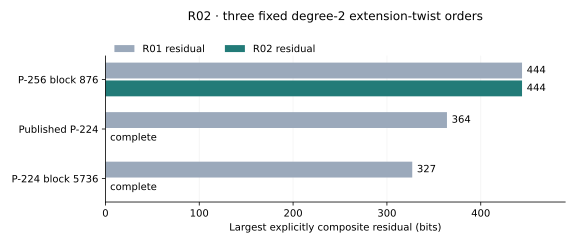
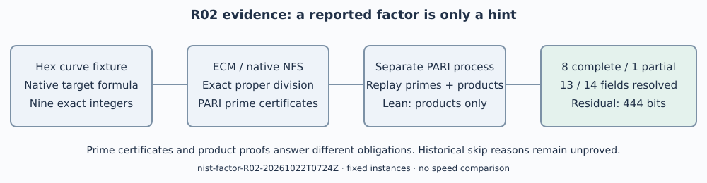

# R02 native factorization continuation

Run `nist-factor-R02-20261022T0724Z`; production began 2026-10-22 07:24 UTC.
The frozen [base protocol](../../PROTOCOL.md), its additive NFS protocols,
per-attempt source commits and receipts define this round. Baseline is
R01 at crypto `99132d1fd1a9d9c125eec4c1a9761edce068076a`.

## Requested work and verified outcome

The user requested continued factorization of the skipped-candidate
DiSSECT results. All three unresolved lineages received native searches.
All nine partitions were recertified and replayed in separate PARI
processes against targets reconstructed from the original hexadecimal
curve fixture. Eight targets are complete, one partial; thirteen of the
fourteen original timeout-valued fields can now be replaced. The earlier
upstream suite contains 438 cases and ten timeout rows; this round is a
factorization supplement, not a fresh execution of that suite.

| Requirement | Status and evidence |
|---|---|
| Continue all three unresolved factorizations | Executed with the frozen allocations; raw `targets/` and `nfs/` |
| Prime-certify every claimed factor | Verified; loose `certificates/final/*/certs-final/` |
| Reconstruct inputs and independently replay products | Verified for all nine; raw `validation/final-loose-replay/` |
| Complete every factorization | Partial: only P-256 block 876 remains composite |
| Product identities and identity records | Verified: nine Lean theorems, nine separately checked records |
| Preserve and publish all raw evidence | Preserved locally; large-archive S3 publication blocked by missing AWS identity |
| Explain historical skips | Not established by these computations |

## Recorded arithmetic results



Figure: largest explicitly composite residual, in bits, before and after
R02, on the three fixed lineages (one integer each). Zero denotes complete
prime factorization. Source: native verifier fields in R01 baseline and
R02 results, transcribed by `plot-data.json`; no sampling uncertainty.
No running-time comparison is plotted.

The 327-bit residual for P-224 block 5736 split on ECM curve 29 into the
40- and 59-digit primes printed in the [round README](../../README.md).
Its complete 448-bit order has largest prime of 196 bits. The published
P-224 364-bit residual split by resumed NFS into 47- and 63-digit primes;
the complete 448-bit order has largest prime of 209 bits. Exact decimal
partitions and exponents are in [results.json](../../results.json).

The only residual is the 444-bit composite

```
33492266050798185653682380062483799213318454801653963493134064721059735936944520907295931496614455858076048437184499090478420204888353
```

It belongs to the 512-bit degree-2 extension-twist order of
`skipped_256_876`; its largest currently proven prime factor is 33 bits.
This says nothing about the smallest prime factor of the residual.

## Methods, controls and failures

Native PARI perfect-power and cross-panel GCD checks found no proper split.
Read-only FactorDB responses reported all three composites without new
factors. An initial asynchronous lookup failed to await its pipelines;
both that failed attempt and the successful `hints-v2/` lookup are retained.

Each lineage received one base-2 P−1 run at B1=10,000,000,
B2=10,000,000,000; eight P+1 starts 6,7,11,13,17,19,23,29 at
B1=1,000,000, B2=1,000,000,000; and up to 100 ECM curves at
B1=11,000,000, native B2=35,133,391,030. P−1/P+1 yielded no split.
P-224 block 5736 attempted/completed 29 ECM curves, exit 14 with a split;
published P-224 completed 100, exit 0; P-256 block 876 attempted 92 and
completed stage 2 for 91, exit 124 at the process limit. Unused allocations
are respectively 71, 0 and 8; none is reported as executed. Positive P−1
and P+1 controls yielded the expected exact proper divisors.

The two up-to-600-second `factorint(C,6)` phases emitted a too-large-MPQS
warning and then a matrix-index serialization error after the alarm. No
usable proposal survived. These are inconclusive implementation failures,
not valid negative factorization results. The verified previous partitions
were recovered unchanged. The corrected matrix guard passed separate
small-matrix and one-second alarm controls, without rerunning production
or resetting its budget. A proper new hint passed native refinement; an
invalid divisor 2 for the odd input was rejected.

YAFU was built from pinned source
`c7d90283972820f99b3b4920bfc1eff05c1f6342`, AVX2/BMI2 and GMP-ECM
enabled, with matching Debian libecm headers. Missing-header build errors,
the initial stdin/seed setup errors and a checksum glob error are retained.
The corrected 85-digit known-answer control first auto-selected SIQS. It
is not GNFS validation. A separate `-gnfs -xover 81` control collected its
relations within a 300-second allocation, timed out during filtering, then
completed and verified both expected prime factors in a separately frozen
300-second resume. See raw `controls/nfs-gnfs-positive/` and
`controls/nfs-verification/result.json`.

Production NFS used two threads, two linear-algebra threads in their
separate phase, seed 20261022, native limit 1800 seconds, outer limit 1860
seconds and 30-second kill grace, per-process virtual memory limit 4 GiB.
The published P-224 attempt exited 139 after retaining about 6.94 million
relations; the cause is unknown. Its separately frozen resume retained
10,830,564 relations, filtered, solved the matrix, and produced the two
certified factors, exit 0. Filtering logged relation warnings; final
prime and exact-product checks passed independently. P-256 terminated
with exit 137 in polynomial search; only search state survived. No selected
polynomial, sieve completion or valid negative arithmetic result is claimed.
An event-based hardlink helper retained native outputs across cleanup;
single-/multiple-owner create-write-unlink smoke controls passed.

## Proofs and validation



The [proof map](../../proof-map.md) links all nine integer equalities and
`identity.certificate/v1` records. Lean 4.35.0 proof gate: nine theorems,
zero failing, zero trusted native proofs, empty axiom lists. The Lean
proofs establish products over `Nat`; PARI certificates establish primality.
`lean4checker` was unavailable. The native repository identity checker
issued and separately checked all nine records with 32 extra modular
evaluation points. Modular identity checking alone is not the integer proof.

Before the main-branch merge, 4,474 library tests passed; after it, 4,479
passed, zero failed and 119 were ignored. Network access was granted for
the loopback-dependent tests. No new library implementation was benchmarked.
The host has four CPUs and 16 GiB RAM; this unisolated session is L0.
Setup, failed builds, controls and production searches are preserved, but
their operational timings do not support a speed comparison. Native tools:
PARI/GP 2.17.2, GMP-ECM 7.0.6; executable/siever hashes are recorded in raw
receipts. Python is used only for plotting recorded values and PDF layout.

## Evidence and open work

The [archive manifest](../../archive-manifest.json) binds the complete local
raw archive. It preserves successes, errors, timeouts, terminated searches,
native checkpoints, source snapshots and scoped Git commit patches. An
optional full Git bundle failed because the blobless clone required
unavailable promisor objects; that failure is retained too. The runtime
has no configured AWS identity, so publication through the required S3
artifact store remains an access blocker; no remote object is claimed.
Loose mathematical certificates and a small P-256 checkpoint excerpt make
verification and resumption reviewable without the bulk archive.

The [specific obstruction](../../../../../../../problems/nist-extension-twist-composite-cofactors.md)
requires a complete, prime-certified split of the remaining P-256 cofactor.
[R03](../../../R03-20261022/README.md) found that the original per-thread
polynomial excerpt restarts search without a master file. Its exact
validation and native-recognized recovery are separate from R02. Use that
corrected checkpoint for continuation; the wrapper now refuses the original
per-thread-only state. R03 must not be counted as an R02 attempt.
The original missing generators and upstream
torsion/trace defects remain outside this supplement. A finite search
cannot establish a historical selection motive or curve security.

The new residual-bit graph and proof diagram are local to this round.
IC scoreboards/timeline, curve diagrams, performance-gains figures and
seed-study visuals contain no affected factorization claim and remain
unchanged. Conductor was unavailable; the documented fallback was used.

Sources: [upstream DiSSECT](https://github.com/crocs-muni/DiSSECT/tree/8edc3030fb91411a55aa6c07d050507d840c5e55),
[pinned YAFU](https://github.com/bbuhrow/yafu/tree/c7d90283972820f99b3b4920bfc1eff05c1f6342),
[Anthropic origin story](https://www.anthropic.com/research/ecdsa-curve-origins),
[Valsorda seed report](https://words.filippo.io/seeds-solved/).
