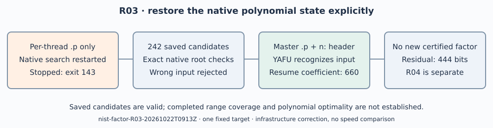

# R03: a polynomial restore failure and its correction

Run `nist-factor-R03-20261022T0913Z`, started 2026-10-22 09:13:55 UTC.
The user requested continued factorization. One P-256 native NFS attempt
was launched from R02's per-thread checkpoint under the separately frozen
[protocol](../../PROTOCOL.md), native limit 1800 seconds, outer 1860 seconds
plus 30 seconds kill grace, seed 20261022 and two threads. Pinned YAFU:
`c7d90283972820f99b3b4920bfc1eff05c1f6342`; PARI/GP 2.17.2.

Only one fixed target was attempted; an infrastructure failure prevented
new coverage from being established. The explanatory diagram replaces a
comparative runtime graph. The 242 count is recorded by the native exact
validator, not a count of tested coefficient ranges or new independent
polynomials found in R03. No sampling interval or speed claim applies.

## What actually happened

The restored files contained `nfs.dat.0.p`, while YAFU's native restore
path requires master `nfs.dat.p` with an `n:` header. Its source at
`factor/nfs/nfs_filemanip.c` checks that master file and otherwise selects
`NFS_STATE_STARTNEW`; `factor/nfs/nfs_poly.c` normally merges a thread's
file only after the batch returns. The interrupted R02 batch had not
performed that merge. R03 therefore began at the old starting coefficient
and repeated the first full candidate. A byte comparison confirms that
repeat; this does not establish that every produced record is a duplicate.

SIGINT was recorded but did not stop the process. SIGTERM then ended it
with exit 143; exact timestamps and reasons are in raw
`manual-{interrupt,terminate}.json`. No native factor hint was returned.
Independent PARI refinement/replay recovered the unchanged verified partial
partition. The 512-bit whole target still has a 444-bit composite residual
and largest currently proven prime factor of 33 bits. Eight of nine whole
targets remain complete, resolving thirteen of fourteen original fields.

## Recovery and controls

The additive [recovery protocol](../../PROTOCOL-CHECKPOINT-RECOVERY.md)
preregistered exact checks before recovery. Native GP validated all 242
complete saved degree-5 candidates from R02: coefficient syntax, nonzero
leading term, rational pair, invertibility of Y1, and zero of the algebraic
polynomial at `-Y0/Y1` modulo the literal input. It wrote the original
candidate blocks with the correct input header and no invented timing.
The first parser version mishandled the string delimiter; its error and
empty proposal are retained. The corrected parser passes.

A different literal input fails the exact root check. The independent
native YAFU recognition diagnostic on a separate copy, bounded to three
seconds plus one second grace, prints `poly file matches input` and
`last leading coefficient was 660`; exit 124 is the diagnostic bound,
not a production negative. Any incidental arithmetic is setup work.
The portable checkpoint restores with the same input and independently
replays the prime certificates and exact whole-target product. Neither
recognition nor partial replay proves complete factorization.

The resume wrapper now refuses unrecognized per-thread-only state. A
configurable native `-pbatch` records the selected batch; R04 separately
freezes a 120-coefficient batch to permit earlier durable checkpoint
merging. That future search is not counted as R03 coverage.

## Evidence, limits and remaining work

Raw `runs.tar.xz` preserves both native attempts' inherited history, the
intervention logs, original/repeated candidates, parser failure, recovery
verdicts, wrong-input rejection and recognition diagnostic. Check its
SHA-256 before extracting. The loose master file and derived checkpoint
excerpt are named directly by the replay/job and remain loose under the
AGENTS.md section 13a exception. The full raw archive is distinct.

The host has four CPUs and 16 GiB RAM, L0 isolation. Python only renders
this document. Existing R02 product proofs and prime certificates still
apply to the unchanged partition; no new factor identity is claimed.
The remaining [factorization obstruction](../../../../../../../problems/nist-extension-twist-composite-cofactors.md)
and separate [bulk-publication access gap](../../../../../../../problems/nist-factorization-raw-archive-publication.md)
remain explicit. Historical generators, upstream trait defects and the
historical skip reason are unresolved. No finite failed search proves
impossibility or a factor-size lower bound.

The local diagram and PDF are new; IC scoreboards, timelines, performance
figures and seed-study diagrams contain no affected result and are unchanged.
