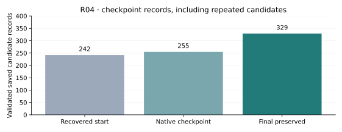
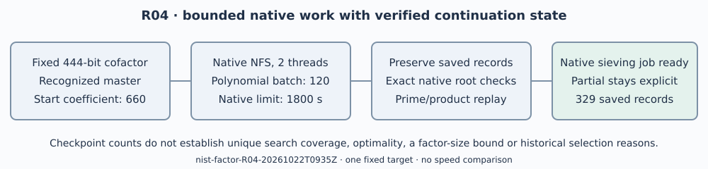

# R04: verified progress in the P-256 polynomial checkpoint

Run `nist-factor-R04-20261022T0935Z`, started 2026-10-22 09:35:14 UTC.
One native NFS allocation continues the 444-bit residual of the 512-bit
`skipped_256_876-twist2` target. The [frozen protocol](../../PROTOCOL.md)
binds the literal input and methods. Exact final counts and execution
status are serialized in [summary.json](../../summary.json); the
[partition](../../result.json) separately records the arithmetic status.

**Outcome: exit 137 at the outer bound, no new factor returned.** The
verified partition remains partial, with a 444-bit composite residual.
Final recovery preserves **329 valid candidate records**, including
repeats, through leading coefficient **900**. The production search produced
no selected final polynomial or sieve relations. A separate bounded
recognition diagnostic then selected a saved polynomial and generated the
native job for the next sieving allocation. Both output formats pass exact
input, coefficient and common-root checks. This terminated search is inconclusive;
the arithmetic total remains eight complete targets and thirteen resolved
timeout fields.

Figure: complete saved candidate records validated by native GP at three
fixed checkpoints, one file per stage. Repeats are retained. These are not
unique candidate counts or completed coefficient-range counts, and no
sampling interval applies. Source fields are linked in `plot-data.json`.
This graph records preservation of usable state, not faster factorization.

## Scope and observations

R03 had discovered that a per-thread-only restore silently restarted the
polynomial search. Before R04, native exact checks validated 242 saved
candidates, wrong-input rejection passed, and a separate diagnostic
confirmed native input matching and resume coefficient 660. R04 starts
from that recognized master. Its per-thread output begins at 660 and later
records pass 800. An intermediate durable native master has 255 verified
records, highest coefficient 720, and a verbatim native `time: 837` line.
This demonstrates actual native checkpoint merging, not just restored bytes.

The method uses unchanged YAFU source
`c7d90283972820f99b3b4920bfc1eff05c1f6342`, `-gnfs -xover 81`, seed
20261022, two sieve/linear-algebra threads in separate phases, polynomial
batch 120, native 1800-second limit, outer 1860 seconds plus 30 seconds
kill grace, and 4 GiB virtual-memory limit per process. Per-attempt source
commit, executable/siever hashes, command, timestamps, stdout, stderr and
receipt are retained. The host has four CPUs and 16 GiB RAM, L0 isolation.
No runtime estimate, speed comparison or new factor-size lower bound is
inferred from those operational limits.

The legacy receipt's `timed_out: false` recognizes exit 124 only and does
not exclude a grace-kill exit 137. The exact timestamps and status are
retained without rewriting it. Future receipt version 2 logs GNU timeout's
signals and reports an unclassified exit 137 as unknown, avoiding that
ambiguity. Its ignored-SIGINT/grace-kill control is retained separately.

## Correctness and durable state

After the native worker stops, complete saved records are preserved and
checked for six integer coefficients, a nonzero leading coefficient,
invertible Y1 and the exact common-root equation modulo the fixed input.
The native master and original thread files remain in raw evidence. The
thin shell helper only frames records; all arithmetic is native PARI/GP
2.17.2. Trailing incomplete blocks are retained in originals and excluded
from accepted candidate input. Native timing lines are copied verbatim.

The helper rejects a live worker. A real-fixture control, applied twice,
keeps the same record count because consumed thread files are retained
outside the active state and cannot be merged twice. Wrong-input root
rejection is inherited from R03. A copied native master with its actual
time record replays byte-for-byte. The new wrapper's prepare-only path
restores the fixed input without starting search. Portable checkpoint
replay independently checks the whole-target product and every retained
prime certificate; a valid partial partition does not imply completion.

The separately preregistered final recognition diagnostic reads coefficient
900 and exits zero at its two-second native limit, inside the three-second
outer diagnostic bound. It selects saved record 83, leading coefficient
240, recorded Murphy-E `5.561e-11`, and writes the native job and polynomial
parameter file. Each file's input and exact common root pass separate GP
checks; their coefficients match. The native printed `C134` equals the
unchanged input and is not a proper factor. The derived job is retained in
the final checkpoint so the next allocation starts sieving. Its configured
46,000,000-relation target is not an observed count, runtime estimate or
guarantee. No sieve relations were generated by this diagnostic.

The current nine exact product identities and prime certificates remain
those of R02 unless the separate result records a new certified split.
Lean's scope is product equality, with primality established separately by
PARI. The default native identity issuer also rechecks all nine unchanged
R01 records, preserving backward compatibility. No library source changed
since the 4,479-pass suite; shell checks and backlog validation pass.

## Evidence and remaining requirement

The complete round archive and checksum preserve attempts, failures,
native states, snapshots, refinement/replay, helper controls and source
copies. A separate compact excerpt provides the exact next-job input.
The later backlog card is draft and unqueued; no lease, paid task or remote
factor worker is created. Python only lays out recorded values and this PDF.

The [specific factorization gap](../../../../../../../problems/nist-extension-twist-composite-cofactors.md)
still requires a complete prime-certified split of the literal residual;
native progress is not an impossibility or security result. R02's separate
large-archive publication remains blocked by missing AWS connection setup.
Historical generators, upstream trait defects and the historical seed-skip
reason remain outside this round's conclusions. Existing IC scoreboards,
timelines and performance figures have no affected result and remain unchanged.
