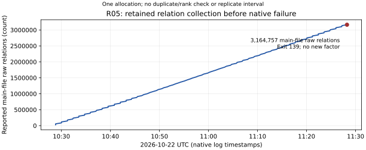

# R05 completion and FactorDB cross-check

The single local R05 allocation ended with exit 139 at 2026-10-22 11:28:15
UTC after reporting 3,164,757 main-file raw relations. Stderr records a
segmentation fault in the native command chain. The exact failing component
and cause remain unknown. No outer-timeout signal was logged; no proper
factor hint was returned. This is an execution failure with retained state,
not a completed factorization or a valid negative factor search.

A subsequent [separate native timeout diagnostic](../../../../native-timeout-diagnostic-20261023/README.md)
reproduces original exit 139 versus patched exit 0 and validates a two-line
printf correction. Its original executable hash matches R05. This identifies
a reproducible failure mechanism; it does not supply a production backtrace
or change the arithmetic result. These bounded controls are outside R05.



Recorded native counters against UTC log timestamps, one allocation;
no replicate spread or uncertainty interval. The [plot data](sieving-progress.json)
come directly from the retained factor log. The final main-file line count
independently matches 3,164,757. A separate 32,684-line worker file is
preserved and excluded from this curve. Neither count has undergone
independent duplicate removal or usable-rank analysis. No throughput,
completion-time estimate or performance comparison is made.

## Exact input and execution

Target: skipped_256_876-twist2, the 512-bit degree-2 extension-twist order
of the exact imported P-256 block-876 model. With t=p+1-n its order is
(p-1)^2+t^2. The still-composite 444-bit residual is

```
33492266050798185653682380062483799213318454801653963493134064721059735936944520907295931496614455858076048437184499090478420204888353
```

Production began at 10:27:42 UTC on October 22. Pinned YAFU
c7d90283972820f99b3b4920bfc1eff05c1f6342 used native lattice sievers, two
threads, seed 20261022 and -gnfs -xover 81 -pbatch 120. Limits: native
3600 seconds, outer 3660 seconds plus 30-second kill grace, 4 GiB virtual
memory per native process, and a launcher-applied 1 GiB maximum per output
file. Host allocation: four CPUs, 16 GiB RAM, L0 shared environment. Limits
are not a failure diagnosis. The configured 46,000,000-relation target was
not reached and is no guarantee of sufficient usable relations.

Twelve native source blobs matched immutable commit
d60b1d54650af216009dee360f6822dfe5457df8 before compute. An initial source
export failed before compute; a small known-input receipt control passed.
Earlier genuine-GNFS known-answer/resume and wrong-input controls remain
prerequisites. Exact commands, source/binary/siever hashes, limits, failures,
stdout/stderr, range ledger, relations and observer-retained outputs are in
the full raw archive identified by its [manifest](../../archive-manifest.json).
The original interim report remains unchanged as a dated observation.

## Arithmetic and portable evidence

Native failure stopped automatic refinement. Finalization on October 23
explicitly refined with the empty hint file, regenerated three prime
certificates, and independently replayed the whole target. Its partition
remains 1657 times 45294121 times 5333949541 times the composite above.
Both native polynomial formats pass fresh exact input/common-root checks.
A saved-candidate reader first rejected an extra informational comment;
that failure is retained. A separately framed reader input omitting only
that comment passed; the native job was preserved unchanged.

All nine original partitions and their prime certificates also pass a
fresh replay against the hexadecimal models. The existing nine Lean
theorems prove exact products over Nat; native PARI certificates separately
prove primality. No new algebraic result is claimed. The
[archive validation](../../archive-validation.json) records checksum,
canonical repack and fresh portable restore/replay checks. These establish
retained bytes and arithmetic portability, not successful native resume or
validity/rank of the collected relations.

## FactorDB: no additional factors

The [API snapshot](../../../../factordb-20261023/README.md) covers all nine
exact timeout targets and the residual. Original-target requests ran from
00:59:23 to 00:59:32 UTC on October 23; the residual's HTTP date is
00:57:58 UTC. The web reader could not access the initial URLs; direct
HTTPS GET requests to the same public API succeeded. Raw responses, headers,
timestamps and curl statuses are retained.

| Observation | Count or result |
|---|---|
| Original targets queried | 9 |
| Additional residual query | 1 |
| FactorDB original targets fully factored (FF) | 1 |
| Local original targets fully prime-certified | 8 |
| Original targets more completely factored locally | 7 |
| Original partitions matching FactorDB | 2 |
| Remaining 444-bit residual | C; no proper factor returned |
| Additional factor information from FactorDB | none |

Native PARI verifies all ten API products and that every returned partition
is a grouping of whole local pieces. A deliberately wrong integer fails
both product checks. API statuses do not replace prime certificates.
No factor submission, novelty or priority claim is made.

## Requirements and remaining work

The original timeout supplement remains partial: eight of nine integers
and thirteen of fourteen timeout-valued fields are resolved. The remaining
prime factorization is open. The completed R05 allocation, failed native
status, relations and post-failure replay are recorded. No factorization
worker is running at finalization. No later production factorization
allocation was launched; the separate timeout controls are reported above.
The archive manifest states actual publication status. The required S3
store has no configured runtime AWS identity; no remote object or store
entry is claimed. Mathematical certificates and checkpoint metadata are
individually reviewable in Git.

Next use a separately bounded continuation with the binary-bound checked
resume wrapper and the validated native correction. Retain the separate
worker file until its safe merge semantics and duplicates are checked.
Completion requires exact division, recursive prime certification and
whole-target replay. The later distributed card is draft/unqueued; no
later production allocation or paid machine was launched. Conductor was unavailable:
the required check failed with command not found before repository edits.

Historical generators, upstream defects, historical skip reasons and the
fresh 23-job batch remain unresolved or unrun as previously recorded.
No smallest-prime-factor bound or security conclusion follows. Existing IC
scoreboards, timelines, factor-size graphs and performance figures have no
changed mathematical result and remain unchanged. The new progress figure
records the finalized operational evidence.
