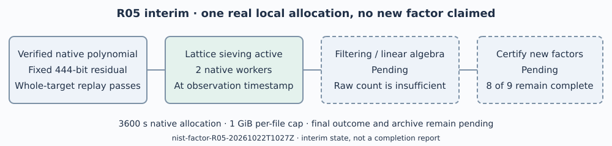

# R05 interim: native P-256 sieving has started

This is an interim observation of `nist-factor-R05-20261022T1027Z`.
The exact observation time, native raw relation count, source commit and
worker PID are in [OBSERVATION.json](../../OBSERVATION.json). The process
was running when observed. This report makes no assertion about its state
after that timestamp and claims no new factor.

One fixed 444-bit cofactor is being processed, so this interim report uses
a phase diagram instead of a comparison graph. Native relation counts
are operational raw counts, not independently deduplicated relations or
proof of enough rank. No sampling interval or runtime estimate applies.

The target is `skipped_256_876-twist2`, a 512-bit whole order whose literal
residual is fixed in the [protocol](../../PROTOCOL.md). R04's selected
native polynomial passes exact input/common-root checks in both formats,
and the whole-target prime/product replay passes. The current arithmetic
result remains eight of nine targets fully factored, resolving thirteen
of fourteen original DiSSECT timeout fields.

Pinned YAFU c7d90283972820f99b3b4920bfc1eff05c1f6342 uses its native lattice
sievers, two workers, seed 20261022, `-gnfs -xover 81 -pbatch 120`, native
3600-second limit, outer 3660 seconds plus 30 seconds kill grace, 4 GiB
virtual-memory cap per native process and a launcher-applied 1 GiB maximum
output per file. The file cap may stop collection before the configured
46,000,000-relation target. This is a bounded continuation, not a promise
to finish factorization here. The host has four CPUs and 16 GiB RAM, L0.
No speed or security conclusion follows; no paid or remote machine runs.

The initial source archive export failed on missing promisor objects before
search. Twelve required native source files were instead copied and every
blob hash matched the frozen commit, isolating the running worker from
later branch edits. A one-second small-input control validates the version-2
receipt writer; it is not a genuine-GNFS coverage claim. Earlier genuine
GNFS known-answer/resume controls and fixed-input rejection checks remain
the method prerequisites. All setup errors and control records are retained.

The live raw tree preserves commands, inputs, hashes, checkpoints, relation
data, stdout/stderr and attempt history. A native event observer retains
outputs across cleanup. The final raw archive, exact status, independent
factor/prime/product replay and final report are pending until termination.
They are not represented as completed by this interim document.

Historical generators, upstream trait defects, historical skip reasons and
the remaining prime factorization stay unresolved. The linked R02 product
proofs establish the existing partitions only. Existing IC scoreboards,
timelines and performance figures have no affected result and remain unchanged.
