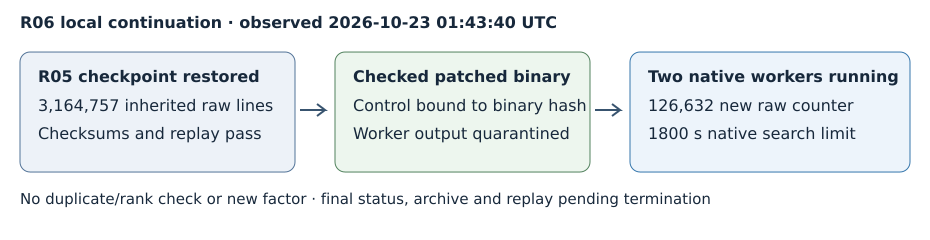

# R06 interim: patched NFS resumes saved relations

At 2026-10-23 01:43:40 UTC, native PID 3070 and two lattice-sieving workers
were running on the exact skipped_256_876-twist2 cofactor. The
[observation](../../OBSERVATION.json) records process state, command, source
commit and native counters. This is a dated live observation, not a claim
that a bounded process remains running indefinitely. No new factor is claimed.

The phase diagram describes one allocation. Inherited main-file lines and
new per-allocation native counters have different scopes, so no comparative
chart, throughput or completion-time estimate is given. Counts are raw;
independent duplicate removal, validity/rank checking and completed NFS
filtering/linear algebra remain unperformed.

## Exact state and controls

R05's checksum-bound archive restores 3,164,757 main-file raw-relation lines,
the range ledger and selected native polynomial. All named checkpoint
checksums and an independent whole-target prime/product replay pass before
compute. The still-composite residual has 444 bits. The whole 512-bit
extension-twist order, reconstructed from the original hexadecimal model,
retains the same certified partial partition as R05.

The checked wrapper installs the exact patched native binary validated by
original-versus-patched controls: original exit 139, corrected exit 0.
Its hash and control summary are retained. All 14 copied runtime source
blobs match immutable commit b08dc783f5ba6c3ef821218ff772fe16cc28cee1.
No later branch edits can change this running source snapshot.

The inherited separate worker file, 32,684 lines, is preserved byte-for-byte
in a quarantine directory outside the active state. Native range selection
starts at the missing Q gap 2925000 rather than silently counting that file.
At observation the native log records 126,632 relations for this allocation
only, excluding inherited main-file relations, against its request for
42,835,243. A native configured target and log ETA are not admitted as a
sufficiency guarantee or completion-time estimate.

## Bounds and pending final evidence

Launcher start: 01:39:33 UTC; native sieve start: 01:40:04 UTC on October 23.
Pinned native sievers and patched YAFU use two workers, seed 20261022,
-gnfs -xover 81 -pbatch 120. Limits are native 1800 seconds, outer 1860
seconds plus 30-second kill grace, 4 GiB virtual memory per native process,
and 1 GiB per output file; core dumps are disabled. Host: four CPUs,
16 GiB RAM, L0 shared environment. The [protocol](../../PROTOCOL.md) was
written before production. Raw commands, source hashes, pre-resume state,
executable replacement/control provenance and native output are retained
under /workspace/nist-factor-R06-20261023.

Stop on a certified result, execution failure or configured bound. Final
status, full deterministic raw archive, post-run independent replay and
completion report remain pending until this worker terminates. Current
arithmetic remains eight of nine integers complete and thirteen of fourteen
timeout fields resolved. Existing product theorems and PARI certificates
apply unchanged; no new algebraic result, security claim or performance
comparison is made.

No paid or remote machine, lease or task was launched. The separate later
distributed card remains draft/unqueued. The prior required S3 publication
gap remains open, while this local allocation uses the existing verified
archive. Historical skip reasons, generators, upstream trait defects and
the unrun fresh 23-job batch remain as previously recorded. Existing IC,
mathematical factor-size and performance figures have no changed result;
the new diagram records this continuation's actual execution state.
