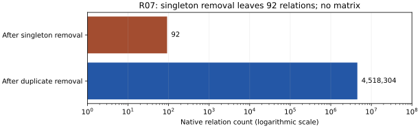

# R07: filter completes, more sieve relations needed

The native filtering diagnostic completed with exit 0 on an independent
copy of R06's 4,592,399 raw relation lines. It retained 4,518,304 unique
relations, including generated free relations, but four singleton passes
left only 92. No matrix prerequisite or factor was produced. The native
controller requested more data. This is a completed filtering result for
this dataset and configuration, not a mathematical impossibility result.

The graph uses a logarithmic relation-count axis to show both recorded
counts. One native filter, no replicate or uncertainty interval; no speed
or rank comparison is claimed. The [data](stages.json) come from the native
filter log. Unique relations include free relations, so their scope differs
from R06's count of lattice-sieved raw lines.

## Actual execution and preserved first failure

Target: the same skipped_256_876-twist2 444-bit residual and selected native
polynomial. The validated patched executable, input and polynomial hashes
match R06. The first command misspelled the dispatch option and returned
help before filtering; its zero exit alone was not success. Its complete
output and source are retained. The [written correction](../../PROTOCOL-correction.md)
changes the spelling to -minrels 1 in a fresh independent output directory.
It does not weaken any arithmetic or elimination condition.

The corrected command uses filtering only (-nc1), two threads, seed
20261025, native 300-second limit, outer 360 seconds plus 15-second kill
grace, 4 GiB address space and 1 GiB per output file; core dumps are disabled.
Host allocation: four CPUs and 16 GiB RAM, L0 shared host. Setting the
collection scheduling gate to one merely enters the native filter on the
existing data. No lattice siever, linear algebra or square-root stage is
selected. The [protocol](../../PROTOCOL.md) and both command/source records
are retained. The actual corrected native filtering log spans October 25
05:12:19 to 05:13:44 UTC; no timing ratio or completion estimate is inferred.

## Recorded filter outcome and integrity

| Native observation | Count |
|---|---|
| Original lattice-sieved raw lines supplied | 4,592,399 |
| Composite-factor rows rejected | 1 |
| Valid original rows read | 4,592,398 |
| Free relations appended | 78,556 |
| Duplicates removed | 152,650 |
| Unique relations, including free | 4,518,304 |
| Tracked large ideals before singleton removal | 10,585,421 |
| Singleton passes | 4 |
| Surviving relations | 92 |
| Surviving tracked large ideals | 0 |

The large-ideal cutoff was 100000 and native target excess 23665. The
source log records the filter's return to the request for more relations.
No matrix prerequisite file was generated. The non-prime-factor warning
belongs to the single rejected row; filtering continued afterward.

R06's original relation file retains SHA-256
1c4926cfcb63c8821ef209ebad4d3b0562980f73807574a8e32b3201430cced9.
The corrected copy preserves that exact prefix and appends free relations;
its changed whole-file hash is expected and recorded. It has 4,670,955
lines afterward. The original checkpoint was not modified. Full raw output,
including the intermediate large-ideal file and both attempts, is retained
locally under the archive manifest pending required artifact-store setup.

## Requirement status

The diagnostic is complete; prime factorization remains partial at eight
of nine integers and thirteen of fourteen timeout fields. The cofactor is
still composite. Existing product proofs and PARI certificates remain
applicable; no new algebraic theorem or historical skip explanation follows.
The next collection must use the original R06 state and preserve its range
ledger. More raw rows are needed by this native configuration, with no
proved smallest-factor bound or promised completion time. Existing IC,
mathematical and performance graphs remain unchanged because their results
did not change. This report adds the native filtering-stage count graph.
