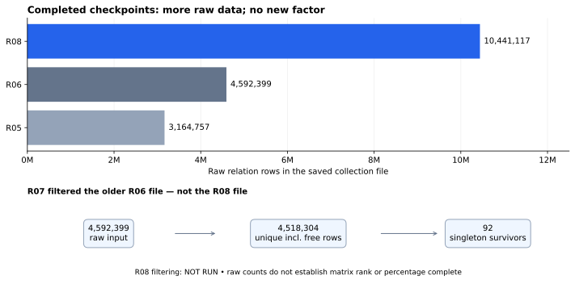

# What the NIST factoring numbers mean

R08 finished at 2026-10-25 07:52:38 UTC. It collected more raw data and
found no new factor. No factoring process is currently running. The next
experiment is defined separately for later execution.

## The answer so far

| Number | What is counted | What it establishes |
|---|---|---|
| 4 skipped curves | P-224 candidates 777, 1485 and 5736; P-256 candidate 876 | The original curve population, not the number of factoring targets |
| 9 target integers | Distinct integers behind the imported DiSSECT factorization timeouts, including published control curves | 8 have complete prime-certified factorizations |
| 14 timeout fields | Report fields that sometimes request the same integer | 13 are resolved; this is a different denominator from 9 |
| 444 bits | Size of the remaining composite cofactor | One unresolved integer; not a security level or a runtime prediction |

The outstanding target is `skipped_256_876-twist2`: a 512-bit degree-2
extension-twist order associated with P-256 candidate 876. It is not the
256-bit base-field curve order or its base-field quadratic-twist order.
Its certified partition remains 1657 × 45294121 × 5333949541 × C, where
C is the exact 444-bit composite in the [result](../../result.json).
The [factorization scope](../../../../README.md) explains the imported
timeout fields. Resolving these arithmetic fields does not establish why
a seed was historically skipped.

## What the relation counts mean

A raw NFS relation is a recorded arithmetic relation produced by sieving.
It is input to later processing. Rows can repeat, fail an integrity check,
or fail to combine into the dependencies needed for linear algebra. More
raw rows are more collected data; they are not discovered prime factors.

| Collection checkpoint | Raw lines in its main relation file |
|---|---:|
| R05 | 3,164,757 |
| R06 | 4,592,399 |
| R08 | 10,441,117 |

For R08, **4,592,399 inherited + 5,848,718 newly collected = 10,441,117
raw lines**. The native log counts only the new allocation; `wc -l` counts
the complete saved file. Both are correct and have different scopes.
The inherited prefix has the same SHA-256 as R06's original file. The
final file is 919,799,315 bytes, SHA-256
`62106d7ae9e828ff433d019ba471cf743552b608421e889cd83f6af0296f20b0`.

The native request was 41,407,601 additional relations, corresponding to
a configured total of 46,000,000 after the inherited file. That is the
tool's collection request. It is not a verified matrix threshold or a
percentage-complete denominator. The native ETA is not admitted as a
factoring completion estimate.

## Why 4.59 million rows previously became only 92

R07 filtered an independent copy of R06, before R08 collected its extra
data. Its [native log](../../../R07-20261025/native-filter.log) records:

| Stage | Recorded count | Meaning |
|---|---:|---|
| Raw input | 4,592,399 | Original collected rows |
| Rejected rows | 1 | A row with composite factors was discarded; filtering continued |
| Free relations added | 78,556 | Extra relations generated by the filter, not extra sieving |
| Duplicates removed | 152,650 | Repeated relations removed |
| Unique relations | 4,518,304 | 4,592,399 − 1 + 78,556 − 152,650 |
| Tracked large ideals before singleton removal | 10,585,421 | Several ideals may occur in one relation; these are not distinct integer factors |
| Relations left after singleton removal | 92 | Four pruning passes; no matrix prerequisite was produced |

An ideal appearing in only one remaining relation cannot cancel in a
dependency. Removing its relation can expose another singleton, so
pruning cascades. Here the filter tracked ideals above its cutoff of
100,000 and ended with 0 tracked large ideals. That does not mean the
entire integer factorization was solved. The native controller requested
more relations; rank and a usable matrix were not established.

**The 92 count applies to the older 4.59-million-row input. The newer
10.44-million-row checkpoint has not been filtered.** Applying the old
survival fraction to the new file would be an unsupported extrapolation.

## Execution, verification and provenance

One R08 allocation was planned, attempted and completed; none was excluded.
The frozen [R08 protocol](../../PROTOCOL.md) and
[actual command](../../evidence/command.txt) bind the input, seed 20261022,
two workers, native 7200-second budget, outer 7260 seconds plus 30-second
kill grace, 4 GiB virtual memory per process and 1 GiB per output file.
The native sieve began at 05:52:08 UTC and reported its limit after
7229.9807 seconds while outstanding worker work stopped. The supervisor
returned exit 0; the outer process timeout did not fire. This is a normal
budget stop, not factoring completion.

This was an L0 shared local host. UTC timestamps and native elapsed output
are provenance, not comparative timing evidence. Runtime source was
blob-checked against commit 5cb553810e5bbfbd8691ec614ffcaacefc625757.
Patched YAFU SHA-256 is
`bc7680adbdd7450a68120e73ef8aa88d0336c8ffa141343f50966c595ca6bae9`;
the earlier binary-bound timeout controls remain applicable.

The post-run native verifier and a fresh replay on October 26 confirm the
whole target, exact product and retained prime certificates. A partial
partition is not a complete prime factorization. Existing Lean partition
identities remain unchanged; no new algebraic identity is claimed.
The [October 26 FactorDB response](../../factordb-20261026/cofactor.json)
still lists C with no proper split.

Small logs, receipts, certificates, checksums and the result are committed.
The [bulk manifest](../../archive-manifest.json) identifies the full local
archive; its remote publication is blocked by the existing
[artifact-access problem](../../../../../../../problems/nist-factorization-raw-archive-publication.md).
No remote object or successful upload is asserted. A second-runner review
of this completion record has not been performed.

## The experiment submitted for later execution

[XP-20261026-nist-p256-checkpoint-filter](../../../../../../../backlog/XP-20261026-nist-p256-checkpoint-filter/README.md)
uses the repository's backlog, frozen `experiment.protocol/v1` record and
draft `crypto.experiment/v1` tracker. It first replays R06's known filtering
counts, then runs the same filter on a separate R08 copy. Neither source
checkpoint is modified. Its 600-second native and 660-second outer limits
apply equally to both arms. It stops before new sieving or linear algebra.

The result will distinguish a completed native request for more relations,
new matrix prerequisites requiring review, and an incomplete execution.
It will preserve every status and return a unified `experiment.export/v1`;
it will not translate raw counts into a security or historical-selection
claim. The card is blocked until the input artifacts and execution setup
are available. No new experiment has been executed or queued by this PR.

## Sources and graph scope

Reviewed primary implementation sources: YAFU c7d90283972820f99b3b4920bfc1eff05c1f6342,
`factor/nfs/nfs_postproc.c` (native filtering), `factor/nfs/nfs.c`
(controller response), and `gnfs/filter/{filter,duplicate,singleton}.c`.
The [upstream source](https://github.com/bbuhrow/yafu/tree/c7d90283972820f99b3b4920bfc1eff05c1f6342)
and retained R07 logs explain why collection, filtering and matrix
readiness are separate stages. No new factoring method is proposed.
The current [backlog protocol](../../../../../../../backlog/README.md),
[queue design](../../../../../../../taskq/deploy/spot-checkpoint/README.md),
and canonical [experiment protocol](https://github.com/aburan28/crypto-autoresearcher/blob/6a69b2d02ecd53f1649bcf56e23e4ffe91d953ad/docs/experiment-protocol.md)
define the prospective submission.

The new graph plots recorded counts, one completed checkpoint per bar,
without a timing interval or performance ratio. Prior R05/R06/R07/R08
interim graphs stay as dated history. IC leaderboards and curve/isogeny
graphs are unchanged: no cost comparison, new curve relation, security
finding or explanation of the skipped seeds was established.
