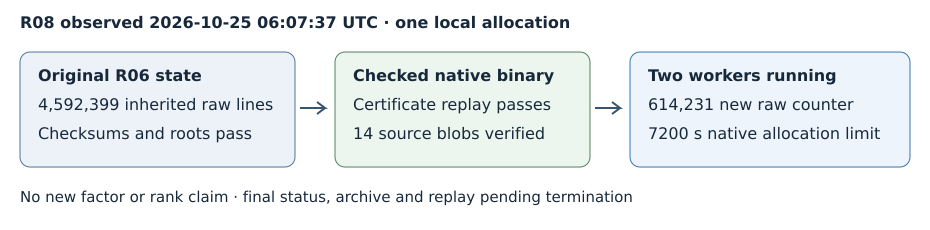

# R08 interim: longer local collection is running

At 2026-10-25 06:07:37 UTC, native PID 9409 and two lattice-sieving workers
were running. The [observation](../../OBSERVATION.json) records the actual
command and process state. It reports 614,231 raw relations for this
allocation only, excluding the inherited 4,592,399 lines. This is a dated
observation, not a claim that the bounded worker remains alive indefinitely.

The diagram describes one allocation. Inherited main-file lines and new
per-allocation counters have different scopes; no comparative throughput,
rank or completion-time estimate is given. The current configured request
for 41,407,601 relations is not a sufficiency guarantee.

R07 completed filtering of the prior dataset and left 92 singleton
survivors with no matrix prerequisite. R08 therefore continues R06's
original state, not the filter-modified copy with appended free relations.
The input relation SHA-256 remains
1c4926cfcb63c8821ef209ebad4d3b0562980f73807574a8e32b3201430cced9.
The range ledger and both native polynomial formats match the predecessor.
The quarantined old worker output stays outside active state.

The exact skipped_256_876-twist2 residual remains the same 444-bit integer
bound by the [protocol](../../PROTOCOL.md). Fresh baseline certification
and a separate whole-target prime/product replay pass. Fourteen copied
runtime source blobs match immutable commit
5cb553810e5bbfbd8691ec614ffcaacefc625757. The validated patched executable
matches its binary-bound native timeout control. Subsequent branch edits
cannot alter this running source snapshot.

Production launched at 05:51:25 UTC; native sieving began at 05:52:08 UTC
on October 25. Two workers use seed 20261022, -gnfs -xover 81 -pbatch 120,
native limit 7200 seconds, outer 7260 seconds plus 30-second kill grace,
4 GiB virtual memory per native process, and 1 GiB per output file, with
core dumps disabled. Host allocation is four CPUs and 16 GiB RAM, L0.
At least 1 GiB free disk was required after state preparation. No R07
filter-dispatch override is applied to production.

Stop on a certified result, native failure or configured bound. Exact
commands, source hashes, pre-resume state, output and statuses are retained
under /workspace/nist-factor-R08-20261025. Final status, full archive,
post-run replay and completion report remain pending until termination.
No new factor is claimed; eight of nine timeout integers and thirteen of
fourteen fields remain resolved. Existing product proofs and certificates
apply unchanged. No paid/remote machine, lease or task was launched; the
distributed card remains draft/unqueued. Existing mathematical and IC
performance figures have no changed conclusion and remain unchanged.
