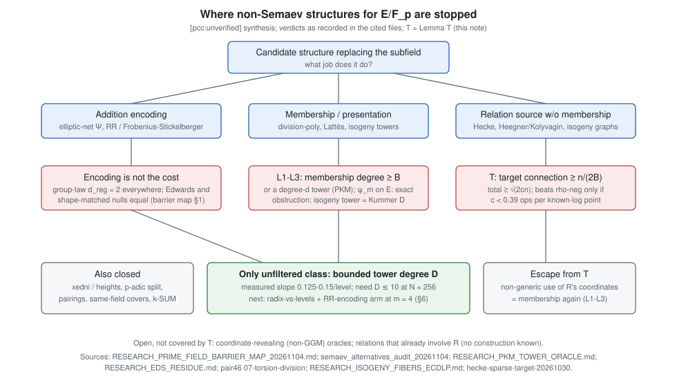

# Non-Semaev decompositions for prime-field ECDLP: elliptic nets, division polynomials, isogeny relations

**Date.** 2026-11-13. **Type.** Search round and analysis (no experiment run).
**Standing.** Every new statement here is an unverified assertion,
**[pcc:unverified]**: no pcc claim is filed. Quoted results keep the standing
their source files give them, which is mostly `[pcc:unverified]`, toy-scale and
single-run.

## Question

The user's question was whether a decomposition for `E/F_p` that does not use
Semaev summation polynomials could work. In it, some algebraic structure (elliptic
nets, division-polynomial structure, or isogeny-based relations) would take the
place of the subfield that Weil descent uses over `F_{q^n}`. The user
called it speculative, with no supporting evidence yet.

## Result

1. **All three suggested structures have already been tried in this lab and closed
   at the exponent level.** The map (§2) gives the paths and the failure mechanisms.
   - Elliptic nets reduce to the rank-1 EDS, which Lauter–Stange show is equivalent to ECDLP.
   - Division polynomials are closed by an exact obstruction: prime order makes `E(F_p)[m] = {O}`, and `[m]` is an automorphism.
   - Isogenies are closed for three reasons:
     - the isogeny-fibre programme's Thm 15.1 says they add nothing in the GGM;
     - the pullback of `S_3` is a product of kernel-twisted `S_3`;
     - the PKM isogeny tower costs 1.00–1.33× a plain base of equal size.
2. **A non-Semaev decomposition has two independent parts** (§3):
   - a *relation source*: an encoding of addition, or an algebraic correspondence;
   - a way to *attach the target*: membership of the target's parts in the factor base.

   The barrier map (`research/notes/ecdlp-general/RESEARCH_PRIME_FIELD_BARRIER_MAP_20261104.md`)
   already shows that changing the addition encoding does not move the cost, and
   that membership is blocked (L1–L3, archimedean, p-adic, height).
3. **New here: Lemma T, the target-connection bound** (§4). It covers every relation
   source that avoids membership:
   - Hecke correspondences;
   - Heegner/Kolyvagin norm relations;
   - isogeny-graph identities;
   - elliptic-net identities.

   All of these give relations *among factor-base points*, so at best a factor
   base with known logs. Attaching a target generically then costs at least `n/(2B)`
   group operations, so the total is at least `c·B + n/(2B) ≥ √(2cn)`.
   - **Exponent.** It stays at `1/2` whatever the relations cost.
   - **Constant.** Negation-rho (`≈ 0.886√n`) is beaten only if a known-log base point costs `c < 0.39` group operations, including its share of the linear algebra.
   - **Linear algebra.** Unstructured linear algebra alone pushes the cost to `n^{2/3}`.

   This closes the one live thread in the "isogeny-based relations" direction
   (Hecke/CM class points, recorded as "open, not promising, unpriced") at the
   exponent level, before any pricing.
4. **What survives** (§5). Only one proposal class passes every filter: an algebraic
   solver whose working degree stays bounded on a membership tower. The elliptic-net
   idea's surviving form is the Riemann–Roch (Frobenius–Stickelberger) addition encoding on such a tower.
   - It was stage-level positive at `m = 3`.
   - It is undecided at `m = 5`.
   - It is a constant-level lever unless the tower degree flattens.

   §6 gives the cheapest discriminating next step.

## 1. Sources checked

- **research-kb.** Not available in this session: the MCP server was not connected, and
  the `scripts/research-kb` CLI needs a `crypto-autoresearcher` virtualenv that is
  not on this host. No `source_id` can be recorded. This search used the files below.
- **Lead atlas.** `crypto-autoresearcher` was cloned read-only and sparsely, at
  `knowledge/leads/ecdlp/`. Every record there is vault-encrypted (`VLT1` header) and
  unreadable here. Its content was taken from the plaintext copies
  `crypto:research/prime_field_lead_assessment_20261107/atlas_survey.md` and
  `crypto:research/lead_sweep_20261110/*/RESULT.md`.
- **Read in full or in the relevant sections:**
  - `crypto:research/notes/ecdlp-general/RESEARCH_PRIME_FIELD_BARRIER_MAP_20261104.md` (§§0–2, 5, 6)
  - `crypto:research/semaev_alternatives_audit_20261104/REPORT.md` (§3 gate, §9 disposition)
  - `crypto:research/notes/index-calculus/RESEARCH_PKM_TOWER_ORACLE.md` (status block)
  - `crypto:src/cryptanalysis/f4_fp_tower.rs` (header: Kummer, Dickson and 2-isogeny tower rules)
  - `crypto:research/lead_sweep_20261110/LEAD-EXO-lattes-xline-dynamics/RESULT.md`
  - `cryptanalysis:experiments/hecke-sparse-target-20261030/{RESULT,PAIR_REUSE_RESULT}.md`
  - `crypto:research/prime_field_lead_assessment_20261107/crypto_survey.md`
- **Sweep.** A read-only sweep of both repositories by a delegated agent found
  the files in §2. Its file:line citations are reproduced there. The paths were checked
  for existence; the quoted numbers were not re-derived.

## 2. Prior work on the three suggested structures (and neighbours)

| structure | path | recorded verdict | mechanism of failure |
|---|---|---|---|
| EDS / elliptic net, residue χ, 2-D net | `crypto:research/notes/cm-isogeny/RESEARCH_EDS_RESIDUE.md` (:278, :391, :430, :726) | falsified for sub-√m | "information-rich yet algorithmically inert"; for `Q=[k]P` the rank-2 net is a reparametrisation of the rank-1 EDS; Lauter–Stange equivalence |
| net / Somos sieve, short annihilator | `crypto:research/lead_sweep_20261110/LEAD-EXO-elliptic-net-eds/RESULT.md:11`; P1540 audit in `research/torsion_division_derivative_20261031/PROTOCOL.md` | falsified at toy scale | sieve is Θ(N) charged operations (sieve/BSGS 24.2→134.7); the QRT state is birationally conjugate to translation |
| ψ_m torsion, level-set and preimage bases | `crypto:research/pair46_factor_bases_20261015/07-torsion-division/RESULTS.md:5` | exact obstruction | `E(F_p)[m]={O}` for prime order; `[m]` is an automorphism, so the coverage change is exactly 0; membership degree `m²·|S|` |
| division-derivative parity oracle (H109) | `crypto:research/torsion_division_derivative_20261031/` | falsified for the frozen family (0/28 exact formulas) | no compact phase; character support ≈ group size |
| FGHR 2-/4-torsion symmetrisation | `crypto:research/prime_s5_small_root_leads_20261028/README.md:545` | closed | needs rational 2-torsion, which prime order excludes |
| isogeny fibres, pullback, transport | `crypto:RESEARCH_ISOGENY_FIBERS_ECDLP.md` (Thm 4.2; Thm 15.1 at :1472) | constants only | pullback of `S_3^{E_2}` = product of kernel-twisted `S_3^{E_1}`; GGM adds nothing; rational kernel trivial for prime order |
| isogeny-class yield, conductor gaps | `crypto:research/isogeny_class_ic_yield_20261102/`; `drastic_prime_conductor_gap_20261012/` | null | cost is a class invariant (ratios 1 ± 3.85e-5) |
| PKM 2-isogeny (Vélu) tower base | `crypto:research/pkm_isogeny_tower_ecbench_20261015/`; `RESEARCH_PKM_TOWER_ORACLE.md` | falsified as a gain | 1.00–1.33× a plain base of equal size, 18–136× rho; same F4 degree `D` as Kummer and as the shape-matched null |
| Vélu-invariant / Q-curve bases | `crypto:research/notes/index-calculus/RESEARCH_GLV_INVARIANT_FACTOR_BASES.md:195` | falsified | an invariant base is empty or all of `⟨G⟩` |
| isogeny + genus-2 cover transfer | `crypto:research/chained_prime_transfer_20261111/RESULTS.md:36` | falsified | same-field Jacobian order `N·Θ(N^{g−1})` |
| Hecke / CM class-point relations | `cryptanalysis:experiments/hecke-sparse-target-20261030/PAIR_REUSE_RESULT.md` | open, not promising, unpriced | DLP curve is `E11 = X_0(11)`; generic pair reuse already closes 2 of 4 cells; target step BSGS-like. **Closed at the exponent level by Lemma T (§4).** |
| Nagao / Riemann–Roch on `F_p` | `crypto:research/split_prime_ecdlp_20261107/followups/p1_rr_dickson/RESULTS.md`; `research/prime_norm_rank_20261112/REPORT.md` | stage-positive at `m=3`, open at `m=5` | still needs a membership tower; linear relaxation refuted |
| xedni / global lift / p-adic | `crypto:research/jksst_xedni_audit_20261101/`; `lead_sweep/LEAD-TRF-kernel-of-reduction-lemma` | closed (conditional end-to-end) | height parallelogram; lift exponent α = 3 vs needed < 1/2; `E(Z/p²)` splits for `p ∤ N` |
| Miller / pairing cocycle | `crypto:research/lead_sweep_20261110/LEAD-EXO-miller-pairing-cocycle/RESULT.md:12` | falsified at toy scale | needs a small embedding degree |

## 3. Anatomy of any decomposition: relation source × target attachment

Over `F_{q^n}` the subfield does two jobs. Over `F_p` one has to ask which of
the two a candidate structure replaces.

- **(a) A small set with a short presentation.** `F_q` has `q = p^{1/n}`-ish
  elements, and Frobenius makes `x^q = x` linear after descent. This gives
  membership with polylogarithmic presentation cost and *conjugate equations*
  (barrier map L2).
- **(b) Relations that involve the target.** The descended system contains
  `x_R`, so every solution is a decomposition of `R` (or of `aG+bR`).

Relation counts are not what the subfield supplies. Mean yield is
`C(B+m−1,m)/N` for *every* base (KN-FIND-007, 288/288 cells), so subfield bases are
random-like in their counts. The subfield's contribution is that solutions can
be *found*.

How the user's structures map onto (a) and (b):

| structure | what it can replace | blocked by |
|---|---|---|
| elliptic-net polynomial `Ψ_{(1,…,1)}` = Frobenius–Stickelberger / Riemann–Roch determinant | the *addition encoding* inside (a)+(b) | the encoding is not the cost (barrier map §1: group-law `d_reg = 2` everywhere; Edwards and shape-matched nulls equal); membership L1–L3 |
| division-polynomial towers (x-maps of `[2]` on an auxiliary `E'`, Lattès maps) | the *presentation* in (a) | already the PKM family; L3 ("no fourth presentation"); tower `D` slope |
| `[m]`, ψ_m on `E` itself | (a) | exact obstruction (prime order) |
| isogeny transport `E → E'` | relabelling only | Thm 4.2 / Thm 15.1 |
| Hecke / Heegner / Kolyvagin / isogeny-graph identities | a *relation source with no membership at all* | **Lemma T** (they do not supply (b)) |

## 4. Lemma T (target connection) [pcc:unverified, proof sketch]

**Setting.** `⟨G⟩` is cyclic of prime order `n`. Some procedure, generic or not,
outputs `B` group elements `Y_1, …, Y_B` with their logarithms `s_i = log_G Y_i`.
Its total cost is `C_base`, measured in group-operation equivalents and including any
linear algebra that turns relations into logs. The target `R` is then used only
through group operations: additions, comparisons of encodings, and so on.

**Claim.** Any such algorithm that outputs `log_G R` with constant probability
makes `q = Ω(min(√n, n/B))` group operations involving `R`. Hence the total cost
satisfies `C_base + q ≥ c·B + n/(2B) ≥ √(2cn)`, where `c = C_base/B`; the
`n/(2B)` uses the negation map.

**Sketch.**
1. In Shoup's generic group model, elements derived from `R` have the form
   `a·R + b·G` with known `(a, b)`.
2. A logarithm is learned only from a collision between two encodings whose
   formal labels differ. Either both involve `R`, or one involves `R` and the other
   is a known-log element (the `B` inputs and anything derived from them).
3. With `q` operations involving `R`, the probability of any such collision is at most
   `q(q + B + q')/n`, where `q'` counts the operations that do not involve `R`.
4. Constant success therefore needs `q ≳ n/(B + q)`, which gives `q ≳ min(√n, n/B)`.
5. Known-log inputs are exactly baby steps that were not paid for in group
   operations, so the bound is BSGS with free baby steps.
6. The negation map halves the giant-step count. Its usual form folds `±`.

**Consequences.**
- **Exponent.** For every relation source that produces relations among base points
  only, the exponent stays `1/2`. This includes Hecke correspondences on `X_0(N)`,
  Heegner points with Kolyvagin norm relations `Tr_{cℓ/c} y_{cℓ} = a_ℓ y_c`, isogeny-graph
  adjacency identities, and elliptic-net recurrences.
- **Constant.** `min_B (cB + n/(2B)) = √(2cn)`, against negation-rho `√(πn/4) ≈ 0.886√n`.
  A gain needs `c < π/8 ≈ 0.39`. One known-log base point must then cost less than
  0.39 group additions, including its share of the linear algebra, with `B ≈ √n` points stored.
- **Linear algebra.** Generic sparse linear algebra on `B` unknowns costs `≳ B²`, which
  forces `B ≲ n^{1/3}` and a total `≳ n^{2/3}`, worse than rho. Linear algebra in
  `O(B log B)` needs structured relations. Heegner points of a fixed discriminant are a
  torsor under `Cl(D)`. Hecke relations are then a Cayley-graph convolution,
  diagonalised by class-group characters. The log function is supported on the
  characters with `χ(𝔩) + χ(𝔩)^{-1} ≡ a_ℓ (mod n)` for every split `ℓ` used.
  That explains the few free logs left in the Hecke records (9–12, 45). Each free log is
  itself a DLP instance, which is the opposite of help.
- **The only escape is non-generic use of `R`.** That means using `R`'s coordinates to
  decompose it over the base, which is membership, and L1–L3 (barrier map §2) then apply.
  Multi-target amortisation stays inside the generic preprocessing bounds
  (Bernstein–Lange; Corrigan-Gibbs–Kogan).

**Not covered.**
- **Coordinate-revealing oracles.** These are not GGM-simulable, and their atlas lead is
  open (`LEAD-EXO-coordinate-revealing-oracles`).
- **Free relations that already involve `R`.** No construction of such relations is
  known, because `R` is arbitrary.
- **Rigour.** The sketch is the standard Shoup collision argument with extra known-log
  elements. It has not been formalised.

## 5. What survives

The barrier map's filter (§5) rejects at proposal time any prime-field idea that does
not name which of L1, L2/L3, k-SUM, p-adic splitting and height it evades. Lemma T adds
a sixth item: **(T) relations among base points only**. Every user-suggested structure
is caught by at least one item (§3 table). Three classes are not caught.

1. **Bounded working degree on a membership tower.** Is there an algebraic solver whose
   degree `D` stays bounded (at 256 bits, `D ≲ 10` at `N ≈ 256` under the quadratic cost
   model)?
   - Measured slope: 0.125–0.15 per tower level.
   - The k-SUM heuristic predicts `D ≳ 0.04·N + c`.
   - The decisive question is whether `D` flattens.
2. **The Riemann–Roch / net encoding on such a tower.** This is the elliptic-net
   direction's surviving form.
   - At `m = 3` it beat the chain system and traded against flat Semaev on width.
   - At `m = 5, t = 4` it is undecided: Spot interruptions killed every attempt, and the
     chain arm hit a 56 GiB cap at `D ≥ 9`.
   - The barrier map predicts it cannot move the exponent: the encoding is not the cost.
3. **Coordinate-revealing (non-generic) oracles.** Open; no construction is on file.

## 6. Recommended next step (not run)

Given the user's frame, the most discriminating cheap test is the barrier map's §6.1
**radix-vs-levels** discriminator, extended with an encoding arm.

- **Question.** At equal `|V|`, is the tower `D` governed by the number of levels or by
  `log₂|V|`? Does the Riemann–Roch encoding lower `D` relative to `S_{m+1}` on the same tower?
- **Build.**
  - `f4_fp_tower` supports only degree-2 steps (`SquareRule`; square-free `u128` masks).
  - A radix-3 arm needs a `CubeRule`, 2-bit exponents, and degree as an exponent sum
    (barrier map §6.1, checked against the code there).
  - The Riemann–Roch arm can reuse the `p1_rr_dickson` system builder.
- **Cells.** `m = 4` (the first arity where the gate `s < m − 3` can matter),
  `|V| ∈ {2^6, 2^12}`, 3 primes × 2 planted targets, with a shape-matched null per arm.
- **Pre-registered prediction (this note).** `D_RR = D_Semaev` and
  `D_radix3 ≥ D_radix2 + 1` at equal `|V|`.
- **Falsifiers.**
  - `D_RR ≤ D_Semaev − 1` at `|V| = 2^12` with matrix width not larger; or
  - `D_radix3 = D_radix2` with multiply-adds lower by ≥ 2×.

  Either result would be the first evidence that the presentation or the encoding moves
  the cost.
- **Route.** Per CLAUDE.md, x86 runs go to isolab-eks with a frozen task card, a resume
  checkpoint and a `bench.record`. The `m = 5` Riemann–Roch cell needs a non-preemptible
  or CRIU-resumable host.

## 7. Limits

- No new measurement was made.
- Lemma T is a proof sketch and is not formalised.
- The prior-work verdicts are those recorded in the cited files, mostly toy-scale and `[pcc:unverified]`.
- The lead atlas could not be read directly (it is encrypted here), and research-kb was
  unavailable. A later session with both should repeat the "not tried" checks in §2 before
  citing them.

