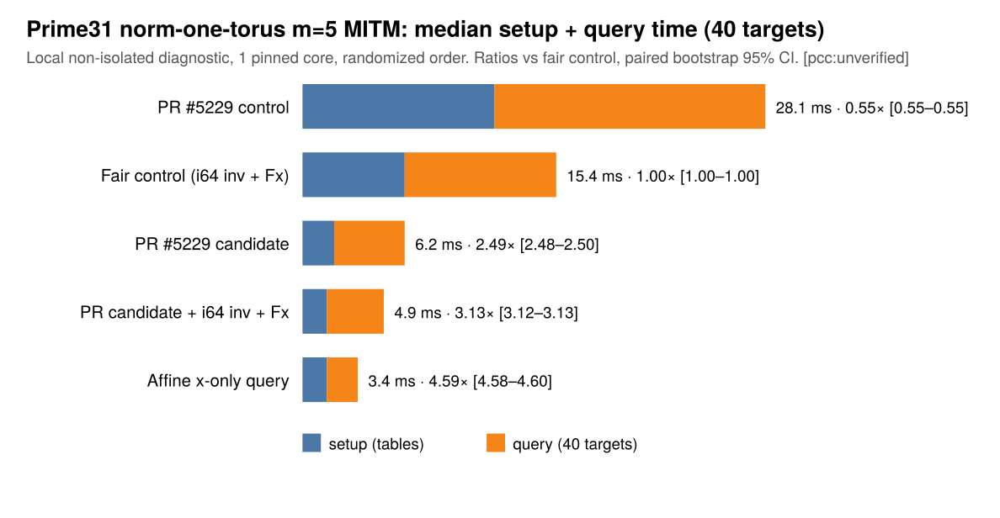

# Norm-one-torus m=5 MITM: fair-baseline ablation and an affine x-only query

Follow-up to merged PR #5229. All timings are local, non-isolated diagnostics
with no keyring signature and no matched rho reference. [pcc:unverified]

## Result

PR #5229 reported a 4.67× speedup for its batch + signed-quotient lane. That
ratio reproduces here (4.54× [4.52–4.55]). But its control used an i128
extended-Euclid inversion (159 ns, against 78 ns for the same algorithm in
native 64-bit words) and std SipHash. Fixing only those two gives the control a
1.82× gain. Against that **fair control**, the PR lane is **2.49× [2.48–2.50]**.

A new arm, the **affine x-only query**, brings the total to **4.59×
[4.58–4.60]** over the fair control (8.37× over the PR control), with the same
result digest and hit mask as the PR control.



| Arm | Setup ms | Query ms | Total ms | vs fair control (95% CI) |
| --- | ---: | ---: | ---: | ---: |
| PR #5229 control | 11.658 | 16.443 | 28.114 | 0.548× |
| Fair control: i64 inversion + Fx hash | 6.207 | 9.203 | 15.410 | 1.000× |
| PR #5229 candidate | 1.928 | 4.277 | 6.195 | 2.487× [2.476–2.497] |
| PR candidate + i64 inversion + Fx hash | 1.477 | 3.458 | 4.930 | 3.126× [3.123–3.131] |
| **Affine x-only query** | 1.476 | 1.874 | **3.358** | **4.589× [4.580–4.604]** |

Medians of 41 rounds on the public-precommit input (40 targets), after one
warm-up per arm, with order shuffled each round and the process pinned to one
core. Intervals are round-paired bootstrap, 2,000 resamples. Raw output:
[`runs/xonly.csv`](runs/xonly.csv).

## What each change buys

Each factor is measured with the other three fixed at their fair settings
(i64 inversion, Fx hash). Source: [`runs/ablate.csv`](runs/ablate.csv), all 24 arms.

| Factor | From → to (ms) | Gain |
| --- | --- | ---: |
| Batch normalization (quotient table) | 12.265 → 4.973 | 2.47× |
| Signed negation quotient (batch) | 6.604 → 4.973 | 1.33× |
| x-only affine query (batch + quotient) | 4.930 → 3.358 | 1.47× |
| i64 vs i128 inversion (individual, full, Fx) | 26.203 → 15.436 | 1.70× |
| Fx vs SipHash (individual, full, i64) | 17.365 → 15.436 | 1.12× |

Inversion and hashing matter only to the unbatched arms. Once inversions are
batched (2 in setup, 179 in query), all three inversion routines tie.

The x-only arm's gain over the best PR-style arm is a point estimate. Its CI is
not computed directly, but the two arms' fair-control intervals,
[3.123–3.131] and [4.580–4.604], do not overlap, so the frozen falsification
target (a CI including 1.0) is not met.

## The x-only query

The signed-quotient three-sum table is keyed by `x` alone. A query therefore
needs only `x(T − L)` for each two-sum `L`, not the whole point:

```
λ  = (−y_L − y_T) · (x_L − x_T)^−1       x_L − x_T batch-inverted per 512-block
x₃ = λ² − x_T − x_L                      lookup on x₃
y₃ = λ(x_T − x₃) − y_T                   only on a hit, to resolve the sign
```

Per two-sum, that costs about 3M for the batch inversion plus 1M and 1S,
against a mixed Jacobian add (7M + 4S) plus normalization (about 6M + 1S) in
the PR lane. Over the 40 queries, multiplications drop from 1,093,603 to
335,768 and squarings from 419,280 to 81,897. Query time halves (3.458 →
1.874 ms). Blocks where `x_L = x_T`, or where `T` is the identity, fall back to
the Jacobian path. `L = O` is handled as `T − O = T`.

## Correctness and fidelity

- **Fidelity to the library.** The root library cannot be type-checked on this
  7 GB host (rustc was killed at 6.2 GB RSS). The harness is therefore a
  standalone crate whose [`fixture.rs`](harness/src/fixture.rs) extracts the
  #5229 fixture contract. Before any timing, it reproduced all 36
  library-produced rows of `public-precommit/results.csv` (all eight op
  counters plus the result digest per row). It also reproduced all 40 retained
  certificates: target points, witnesses, result digest, and the manifest hash.
  See [`runs/fidelity.txt`](runs/fidelity.txt).
- **Recall.** On a fresh domain with 4,000 random and 64 planted targets, all
  25 arms return the identical hit mask, and every witness replays with the
  affine law. An independent affine 3+2 brute force finds 86 decomposable
  targets (22 random, 64 planted) and 0 mismatches. The 0.55% random hit rate
  fits the multiset count estimate C(72,5)/#E ≈ 0.65% (about 26 ± 5 expected).
  See [`runs/recall.txt`](runs/recall.txt).
- **Tests.** `cargo test --release` covers inversion agreement and every-arm
  mask equality on a synthetic fixture, including a planted witness with a
  repeated index and block sizes 1, 7, 512 and 4096.

## Boundary and limits

- This is a component measurement: generic 2+3 decomposition on a 68-point
  base at p = 2³¹ − 1, O(B³) setup and O(B²) query. No relation stream, linear
  algebra or logarithm is involved, and nothing here bears on the asymptotics.
  It does not enter the IC leaderboard: there is no matched rho reference and
  no replay or validator signature.
- The host has 2 vCPUs (Intel Xeon @ 2.30 GHz) and was not isolated. Absolute
  times differ from the #5229 producer host (Xeon Platinum 8573C). Ratios
  agree: 4.54× here against 4.67× there for the PR's own pair.
- Inversion costs about 35 multiplications at this field size, so batching
  gains less here than it would at cryptographic sizes. That scaling is
  unmeasured.
- Setup (1.48 ms) is now 44% of the total. Building the three-sum table level
  by level in affine coordinates, with batched inversion, is the next lever.

## Reproduce

```sh
cd research/norm_one_torus_ablation_20261127/harness
cargo test --release
cargo build --release
B=target/release/norm-one-torus-ablation
M=../../norm_one_torus_rust_mitm_20261126/public-precommit
$B --manifest $M/manifest.json fidelity --results-csv $M/results.csv --certificates $M/certificates.json
taskset -c 1 $B --manifest $M/manifest.json ablate --rounds 41
taskset -c 1 $B --manifest $M/manifest.json xonly --rounds 41 --svg headline.svg
$B --manifest $M/manifest.json recall
```

The protocol was frozen in [`PROTOCOL.md`](PROTOCOL.md) and pushed (commit
`43db3d46`) before the recorded runs. Host, binary and source hashes are in
[`runs/environment.txt`](runs/environment.txt).

## Sources

- PR #5229 report: [`research/norm_one_torus_rust_mitm_20261126/REPORT.md`](../norm_one_torus_rust_mitm_20261126/REPORT.md)
- PR #5229 solver: [`examples/norm_one_torus_mitm.rs`](../../examples/norm_one_torus_mitm.rs) (left byte-identical)
- Montgomery's simultaneous inversion and the negation map are standard. No
  novelty is claimed for either. The x-only lookup is a direct consequence of
  #5229's x-keyed quotient table.
