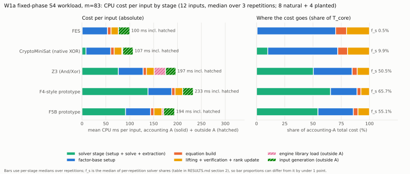
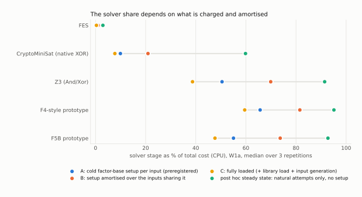
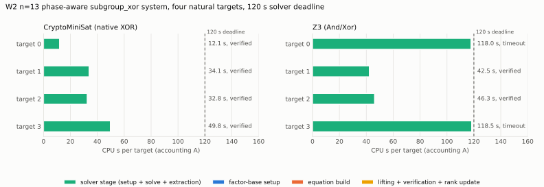

# Total verified-relation cost of FES, SAT, F4-style and F5B solvers (Lead 4)

Directory `research/notes/ecc2k130/solver_total_cost_20261011/`. Protocol:
[`PROTOCOL.md`](PROTOCOL.md), committed (`fdb7692f4`) before any frozen measurement. Base commit
`bbd330a9d` (origin/main as of 2026-10-11; it could not be refreshed afterwards). Every number in the
tables and sentences below is rendered from `results/summary.json` by `summarize.py`; `verify.py`
recomputes the summary from the raw receipts and checks that this file is exactly that rendering.

**This is a stage-composition diagnostic.** No discrete logarithm was recovered. A matched Pollard-rho
reference, `S = total_operations / sqrt(r)`, the ratio to the floor, any end-to-end speedup and any
ECC2K-130 transfer are **not measured and are left null**. Under `AGENTS.md` section 3 the work is
classified **accounting**: the algorithms did not change, only what is charged to them.



## 0. Requested deliverables and status

| requirement | status | evidence |
|:--|:--|:--|
| Read the m83 PROTOCOL/RESULTS and runners; preflight passes; record engines | verified complete | `results/preflight.json`: frozen `verify_archive.py` and `preflight_engines.py` pass on a scratch copy; `pycryptosat` {{w1_receipts/versions/pycryptosat}} and Z3 {{w1_receipts/versions/z3}} available; msolve, WDSat, Sage and the `cryptominisat5` CLI unavailable here |
| Protocol written and committed before measuring | verified complete | `PROTOCOL.md`, commit `fdb7692f4` |
| W1: every engine, every input, CPU and wall seconds per stage, planted rows charged but not counted | verified complete | `results/w1/receipts.jsonl` (360 children = 3 repetitions x 120 cells) |
| Primary metric: seconds per newly independent verified relation | **undefined for the measured workloads (0 natural relations)**; reported as cost per attempt, cost per verified planted relation, a measured 95% bound and a labelled derived bound (section 5) | table "cost per relation" |
| Solver-stage fraction of total | verified complete, with its sensitivity to accounting (sections 2-4) | tables, `figures/` |
| RESULTS.md, stacked-bar figure, PDF | complete; figures are SVG (+PNG); PDF rendered with Typst (`results/report_build.json`) | `figures/`, `report.pdf` |
| Verify script that recomputes the summary | verified complete | `verify.py`, `results/verify_report.json` |
| W2: n=13 CryptoMiniSat vs Z3, 120 s deadlines | verified complete: 8 children (4 targets x 2 engines); the two Z3 deadline timeouts are preserved and charged | `results/w2/receipts.jsonl` |
| Pull request | **not opened**: GitHub access was unavailable (raw git 403, API 404). Committed locally; body prepared | local branch |

## 1. What ran

* **W1a**: the 12 frozen fixed-phase S4 inputs of the m83 matrix (seeds 260938 and 260939, 2 planted plus
  4 natural per seed), 5 engines, 3 repetitions: 180 children.
* **W1b**: the normal-subspace payload sweep s = 2, 3, 4 (planted input 0 and natural input 2 per seed),
  5 engines, 3 repetitions: 180 children.
* Per-child limits as in the m83 protocol: 1 GiB address space, 70 s wall kill, 25 s equation-build
  deadline, 5 s aggregate solver deadline, one benchmark process at a time. The host (4 cores, shared
  with other workers) had 1-minute load averages up to {{w1/groups/W1a/engines/fes/max/child.loadavg_max|f3}} at a W1a child start.
* Every completed cell reproduces the input hash, equation hash, complete algebraic root set and group
  verification of the same-repetition FES receipt (255 cells) and of the archived m83 receipt (246 cells);
  there are no mismatches (`results/verify_report.json`).

## 2. Solver-stage ranking versus total-cost ranking (W1a)

{{table:t1_headline}}

`f_s` is the solver stage (solver setup + solve + model extraction) as a fraction of `T_core`, the sum of
all charged stages (accounting A: factor-base setup, equation build, solver stage, lifting,
verification, rank update). `g = T_core / (T_core - T_solver)` is the most that making the solve stage
free could save. Natural relations are new independent verified natural relations over all natural
attempts; planted inputs are lifted, verified and rank-updated (their cost is charged) but never counted.

{{table:t4_ordering}}

Under accounting A the two orderings are identical (Kendall tau {{o:kendall_tau_solver_vs_core|f3}}): the
non-solver stages are common to all engines, and an additive common cost cannot reorder them. What changes is the size of
the gaps. The solver stages span {{o:spread_max_over_min_T_solver|x1}} (max/min over engines); total
cost spans {{o:spread_max_over_min_T_core_A|x1}}. CryptoMiniSat's solver stage is
{{o:ratio_sat-cms-xor_solver|x1}} FES's, but its total cost is {{o:ratio_sat-cms-xor_core_A|x2}} FES's
(accounting A, CPU seconds). Z3's total is {{o:ratio_z3_over_cms_core_A|x2}} CryptoMiniSat's, against
{{o:ratio_z3_over_cms_solver|x1}} in the solver stage alone.

## 3. Which component dominates (W1a)

{{table:t2_stages}}

* FES and CryptoMiniSat: factor-base setup is the largest charged stage
  ({{a:fes/cpu_s.per_attempt.stage.fb_setup|ms1}} ms of {{a:fes/cpu_s.per_attempt.T_A|ms1}} ms for FES;
  {{a:sat-cms-xor/cpu_s.per_attempt.stage.fb_setup|ms1}} ms of
  {{a:sat-cms-xor/cpu_s.per_attempt.T_A|ms1}} ms for CryptoMiniSat). Their solver stages are
  {{a:fes/cpu_s.per_attempt.T_solver|ms2}} ms and {{a:sat-cms-xor/cpu_s.per_attempt.T_solver|ms2}} ms.
* Lifting, verification and rank update are spent only on the 4 planted inputs (their algebraic roots,
  including the {{a:fes/false_positives.total|int}} that failed to lift). All 8 natural targets returned an
  **empty root set** from every engine: their Boolean systems are unsatisfiable, so a natural attempt
  incurs no lifting cost at all. Averaged over all 12 inputs, lifting + verification cost
  {{a:fes/cpu_s.per_attempt.stage.lifting|ms1}} ms + {{a:fes/cpu_s.per_attempt.stage.verification|ms1}} ms
  per input, more than the whole FES solve.
* Z3: the largest stage is solver setup (translating the equations to And/Xor terms,
  {{a:sat-z3/cpu_s.per_attempt.stage.solver_setup|ms1}} ms), then the solve
  ({{a:sat-z3/cpu_s.per_attempt.stage.solve|ms1}} ms) and library load
  ({{a:sat-z3/cpu_s.per_attempt.stage.engine_load|ms1}} ms, outside accounting A).
* F4-style and F5B prototypes: the solve stage dominates
  ({{a:f4-boolean/cpu_s.per_attempt.stage.solve|ms1}} ms and {{a:f5b-boolean/cpu_s.per_attempt.stage.solve|ms1}} ms).
* Equation build is {{a:fes/cpu_s.per_attempt.stage.eq_build|ms1}} ms for every engine (same equations);
  rank updates cost about {{a:fes/cpu_s.per_attempt.stage.rank_update|ms3}} ms.

## 4. How much of this is the accounting

{{table:t3_accountings}}



Accounting A (preregistered primary) charges every child its own cold factor-base setup. B divides that
setup over the inputs sharing a factor base (6 per seed for W1a). C adds library load and input
generation. A fourth view was **added after seeing the first results and is not preregistered**: a
steady-state stream of natural attempts with no factor-base setup, library load or input generation:

{{table:t11_posthoc}}

The engine ordering is the same under A, B and the post hoc steady state (Kendall tau {{o:kendall_tau_solver_vs_B|f3}} under B and {{o:kendall_tau_solver_vs_posthoc|f3}} post hoc). Under C, which also charges library load, Z3 and F5B exchange places (tau {{o:kendall_tau_solver_vs_C|f3}}): Z3's {{a:sat-z3/cpu_s.per_attempt.stage.engine_load|ms1}} ms import is charged there. The size of the solver share is the accounting-dependent quantity: FES
stays at or below {{a:fes/cpu_s.ss.f_s|pct1}} while CryptoMiniSat moves from {{a:sat-cms-xor/cpu_s.f_s|pct1}}
(A) to {{a:sat-cms-xor/cpu_s.f_s_B|pct1}} (B) to {{a:sat-cms-xor/cpu_s.ss.f_s|pct1}} (post hoc steady
state). In that steady state the spread over engines is {{o:spread_max_over_min_T_posthoc_steady_state|x1}}
instead of {{o:spread_max_over_min_T_core_A|x1}}, and CryptoMiniSat costs
{{o:ratio_sat-cms-xor_posthoc|x2}} FES per natural attempt instead of {{o:ratio_sat-cms-xor_core_A|x2}}.
Whether the solver choice among FES and CryptoMiniSat matters therefore depends on how many inputs share
one factor-base setup, a pipeline property this workload does not fix.

## 5. Yield: zero natural relations, so cost per relation is undefined here

{{table:t5_cost_per_relation}}

* Measured: no engine produced a natural relation in the 8 natural attempts (the m83 full-orbit control
  over all 83 phases found none either). The primary metric, seconds per newly independent verified
  relation, is therefore **undefined (infinite) at this factor-base size, and that is itself the finding**.
  Natural rank is 0 for every engine.
* Reported instead: T_core per natural attempt; T_core per verified planted relation (4 of 4 planted
  controls verified for every engine; planted cost includes lifting, verification and a charged
  rank update on a scratch matrix); and a measured one-sided 95% Clopper-Pearson bound: 0 successes in
  8 attempts bounds the yield per attempt below 0.312, so cost per relation is at least the per-attempt
  cost divided by 0.312. That bound is tiny next to the derived value below, because 8 attempts cannot
  distinguish a yield of 0.3 from 1e-22.
* **Derived, not measured**: for a uniformly random target in the 81-bit subgroup the chance that a
  fixed-phase attempt hits one of the ordered triples of signed factor-base lifts is at most
  `lifts^3 / (r - 1)` (64 and 216 triples for the two seeds, `r = 2417851639230796216685689`). Dividing the
  measured per-attempt cost by that probability gives the last column, of order 1e21 CPU seconds per
  relation. Every engine sees the same equations and the same roots, hence the same yield, so the
  total-cost ranking per relation equals the per-attempt ranking of section 2; no engine choice rescues a
  workload whose expected yield is about 6e-23 per attempt.

## 6. Payload sweep, s = 2, 3, 4 (W1b)

{{table:t6_w1b}}

{{table:t2b_w1b_stages}}

* Setup failures are inputs with no planted triple (2 of 4 cells at s = 2 and 3, 1 of 4 at s = 4), as in
  m83; they are not attempts, and their setup cost is not in the per-attempt averages.
* Timeouts are charged their full deadline (about 5 s of solver time) to the engine. F4-style and F5B
  time out at s >= 3 and Z3 reaches its deadline at s = 4 on some cells, so their totals at larger s are
  set by the deadline, not by an algorithm's completion time.
* **Deviation from m83**: this host's solver stage is faster than m83's (section 8), and several cells
  near the 5 s deadline completed here that m83 recorded as timeouts: Z3 at s = 4 and one F5B cell at
  s = 3 (9 cells over 3 repetitions, listed in `results/verify_report.json`). Cells whose status changed
  between repetitions are named in the table. A timeout at a fixed 5 s deadline is a property of the
  host speed as much as of the engine.
* At s = 4 the solver stage is no longer small next to equation build, and CryptoMiniSat's total is
  below FES's ({{g:W1b-s4/sat-cms-xor/cpu_s.per_attempt.T_A|ms1}} ms against
  {{g:W1b-s4/fes/cpu_s.per_attempt.T_A|ms1}} ms per attempt), as in m83's solver-stage ranking.
  No natural relation was found at any size.

## 7. W2: n = 13 phase-aware systems, CryptoMiniSat (native XOR) against Z3 (And/Xor)

The encoder of `research/frobenius_quotient_sat_20260930` is unchanged (formulation `subgroup_xor`, phases
unknown, s = 4, seed 20260930; {{w2:sat-cms-xor/rows/0/model/vars|int}} Boolean variables,
{{w2:sat-cms-xor/rows/0/model/clauses|int}} clauses, {{w2:sat-cms-xor/rows/0/model/xors|int}} XOR
constraints, {{w2:sat-cms-xor/rows/0/model/and_gates|int}} AND gates). The four targets are the four
*random* (natural) targets that harness draws; their coordinates and the factor-space basis were checked
equal to the recorded `results/n13_phase_b300.jsonl` meta before the run. Z3 receives exactly the clauses
and XOR constraints the encoder produced (clause to `Or`, XOR to an `Xor` tree). The 120 s aggregate
deadline starts when the solver stage starts, so it includes Z3's translation.

{{table:t9_w2_targets}}

{{table:t10_w2_total}}



* **The dominant component flips with the workload.** At n = 13 the solver stage is
  {{w2:sat-cms-xor/cpu.f_s|pct1}} (CryptoMiniSat) and {{w2:sat-z3/cpu.f_s|pct1}} (Z3) of the charged cost,
  against 0.5%-66% for the six-variable m = 83 systems of W1a. Everything outside the solver together
  costs {{w2:sat-cms-xor/cpu.nonsolver|ms1}} ms (CryptoMiniSat) and {{w2:sat-z3/cpu.nonsolver|ms1}} ms (Z3) of CPU
  per four targets, so here engine choice is essentially the whole cost. This compares workload scale, not engine merit.
* **Here the metric is finite.** These targets are natural and decompose, so CryptoMiniSat produced
  {{w2:sat-cms-xor/new_independent|int}} independent verified natural relations (rank
  {{w2:sat-cms-xor/rank_final|int}} over Z/2003, rows re-reduced independently by `verify.py`) at
  {{w2:sat-cms-xor/cpu.per_new_independent_A|s1}} CPU s per relation. Z3 produced
  {{w2:sat-z3/new_independent|int}} in {{w2:sat-z3/cpu.T_A|s1}} CPU s:
  {{w2:sat-z3/cpu.per_new_independent_A|s1}} CPU s per relation, i.e. {{w2r:ratio_z3_over_cms_per_relation|x1}}
  CryptoMiniSat's. That figure is a **lower bound**: the two timed-out targets are charged the 118-120 s
  they consumed, and their true cost is higher (right-censored).
* On the two targets both engines solved, Z3 took 1.2x and 1.4x CryptoMiniSat's time; on the other two
  CryptoMiniSat took 12 s and 50 s and Z3 reached its deadline. Four targets, one trial each, and an
  unconfigurable CryptoMiniSat seed: the per-target spread is as large as the engine gap on the solved
  pair, so only the coarse statement is supported (CryptoMiniSat with native XOR solved all four, Z3 with
  Xor terms two).
* The comparison pits native XOR against XOR flattened to terms; it is not a statement about SAT solvers
  in general. The Z3 runs saw 1-minute load averages of about 2-3 against 1.3-2.0 during CryptoMiniSat's;
  CPU seconds are reported, but cache and frequency effects of a shared host are not controlled.
* This does not repeat Lead 1's paired phase-on/phase-off comparison on the same harness; it varies the
  engine, not the formulation.

## 8. Bridge to the m83 numbers, and deviations

{{table:t7_m83_bridge}}

* The m83 solver-stage timer wrapped the library import (`import z3`, `import pycryptosat`, the F5B module
  import) inside the timed region, so its published medians include library load. Here `engine_load`
  is a separate stage; the third column restores the m83 definition and the fourth removes the load.
* This host's solver stages are 0.4x-0.8x of the m83 run's. The m83 receipts record Python 3.12.14 (a Clang
  build), Z3 4.15.3 and `Linux-6.18.44` but no CPU model, so whether the hardware differed is not
  established; the interpreter and Z3 builds certainly differ. This run: Python 3.13.16 (GCC build), Z3
  {{w1_receipts/versions/z3}}, `pycryptosat` {{w1_receipts/versions/pycryptosat}}, an Intel Xeon at 2.10 GHz
  under a Linux kernel with the same 6.18.44 base. Absolute seconds are not comparable across runs; the
  ratios between stages within one run are the claim.
* Repetition spread (T_core sums over the 12 W1a inputs; the host was shared):

{{table:t8_reps}}

* `PYTHONPYCACHEPREFIX` pointed at a warmed cache outside the repository, so bytecode compilation is not
  in any stage; a warm-up child ran before the first measurement.

## 9. Preregistered predictions, checked

1. *Natural verified relations are 0 in every W1 cell.* Held: 0 of 8 (W1a) and 0 of the completed natural
   attempts of W1b for every engine.
2. *`fb_setup` exceeds `eq_build` and, for FES and CryptoMiniSat, `T_solver`.* Held:
   {{a:fes/cpu_s.per_attempt.stage.fb_setup|ms1}} ms against {{a:fes/cpu_s.per_attempt.stage.eq_build|ms1}} ms,
   and against solver stages of {{a:fes/cpu_s.per_attempt.T_solver|ms2}} and
   {{a:sat-cms-xor/cpu_s.per_attempt.T_solver|ms2}} ms.
3. *`f_s` below 5% for FES, below 50% for CryptoMiniSat, above 50% for Z3 (accounting A).* Held, narrowly for
   Z3: {{a:fes/cpu_s.f_s|pct1}}, {{a:sat-cms-xor/cpu_s.f_s|pct1}}, {{a:sat-z3/cpu_s.f_s|pct1}} (wall:
   {{a:sat-z3/wall_s.f_s|pct1}}).
4. *Orderings by `T_core` and by `T_solver` agree, with the ratio shrinking sharply.* Held under A (tau
   {{o:kendall_tau_solver_vs_core|f3}}), B and the post hoc steady state; **not held under C**, where Z3 and F5B
   swap (tau {{o:kendall_tau_solver_vs_C|f3}}). The shrinkage is accounting-dependent: max/min over engines is
   {{o:spread_max_over_min_T_solver|x1}} (solver stage), {{o:spread_max_over_min_T_core_A|x1}} (A),
   {{o:spread_max_over_min_T_core_B|x1}} (B), {{o:spread_max_over_min_T_core_C|x1}} (C) and
   {{o:spread_max_over_min_T_posthoc_steady_state|x1}} (post hoc).
5. *In W2 the solver fraction exceeds 95% for both engines.* Held: {{w2:sat-cms-xor/cpu.f_s|pct1}} and {{w2:sat-z3/cpu.f_s|pct1}}.

Amdahl thresholds declared in the protocol (`g < 1.25` negligible, `1.25 <= g < 2` minor, `g >= 2` majority):
FES {{a:fes/cpu_s.amdahl_g|x2}} and CryptoMiniSat {{a:sat-cms-xor/cpu_s.amdahl_g|x2}} are negligible;
Z3 {{a:sat-z3/cpu_s.amdahl_g|x2}}, F5B {{a:f5b-boolean/cpu_s.amdahl_g|x2}} and F4-style
{{a:f4-boolean/cpu_s.amdahl_g|x2}} are majority-solver (accounting A).

## 10. Scope limits

* Stage diagnostic only. No discrete logarithm, no rank-complete matrix, no matched rho, no `S`, no ratio
  to the floor, no ECC2K-130 or m=131 transfer, and no ECDLP speedup claim.
* The two m=83 factor bases have 2 and 3 Frobenius-orbit columns; the rank cap is 2 or 3. The fixed phase
  triple, six payload variables and 4-6 usable lifts make the expected natural yield about 1e-22 per
  attempt, so this workload cannot show a relation yield for any engine.
* All engines other than CryptoMiniSat and Z3 are the pinned **Python prototypes** of the m83 matrix, not
  Magma F4/F5 or msolve (unavailable here). The factor-base, equation-build, lifting and verification
  stages are pure-Python field and curve arithmetic. The stage fractions are properties of that
  implementation: a native pipeline shrinks the non-solver stages and raises every solver share. Under
  `AGENTS.md` ("no Python") these results must be re-measured natively before they inform a performance
  claim; the frozen workload and engines are legacy Python by assignment.
* CryptoMiniSat's binding exposes no seed; Z3 uses seed 13. Timings are single-host, shared-CPU, three
  repetitions for W1 and a single trial per cell for W2.
* Single-thread CPU seconds (`process_time`) are primary, wall seconds are reported alongside; both agree
  closely here ({{a:fes/wall_s.T_A|s3}} s wall against {{a:fes/cpu_s.T_A|s3}} s CPU for FES, summed over
  the inputs).
* No canonical scoreboard, leaderboard or lab-browser panel changes: the work lands no whole-pipeline
  measurement, reference, curve or verdict change (`AGENTS.md` sections 7-7c).

## 11. Reproduction

```bash
cd research/notes/ecc2k130/solver_total_cost_20261011
export PYTHONHASHSEED=0 PYTHONPYCACHEPREFIX=/some/scratch/pycache
python3 preflight.py
python3 -m unittest test_rank && python3 test_replication.py
timeout 1800 python3 run_w1.py --out results/w1 --reps 3
timeout 1700 python3 run_w2.py --out results/w2
python3 summarize.py && python3 make_figures.py && python3 build_report.py && python3 verify.py
```

Outputs: `results/w1/receipts.jsonl`, `results/w2/receipts.jsonl`, `results/summary.json`,
`results/tables.md`, `results/verify_report.json`, `figures/*.svg|png`, `report.pdf`.
