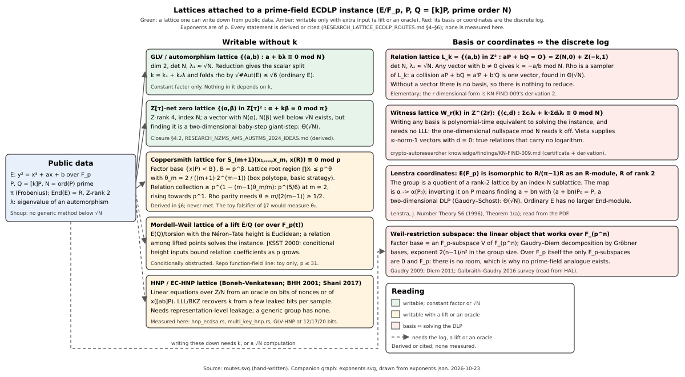
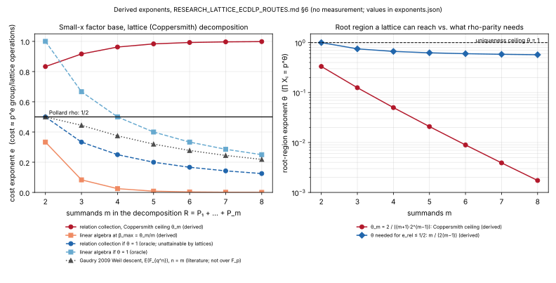

# Lattice routes to the prime-field ECDLP: what the lattices are, which ones can be written down, and what each is worth

**Status:** evaluation note, 2026-10-23. Literature review plus derivations;
no measurement, no new attack claim, no scoreboard change. Classed under the
repository's rules as a *direction* assessment, like
[`RESEARCH_REPRESENTATION_STRUCTURE.md`](RESEARCH_REPRESENTATION_STRUCTURE.md):
it closes nothing that a measured row holds open, and it declines to open a
campaign.

**Question asked (owner, 2026-10-23):** evaluate approaches that use lattices
for the elliptic-curve discrete logarithm problem; the intuition offered was
that a hard problem like the ECDLP "can be represented in high-dimensional
space", that this seems promising, and that it is under-represented in the
literature.

**Visuals:** [`lattice_ecdlp_routes_20261023/routes.svg`](lattice_ecdlp_routes_20261023/routes.svg)
(the map of lattices attached to an instance) and
[`lattice_ecdlp_routes_20261023/exponents.svg`](lattice_ecdlp_routes_20261023/exponents.svg)
(derived cost exponents of §6, values in
[`exponents.json`](lattice_ecdlp_routes_20261023/exponents.json)); PDF of
this note with both: [`lattice_ecdlp_routes_20261023/REPORT.pdf`](lattice_ecdlp_routes_20261023/REPORT.pdf).

**Companions:** [`RESEARCH_ECDLP_STATE_OF_THE_ART.md`](RESEARCH_ECDLP_STATE_OF_THE_ART.md),
[`RESEARCH_NZMS_AMS_AUSTMS_2024_IDEAS.md`](RESEARCH_NZMS_AMS_AUSTMS_2024_IDEAS.md) §4.2,
[`../lattice-hnp/RESEARCH_HNP_LANDSCAPE.md`](../lattice-hnp/RESEARCH_HNP_LANDSCAPE.md),
[`../lattice-hnp/RESEARCH_GLV_HNP_PHASE2.md`](../lattice-hnp/RESEARCH_GLV_HNP_PHASE2.md) §8b,
`crypto-autoresearcher:knowledge/findings/KN-FIND-009.md` (witness lattices),
`crypto-autoresearcher:knowledge/findings/KN-FIND-003.md` … `KN-FIND-011.md`
(function-field xedni line).

## TL;DR

1. **The premise is half right.** The ECDLP does have exact lattice
   representations, several of them, and the group `E(F_p)` of an ordinary
   curve literally *is* a lattice quotient: `E(F_p) ≅ R/(π−1)R` as a module
   over the endomorphism ring `R`, which has Z-rank 2 (Lenstra 1996,
   Theorem 1(a), read from the paper). What is wrong is "high-dimensional":
   every lattice that an instance `(E, P, Q = [k]P)` carries *intrinsically*
   has rank 2 (or 4 over `Z[τ]`), because `End(E)` of an ordinary curve has
   rank 2 and `F_p` has no proper subfield to descend along. The
   high-dimensional objects one can build (witness lattices of rank `2r`,
   Mordell–Weil lattices of lifts, Coppersmith lattices for summation
   polynomials) are high-dimensional by construction, not by structure, and
   each pays for its dimension in a way §4–§6 make explicit.
2. **The dividing line is "writable without `k`".** Every lattice whose
   short vectors encode `k` (the relation lattice `L_k`, the witness lattice
   `W_r(k)`, Lenstra's coordinates) has a basis that is *polynomial-time
   equivalent to the discrete log itself*; the repository already holds the
   certificate and derivation for the witness case (KN-FIND-009). Lattice
   reduction needs a basis to start from, so these lattices cannot be reduced,
   only sampled, and Pollard rho is exactly a `Θ(√N)` sampler of `L_k`. Every
   lattice one *can* write from public data (the GLV lattice, the `Z[τ]`-net
   zero lattice) is `k`-independent and yields at most the automorphism
   constant `√#Aut(E) ≤ √6`, or a two-dimensional baby-step giant-step that
   is still `Θ(√N)` (§4.2 of the NZMS note).
3. **Lattices are decisive exactly where a *linear* equation over `Z/N`
   exists**, which the group law never provides but a protocol or a side
   channel does: the hidden-number problem family (Boneh–Venkatesan 1996;
   Howgrave-Graham–Smart 2001; Nguyen–Shparlinski 2002; EC-HNP of
   Boneh–Halevi–Howgrave-Graham 2001; Shani 2017). This repository measures
   those routes (`src/cryptanalysis/hnp_ecdsa.rs`, `multi_key_hnp.rs`, the
   GLV-aware lattice at 12/17/20 bits). That is why the lattice literature
   around elliptic curves looks "under-represented" for the pure ECDLP: it
   is concentrated where it works, and the pure problem offers no linear
   handle. The under-representation is a consequence of a barrier, not an
   oversight.
4. **The one route that looks like a genuine lattice attack on the pure
   problem, Coppersmith-style point decomposition over a small-`x` factor
   base, is closed by a derivation (§6):** the root region a Coppersmith
   lattice can reach for the summation polynomial `S_{m+1}` is
   `∏ X_i ≤ p^{θ_m}` with `θ_m = 2/((m+1)·2^{m−1})`, which caps the factor
   base at `B ≤ p^{θ_m/m}` and the relation-collection cost at
   `p^{1 − (m−1)θ_m/m}`: `p^{5/6}` at `m = 2`, rising towards `p^1`. Matching
   rho's `p^{1/2}` would need `θ ≥ m/(2(m−1)) ≥ 1/2`, and for `m = 2` it would
   need `θ ≥ 1`, the point at which the "small root" is no longer
   distinguished from the other solutions and the lattice step *is* the
   decomposition problem. No Coppersmith-type method reaches `p^{1/2}` for a
   polynomial of degree 2 or more. This agrees with Galbraith–Gaudry's
   survey verdict that over prime fields "there is no known efficient
   decomposition algorithm" for Semaev's small-abscissa base, and sharpens
   it to a quantitative ceiling.
5. **The lifting route (xedni, Mordell–Weil lattices) is refuted in the
   literature and exhausted at toy scale here.** Jacobson–Koblitz–
   Silverman–Stein–Teske (2000) show an absolute bound on the coefficients of
   any relation among lifted points, so dependence vanishes as `p` grows.
   The repository's function-field variant (GOAL-XEDN-001/002/003,
   GOAL-ICLIFT-001, all `completed`) found ∞-norm-1 Mordell–Weil relations
   only at `p ≤ 31` and settled its density gate exactly at rate `p^{−3}`
   (KN-FIND-008); its own goal text forbids presenting it as an attack
   improvement.
6. **Recommendation.** Do not open a lattice campaign on the pure
   prime-field ECDLP. Two bounded items are worth doing (§7): a toy
   measurement of `θ_2` that would falsify §6 if Coppersmith on `S_3`
   reached beyond `p^{1/3}`, and a short derivation turning the "writable
   lattices are `k`-independent" observation into a lemma under the R1–R5
   admissibility test. Keep lattice work where it is live: the HNP /
   leakage line, and the constant-factor automorphism folds already in the
   index-calculus notes.

## 1. The question, made precise

"Represent the ECDLP in a high-dimensional space" can mean four different
things, and they have four different answers.

| reading | the object | what it is worth | section |
|:--|:--|:--|:--|
| (a) the *group* is a lattice quotient | `E(F_p) ≅ R/(π−1)R`, `R = End(E)` of rank 2 | exact, but the coordinate map is a 2-D DLP (`Θ(√N)`) | §4.3 |
| (b) the *relations* form a lattice | `L_k = {(a,b) : aP + bQ = O}`, det `N`; rank-`2r` witness lattices | a basis ⇔ the log; reduction cannot start; rho samples it | §4.1, §4.2 |
| (c) the *scalar* lives in a lattice | GLV lattice `{(a,b) : a + bλ ≡ 0 mod N}`; `Z[τ]`-net zero lattice | writable; constant factor `√#Aut`, or a 2-D BSGS at `Θ(√N)` | §4.4, §4.5 |
| (d) the *decomposition* or the *lift* is a lattice problem | Coppersmith lattices for `S_{m+1}`; Mordell–Weil lattices of lifts | writable with extra input; ceilings derived (§6) or refuted (JKSST) | §5, §6 |

A fifth reading, (e) *a linear equation over `Z/N` from outside the group*,
is the hidden-number problem, where lattices are the right tool and the
repository already works (§5.4). It is not the pure ECDLP.

The barrier behind all of (a)–(d) is Shoup's generic-group bound
(`Ω(√N)` for any algorithm that touches the group only through its
operation and equality) together with the observation, made precise in §3,
that a lattice can only be reduced if its basis can be written down, and
every basis that depends on `k` *is* `k`.

## 2. What the repository already holds (checked first)

- **Witness lattices, certificate level.** `KN-FIND-009` (crypto-autoresearcher,
  2026-07-28): for a `j = 0` curve with eigenvalues `{1, λ₂, λ₃}` of the
  order-3 automorphism, the eigenvalue-augmented witness lattice `W_r(k)`
  has an ∞-norm-1 vector `(1,1,1,0,…)` for every `r ≥ 3` and every `k`
  (Vieta: `1 + λ₂ + λ₃ ≡ 0 mod N`), against a Minkowski prediction of
  `N^{1/(2r)}`; the on-curve relation `P + φ(P) + φ²(P) = O` yields no
  logarithm. Derivation 2 there: writing *any* basis of `W_r(k)` is
  polynomial-time equivalent to solving the instance, with no LLL involved
  (a one-dimensional nullspace mod `N` reads `k` off). Derivation 3: the
  degeneracy of these lattices is governed by short eigenvalue relations,
  not by the rank of `End(E)`.
- **`Z[τ]`-net zero lattice.** [`RESEARCH_NZMS_AMS_AUSTMS_2024_IDEAS.md`](RESEARCH_NZMS_AMS_AUSTMS_2024_IDEAS.md)
  §4.2: the zero set `Λ = {(α,β) ∈ Z[τ]² : α + kβ ≡ 0 mod π}` has Z-rank 4
  and index `r`; Minkowski gives `(α,β)` with `N(α), N(β) ≪ r^{1/2}`, but
  finding it is a two-dimensional baby-step giant-step, so it stays generic.
- **Function-field xedni.** GOAL-XEDN-001/002/003 and GOAL-ICLIFT-001
  (all `status: completed`); findings KN-FIND-003, -004, -005, -008, -010,
  -011. Mordell–Weil relations of ∞-norm 1 were found on non-isotrivial
  surfaces at `p ∈ {7, 13, 19, 31}` by full enumeration; the lift-probability
  gate was settled exactly as `P_lift(p) = (1 − 2/p + p^{−3})/(2p^3)`
  (KN-FIND-008), i.e. codimension 3. Every record is marked toy-scale and
  `support_scoped`; GOAL-ICLIFT-001's objective states that neither route "is
  permitted to be presented as an attack improvement".
- **HNP line, measured.** [`../lattice-hnp/`](../lattice-hnp/): the
  Boneh–Venkatesan basis in `src/cryptanalysis/hnp_ecdsa.rs`, multi-key HNP,
  Bleichenbacher; the GLV-aware `k₁`-only-leak lattice implemented and
  measured over 3000 instances at 12, 17 and 20 bits
  ([`RESEARCH_GLV_HNP_PHASE2.md`](../lattice-hnp/RESEARCH_GLV_HNP_PHASE2.md) §8b);
  the secp256k1 "LLL degeneracy" traced to floating-point Gram–Schmidt
  defects and re-run ([`research/lll_degeneracy_rerun_20261016/`](../../lll_degeneracy_rerun_20261016/README.md)).
  All of it needs leaked nonce bits; none of it touches the pure ECDLP.
- **Representation test.** [`RESEARCH_REPRESENTATION_STRUCTURE.md`](RESEARCH_REPRESENTATION_STRUCTURE.md):
  every attack that ever beat the generic bound transferred the problem into
  a category with a non-generic algorithm, licensed by a specific published
  algebraic object (a subfield, a small embedding degree, trace 1, a torsion
  image). Its R1–R5 test is applied to each lattice route in §4–§5.
- **Attack matrix.** `docs/ECDLP_ATTACK_MATRIX.md` row 22 lists the only
  lattice entry: biased / partial-nonce HNP, "protocol" class.
- **Knowledge corpus.** `crypto-autoresearcher:knowledge/literature/`
  holds KN-LIT-020/021 (xedni and its analysis), KN-LIT-043/044/045
  (HNP, Nguyen–Shparlinski, lattice attacks on signatures), KN-LIT-037
  (Coppersmith), and the LWE/NTRU lattice-cryptanalysis spine (BKZ 2.0,
  sieving, G6K), which is about lattice *problems*, not the ECDLP.

- **Coppersmith on `S₃`, already measured (correction, 2026-10-23).** The
  first version of this note missed three records, found while building the
  §7 falsifier: `RESEARCH_PRIME_FIELD_BREAKTHROUGH_PROGRAM.md` §3.2–§3.3
  (Probe B: the JM basic lattice on `S₃` at 40 bits, "≥ 2 rows vanish" to
  `δ = 0.12`–`0.14` and Howgrave-Graham to `0.10`; Probe C: extended shifts
  and the symmetric `(e₁, e₂)` lattice, same threshold), §2.2's derived
  `2/(m(m+1)d)` limits `1/6, 1/24, 1/80`, and
  [`research/lit2026_w10_s5_coppersmith_20261011/`](../../lit2026_w10_s5_coppersmith_20261011/README.md)
  (an exact min-cut optimiser over all monomial sets in the box, reproducing
  `1/18, 1/10, 0.119` at `ℓ = 1, 2, 3` and the `1/6` limit for `S₃`, and
  closing the `S₅` route at `1/80`). §6's `θ_m = 2/((m+1)·2^{m−1})` is the
  same quantity as that `2/(m(m+1)d)` with `d = 2^{m−1}` and the per-variable
  `β` doubled to the product exponent, so the derivation was already in the
  repository and already measured at one size and one multiplicity each.
  The original sentence below ("What was missing is … the Coppersmith
  ceiling (§6)") is kept as written and is wrong on that point; what §6
  adds is the cost-exponent consequence (`p^{5/6}` relation collection and
  the `θ ≥ m/(2(m−1))` parity condition), not the root bound.

So the repository has already measured the two lattice routes that can be
measured at all (HNP with leakage, function-field lifting at toy scale) and
certified the `k`-dependence obstruction for witness lattices. What was
missing is the map (this note's §4), the Coppersmith ceiling (§6), and a
one-page answer to "why not lattices".

## 3. The barrier, stated once

Let `G = ⟨P⟩ ⊂ E(F_p)` have prime order `N`, `Q = [k]P`.

**Lemma A (bases are logs).** Let `L ⊂ Z^d` be a full-rank lattice,
computable from `(E, P, Q)` in polynomial time *as a set* (membership is
decidable from the group law), such that some vector of `L` determines `k`
by a polynomial-time map. If `L` is the kernel of a homomorphism
`Z^d → Z/N` (every relation lattice is), then from any basis of `L` one
reads `k` in polynomial time without lattice reduction: the annihilator of
`L` in `(Z/N)^d` is cyclic of order `N`, generated by the row vector of
character values, and `k` is a ratio of two of its coordinates. Conversely
a basis can be written from `k`. Hence writing a basis is polynomial-time
equivalent to solving the instance. This is derivation 2 of KN-FIND-009
for `W_r(k)`; for `L_k = {(a,b) : a + bk ≡ 0 mod N} = Z(N,0) ⊕ Z(−k,1)` it
is immediate.

**Consequence.** Lattice reduction (LLL, BKZ, sieving) takes a basis and
returns short vectors. On a relation lattice there is no basis to give it,
so there is nothing for it to shorten. What *can* be done is to sample
vectors of `L_k`: a Pollard rho collision `aP + bQ = a'P + b'Q` is the
vector `(a − a', b − b') ∈ L_k`, found after `Θ(√N)` group operations.
Rho is a sampler of the relation lattice, and Shoup's bound says no
generic sampler is faster.

**Lemma B (writable lattices are `k`-independent).** A lattice whose basis
is computable from `(E, P, Q)` without a `√N` computation cannot have `k`
in its basis, hence its reduced vectors are functions of `(E, P, Q)` that
every instance with the same `(E, P)` shares. Such a lattice can encode
*structure of the curve* (the automorphism eigenvalue `λ`, the Frobenius
`π`), and the only way that structure has ever fed an attack is through
the transfer pattern of `RESEARCH_REPRESENTATION_STRUCTURE.md` or through a
constant-factor fold of a generic walk. (Proposed as a lemma; the
one-line proof is that a basis is a function of its inputs. The content is
in what follows: whether some `k`-independent lattice licenses a
transfer. §4 finds none.)

Lemma B is why "which lattice?" is the whole question. §4 goes through every
lattice an instance carries; the diagram
[`routes.svg`](lattice_ecdlp_routes_20261023/routes.svg) is the same list
drawn.



## 4. The lattices an instance carries

### 4.1 The relation lattice `L_k` (rank 2, unwritable)

`L_k = {(a,b) ∈ Z² : aP + bQ = O} = Z(N,0) ⊕ Z(−k,1)`, `det L_k = N`,
`λ₁(L_k) ≈ √N` for random `k`. A reduced basis has two vectors of norm
about `√N`; any one with `b ≠ 0` gives `k = −a/b mod N`. **Verdict:** a
basis is the log (Lemma A). Sampling it is rho. Nothing to do.

### 4.2 Witness lattices `W_r(k)` (rank `2r`, unwritable, degenerate)

Augmenting with endomorphism eigenvalues (`λ_i` of `φ ∈ End(E)` acting on
`G`) gives `W_r(k) = {(c,d) ∈ Z^{2r} : Σ c_i λ_i + k Σ d_i λ_i ≡ 0 mod N}`.
This is the "high-dimensional" lattice one gets by adding structure, and
KN-FIND-009 shows two things about it: its basis is still the log
(Lemma A), and its first minimum is *not* the Minkowski `N^{1/(2r)}` but 1,
because the eigenvalues satisfy short integer relations (Vieta), and those
short vectors have `d = 0` and carry no logarithm. **Verdict:** closed at
certificate level in the repository. Adding dimensions added degenerate
short vectors, not information.

### 4.3 Lenstra coordinates (rank 2, the coordinate map is a 2-D DLP)

Lenstra (1996), Theorem 1(a): for `E/k` over a finite field with Frobenius
`π ∉ Z`, `R = End_k(E)` has Z-rank 2 and `E(l) ≅ R/R(π^n − 1)` as
`R`-modules for `l/k` of degree `n`. So `E(F_p) ≅ R/(π−1)R`: the group is
the quotient of the rank-2 lattice `R` by the index-`N(π−1) = #E(F_p)`
sublattice `(π−1)R`. The isomorphism is `α ↦ α(P₀)` for a module generator
`P₀`. To use it one needs the inverse map on `P` and `Q`, i.e. `a + bπ ∈ R`
with `(a + bπ)P₀ = P`: a two-dimensional discrete logarithm in the
`Z[π]`-module, which Gaudry–Schost solves in `Θ(√N)` and nothing solves
faster (it is a generic problem on a rank-2 abelian group). **Verdict:**
exact, pretty, and generic. It also shows there is no "higher-dimensional
End-module" to look for on an ordinary curve: the rank is 2. (Theorem 1(b),
`π ∈ Z` with `R` of rank 4, is the supersingular case over suitable
extension fields, which MOV already breaks.)

### 4.4 The GLV / automorphism lattice (rank 2, writable, constant factor)

For a curve with an efficient automorphism `φ` of eigenvalue `λ` on `G`,
`L_λ = {(a,b) : a + bλ ≡ 0 mod N}` is writable from the curve alone;
Gauss reduction gives the GLV decomposition `k = k₁ + k₂λ` with
`|k_i| ≈ √N`, and the same lattice is what folds rho by `√#Aut(E)`
(Duursma–Gaudry–Morain 1999; Wiener–Zuccherato 1999 for Koblitz). `#Aut(E)
≤ 6` for ordinary curves, so the fold is at most `√6`. This repository's
index-calculus notes use the same object as the "fold" of endomorphism-
invariant factor bases ([`../index-calculus/RESEARCH_GLV_INVARIANT_FACTOR_BASES.md`](../index-calculus/RESEARCH_GLV_INVARIANT_FACTOR_BASES.md)).
**Verdict:** live, used, and a constant.

### 4.5 The `Z[τ]`-net zero lattice (rank 4, writable up to a 2-D BSGS)

Covered by the NZMS note §4.2: short vectors exist by Minkowski; finding
them is a two-dimensional baby-step giant-step at `Θ(√N)`. **Verdict:**
generic. (Rank 4 here is `Z[τ]² `, two copies of a rank-2 ring; it is the
rank-2 ceiling of §4.3 twice, not a way around it.)

### 4.6 The Weil-restriction subspace (the linear object that *does* work, over `F_{p^n}`)

Over an extension field, the factor base of Gaudry (2009) and Diem (2011)
is an `F_p`-linear subspace `V ⊂ F_{p^n}` of dimension `n'`, decomposition
is a Gröbner-basis solve of the Weil-descended summation polynomial, and
the exponent in the group size is `2(n−1)/n²` (Gaudry's `Õ(q^{2−2/n})`
over `F_{q^n}`), below rho's `1/2` from `n = 3` on. This is the only
"linear subspace" structure that has ever lowered the ECDLP exponent, and
it is exactly the structure `F_p` lacks: the only `F_p`-subspaces of `F_p`
are `0` and `F_p`. **Verdict:** the honest version of "high-dimensional
representation" exists, is called Weil descent, and has no prime-field
instance. (The repository's Diem-descent and Koblitz notes are this
route; see [`../index-calculus/RESEARCH_DIEM_DESCENT.md`](../index-calculus/RESEARCH_DIEM_DESCENT.md).)

## 5. Routes that need extra input

### 5.1 Lifting to characteristic zero: xedni and Mordell–Weil lattices

Silverman's xedni calculus (1999) lifts `r` combinations of `P, Q` to
`Q`-points on a lift `Ẽ/Q` and hopes they are linearly dependent in
`Ẽ(Q)`; a dependence reduces to a relation in `E(F_p)` and solves the
instance. `Ẽ(Q)/tors` with the Néron–Tate height is a Euclidean lattice, so
"find the dependence" is a short-vector search in the Mordell–Weil lattice
given its Gram matrix, and this is the one place where the ECDLP meets
lattice reduction in the strict sense. Jacobson–Koblitz–Silverman–Stein–
Teske (2000; read from the PDF) show that "asymptotically the algorithm is
virtually certain to fail, because of an absolute bound on the size of the
coefficients of a relation satisfied by the lifted points", and that at
small `p` "the odds against finding a suitable lifting are prohibitively
high" (their §4 states the theorem, §5 the experiments at `r = 2, 3, 4`).
Huang–Raskind's signature calculus (2009) is a formalism over number fields
with global duality; its ECDLP equivalence rests on heuristics and no
cost advantage is claimed. Galbraith–Gaudry (2016; read from HAL): "the
paper [72] analysed the algorithm and explained why this approach is not
likely to be successful. We do not discuss it further."

The repository's function-field variant replaces `Q` by `F_p(t)` (an
elliptic surface) so that heights are degrees and the Mordell–Weil lattice
is exactly computable; it found ∞-norm-1 relations at `p ≤ 31` and an exact
lift-rate of codimension 3. Nothing in it moved past toy scale, and the
coefficient bound of JKSST transfers (KN-FIND-004, "coefficient-bound
transfer past μ₃ supported"). **Verdict:** refuted in the literature; the
repository's own line is complete and scoped to toy support.

### 5.2 Coppersmith lattices for point decomposition

The one route that is a lattice attack on the *pure* prime-field problem.
Treated in §6; the verdict is a derived ceiling of `p^{5/6}` on relation
collection.

### 5.3 Lattices inside index calculus (the linear-algebra stage)

Relations live in `Z^{|F|}` and their kernel is the lattice of §4.1 in
`|F|` dimensions; the final solve is over `Z/N`, not over `Z`, and sparse
Wiedemann / structured Gaussian elimination is the right tool. Lattice
reduction on relation vectors to shrink coefficients before elimination is
occasionally used in NFS; it changes constants in the linear algebra, and
the linear algebra is not the bottleneck of any prime-field index calculus
in this repository (the decomposition is). **Verdict:** no exponent, and
not the bottleneck. Lattice *sieving* in the NFS sense needs a linear
`(a,b)`-plane of candidates, which the small-`x` factor base does not have
(the abscissa of `P₁ + P₂` is a rational function, not a linear form, of
the abscissae of `P₁, P₂`; Galbraith–Gaudry: "the elliptic group law is
deeply incompatible with the multiplication of the integers representing
the abscissae").

### 5.4 Hidden-number problems (the route that works, with an oracle)

Given an oracle that returns a few bits of `k_i` for many
`(h_i, r_i, s_i)` ECDSA signatures, or of `x([ab]P)` for many `(aP, bP)`,
the unknown enters a *linear* equation over `Z/N`, the Boneh–Venkatesan
lattice has the secret as a close vector, and LLL/BKZ recovers it with a
handful of leaked bits per sample (Howgrave-Graham–Smart 2001;
Nguyen–Shparlinski 2002/2003). The elliptic-curve HNP (Boneh–Halevi–
Howgrave-Graham 2001) has the same shape with the group law replacing
modular addition, and Shani (2017) proved that about 5/6 of the most
significant bits of the `x`-coordinate of an ECDH key are as hard as the
whole key, with later Coppersmith-based heuristic improvements
(Xu–Sarkar–Wang–Hu 2022). **Verdict:** this is where lattices on elliptic
curves are decisive, and it is the repository's measured lattice line.
The oracle is representation-level leakage; the generic group has none,
so it does not touch the pure problem. Multi-dimensional versions of the
HNP (the repository's GLV-aware `k₁`-only leak) still need the leak.

### 5.5 Quantum post-processing

Ekerå–Håstad-style lattice post-processing of Shor's ECDLP output is
lattice reduction on the *classical* side of a quantum algorithm; it is
orthogonal to a classical attack and is not evaluated here.

## 6. Derivation: the Coppersmith ceiling on small-`x` decomposition

**Setup.** `E/F_p`, `G` of prime order `N ≈ p`. Factor base
`F = {P ∈ G : 0 ≤ x(P) < B}`, `B = p^β`, `|F| ≈ B` (each abscissa carries
0 or 2 points, on average 1). A relation is a decomposition
`R = P₁ + … + P_m`, `P_i ∈ F`, of a random `R = [a]P + [b]Q`; Semaev's
summation polynomial gives the condition
`S_{m+1}(x₁, …, x_m, x(R)) ≡ 0 (mod p)`, of degree `2^{m−1}` in each `x_i`.
Standard heuristics (Gaudry 2009; this repository's boundary ledger):

- a random `R` decomposes with probability `≈ B^m / (m!·N)`, so collecting
  `≈ |F| = B` relations takes `T_rel ≈ B · m!·N / B^m = m!·p / B^{m−1}`
  decomposition attempts, each costing one lattice call `C_lat`;
- the linear algebra on a `B × B` sparse matrix of row weight `m` costs
  `≈ m·B²` operations mod `N`.

**The lattice step.** To decompose by lattice reduction, one runs a
Coppersmith-type method on `f(x₁,…,x_m) = S_{m+1}(x₁,…,x_m, x(R)) mod p`
and asks it to return the root with all `|x_i| < X_i = B`. Such a method
reaches roots in a region `∏ X_i ≤ p^{θ}` for a `θ` that depends on the
Newton polytope of `f`. For `S_{m+1}` the polytope is contained in the box
`[0, d]^m` with `d = 2^{m−1}`, and the leading monomial is `(x₁⋯x_m)^d`.
The basic strategy of Jochemsz–May (2006) with shift bound `t` uses the
monomial sets `M_k = {i ∈ [0, dt]^m : i_j ≥ kd for all j}`, the shift
polynomials `x^{i − kd·1} f^k p^{t−k}` for `i ∈ M_k \ M_{k+1}`, and the
determinant condition `∏_{i ∈ M_0} X^{|i|} · p^{Σ_k (t−k)(|M_k| − |M_{k+1}|)} < p^{t·|M_0|}`
(symmetric bounds `X_i = X`). With `|M_k| = (d(t−k)+1)^m`, the `p`-exponent
telescopes to `t|M_0| − Σ_{k≥1} |M_k|`, so the condition reads
`X^{Σ_{i∈M_0}|i|} < p^{Σ_{k≥1}|M_k|}`. Asymptotically in `t`,
`Σ_{i∈M_0}|i| ≈ (dt)^m · m·dt/2` and `Σ_{k≥1}|M_k| ≈ d^m t^{m+1}/(m+1)`,
hence

```text
    X^m  <  p^{ 2 / ((m+1)·d) },      i.e.     θ_m = 2 / ((m+1)·2^{m−1}).
```

Checks: `m = 1` gives Coppersmith's univariate `X < p^{1/d}`; `m = 2`,
`d = 2` gives `XY < p^{1/3}`, Coppersmith's bivariate heuristic bound for
degree 2 in each variable. The extended strategy of Jochemsz–May and the
symmetry of `S_{m+1}` change constants inside the lattice, not the `1/d`
scaling, and the method is heuristic in the usual sense (the reduced
polynomials must be algebraically independent). Two ceilings bracket it:

- **Uniqueness ceiling `θ ≤ 1`.** When `∏ X_i ≥ p` the congruence has
  `≈ ∏ X_i / p ≥ 1` expected solutions in the box, the sought root is not
  the small one, and the lattice step is the decomposition problem itself.
- **Coppersmith ceiling `θ_m`** as derived.

**Cost.** The lattice reaches the decomposition only if `B^m ≤ p^{θ_m}`,
so `β ≤ θ_m/m`, and then

```text
    e_rel(m) = 1 − (m−1)·θ_m/m          (attempts; each one a lattice call)
    e_la(m)  = 2·θ_m/m                  (sparse linear algebra)
```

| `m` | `θ_m` | `β_max` | `e_rel` | `e_la` | `θ` needed for `e_rel ≤ 1/2` |
|:--:|:--:|:--:|:--:|:--:|:--:|
| 2 | 1/3 | 1/6 | **5/6** | 1/3 | 1 |
| 3 | 1/8 | 1/24 | 11/12 | 1/12 | 3/4 |
| 4 | 1/20 | 1/80 | 77/80 | 1/40 | 2/3 |
| 5 | 1/48 | 1/240 | 59/60 | 1/120 | 5/8 |
| 6 | 1/112 | 1/672 | 667/672 | 1/336 | 3/5 |

(`exponents.json`; graph `exponents.svg`, left panel the exponents against
rho's `1/2`, right panel `θ_m` against the `θ` rho-parity needs.)



**Reading.** The best case is `m = 2` at `p^{5/6}` lattice calls, each a
reduction of a lattice of dimension `(2t+1)²` in `≈ 2t·log p`-bit entries,
against rho's `p^{1/2}` curve additions. Adding summands makes it worse,
because the degree `2^{m−1}` of `S_{m+1}` shrinks the root region faster
than the extra summands enlarge the decomposable set. Rho parity needs
`θ ≥ m/(2(m−1))`: at `m = 2` that is `θ ≥ 1`, the uniqueness ceiling, so
even a *perfect* lattice method would have to solve the decomposition
problem outright; for every `m` it is at least `1/2`, and no Coppersmith-
type method reaches `p^{1/2}` on a polynomial of degree `≥ 2`. The
"oracle" rows of the graph (`θ = 1`) are the standard statement that a
decomposition oracle would make index calculus beat rho from `m ≥ 5`; they
are drawn only to show how far the lattice ceiling is from it.

**Status of the derivation.** Derived, not measured; heuristic at the
level of every Coppersmith analysis; the box polytope is an upper estimate
of `S_{m+1}`'s support, so `θ_m` is an *upper* bound on what the basic
strategy gives for the actual polynomial (the real bound can only be
smaller). It agrees with Galbraith–Gaudry's qualitative verdict and with
the repository's position that no prime-field index calculus has rho's
exponent ([`../index-calculus/RESEARCH_IC_BOUNDARY_LEDGER.md`](../index-calculus/RESEARCH_IC_BOUNDARY_LEDGER.md)).
No `identity.certificate` is shipped because no algebraic identity is
claimed; the one measurable statement is `θ_2 ≈ 1/3`, and §7 says how to
test it.

## 7. What, if anything, to do

1. **Toy falsifier for §6 (bounded; optional).** Implement Coppersmith's
   bivariate method for `S_3(x₁, x₂, x(R)) mod p` in Rust on the existing
   lattice code (`src/cryptanalysis/lattice.rs`), at `p ≈ 2^{20}`–`2^{40}`,
   and measure the largest `β` at which the planted decomposition is
   recovered against `θ_2/2 = 1/6`. Pre-registered stop rule: if recovery
   holds at `β > 1/4` (i.e. `θ > 1/2`) across sizes, §6 is wrong and this
   note is corrected; otherwise the route is closed at measured level. Cost:
   one session. It cannot produce a speedup, so it never reaches the IC
   leaderboard; it is a check on a derivation. Class: boundary measurement.
   **Done (2026-10-23):** [`research/coppersmith_s3_theta2_20261023/`](../../coppersmith_s3_theta2_20261023/REPORT.md),
   protocol frozen before the run, instrument
   `examples/coppersmith_s3_theta2_falsifier.rs` (full pipeline: lattice,
   LLL, resultant root extraction, candidates checked against `S₃`), four
   sizes 24–56 bits, `ℓ ≤ 3`, `β` to 0.34, positive and negative controls.
   The verdict against the stop rule is in that study's `REPORT.md`.
2. **Lemma B as a derivation record.** State and prove, under the R1–R5
   test of `RESEARCH_REPRESENTATION_STRUCTURE.md`, that a lattice computable
   from `(E, P, Q)` in time `o(√N)` is `k`-independent, and that a
   `k`-independent lattice feeds an attack only through a transfer object or
   an automorphism fold. One page; closes the "which lattice?" question for
   future proposals in four lines, the way the NZMS note's closures do.
3. **Do not open** a campaign on lattice reduction for the pure prime-field
   ECDLP: every writable lattice is `k`-independent (Lemma B), every
   `k`-dependent one has a basis that is the log (Lemma A), the lift route is
   refuted (JKSST) and exhausted here at toy scale, and the decomposition
   route is capped at `p^{5/6}` (§6).
4. **Keep lattices where they are live:** the HNP / leakage line
   (`research/notes/lattice-hnp/`), where the next measured item is the
   GLV-aware lattice at cryptographic size; the automorphism fold inside the
   index-calculus baseline, where a constant is a constant.

The success criterion of `AGENTS.md` is a measured improvement over the
index-calculus baseline; nothing in this note is one, and nothing in it is
reported as one. The distance to rho for the small-`x` lattice route is
`p^{5/6}` against `p^{1/2}`, before the per-attempt lattice cost.

## 8. Sources checked

Primary sources read for this note (links or repository paths; "read"
means the text was read, "abstract" means only the abstract or a secondary
summary was available):

- H. W. Lenstra Jr., *Complex multiplication structure of elliptic curves*,
  J. Number Theory 56 (1996) 227–241. Read (Theorem 1).
  https://pub.math.leidenuniv.nl/~lenstrahw/PUBLICATIONS/1996c/art.pdf
- M. J. Jacobson, N. Koblitz, J. H. Silverman, A. Stein, E. Teske, *Analysis
  of the xedni calculus attack*, Des. Codes Cryptogr. 20 (2000) 41–64.
  Read (abstract, §4 asymptotic failure, §5 experiments).
  https://pages.cpsc.ucalgary.ca/~jacobs/PDF/xedni.pdf ;
  `crypto-autoresearcher:knowledge/literature/KN-LIT-021.md`.
- J. H. Silverman, *The xedni calculus and the elliptic curve discrete
  logarithm problem*, Des. Codes Cryptogr. 20 (2000). Abstract;
  `KN-LIT-020.md`.
- S. D. Galbraith, P. Gaudry, *Recent progress on the elliptic curve discrete
  logarithm problem*, Des. Codes Cryptogr. 78 (2016) 51–72. Read (HAL copy,
  hal-01215623: xedni paragraph; §"prime fields"; the conclusion on
  Semaev's small-abscissa base). https://hal.science/hal-01215623
- P. Gaudry, *Index calculus for abelian varieties of small dimension and
  the elliptic curve discrete logarithm problem*, J. Symb. Comput. 44 (2009).
  Exponent `2 − 2/n` over `F_{q^n}` taken from the survey above.
- I. Semaev, *New algorithm for the discrete logarithm problem on elliptic
  curves*, arXiv:1504.01175 (2015). Read (abstract; binary-field claim under
  a first-fall-degree assumption, not a lattice method).
- E. Jochemsz, A. May, *A strategy for finding roots of multivariate
  polynomials with new applications in attacking RSA variants*, ASIACRYPT
  2006. Basic strategy re-derived in §6 for the box polytope; the paper
  itself was not fetched this session.
- D. Coppersmith, *Small solutions to polynomial equations, and low
  exponent RSA vulnerabilities*, J. Cryptology 10 (1997). Univariate and
  bivariate bounds used as checks; `KN-LIT-037.md`.
- D. Boneh, R. Venkatesan, *Hardness of computing the most significant bits
  of secret keys in Diffie–Hellman and related schemes*, CRYPTO 1996
  (`KN-LIT-043.md`); N. Howgrave-Graham, N. P. Smart, *Lattice attacks on
  digital signature schemes*, Des. Codes Cryptogr. 23 (2001)
  (`KN-LIT-045.md`); P. Q. Nguyen, I. E. Shparlinski, *The insecurity of
  the elliptic curve digital signature algorithm with partially known
  nonces*, Des. Codes Cryptogr. 30 (2003) (`KN-LIT-044.md`).
- D. Boneh, S. Halevi, N. Howgrave-Graham, *The modular inversion hidden
  number problem*, ASIACRYPT 2001 (EC-HNP); B. Shani, *On the bit security
  of elliptic curve Diffie–Hellman*, PKC 2017 (5/6 of the MSBs, rigorous;
  https://www.iacr.org/archive/pkc2017/101740346/101740346.pdf);
  J. Xu, S. Sarkar, H. Wang, L. Hu, ASIACRYPT 2022 (Coppersmith-based
  heuristic `1/(d+1)` fraction;
  https://www.iacr.org/archive/asiacrypt2022/137910066/137910066.pdf).
  Abstracts.
- M.-D. Huang, W. Raskind, *Global duality, signature calculus and the
  discrete logarithm problem*, LMS J. Comput. Math. 12 (2009). Abstract.
- I. Duursma, P. Gaudry, F. Morain, *Speeding up the discrete log
  computation on curves with automorphisms*, ASIACRYPT 1999; M. Wiener,
  R. Zuccherato, *Faster attacks on elliptic curve cryptosystems*, SAC 1998.
  Standard; constants quoted from memory of the statements.
- Repository: `KN-FIND-003/004/005/008/009/010/011`,
  `ledger/goals/GOAL-XEDN-00{1,2,3}.yaml`, `GOAL-ICLIFT-001.yaml`
  (crypto-autoresearcher); `research/notes/lattice-hnp/*`,
  `research/lll_degeneracy_rerun_20261016/`, `docs/ECDLP_ATTACK_MATRIX.md`,
  `RESEARCH_NZMS_AMS_AUSTMS_2024_IDEAS.md` §4.2,
  `RESEARCH_REPRESENTATION_STRUCTURE.md` (this repository).

- Repository, Coppersmith on summation polynomials (missed in the first
  version, added 2026-10-23): `RESEARCH_PRIME_FIELD_BREAKTHROUGH_PROGRAM.md`
  §2.2, §3.2 (Probe B), §3.3 (Probe C);
  `research/lit2026_w10_s5_coppersmith_20261011/README.md` and
  `examples/lit2026_w10_coppersmith_bound.rs`; `examples/prime_ecdlp_breakthrough_probe.rs`.

**Gaps.** Amadori–Pintore–Sala (2018, eprint 2017/609) and Petit–Kosters–
Messeng (2016) were not re-read this session (eprint returned 403 through
the proxy); the survey's verdict on prime-field decomposition is used in
their place. No 2024–2026 paper proposing a classical lattice algorithm for
the pure ECDLP was found in two searches (one extended); the recent
"lattice + elliptic curve" literature is nonce-leakage HNP, quantum
resource estimates, and isogeny problems (KLPT-type quaternion lattices,
a different problem). A failed search is not proof that none exists.
