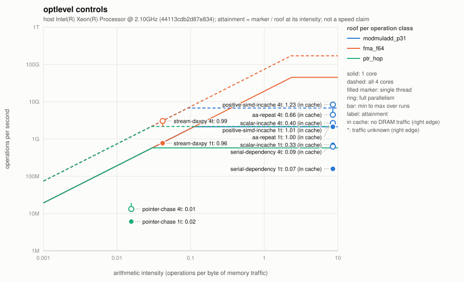
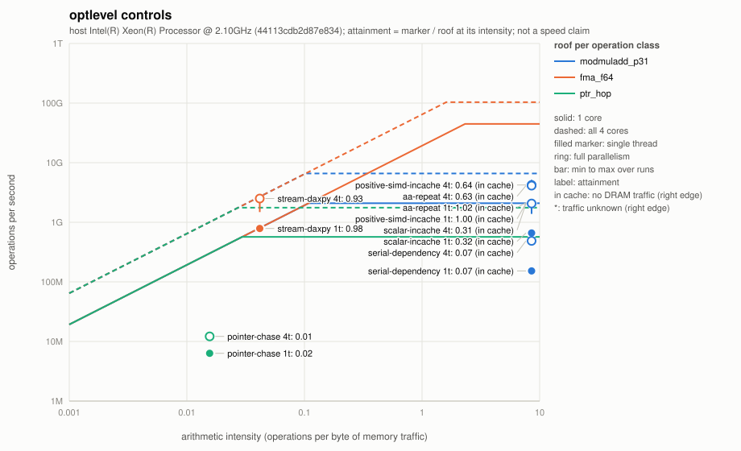
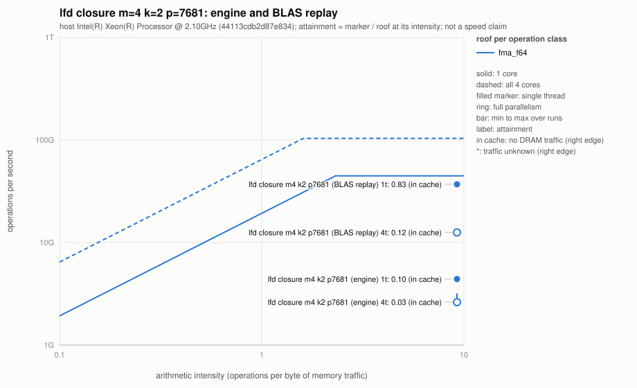

# Optimization-level metric: validation on a host without a PMU or GPU (2026-11-17)

Tool: [`tools/optlevel/`](../../tools/optlevel/optlevel.py). Definition:
[`docs/OPTIMIZATION_LEVEL.md`](../../docs/OPTIMIZATION_LEVEL.md). Skill:
[`.claude/skills/optlevel/SKILL.md`](../../.claude/skills/optlevel/SKILL.md).

Every number here is a producer measurement on one shared cloud VM, tier
`T-timing`, and is an unverified assertion `[pcc:unverified]`. Nothing here is
a speed claim, a benchmark row or a leaderboard row. No `bench.record/v1` was
opened: the runs calibrate and exercise a measuring tool on synthetic kernels
and one small Python closure, and report no speed of any research code.

## 1. Host and conditions

| | |
|:--|:--|
| CPU | Intel Xeon (family 6 model 207, Sapphire Rapids class) @ 2.10 GHz nominal, KVM guest, 4 vCPUs, SMT off, 1 NUMA node |
| ISA used | AVX2, AVX-512 F/DQ/BW/VL/IFMA/VPOPCNTDQ, FMA, BMI2, ADX |
| caches as reported to the guest | L1d 48 KiB, L2 2 MiB per core, L3 260 MiB (the host's, shared with unseen tenants) |
| memory | 16 GiB |
| PMU | none: `/sys/bus/event_source/devices` has no `cpu` source and no `perf` binary is installed; `tools/perf_ipc.sh --repeat 1 -- true` exits 3 (`probe.json`) |
| GPU | none: `optlevel.py gpu probe` exits 3 |
| compiler | gcc 13.3.0; builds `native`, `w512`, `scalar` (flags in each `calibration.json`) |
| other load | **another job used the same 4 vCPUs throughout.** 1-minute load average 2.1 to 5.7; CPU used by everything else, measured per run from `/proc/stat`: 0.01 to 3.0 cores |

The last row matters more than any other. Single-thread points were pinned to
one CPU and stayed stable. All-core points were not reliable.

## 2. Calibration (machine ceiling)

Two independent calibrations, 5 repeats of 0.5 s per kernel. `1c` and `4c` are
the ceilings (maximum over repeats of the summed rate of pinned copies), in
operations per second; `med` is the median, the low end of the interval.

| class | run 1: 1c | run 1: 4c (med) | run 2: 1c | run 2: 4c (med) | scalar 1c | SIMD/scalar | best build |
|:--|--:|--:|--:|--:|--:|--:|:--|
| `muladd_u32` | 18.06 G | 35.71 G (34.76 G) | 17.65 G | 36.43 G (35.19 G) | 2.63 G | 6.87 | muladd_u32@w512 |
| `muladd_u64` | 7.52 G | 29.43 G (29.02 G) | 7.49 G | 14.82 G (14.39 G) | 2.69 G | 2.80 | muladd_u64@w512 |
| `mulwide_u64` | 1.86 G | 7.16 G (4.95 G) | 1.82 G | 3.76 G (3.60 G) | 1.86 G | 1.00 | mulwide_u64@scalar |
| `modmuladd_p31` | 2.13 G | 6.77 G (4.89 G) | 2.09 G | 6.60 G (6.49 G) | 0.72 G | 2.96 | modmuladd_p31@w512 |
| `modmuladd_p62` | 0.73 G | 2.13 G (1.75 G) | 0.71 G | 1.36 G (1.32 G) | 0.70 G | 1.03 | modmuladd_p62@w512 |
| `xor_u64` | 10.00 G | 39.64 G (38.54 G) | 9.80 G | 19.19 G (18.02 G) | 2.60 G | 3.84 | xor_u64@w512 |
| `popcnt_u64` | 9.51 G | 36.02 G (30.76 G) | 8.93 G | 28.43 G (27.88 G) | 2.42 G | 3.93 | popcnt_u64@w512 |
| `fma_f64` | 45.10 G | 170.84 G (170.32 G) | 44.66 G | 103.58 G (81.58 G) | 2.73 G | 16.53 | fma_f64_reg@native |
| `ptr_hop` | 0.58 G | 2.17 G (2.16 G) | 0.57 G | 1.76 G (1.08 G) | 0.56 G | 1.03 | chase@native |

| memory | run 1 | run 2 |
|:--|--:|--:|
| bandwidth, 1 core(s), GB/s: ceiling (median) | 19.2 (19.0) | 19.3 (18.8) |
| bandwidth, 2 core(s), GB/s: ceiling (median) | 37.8 (37.3) | 37.8 (37.4) |
| bandwidth, 4 core(s), GB/s: ceiling (median) | 74.0 (73.3) | 64.5 (37.4) |
| 1-core bandwidth by kernel, GB/s (run 1): triad 32 B/el, xor 24, popcount 16 | 17.1 / 19.2 / 13.8 | |
| dependent-load latency, ns (median [min, max]) | 158 [154, 173] | 167 [156, 170] |
| effective clock, GHz (median [min, max]) | 2.77 [2.72, 2.87] | 2.81 [2.61, 2.93] |
| CPU used by everything else during calibration, cores | 0.77 | 2.03 |
| flags | CONTENDED, VIRTUALIZED, CLOCK_UNSTABLE | CONTENDED, VIRTUALIZED, CLOCK_UNSTABLE |
| streaming array size | 390 MiB each (1.5 x reported LLC) | same |

Readings:

- **Single-core ceilings reproduce within 1–5% between the two runs.** They are
  usable.
- **All-core ceilings do not.** `muladd_u64` 4c read 29.4 G in run 1 and 14.8 G
  in run 2; `fma_f64` 171 G and 104 G; 4-core bandwidth has a run-2 median of
  37.4 GB/s against a maximum of 64.5. Both calibrations carry `CONTENDED`.
  This is the other job, not the tool, but the tool cannot tell a contended
  ceiling from a low one except by that flag.
- **Vectorizing two classes does not help on this compiler and CPU.**
  `mulwide_u64` and `modmuladd_p62` (64x64→128 multiplies) have a SIMD/scalar
  ratio of 1.0: gcc's vector code for them reaches the same rate as scalar `mulx` [pcc:unverified]. The
  ceiling is the best of the builds, so this costs nothing. It says only that
  gcc's auto-vectorization gives the `modmuladd_p62` and `mulwide_u64`
  calibration loops no headroom here; hand-written IFMA limbs were not tried
  and v1 has no class for them.
- **A memory-to-memory FMA loop is not the FMA ceiling.** The array kernel
  reached 7–11 G/s; sixteen register-resident vector accumulators reached
  45 G/s (about 16 per cycle). A blocked matrix product approaches the second,
  so the class takes the larger. Without it the BLAS record in section 4 would
  have exceeded its ceiling four times over.
- **STREAM's 24 bytes per triad element undercounts.** With the write-allocate
  read the triad moves 32; counted that way it agrees with the xor stream
  (17.1 against 19.2 GB/s) instead of sitting 30% below it. The first smoke
  run used 24 and the streaming control then read 1.43 of the roof.

## 3. Controls

### Run 1

| control | R(1), ops/s | A_single [low, high] | A_full | raw / normalised parallel eff. | A/A deviation | noise floor | load avg | other CPU at 1t / 4t, cores | score, grade, scope | limiting factor |
|:--|--:|:--|--:|:--|--:|--:|--:|:--|:--|:--|
| positive-simd-incache | 2.150e+09 | 1.009 [0.965, 1.110] | 1.232 | 0.97 / 1.22 | 0.012 | 0.094 | 2.4 | 0.02 / 0.02 | none (invalid) | invalid: attainment 1.23 at the full point exceeds 1: the calibrated ceiling is not a ceiling for this kernel, or its operation counter overcounts |
| scalar-incache | 6.989e+08 | 0.328 [0.298, 0.368] | 0.396 | 0.96 / 1.21 | 0.049 | 0.161 | 2.5 | 0.01 / 0.01 | 0.361, B/C, single+parallel | core bound / not vectorized (static vector share 0.00 in the named symbols; the class's SIMD ceiling is 3.0x its scalar ceiling) |
| serial-dependency | 1.580e+08 | 0.074 [0.069, 0.081] | 0.092 | 0.99 / 1.24 | 0.039 | 0.109 | 2.4 | 0.01 / 0.02 | 0.083, D/E, single+parallel | core bound / not vectorized (static vector share 0.00 in the named symbols; the class's SIMD ceiling is 3.0x its scalar ceiling) |
| stream-daxpy | 7.696e+08 | 0.962 [0.942, 1.001] | 0.986 | 0.99 / 1.02 | 0.003 | 0.049 | 2.2 | 0.03 / 0.02 | 0.974, A, single+parallel | at the memory-bandwidth roof: only higher arithmetic intensity (blocking, packing, fewer bytes per operation) or a different algorithm helps |
| pointer-chase | 6.069e+06 | 0.020 [0.019, 0.021] | 0.011 | 0.55 / 0.57 | 0.004 | 0.077 | 3.1 | 2.69 / 1.68 | 0.020, E, single-thread only | memory latency bound: the rate matches one outstanding dependent miss at a time (latency attainment 0.96); far below the bandwidth roof |
| aa-repeat | 2.121e+09 | 0.996 [0.956, 1.067] | 0.659 | 0.53 / 0.66 | 0.002 | 0.064 | 3.8 | 2.97 / 1.77 | 0.996, A, single-thread only | none above threshold: near the roofline; what remains is the algorithmic axis |



### Run 2

| control | R(1), ops/s | A_single [low, high] | A_full | raw / normalised parallel eff. | A/A deviation | noise floor | load avg | other CPU at 1t / 4t, cores | score, grade, scope | limiting factor |
|:--|--:|:--|--:|:--|--:|--:|--:|:--|:--|:--|
| positive-simd-incache | 2.082e+09 | 0.996 [0.939, 1.083] | 0.640 | 0.51 / 0.64 | 0.012 | 0.096 | 5.1 | 3.00 / 1.99 | 0.996, A, single-thread only | none above threshold: near the roofline; what remains is the algorithmic axis |
| scalar-incache | 6.607e+08 | 0.316 [0.277, 0.344] | 0.313 | 0.78 / 0.99 | 0.058 | 0.163 | 5.0 | 1.15 / 0.87 | 0.316, C, single-thread only | core bound / not vectorized (static vector share 0.00 in the named symbols; the class's SIMD ceiling is 2.9x its scalar ceiling) |
| serial-dependency | 1.526e+08 | 0.073 [0.069, 0.080] | 0.074 | 0.80 / 1.01 | 0.006 | 0.094 | 4.7 | 1.04 / 0.81 | 0.073, E, single-thread only | core bound / not vectorized (static vector share 0.00 in the named symbols; the class's SIMD ceiling is 2.9x its scalar ceiling) |
| stream-daxpy | 7.858e+08 | 0.979 [0.885, 1.020] | 0.931 | 0.80 / 0.95 | 0.006 | 0.112 | 4.0 | 2.01 / 1.24 | 0.979, A, single-thread only | at the memory-bandwidth roof: only higher arithmetic intensity (blocking, packing, fewer bytes per operation) or a different algorithm helps |
| pointer-chase | 6.332e+06 | 0.021 [0.020, 0.022] | 0.012 | 0.48 / 0.57 | 0.035 | 0.094 | 5.1 | 2.99 / 2.00 | 0.021, E, single-thread only | memory latency bound: the rate matches one outstanding dependent miss at a time (latency attainment 1.06); far below the bandwidth roof |
| aa-repeat | 2.127e+09 | 1.018 [0.963, 1.122] | 0.625 | 0.48 / 0.61 | 0.010 | 0.106 | 5.6 | 2.95 / 2.09 | 1.018, A, single-thread only | none above threshold: near the roofline; what remains is the algorithmic axis |


### What the controls show

Single-thread attainment, both runs:

| control | expected | run 1 | run 2 | verdict |
|:--|:--|--:|--:|:--|
| vectorized modular multiply-add, in cache | near 1 | 1.009 | 0.996 | as expected (see the caveat below) |
| the same loop, vectorization disabled | clearly lower, core bound / not vectorized | 0.328 | 0.316 | as expected; 0.97 and 0.93 of the class's scalar ceiling; static vector share 0.00 |
| the same arithmetic as a Horner chain | clearly lower, core bound | 0.074 | 0.073 | as expected; labelled "not vectorized", which is true but does not name the dependency |
| daxpy over arrays above the LLC | on the bandwidth slope, high | 0.962 | 0.979 | as expected; binding roof memory |
| pointer chase above the LLC | low, latency bound | 0.020 | 0.021 | as expected; latency attainment 0.96 and 1.06 |
| A/A repeat of the first control | equal to the first | 0.996 | 1.018 | equal within the floor (first: 1.009, 0.996) |

- **The timing tier separates the controls at one thread.** The five kinds
  sit at 1.0, 0.32, 0.07, 0.97 and 0.02; the largest noise floor is 0.16; the
  two runs agree to 0.02 or better on every control, with 0 to 3 cores of
  foreign load during the single-thread points.
- **Noise floor.** A/A median deviation 0.002 to 0.058; full relative range
  over ten runs 0.049 to 0.163. The floor each record carries is the larger of
  the two. Between records of the same control (first against A/A repeat):
  0.013 in run 1, 0.022 in run 2.
- **The timing tier does not give a usable full-parallel point on this host.**
  The same kernel's `A_full` read 1.232 (positive control, run 1, quiet
  neighbours but a ceiling calibrated under contention: `CEILING_EXCEEDED`,
  no grade), 0.659 (A/A repeat, run 1, 1.8 foreign cores) and 0.640, 0.625
  (run 2, 2 foreign cores). That spread is the host, and the tool says so
  (`CALIBRATION_CONTENDED`, `FULL_POINT_CONTENDED`), but no parallel-efficiency
  figure from this machine should be read as a property of any kernel. Where
  the scaled runs happened to be quiet (run 1, rows 2 to 4) the normalised
  efficiency came out at 1.02 to 1.24, above 1 because the all-core ceiling
  was low.
- **Rule added after seeing run 1.** The first scoring of run 1 graded the A/A
  repeat "A, limiting factor: parallel scaling", which was the other job, not
  the kernel. `FULL_POINT_CONTENDED` (the full point is reported but not
  graded when foreign CPU use exceeds 0.25 cores) was added then, and run 1
  was re-scored from its unchanged measurement files. A second change, letting
  the full point's own spread widen the `CEILING_EXCEEDED` slack, made the
  1.232 pass as a score of 1.115; it was reverted because it hid a real
  calibration failure. No threshold was changed to move a control.
- **Caveats.**
  1. The positive and streaming controls are near 1 partly by construction:
     they are loops of the same shape as calibration kernels (the daxpy is
     not a bandwidth kernel, but the row operation is the `modmuladd_p31`
     ceiling kernel). They test the pipeline and its stability, not that the
     ceiling is the best possible code. Only an independent, better-tuned
     implementation can test that, and it would show as `CEILING_EXCEEDED`.
  2. "Not vectorized" comes from `objdump` (static share 0.00 for the scalar
     build, 0.29 for the vector build, whose function also holds scalar
     prologue and remainder code) and from the rate matching the scalar
     ceiling. Neither is a measurement of executed instructions.
  3. The LLC the guest reports (260 MiB) is the host's. The in-cache rule
     used it; a tenant's real share is unknown.

## 4. One real kernel: the split-m closure of lfd-summation-systems

Kernel: `scripts/run_ic_split_m.py cell --m 4 --k 2 --primes 7681 --seeds 1`
(lfd-summation-systems at 2cb270c), engine `csd/ic_bounds_split_m.py`
`InPlaceClosure`: exact closure by float64 matrix products through
numpy 2.5.3 / OpenBLAS 0.3.34, 1,792 columns at D = 6, result `exact-unit 6`.
That repository was not modified:
[`real_kernel/closure_wrapper.py`](real_kernel/closure_wrapper.py) redirects
the script's output directory, replaces the two engine methods that contain
the products with counting versions, and prints an `optlevel.ops/v1` line.
The operation is one float64 multiply-add; a product `(r x s) @ (s x n)` is
`r*s*n` of them; 55 products, 15,069,600,589 multiply-adds, identical in all
15 runs. The largest product is 768 x 1782 x 1792.

| record | R(1), FMA/s [min, max] | A_single [low, high] | noise floor | score | what `kernel_seconds` covers |
|:--|--:|:--|--:|:--|:--|
| engine ([record](real_kernel/engine.record.json)) | 4.40e9 [4.17e9, 4.51e9] | 0.098 [0.093, 0.105] | 0.079 | 0.098, D | the two engine methods: products, `np.mod`, the int64 echelon, the Python RREF loop |
| BLAS replay ([record](real_kernel/blas-replay.record.json)) | 3.69e10 [3.36e10, 3.83e10] | 0.827 [0.753, 0.894] | 0.128 | 0.827, A | the same 55 shapes replayed three times as dense products of random residues, nothing else |



Both are `T-timing`, compute roof (`fma_f64`, 44.7 G/s per core), with
`CONTENDED` (about 3 foreign cores) and `WORKING_SET_IN_LLC` (basis and
temporaries about 51 MiB: above L2, below the reported LLC, so the compute
roof may overstate the bound). The 4-thread points (`OPENBLAS_NUM_THREADS=4`)
are `FULL_POINT_CONTENDED` and are not interpreted: the engine got 0.31 of
four cores.

What the two records say together:

- **OpenBLAS runs these products at 0.83 of this host's FMA ceiling.** There
  is little to gain in the multiply itself.
- **The engine as a whole delivers its multiply-adds at 0.098 of the
  ceiling.** At the replay rate the 15.07e9 multiply-adds take about 0.41 s;
  the engine methods take about 3.43 s. So roughly 12% of the engine's time
  is the counted arithmetic and 88% is work the counter does not see:
  `np.mod` over the whole basis after every update, `astype` conversions
  between float64 and int64, the int64 echelon in `csd/_elim.c`, the
  row-by-row RREF among new rows in Python, and product-row assembly.
- **The limiting-factor text on the engine record is wrong in spirit.** It
  says "core bound below the compute roof: instruction overhead, partial
  vectorization or dependency chains". The timing tier cannot see that most
  of the time is outside the counted operation; only the second record, or a
  profile (`tools/profile.sh cpu`, software timer sampling works here), shows
  it. This is the "operation counter counts the wrong thing" failure mode in
  its undercounting form, which the tool cannot detect by itself. The record
  is still useful as a number: it says the float64 path is not the
  bottleneck at this size, so another BLAS or a GPU could change this cell by
  at most about 12%.
- **Algorithmic axis, not scored.** The counted products are dense, while the
  product rows are shifts of sparse basis rows. Whether a sparse reduction
  would need fewer operations is a separate question that an attainment
  cannot answer.

This describes one small cell (3.6 s). The large closures (`k = 4`, 5,282
columns; the CuPy engine at 499,178 columns) have a different balance, with
larger products, and were not measured.

## 5. What is not validated here

| component | why not | how to validate on a proper host |
|:--|:--|:--|
| `T-pmu` path: IPC, cycles and instructions per op, branch-miss rate, LLC, L1d and dTLB misses per op | no PMU; parser and tier logic are unit-tested on synthetic `perf stat -x,` output only | bare metal or isolab with the PMU exposed: `python3 tools/optlevel/optlevel.py controls --out <dir>`; expect IPC about 3 or more on the positive control and below 1 on the pointer chase, about 1 LLC miss per hop on the chase, `MULTIPLEXED` absent |
| measured memory traffic (`llc-miss`) | no PMU | same run: the streaming control's `intensity.declared_over_measured` should be near 1 (declared 24 B/op); far above 1 means the prefetcher hides traffic and the source must not be used |
| IMC traffic, sampled vector share | not implemented | `perf stat -a -e uncore_imc/cas_count_read/,uncore_imc/cas_count_write/` around the streaming control; `perf record` + `perf annotate` on the two modmuladd builds |
| top-down ingestion | no PMU; name normalisation unit-tested on invented metric names | `tools/profile.sh topdown --level 2 --out TD -- <optk> horner_p31 --seconds 5`, then `optlevel.py score --topdown TD/topdown.json ...`; expect "backend: core bound" for the Horner chain, "retiring-dominated" for the scalar build, "backend: memory bound" for the chase |
| full-parallel attainment and parallel efficiency | host shared with another job; all-core ceilings varied up to 2x between calibrations | any quiet host: `calibrate` twice, require all-core ceilings within 5%, then `controls`; expect normalised efficiency within the noise floor of 1 for all five kinds |
| all GPU code: `gpu calibrate`, `gpu measure`, `kernels/gpu_calib.cu`, `ncu`/`nsys` ingestion | no GPU, no `nvcc`; `gpu_calib.cu` has never been compiled; `nvidia-smi` and `ncu` parsers unit-tested on fixture text only | GPU host via the lab runner: `optlevel.py gpu calibrate --out CAL.json`; `tools/profile.sh ncu --out NCU -- <gpu_calib binary>` and compare each class's `sm__throughput` with 100%; then score `ecc2k130 --bench` and compare with `ecc2k130/ROOFLINE.md` (0.73 of the carry-less speed of light at 20 B/s) |
| SMT, NUMA, thermal, frequency detection | this guest has SMT off, one node, no cpufreq and no throttle counters; the code paths returned "unreadable" | run `probe` on bare metal and check each field against `lscpu` and `cpupower` |
| ceilings as true ceilings | only gcc 13 auto-vectorized C was tried | hand-written AVX-512 or IFMA kernels per class; any that beat the calibration raise `CEILING_EXCEEDED` |
| cache-level roofs (L2, L3 bandwidth) | not implemented; `WORKING_SET_IN_LLC` flags the gap | add the streaming kernels at L2 and L3 sizes to `calibrate` |
| Rust kernels in the registry | the crate was not built (shared CPUs, disk) | build on a quiet host and follow each entry's `measure` template |

Not available in this container, and not worked around: Conductor (no task was
attached; no other session's files were edited), the research-kb server (no
knowledge-base receipt; prior art was found by reading the three checkouts:
`ecc2k130/ROOFLINE.md`, `docs/hwcost/README.md`, `cryptanalysis/gpueff/README.md`),
AWS/EKS (no experiment was submitted; these are local development checks of a
tool), S3 (no checkpoint or raw-data upload).

## 6. Commands

```sh
export OPTLEVEL_CACHE=<scratch>/cache            # where the compiled kernels go
python3 tools/optlevel/test_optlevel.py          # 33 unit tests
python3 tools/optlevel/optlevel.py probe > research/optlevel_20261117/probe.json

# controls, twice (each run calibrates first: --cal-repeat 5 --cal-seconds 0.5)
python3 tools/optlevel/optlevel.py controls --out research/optlevel_20261117/controls-run1 --repeat 5 --seconds 1.0 --cal-seconds 0.5 --cal-repeat 5
python3 tools/optlevel/optlevel.py controls --out research/optlevel_20261117/controls-run2 --repeat 5 --seconds 1.0 --cal-seconds 0.5 --cal-repeat 5
# after the scorer changed (section 3): same measurements, scored again
python3 tools/optlevel/optlevel.py controls --rescore --out research/optlevel_20261117/controls-run1
python3 tools/optlevel/optlevel.py controls --rescore --out research/optlevel_20261117/controls-run2

# real kernel (scored against the run-2 calibration)
W="python3 $PWD/research/optlevel_20261117/real_kernel/closure_wrapper.py /home/user/lfd-summation-systems <scratch>/rk-out -- cell --m 4 --k 2 --primes 7681 --seeds 1"
python3 tools/optlevel/optlevel.py measure --label "lfd closure m4 k2 p7681 (engine)" --repeat 5 --scale env:OPENBLAS_NUM_THREADS:1,4 --out research/optlevel_20261117/real_kernel/engine.measurement.json -- $W
OPTLEVEL_REPLAY=3 python3 tools/optlevel/optlevel.py measure --label "lfd closure m4 k2 p7681 (BLAS replay)" --repeat 5 --scale env:OPENBLAS_NUM_THREADS:1,4 --out research/optlevel_20261117/real_kernel/blas-replay.measurement.json -- $W
for n in engine blas-replay; do python3 tools/optlevel/optlevel.py score --calibration research/optlevel_20261117/controls-run2/calibration.json --measurement research/optlevel_20261117/real_kernel/$n.measurement.json --out research/optlevel_20261117/real_kernel/$n.record.json --repository lfd-summation-systems --path csd/ic_bounds_split_m.py --registry-id lfd.closure.batched; done
python3 tools/optlevel/optlevel.py plot --calibration research/optlevel_20261117/controls-run2/calibration.json --out research/optlevel_20261117/real_kernel/real-kernel-roofline.svg research/optlevel_20261117/real_kernel/engine.record.json research/optlevel_20261117/real_kernel/blas-replay.record.json
python3 tools/optlevel/optlevel.py validate research/optlevel_20261117/*/*.record.json

# PNG renders (150 dpi equivalent) from the same SVG files
google-chrome --headless=new --no-sandbox --force-device-scale-factor=1.5 --window-size=920,560 --screenshot=<name>.png file://<name>.svg
```

Earlier attempts kept out of the tables: a smoke run of the controls (2
repeats, 0.2 s calibration) that exposed the two convention errors named in
section 2, and a first BLAS replay of one pass whose timed region was 0.41 s
(`TOO_SHORT`, no grade; single-thread attainment 0.818), replaced by the
three-pass replay above.

## 7. Files

- `probe.json`: what this host can measure.
- `controls-run{1,2}/`: `calibration.json`, six `*.measurement.json` (every
  run with its conditions), six `*.record.json`, `controls.md`,
  `controls-roofline.svg` and `.png`.
- `real_kernel/`: the wrapper, two measurements, two records, the roofline
  SVG and PNG.
- `report.pdf`: this page's tables and figures, rendered at commit cb21eb38c6;
  three sentences were reworded afterwards (sections 2, 3 and 4), no number changed.
