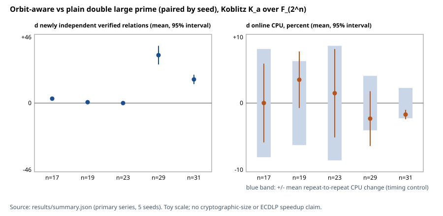

# Results: orbit-aware double large primes on small Koblitz curves (Lead 3)

Measured on 2026-10-26 by the VM clock (the lead, branch and directory names carry the
program date 2026-10-11, which is also the date at the head of PROTOCOL.md). Local base
`bbd330a9d`, not refreshed. Protocol:
[`PROTOCOL.md`](PROTOCOL.md), committed before any measurement seed was run.

**Headline (measured, toy scale, no ECDLP speedup claim).** Quotienting the
large-prime vertices by signed Frobenius orbits, with the `+-lambda^k` phase
kept, produced more independently verified relations than the plain double
large prime from the *same* relation stream at n = 17, 29 and 31 (every seed),
a small and not clearly nonzero gain at n = 19, and none at n = 23. The gain
tracks the number of orbit collisions among the fixed large primes, which a
random model predicts (n = 17, 19, 29) and which is far above the model at
n = 31 for a reason not found. Every one of 17,865 emitted complete relations
passed both replays; no replay or audit failed. Online CPU is not
distinguishable between the two arms, so CPU per verified relation falls only
because the yield rises.

## 1. Requirement status

| # | requirement | status | evidence |
|---|---|---|---|
| 1 | orbit mode, default off; canonicalise large primes to the least-abscissa signed Frobenius representative, record phase k and sign, column = orbit id with coefficient `+-lambda^k`; feed `filter_large_primes`; replay every emitted relation; count failures | verified complete | `src/cryptanalysis/ecbench_large_prime.rs` (`LargePrimeGraph`), `src/cryptanalysis/ecbench_large_prime/orbit.rs`; `Online` default |
| 2a | hand-built conjugate pair cancels under orbit mode and the replayed row verifies on the curve | verified (test passes) | `orbit::tests::frobenius_conjugate_large_primes_cancel_and_replay_on_the_curve`; control `without_the_orbit_quotient_the_same_two_rows_do_not_close` |
| 2b | a wrong phase coefficient makes the replay fail | verified (test passes) | `orbit::tests::a_wrong_phase_or_sign_cancels_in_the_filter_but_fails_the_curve_replay` (phase off by one, sign flipped, identifier only) |
| 2c | orbit mode off reproduces the existing fixture byte for byte | verified (test passes) | `tests/ecbench_large_prime.rs::orbit_mode_off_reproduces_the_recorded_fixture_report_byte_for_byte` against output of the unmodified base commit (`tests/fixtures/ecbench_large_prime_n11_default.golden.json`); only the manifest path, the executable's own hash and wall time are normalised |
| 3 | three arms, identical seeds and trial caps, n in {17,19,23,29,31}, >= 3 seeds, paired differences, noise statement | complete for the stated parameters | sections 3-5, `results/`, `receipts/` (250 cells, 5 seeds primary, 3 seeds dose). `m = n-1` was not run: the collector refused it (`refusals.txt`), so m = 3 or 4 |
| 4 | research note: PROTOCOL before measuring, receipts JSON, summarizer, RESULTS, PNG chart, `report.pdf` | partial | PROTOCOL, receipts, Rust summarizer (`examples/orbit_large_prime_bench.rs`; no `summarize.py` because the repo bans Python for this), RESULTS, **SVG** chart and diagram instead of PNG/matplotlib. **No `report.pdf`**: no PDF engine exists here (typst, pdflatex, xelatex, lualatex, tectonic, wkhtmltopdf absent; `pandoc` 3.1.3 is installed but fails with "pdflatex not found"). Not substituted with a Python renderer. |
| 5 | rustfmt, `cargo test --release -j2 --test ecbench_large_prime`, new tests, clippy | complete | rustfmt clean on every touched file; 8/8 integration tests and 7/7 `ecbench_large_prime` lib tests pass; clippy `--release ... -- -D warnings` exits 0 on lib, bin `ic`, the example and the test (section 7) |

## 2. Setup in one paragraph

Instances are the repo's own `koblitz_instance(a, n)`: K_1 for n = 17, 19, 23,
29 and K_0 for n = 31, each with the prime subgroup of the largest prime factor
of the group order (r between 2^15 and 2^21; cofactors 2, 2, 2, 12646, 1492).
Factor base: abscissae `x < 2^env` (env = 10), small base `x < 2^small`. Each
cell draws `cap` residuals `aG + bT` from a seed, decomposes each as an exact
`m`-term sum of factor-base points with at most two distinct large columns,
stores every accepted partial relation, runs the batch hypergraph filter once,
replays every emitted row on the curve, and counts a row as *independent* when
it raises the rank of an incremental elimination mod r. The four arms differ
only in the graph: `none` (no large primes), `dlp` (plain double large prime),
`dlp_orbit` (orbit vertices, phase kept) and, secondary, `dlp_orbit_absorb`
(also rewrites a large prime whose orbit contains a small column into that
column). The mechanism is drawn in [`diagram_mechanism.svg`](diagram_mechanism.svg).

## 3. Primary series: arm means over 5 seeds

`rank` is out of S+1 columns (S small columns plus the target column); `indep`
equals the rank reached because only verified rows enter the rank. Online CPU =
collect + filter + replay, process CPU, mean over the repeats.

| series | n | cap | arm | seeds | reps | partials f/s/d | complete | indep | rank (of S+1) | online CPU ms | CPU ms per indep | complete per attempt |
|---|---|---|---|---|---|---|---|---|---|---|---|---|
| primary | 17 | 200 | none | 5 | 1 | 6.6/0.0/0.0 | 6.6 | 6.6 | 6.6 (15) | 288.35 | 47.057 (n=5) | 0.0330 |
| primary | 17 | 200 | dlp | 5 | 3 | 0.4/37.8/161.8 | 6.4 | 6.2 | 6.2 (15) | 1.66 | 0.275 (n=5) | 0.0320 |
| primary | 17 | 200 | dlp_orbit | 5 | 3 | 0.4/37.8/161.8 | 10.8 | 9.2 | 9.2 (15) | 1.65 | 0.181 (n=5) | 0.0540 |
| primary | 17 | 200 | dlp_orbit_absorb | 5 | 1 | 1.8/48.6/149.6 | 15.6 | 11.0 | 11.0 (15) | 1.69 | 0.156 (n=5) | 0.0780 |
| primary | 19 | 400 | none | 5 | 1 | 28.2/0.0/0.0 | 28.2 | 27.2 | 27.2 (32) | 272.24 | 10.109 (n=5) | 0.0705 |
| primary | 19 | 400 | dlp | 5 | 3 | 2.4/65.4/332.2 | 49.8 | 25.6 | 25.6 (32) | 4.06 | 0.160 (n=5) | 0.1245 |
| primary | 19 | 400 | dlp_orbit | 5 | 3 | 2.4/65.4/332.2 | 53.2 | 26.2 | 26.2 (32) | 4.20 | 0.161 (n=5) | 0.1330 |
| primary | 19 | 400 | dlp_orbit_absorb | 5 | 1 | 5.8/89.8/304.4 | 65.4 | 29.0 | 29.0 (32) | 4.31 | 0.149 (n=5) | 0.1635 |
| primary | 23 | 450 | none | 5 | 1 | 9.6/0.0/0.0 | 9.6 | 9.6 | 9.6 (54) | 104.12 | 11.086 (n=5) | 0.0213 |
| primary | 23 | 450 | dlp | 5 | 3 | 3.6/86.8/357.4 | 92.6 | 50.8 | 50.8 (54) | 8.54 | 0.168 (n=5) | 0.2058 |
| primary | 23 | 450 | dlp_orbit | 5 | 3 | 3.6/87.0/357.2 | 94.2 | 50.8 | 50.8 (54) | 8.66 | 0.171 (n=5) | 0.2093 |
| primary | 23 | 450 | dlp_orbit_absorb | 5 | 1 | 5.4/100.2/343.8 | 102.0 | 50.8 | 50.8 (54) | 9.43 | 0.186 (n=5) | 0.2267 |
| primary | 29 | 300 | none | 5 | 1 | 6.0/0.0/0.0 | 6.0 | 6.0 | 6.0 (62) | 29000.13 | 5093.851 (n=5) | 0.0200 |
| primary | 29 | 300 | dlp | 5 | 3 | 1.2/34.8/263.6 | 19.4 | 19.2 | 19.2 (62) | 570.53 | 31.481 (n=5) | 0.0647 |
| primary | 29 | 300 | dlp_orbit | 5 | 3 | 1.2/35.0/263.4 | 51.8 | 51.6 | 51.6 (62) | 557.27 | 10.794 (n=5) | 0.1727 |
| primary | 29 | 300 | dlp_orbit_absorb | 5 | 1 | 4.0/55.2/240.8 | 68.2 | 58.4 | 58.4 (62) | 338.48 | 5.803 (n=5) | 0.2273 |
| primary | 31 | 450 | none | 5 | 1 | 3.2/0.0/0.0 | 3.2 | 3.2 | 3.2 (66) | 50851.31 | 18602.299 (n=5) | 0.0071 |
| primary | 31 | 450 | dlp | 5 | 2 | 1.8/38.4/339.4 | 45.6 | 45.6 | 45.6 (66) | 10247.61 | 226.632 (n=5) | 0.1013 |
| primary | 31 | 450 | dlp_orbit | 5 | 2 | 1.8/38.4/340.6 | 62.2 | 61.6 | 61.6 (66) | 10071.87 | 165.164 (n=5) | 0.1382 |
| primary | 31 | 450 | dlp_orbit_absorb | 5 | 1 | 6.8/75.2/360.8 | 110.0 | 65.6 | 65.6 (66) | 3288.19 | 50.110 (n=5) | 0.2444 |

CPU per independent relation is in milliseconds (the primary metric, seconds
x 1e-3). `complete per attempt` is complete rows divided by trials.

## 4. Paired differences: orbit (iii) minus plain double large prime (ii)

Same seed means the same residual stream, factor base and trial cap in both
arms, so counter differences are exact properties of the arm, not noise. The
signs columns count seeds where orbit was above / equal / below plain.

| series | n | cap | treatment | S | d complete | signs | d indep | signs | d rank | d CPU per indep % | verdict (CPU per indep) | d online CPU % | verdict (online CPU) | timing control % |
|---|---|---|---|---|---|---|---|---|---|---|---|---|---|---|
| primary | 17 | 200 | dlp_orbit | 5 | +4.4 +/- 1.4 | 5+/00/0- | +3.0 +/- 0.9 | 5+/00/0- | +3.0 +/- 0.9 | -33.0 +/- 9.4 (n=5) | outside noise | +0.0 +/- 5.8 | within noise | 8.0 |
| primary | 17 | 200 | dlp_orbit_absorb | 5 | +9.2 +/- 3.2 | 5+/00/0- | +4.8 +/- 2.0 | 5+/00/0- | +4.8 +/- 2.0 | -41.8 +/- 14.2 (n=5) | outside noise | +2.2 +/- 7.1 | within noise | 8.0 |
| primary | 19 | 400 | dlp_orbit | 5 | +3.4 +/- 3.2 | 5+/00/0- | +0.6 +/- 0.7 | 3+/20/0- | +0.6 +/- 0.7 | +1.0 +/- 4.4 (n=5) | within noise | +3.5 +/- 4.2 | within noise | 6.2 |
| primary | 19 | 400 | dlp_orbit_absorb | 5 | +15.6 +/- 4.4 | 5+/00/0- | +3.4 +/- 2.1 | 5+/00/0- | +3.4 +/- 2.1 | -6.2 +/- 12.4 (n=5) | within noise | +6.1 +/- 7.0 | within noise | 6.2 |
| primary | 23 | 450 | dlp_orbit | 5 | +1.6 +/- 1.1 | 4+/10/0- | +0.0 +/- 0.0 | 0+/50/0- | +0.0 +/- 0.0 | +1.5 +/- 6.5 (n=5) | within noise | +1.5 +/- 6.5 | within noise | 8.5 |
| primary | 23 | 450 | dlp_orbit_absorb | 5 | +9.4 +/- 1.9 | 5+/00/0- | +0.0 +/- 0.0 | 0+/50/0- | +0.0 +/- 0.0 | +9.4 +/- 24.7 (n=5) | within noise | +9.4 +/- 24.7 | within noise | 8.5 |
| primary | 29 | 300 | dlp_orbit | 5 | +32.4 +/- 6.3 | 5+/00/0- | +32.4 +/- 6.3 | 5+/00/0- | +32.4 +/- 6.3 | -63.8 +/- 10.7 (n=5) | outside noise | -2.3 +/- 4.1 | within noise | 4.0 |
| primary | 29 | 300 | dlp_orbit_absorb | 5 | +48.8 +/- 8.9 | 5+/00/0- | +39.2 +/- 6.9 | 5+/00/0- | +39.2 +/- 6.9 | -80.5 +/- 6.0 (n=5) | outside noise | -40.3 +/- 6.7 | outside noise | 4.0 |
| primary | 31 | 450 | dlp_orbit | 5 | +16.6 +/- 4.0 | 5+/00/0- | +16.0 +/- 3.2 | 5+/00/0- | +16.0 +/- 3.2 | -27.1 +/- 2.8 (n=5) | outside noise | -1.7 +/- 0.7 | within noise | 2.2 |
| primary | 31 | 450 | dlp_orbit_absorb | 5 | +64.4 +/- 6.2 | 5+/00/0- | +20.0 +/- 4.6 | 5+/00/0- | +20.0 +/- 4.6 | -77.7 +/- 3.8 (n=5) | outside noise | -67.9 +/- 3.5 | outside noise | 2.2 |

Reading the verdicts: the timing control is the mean absolute relative change
in online CPU between repeats of the same cell (2.2% to 8.5% here, a shared
4-core VM). A difference is `within noise` if it is no larger than the t
half-width or the control, as fixed in the protocol.

Per-seed paired differences, primary series, arm (iii) minus arm (ii)
(`d CPU` columns in percent of the plain arm):

| n | cap | seed | d complete | d indep | d rank | d online CPU % | d CPU per indep % |
|---|---|---|---|---|---|---|---|
| 17 | 200 | 1 | +3 | +3 | +3 | -3.34 | -39.59 |
| 17 | 200 | 2 | +6 | +4 | +4 | +4.77 | -41.79 |
| 17 | 200 | 3 | +4 | +3 | +3 | -3.10 | -32.17 |
| 17 | 200 | 4 | +5 | +3 | +3 | +5.52 | -26.14 |
| 17 | 200 | 5 | +4 | +2 | +2 | -3.80 | -25.18 |
| 19 | 400 | 1 | +1 | +1 | +1 | +4.37 | +0.20 |
| 19 | 400 | 2 | +1 | +0 | +0 | +0.06 | +0.06 |
| 19 | 400 | 3 | +7 | +1 | +1 | -0.20 | -3.64 |
| 19 | 400 | 4 | +3 | +1 | +1 | +7.17 | +2.71 |
| 19 | 400 | 5 | +5 | +0 | +0 | +5.89 | +5.89 |
| 23 | 450 | 1 | +2 | +0 | +0 | +0.09 | +0.09 |
| 23 | 450 | 2 | +2 | +0 | +0 | -0.23 | -0.23 |
| 23 | 450 | 3 | +2 | +0 | +0 | -2.56 | -2.56 |
| 23 | 450 | 4 | +2 | +0 | +0 | +10.72 | +10.72 |
| 23 | 450 | 5 | +0 | +0 | +0 | -0.69 | -0.69 |
| 29 | 300 | 1 | +37 | +37 | +37 | -2.97 | -77.76 |
| 29 | 300 | 2 | +37 | +37 | +37 | +2.38 | -65.27 |
| 29 | 300 | 3 | +27 | +27 | +27 | -6.10 | -55.81 |
| 29 | 300 | 4 | +34 | +34 | +34 | -0.69 | -62.08 |
| 29 | 300 | 5 | +27 | +27 | +27 | -4.13 | -58.06 |
| 31 | 450 | 1 | +21 | +19 | +19 | -2.50 | -30.56 |
| 31 | 450 | 2 | +18 | +18 | +18 | -0.95 | -28.38 |
| 31 | 450 | 3 | +13 | +13 | +13 | -1.51 | -26.13 |
| 31 | 450 | 4 | +14 | +14 | +14 | -1.75 | -25.07 |
| 31 | 450 | 5 | +17 | +16 | +16 | -1.78 | -25.59 |

Per-arm, per-seed, per-repeat numbers for all 250 receipts are in
[`results/tables_all_receipts.md`](results/tables_all_receipts.md) and
[`results/summary.json`](results/summary.json); raw receipts in `receipts/`.



## 5. What the orbit quotient did to the large columns

Random model: two distinct large points lie in one signed Frobenius orbit with probability about (2n-2)/(r-1), so E[colliding pairs] = C(L,2)(2n-2)/(r-1) for L large points. `merged` counts large points that share an orbit vertex with another large point (L minus orbits, absorbed excluded).
| n | curve | r | cofactor | L (large points) | orbits | merged | absorbed (absorb arm) | E[pairs] random model | L/r |
|---|---|---|---|---|---|---|---|---|---|
| 17 | K_1 | 65587 | 2 | 474 | 410 | 64 | 19 | 54.7 | 0.0072 |
| 19 | K_1 | 262543 | 2 | 490 | 478 | 12 | 18 | 16.4 | 0.0019 |
| 23 | K_1 | 4196903 | 2 | 444 | 442 | 2 | 9 | 1.0 | 0.0001 |
| 29 | K_1 | 42457 | 12646 | 444 | 340 | 104 | 38 | 129.7 | 0.0105 |
| 31 | K_0 | 1439393 | 1492 | 460 | 426 | 34 | 38 | 4.4 | 0.0003 |

`merged` is large points removed from the vertex set by being a Frobenius
conjugate of another large point (members of one orbit). Every merge is a true
conjugate: building the table checks `[factor]rep == Q` against the curve for
each large point, and the build refuses otherwise.

* Where the random model predicts at least 5 colliding pairs (n = 17, 19, 29),
  the observed merges are within a factor of 1.4 of it (64 vs 54.7, 12 vs 16.4,
  104 vs 129.7), which meets the expectation fixed in the protocol.
* n = 23: 2 observed, 1.0 expected (below the protocol's threshold of 5).
* **n = 31: 34 observed, 4.4 expected.** This is not explained. The phases of
  the merged pairs are spread over the whole range, with several pairs differing
  by 2 or 8; I did not investigate further. The excess is why n = 31 has a
  gain that the random model alone would not predict. It is a recorded
  anomaly, not a result.
* The absorb arm absorbs more large points into small columns than the random
  model for a small base predicts at n = 17, 19, 23 and 31 (for example 19 vs
  about 3 at n = 17). *Untested hypothesis:* Frobenius sends low-degree
  abscissae (`x^2` has degree `2 deg x`, no reduction below degree n) into the
  prefix subspace `x < 2^env`, so a prefix base is partly Frobenius-structured.
  The large-to-large merge counts above are consistent with random pairing at
  n = 17, 19 and 29 (not at n = 31); the small-to-large relation is where I
  would look first.

Ordering the five curves by merged fraction (n = 23: 0.5%, 19: 2.4%, 31: 7.4%,
17: 13.5%, 29: 23.4%) orders them the same way by relative gain in independent
relations (0%, +2%, +35%, +48%, +169%). Five points; no fit is claimed.

## 6. Other arms and the dose series

No-large-prime arm (i), the plain arm (ii), orbit (iii) and absorb (iv), primary
series (independent relations at the cap, and CPU per independent relation):

| n | cap | S | indep: none | indep: dlp | indep: orbit | indep: orbit+absorb | CPU ms per indep: none | dlp | orbit | orbit+absorb |
|---|---|---|---|---|---|---|---|---|---|---|
| 17 | 200 | 5 | 6.6 | 6.2 | 9.2 | 11.0 | 47.057 | 0.275 | 0.181 | 0.156 |
| 19 | 400 | 5 | 27.2 | 25.6 | 26.2 | 29.0 | 10.109 | 0.160 | 0.161 | 0.149 |
| 23 | 450 | 5 | 9.6 | 50.8 | 50.8 | 50.8 | 11.086 | 0.168 | 0.171 | 0.186 |
| 29 | 300 | 5 | 6.0 | 19.2 | 51.6 | 58.4 | 5093.851 | 31.481 | 10.794 | 5.803 |
| 31 | 450 | 5 | 3.2 | 45.6 | 61.6 | 65.6 | 18602.299 | 226.632 | 165.164 | 50.110 |

* Arm (i) is about 60 to 170 times more expensive per independent relation than
  (ii) in these runs (63, 66, 82, 162, 171 at n = 19, 23, 31, 29, 17). That ratio mixes the arms' yield with this collector's
  cost model: a trial that finds no acceptable decomposition scans the whole
  right-hand table, and without large primes most trials fail. It is a property
  of this implementation at this scale, not of large primes in general.
* At n = 17 and 19 arm (i) reached about as many independent relations as (ii)
  at the chosen cap (6.6 vs 6.2; 27.2 vs 25.6), so large primes did not raise
  the yield there; at n = 23, 29, 31 they did (9.6, 6.0, 3.2 vs 50.8, 19.2, 45.6).
* The absorb arm (iv) has a larger gain still and, at n = 29 and 31, a large
  CPU reduction (-40.3% and -67.9% online CPU against plain, outside noise).
  That is a different mechanism from the large-prime graph: absorbing turns
  large primes into small ones, which makes more decompositions acceptable, so
  the scan stops earlier. It is reported as secondary and is not the lead's
  arm (iii).

Dose series (caps 0.5x and 2x the primary cap, 3 seeds, arms `dlp` and
`dlp_orbit`, one repeat, so no timing control; verdicts use the t half-width
only):

| series | n | cap | treatment | S | d complete | signs | d indep | signs | d rank | d CPU per indep % | verdict (CPU per indep) | d online CPU % | verdict (online CPU) | timing control % |
|---|---|---|---|---|---|---|---|---|---|---|---|---|---|---|
| dose | 17 | 100 | dlp_orbit | 3 | +0.3 +/- 1.4 | 1+/20/0- | +0.3 +/- 1.4 | 1+/20/0- | +0.3 +/- 1.4 | -16.4 +/- n/a (n=1) | S=1 | -4.5 +/- 25.7 | within noise | n/a |
| dose | 17 | 400 | dlp_orbit | 3 | +27.0 +/- 7.5 | 3+/00/0- | +0.3 +/- 1.4 | 1+/20/0- | +0.3 +/- 1.4 | +4.9 +/- 7.5 (n=3) | within noise | +7.7 +/- 19.5 | within noise | n/a |
| dose | 19 | 200 | dlp_orbit | 3 | +0.7 +/- 2.9 | 1+/20/0- | +0.7 +/- 2.9 | 1+/20/0- | +0.7 +/- 2.9 | -16.5 +/- 50.8 (n=3) | within noise | -5.9 +/- 28.0 | within noise | n/a |
| dose | 19 | 800 | dlp_orbit | 3 | +10.3 +/- 2.9 | 3+/00/0- | +0.0 +/- 0.0 | 0+/30/0- | +0.0 +/- 0.0 | +8.3 +/- 54.2 (n=3) | within noise | +8.3 +/- 54.2 | within noise | n/a |
| dose | 23 | 225 | dlp_orbit | 3 | +0.0 +/- 0.0 | 0+/30/0- | +0.0 +/- 0.0 | 0+/30/0- | +0.0 +/- 0.0 | +7.2 +/- 19.7 (n=3) | within noise | +7.2 +/- 19.7 | within noise | n/a |
| dose | 23 | 900 | dlp_orbit | 3 | +2.0 +/- 0.0 | 3+/00/0- | +0.0 +/- 0.0 | 0+/30/0- | +0.0 +/- 0.0 | -0.6 +/- 19.0 (n=3) | within noise | -0.6 +/- 19.0 | within noise | n/a |
| dose | 29 | 150 | dlp_orbit | 3 | +1.0 +/- 4.3 | 1+/20/0- | +1.0 +/- 4.3 | 1+/20/0- | +1.0 +/- 4.3 | -20.2 +/- 111.0 (n=3) | within noise | +8.0 +/- 12.1 | within noise | n/a |
| dose | 29 | 600 | dlp_orbit | 3 | +85.0 +/- 10.8 | 3+/00/0- | +0.0 +/- 0.0 | 0+/30/0- | +0.0 +/- 0.0 | -2.1 +/- 11.7 (n=3) | within noise | -2.1 +/- 11.7 | within noise | n/a |
| dose | 31 | 225 | dlp_orbit | 3 | +2.0 +/- 5.0 | 2+/10/0- | +2.0 +/- 5.0 | 2+/10/0- | +2.0 +/- 5.0 | -40.1 +/- 102.4 (n=3) | within noise | -1.5 +/- 7.5 | within noise | n/a |
| dose | 31 | 900 | dlp_orbit | 3 | +33.0 +/- 6.6 | 3+/00/0- | +0.0 +/- 0.0 | 0+/30/0- | +0.0 +/- 0.0 | -3.6 +/- 3.8 (n=3) | within noise | -3.6 +/- 3.8 | within noise | n/a |

Observation: the gain in independent relations is confined to caps where the
plain arm's rank is neither near zero nor saturated. At the low cap there are
too few cycles for either arm; at the high cap both reach full rank (e.g.
n = 29, cap 600: 62 of 62 for both) and only the count of complete (dependent)
rows differs (+85 for orbit). The orbit arm reaches a given rank at a smaller
cap; the dose series has one point per n and cap and no more claim than that.

## 7. Integrity and noise

- receipts: 250; (series, n, cap, arm, seed) groups: 160; verified complete relations: 17865.
- replay or partial-audit failures (linear + curve + audit, all receipts): 0.
- receipts whose recovered scalar equals the planted log: 186; disagreeing with it: 0.
- groups whose repeats disagree on a deterministic counter: 0.
- longest per-cell audit CPU (excluded from online CPU): 0.004 s; setup CPU is excluded from online CPU and is identical across arms.

* The validity gates in PROTOCOL.md section 7 hold: zero replay failures, zero
  partial-audit failures, every recovered scalar equals the planted log, repeats
  agree exactly on all deterministic counters.
* The checker is not vacuous: unit test 2b shows the curve replay rejecting a
  wrong phase, wrong sign and identifier-only merge that the filter and the
  linear replay both accept.
* Peak RSS per cell (own process): at most 72, 106, 163, 204 and 210 MB for
  n = 17, 19, 23, 29, 31 (dominated by the exact combination table).
* Measurement compute: 892.6 s of process CPU over the 250 cells (718.0 s in the
  primary series). Build wall times are in the PR description.
* Clippy: `cargo clippy --release -j2 --locked --lib --bin ic --example
  orbit_large_prime_bench --test ecbench_large_prime -- -D warnings` exits 0; its
  only output is the pre-existing warning that the local clippy 1.97 does not know
  `clippy::chunks_exact_to_as_chunks` (allowed in Cargo.toml for the CI toolchain
  1.98). CI lints the whole crate with `--all-targets`; I did not.
* Timing is single-threaded process CPU on a shared 4-core VM with other jobs
  running; it is diagnostic, not a benchmark.

## 8. Deviations from the plan and caveats

* **Summands.** `m = n-1` is infeasible at these n; the collector's refusal
  message for each n is in `refusals.txt`. m = 3 (n <= 23) and 4 (n >= 29)
  with env = 10 were chosen in the pilot, by starving arm (i) (it finds a full
  relation in 1 to 6% of trials) while keeping the rank unsaturated, not by the
  quantity compared. The caps were fixed from pilot seeds 9001-9004 before the
  measurement seeds 1-5 ran. This is a different problem from the repo's
  `m = n-1` convention, and the result should be read as one.
* **Curves.** At n = 29 and 31 the prime subgroup is much smaller than the field
  (r ~ 2^15.4 and 2^20.5 with cofactors 12646 and 1492), a dense regime for
  the base (L/r = 1.0% at n = 29). The n = 29 gain is the largest partly for
  that reason.
* **Different graph code.** Arms (i)-(iv) use the batch filter, not the repo's
  streaming `LargePrimeEliminator`, and do not stop at recovery, so they are not
  comparable with the existing receipts' trial counts; the existing path is
  unchanged and is not an arm.
* **Summarizer revised after the run.** After the measurement I added a verdict
  column for the primary metric and paired rows for the absorb arm, then
  regenerated all tables from the same receipts; the cell code, collector and
  library were not touched (`results/SUMMARIZER.txt`). The verdict rule itself
  is the one in the protocol.
* **Unit tests and the `-j2` builds** ran on the same sources as the
  measurement (rustfmt was applied before the lib tests, the integration tests
  and the measurement binary were built).
* **Not tested:** ledger hypothesis H-BINSTD-555991 (no matched rho was run);
  anything about ECC2K-130 or any deployed curve; the streaming eliminator as a
  baseline; Frobenius-closed factor bases.

## 9. Scope limits, and what a cryptographic-size claim would additionally need

Established here: on 5 small Koblitz curves with prefix-subspace factor bases,
orbit quotienting of the large columns, with the phase kept and checked on the
curve, yields extra verified relations in proportion to how many large primes
are Frobenius conjugates of each other, at no measurable change in online CPU.

Not established, and not inferred: any statement about r ~ 2^130 or any speedup
over rho. As an *arithmetic remark under the random model, not a measurement*,
the expected number of conjugate pairs among L fixed large primes is about
`L^2 n / r`; for a prefix base at cryptographic r it is vanishingly small, so a
gain there would have to come from a factor base that is closed under Frobenius
(a different regime, already the basis of the program's compact-orbit work).

A cryptographic-size claim would additionally need: (1) the same measurement on
Frobenius-closed bases (where every large prime has n orbit mates) and at
rungs where the base and r are not both toy-sized; (2) cost accounting in the
repo's counted unit with the unpriced items (combination-table enumeration,
hash lookups, canonicalisation, modular row operations) priced, instead of
process CPU of a single-threaded toy; (3) an end-to-end solve (relations +
linear algebra + descent) against matched `rho.signed_frobenius` in ecbench, so
the ledger hypothesis can be tested; (4) the right large-prime count and
cycle-length budget at scale (the filter is exact here; fill-in and the
`max_sources` / `max_small_weight` caps at scale are untested); (5) multi-target
and cold-start versus amortised accounting; (6) independent replay on another
runner (the repo's isolab / replay-certificate workflow) before any claim.

## 10. Reproduction

```text
export CARGO_TARGET_DIR=/home/user/cargo-target
cargo build --release -j2 --locked --example orbit_large_prime_bench
research/orbit_aware_large_prime_20261011/run_all.sh all      # ~15 min, 250 cells
cargo run --release -j2 --locked --example orbit_large_prime_bench -- \
   summarize --in research/orbit_aware_large_prime_20261011/receipts \
             --out research/orbit_aware_large_prime_20261011/results
cargo test --release -j2 --locked --lib -- ecbench_large_prime
cargo test --release -j2 --locked --test ecbench_large_prime
cargo clippy --release -j2 --locked --lib --bin ic --example orbit_large_prime_bench \
   --test ecbench_large_prime -- -D warnings
# one cell by hand, then cross-check n = 17..29 with the CLI on a manifest:
orbit_large_prime_bench cell --n 29 --arm dlp_orbit --seed 1 --small 7 --env 10 \
   --summands 4 --trials 300 --max-states 3000000 --out /tmp/cell
orbit_large_prime_bench manifest --n 29 --small 7 --env 10 --out /tmp/m29.json
ic --json large-prime --manifest /tmp/m29.json --graph orbit --summands 4 \
   --small-dimension 7 --envelope-dimension 10 --max-trials 300 --max-states 3000000 --seed 1
```

Environment of the measurement: `receipts/ENVIRONMENT.txt`. Pilot receipts:
`pilot/` (see `pilot/NOTE.txt`).
