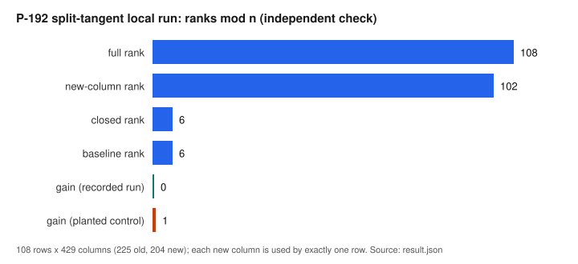

# Independent closure check: P-192 split-tangent local run

Status: completed 2026-11-25 (Claude Code). The checker is separately
written and does not use the producer's C++ code. The result has not been
signed by a validator key, so it is [pcc:unverified].
Classification: **validation of a negative result**. It is not an improvement
and adds no leaderboard row.

## Question

PR #5123 recorded an authorized local run of the fixed split-tangent
collector on P-192:
`research/nist_cover_three_tests_20261116/local_collection_20261124/evidence/attempt-v1/pipeline/result.json`
(SHA-256 `0f5762075fc29a6f22d9c28a65264844bf627a6b93fb731a4da8a4b397cb8c40`).
The producer reported ranks 108 / 102 / 6 and an old-base gain of 0
(claims PCC-20261124-695364 and PCC-20261124-655ae2, both unverified). Two
earlier derivations put a lower bound on the support of any closing
combination: at least 3 rows (PCC-20261124-df73b8) and at least 4 rows
(PCC-20261124-1b9035 and PCC-20261124-2129c1).

This check asks two things:

- Do the recorded numbers reproduce with independent arithmetic?
- Does the recorded matrix settle the question at every support size, so the
  minimum-support chain is not needed for this batch?

## What the checker does

`check_closure.py` uses only the Python standard library. It reads the
published JSON schema and nothing else.

| Check | Result |
| --- | --- |
| A. All 429 base points lie on P-192, n·P = O; control (n−1)·P ≠ O | 429/429, control passes |
| B. Every matrix row is an elliptic relation, Σ cⱼBⱼ = O | 108/108 |
| C. Rows touching new columns (index ≥ 225) | 102. Each has exactly 2 private new columns; 0 of 204 new columns are shared, 0 unused |
| D. Ranks mod n | full 108, new-column 102, closed 6, baseline (6 rows with no new support) 6, **gain 0** |
| E. The producer's 6 closure combinations and old rows | 6/6 combinations reproduce old-only rows; old rows lie in the span of the baseline rows |
| F1. Planted control: one added row plus a fresh old unit vector | gain 1; 2 rows lose privacy (101/103). The detector works |
| F2. Corrupt one coefficient of an added row | row sum ≠ O, so it is rejected |

Cost on one container core: the point checks took 8.9 s, the row sums 8.2 s,
the linear algebra 0.04 s and the controls 0.1 s. The full output is in
`result.json`.



## Conclusion for this batch (exact)

None of the 204 new columns appears in two rows. Take any combination
Σ λᵢ rᵢ and project it onto the new columns. On a row's private column c,
that projection equals λᵢ·rᵢ[c], and rᵢ[c] ≠ 0 modulo the prime n. So the
projection vanishes only if λᵢ = 0 for every added row.

Every combination that closes on the old base therefore uses only the 6
baseline rows. **The gain is 0 at every support size, not just at 1, 2 or 3
rows.** For this recorded batch, this supersedes the 3-row and 4-row lower
bounds: those were necessary-condition tests on traces taken before
collection, and the collected images settle the question directly.

## Why the lead looks exhausted (heuristic, not proven)

A closing combination needs two different rows to share a new column, that
is, two residual images that land on the same point of E(F_p) with
|E| = n ≈ 2¹⁹². In this batch the 204 images are pairwise distinct and pass
the order-n check.

If the images behave like independent uniform points, a shared column first
appears after about √n ≈ 2⁹⁶ images (the birthday bound). That is the cost
of Pollard rho itself, so a larger collection from this family cannot
undercut rho unless some structure forces the images to collide.

This is a heuristic, conditional on images being close to uniform. A
uniformity test on the recorded images would be needed to firm it up. What
the batch does show exactly is the absence of collisions at 204 images.

## What this does not say

- It says nothing about other relation families, or about split-tangent
  rows built with a different map.
- It does not replace an independent signed verdict on the geometry (the
  cover maps and correspondence), and it does not price original map
  synthesis.
- It does not test whether residual images are uniform. The √n argument
  above is heuristic.

## Sources checked

The research-kb MCP server was not loaded in this session, so I used the
repository sources directly:
`research/nist_cover_three_tests_20261116/local_collection_20261124/{README.md,RESULTS.json}`
and the 2026-11-24 session log (two-row, three-row, aggregate and pair
entries). I make no novelty claim. That shared birthday collisions are needed
mirrors the standard large-prime-variation argument for elliptic index
calculus. It is cited from memory and is not a checked source.

## Reproduce

```bash
cd research/p192_closure_independent_20261125
python3 check_closure.py ../nist_cover_three_tests_20261116/local_collection_20261124/evidence/attempt-v1/pipeline/result.json result.json
python3 figure.py
```
