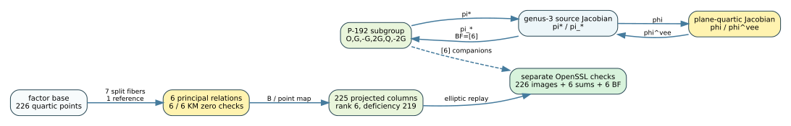

# P-192 plane-quartic transfer replay

## Outcome

A fresh local replay at source revision
`5d05bef010a8a9dbd56b4cadf9a8c2cbeb79e6b2` passes the requested functional
pipeline. It generates relations on the actual kernel-3 plane quartic, checks
them in the target Jacobian, transports every row to P-192, and checks the
elliptic sums with a separate OpenSSL implementation. The complete
`F = phi o pi*`, `B = pi_* o phi^vee` panel also passes `B(F(P)) = [6]P` on
`O, G, -G, 2G, Q, -2G`; the last input exercises the old-shift infinity
case. [pcc:unverified]



This is a successful reproducible local functional run. It is not a signed
PCC verdict, an independently reconstructed quotient, or an admitted
performance comparison. The machine-readable record is
[`receipt.json`](receipt.json). [pcc:unverified]

## Fixed construction and factor base

The replay uses the archived actual kernel-3 P-192 construction consumed by
the existing [`check-relation-e2e.sh`](../nist_cover_three_tests_20261116/check-relation-e2e.sh)
entrypoint. The collector scans the 256 fixed affine vertical lines and keeps
all quartic points above `x = 0,...,255`. This gives a factor base of 226
quartic points and seven completely split simple fibers. The first split
fiber is the reference; each of the remaining six supplies

```text
H_a - H_b = div((X-aZ)/(X-bZ)).
```

The target Khuri-Makdisi implementation checks all six classes as zero in the
quartic Jacobian. The separate checker repeats all 226 map images, seven fiber
factorizations, and six elliptic relation sums using GMP polynomial arithmetic
and OpenSSL P-192 group operations. Its four corruption controls reject.
[pcc:unverified]

## Relation yield and independence

| Quantity | Fresh result |
|---|---:|
| Candidate vertical lines | 256 |
| Quartic factor-base points | 226 |
| Completely split fibers | 7 |
| Nontrivial principal relations | 6 |
| Target Jacobian zero checks | 6 / 6 |
| Projected nonzero P-192 columns | 225 |
| Zero projected rows | 0 |
| Rank modulo the P-192 subgroup order | 6 |
| Rank deficiency | 219 |
| Relation yield per candidate line | 2.34375% |
| Independent-row yield | 6 / 6 (100%) |

The six rows are linearly independent, but they are only setup relations:
rank 6 on 225 columns does not supply a full logarithm system. No scalar
recovery or speedup follows. [pcc:unverified]

## Complete transfer and exceptional representations

For this fixed construction, the polarized quotient has
`phi^vee(phi(D)) = [3]D` and the degree-two cover has
`pi_*(pi*(P)) = [2]P`. Therefore the typed composition is

```text
B(F(P)) = pi_* phi^vee phi pi*(P)
        = pi_* [3] pi*(P)
        = [3][2]P
        = [6]P.
```

The quotient premise and its exact scope are recorded in
[`POLARIZED_QUOTIENT.md`](../nist_cover_three_tests_20261116/POLARIZED_QUOTIENT.md).
The fresh run below checks the composed identity directly rather than relying
only on this derivation. [pcc:unverified]

The fresh transfer producer executes the forward cover pullback, target
isogeny and target Jacobian encoding, then the transpose/dual and cover norm.
Five nonzero inputs also pass the exact source-Jacobian identity
`phi^vee(phi(D)) = [3]D` before the norm. All six final P-192 outputs equal
`[6]P`. The panel contains the identity, signs, doubling, an independent
public point, and `-2G`, whose shifted input reaches the infinity fiber.
[pcc:unverified]

The transfer checker consumes only the fresh output and uses OpenSSL group
arithmetic for all six companions. It confirms the exceptional `-2G` binding
and rejects a changed norm. This independently checks the final P-192
arithmetic; it does not independently derive the genus-3 correspondence.
[pcc:unverified]

## Recorded cost

The following are one-run local process diagnostics on a five-vCPU AMD EPYC
9V74 container. They include both producer and checker builds. [pcc:unverified]

| Process | Wall s | User s | System s |
|---|---:|---:|---:|
| Relation producer build | 11.382 | 10.978 | 0.401 |
| Relation checker build | 2.529 | 2.425 | 0.103 |
| Relation producer | 5.324 | 5.310 | 0.012 |
| Relation checker | 0.369 | 0.360 | 0.009 |
| Transfer producer build | 13.587 | 12.826 | 0.746 |
| Transfer checker build | 1.852 | 1.624 | 0.226 |
| Complete-transfer producer | 33.059 | 32.946 | 0.065 |
| Complete-transfer checker | 0.009 | 0.005 | 0.004 |
| Portable reviewer build | 2.210 | 1.740 | 0.460 |
| Portable reviewer comparison | 0.010 | 0.010 | 0.000 |
| **Total recorded** | **70.331** | **68.224** | **2.026** |

The relation producer's internal stages total 5.316664 wall seconds; the
complete-transfer producer's internal stages total 33.047168 wall seconds.
Every internal stage is listed in `receipt.json`. Timings are diagnostics,
not an isolated benchmark. They exclude the historical construction of the
pinned quotient and maps, and the 70.331-second sum includes compilation and
review but not checkout or this report's rendering. [pcc:unverified]

## Independent replay comparison

The typed portable reviewer compares the four fresh result trees against the
published replay while excluding only 33 nonnegative timing fields. It binds
112 manifest subjects, reports the same OpenSSL version, and rejects six
structural/hash corruptions. The fresh mathematical outputs match exactly;
the comparison receipt has SHA-256
`1a2d28860a5b88216aa42f62c942d9c05006d663578a33c83363bcc881deb836`.
[pcc:unverified]

## Reproduce

From the repository root:

```sh
cd research/nist_cover_three_tests_20261116
./check-relation-e2e.sh /absolute/path/to/new-replay
c++ -std=c++17 -O2 -Wall -Wextra -Werror -pedantic \
  review_relation_replay.cpp -lcrypto -o /tmp/p192-replay-reviewer
/tmp/p192-replay-reviewer "$(git rev-parse --show-toplevel)" \
  "$PWD/evidence/relation-e2e-v1" /absolute/path/to/new-replay \
  research/nist_cover_three_tests_20261116/evidence/relation-portable-inputs-v1.sha256
```

The e2e entrypoint imposes a 600-second and 1-GiB limit on each worker and
retains input/source manifests, exits, raw results, and process costs. The
full construction and checker boundaries are documented in the existing
[`RELATION_PIPELINE.md`](../nist_cover_three_tests_20261116/RELATION_PIPELINE.md)
and [`PORTABLE_REPLAY.md`](../nist_cover_three_tests_20261116/PORTABLE_REPLAY.md).

## Evidence boundary

Supported by this replay: the fixed factor-base census, six actual quartic
relations, six target-Jacobian zero checks, transport of every row, rank 6,
the six-input complete transfer, the exceptional old-shift case, the separate
P-192 arithmetic checks, and all listed local costs. [pcc:unverified]

Still outside this replay: signed independent geometric verification,
independent reconstruction of the quotient/correspondence, a broader relation
collector, enough rows for a restricted logarithm solve, and an admitted
end-to-end performance comparison. Those limits do not invalidate the
functional acceptance run reported here. [pcc:unverified]
