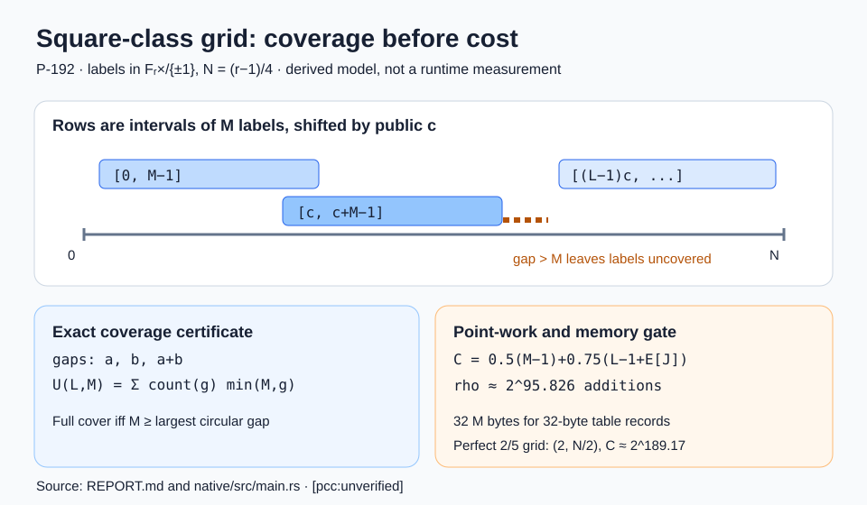

# P-192 ray-character square grid: exact coverage and point-work gate

2026-11-23, updated 2026-11-24 (America/Los_Angeles) · status: research certificate, [pcc:unverified]

## Question and scope

For the P-192 prime-order subgroup, can a point-dependent ray character of a
marked point be evaluated for less than the reference expected rho work? This
round studies the specific square-class grid generated by the public integers
2 and 5. It does not use a horizontal isogeny evaluation. The graph and cost
certificate are a screening step for that candidate, not an EC scalar
recovery or a practical evaluator.

The subgroup order is

`r = 6277101735386680763835789423176059013767194773182842284081`.

The square classes in `F_r^×/{±1}` have order

`N = (r-1)/4 = 1569275433846670190958947355794014753441798693295710571020`.

The point input is an order-`r` point `P` on the fixed P-192 curve. The
candidate operation tests whether its discrete scalar relative to a chosen
generator falls into the subgroup of squares, using known scalar multiples
`2P` and `5P` in a meet-in-the-middle grid. That information distinguishes
the marked point and is invisible in the unmarked class-group quotient.

## Construction

Both 2 and 5 are squares modulo `r`. Write `2^c = ±5 (mod r)` in the square
classes. This `c` is a *public finite-field* logarithm, not the unknown
elliptic-curve scalar. A table of `M` successive 2-multiples and `L`
successive 5-multiples covers exactly the circular exponent intervals

`[c j, c j + M - 1] (mod N)`, for `0 ≤ j < L`.

Let `a` be the least positive orbit residue among `j c (mod N)`, `0 ≤ j < L`,
and `N-b` the greatest. Let `u` and `v` be their respective nonzero orbit
indices. The first-return form of the three-gap theorem gives gap lengths
`a`, `b`, and `a+b`, with multiplicities `L-u`, `L-v`, and `u+v-L` (the last
can be zero). Equal lengths are merged. The exact coverage of a table of
length `M` is

`U(L,M) = Σ_g multiplicity(g) · min(M,g)`.

Thus full coverage is equivalent to `M ≥ max(g)`. A floor-sum count and binary
search find the extremal residues without iterating `L` times. The Rust
certificate checks the gap count and that the lengths sum to `N`, then
computes the coverage. [pcc:unverified]



The diagram source is [`grid.svg`](grid.svg). The blue interval is one table
row; adjacent rows are shifted by `c`. A circular gap longer than `M` leaves
uncovered labels. The cost gate follows from the full-cover condition and
must be evaluated with the actual first-hit distribution.

## Cost gate

The reference is `sqrt(pi·r/4) ≈ 2^95.826` group additions. The following
model grants the square-grid candidate inexpensive point steps: one table
step costs `0.5` additions and one query step costs `1.5` additions. It counts
point arithmetic only; table lookups, memory traffic, setup, and finite-field
log computation are additional costs.

For a uniformly random square-class label, let `J` be the first query index
whose interval contains it. For a label outside the target class, the search
scans the full query list. Under equal prior probabilities, expected point
work is

`C = 0.5(M-1) + 0.75[(L-1) + E(J)]`.

For a full-cover grid, `E(J) = [Σ_{j=1}^{L-1}(N-U(j,M))]/N` exactly. Each
`U(j,M)` is computed from the gap certificate. The implementation uses
monotonicity between sampled `j` values to return integer lower and upper
bounds on the sum, refined by a requested number of splits. It separately
reports an *optimistic* lower bound on first-hit work by giving every query
the maximal `M` fresh labels. Passing that optimistic bound is necessary,
not sufficient, for this grid to beat rho. [pcc:unverified]

Even the idealized balanced perfect-cover point-work minimum is about
`2^95.585` additions, around `0.846` times the reference. It needs roughly
`2^95.585` table records, or `2^100.585` bytes at 32 bytes per record. A
1-PiB table cap allows only `2^45` such records and implies
`L ≥ ceil(N/2^45)`, about `2^145` queries even before overlap. Therefore the
idealized ratio is a point-arithmetic observation under an enormous memory
assumption, not an efficient evaluation. The actual rotation also has
`ord(5)=N/2` in the square-class quotient, so it cannot form a balanced
perfect tiling of the full `N` labels. The native self-test checks
`N = 4·5·2389·9564682313913860059195669·3433859179316188682119986911`,
`2^N = -1`, `5^(N/2) = -1`, and nontrivial residues after dividing the
respective exponent by every distinct prime factor. A separate PARI/GP
`isprime` check returned 1 for each of the two large factors. The tiling
obstruction follows by evaluating the interval/query convolution at a
primitive `N`-th root of unity: the interval transform is nonzero for `M<N`,
forcing the query transform to vanish. Hence `ord(5)` divides `L`, which is
incompatible with balanced `L` and `ML=N`. [pcc:unverified]

This also classifies the *perfect* 2/5 rectangles. The query step 5 has
period `N/2`, so a nonrepeating query list has `L ≤ N/2`. In any perfect
tiling with `ML=N` and `M<N`, the primitive-root argument above forces
`N/2 | L`; hence `L=N/2` and `M=2`. This pair really is a tiling: the 5
orbit is the even exponent classes and the two table entries are the even
and odd cosets. The only other rectangle with `ML=N` is the degenerate full
table `(M,L)=(N,1)`. In the stated point-work model, the nondegenerate
tiling has `E[J]=(L-1)/2` and exact expected cost
`C=(9N-10)/16 ≈ 2^189.170` addition equivalents. The full-table option
costs `(N-1)/2 ≈ 2^189`. Both are over `2^93` times the rho reference,
before memory or lookup. A near-balanced sub-reference grid therefore
necessarily has `ML>N` and overlap; the perfect-packing arithmetic lower
bound is unattainable there. [pcc:unverified]

The 1-PiB gate extends beyond the specific 2/5 rotation to any *zero-error
enumerative two-list test* that stores at most `M` labels and checks one
target-dependent ratio against those labels per query. On a negative input,
every query returns a miss; even adaptive query choices follow this all-miss
path. Each query can exclude at most `M` square labels, so certifying the
negative class requires `L ≥ ceil(N/M)`. At `M = 2^45`, the exact minimum is
`44,601,490,397,061,246,283,071,436,545,072,138,910,705,880`
(approximately `2^145`) queries. For uniformly random input scalars, the
negative half alone contributes at least `(L-1)/2` queries in expectation.
To fit that contribution under the rho point-work reference, each query
would need to cost less than about `2^-48.174` group-addition equivalents,
before table construction or lookup. This is a counting gate for this
enumerative interface; it does not constrain algebraic aggregation of many
labels into one point-dependent evaluation. [pcc:unverified]

## Generic-group sign-bit boundary

Apply [Shoup's generic-group collision method](https://www.shoup.net/papers/dlbounds1.pdf)
to this one bit. With `G,Q=[d]G` and uniform nonzero `d`, every
point created by generic group operations has a formal label
`(a+bd)G`. Among `t` distinct formal labels, each pair can
collide for at most one `d`. Outside the at most `binom(t,2)`
exceptional scalars, the encoding transcript carries no
information about `χ_r(d)`. Since that bit is balanced,

`Pr[correct] ≤ 1/2 + binom(t,2)/(r-1)`.

For a **fixed** label cap and success probability at least 99%,
this inequality requires
`t(t-1) ≥ ceil(49(r-1)/50)`. At the recorded P-192 order,
the least integer is
`t=78,431,879,364,700,595,886,224,713,519≈2^95.9854`,
about `1.117` times the report's expected rho-work number
`R=sqrt(πr/4)≈2^95.8257`. Cold generic preprocessing labels
count in `t`. This **fixed-budget generic-model** comparison
does not establish an expected-work lower bound with the same
constant, and it does not cover coordinate arithmetic, CM
invariants, or algebraic aggregation. Under the stated fixed
budget and success rule, a sub-reference result would need
information from such non-generic structure.
[pcc:unverified]

## Single endpoint character gate

A separate candidate applies a rational horizontal isogeny chain
`φ:E → E′`, then returns the field quadratic character of
`x(φ(P)) - c` as the ray sign. The earlier pullback degree calculation
`D = 2 deg(φ) > 2^92` supplied only a necessary chain-length gate.
There is a stronger conclusion: **no chain length makes this one
endpoint coordinate character exact on all nonidentity P-192 points.**
[pcc:unverified]

Indeed, `#E(F_p)=#E′(F_p)=r` is prime. If `φ` is nonzero on rational
points, its restriction is a bijection. An exact endpoint sign would
therefore make the degree-two function `f′(R)=x(R)-c` an exact scalar
quadratic character, up to a fixed sign, on every nonidentity point of
`E′(F_p)`. Since `(2/r)=+1`, the field character of
`h′=(f′∘[2])/f′` would be `+1` there. The
[Shparlinski–Stange, Lemma 4.1](https://www.cambridge.org/core/services/aop-cambridge-core/content/view/6D1DC44634CB19BEF784CE153323C084/S0008439500021871a.pdf/character-sums-with-division-polynomials.pdf)
gives `r-2 ≤ 2 deg(h′)√p ≤ 20√p`, impossible for P-192:
`(r-2)^2 > 400p`. The bound applies because `h′` is not a geometric
square: the odd-valuation support of `f′` is nonempty (there is no
rational 2-torsion on the odd-order endpoint curve), and inverse `[2]`
would quadruple its size if `h′` were square. If `φ` is zero on rational
points, its output is constant there and cannot give balanced scalar
signs. [pcc:unverified]

The same reasoning gives a chain-independent gate for **any one**
endpoint rational function `f′` defined and nonzero at all nonidentity
rational points. If its field character equals the scalar sign exactly,
then `h′=(f′∘[2])/f′` has degree at most `5D′`, where
`D′=deg(f′)`. Its geometric nonsquare property follows from the
odd-valuation support argument; if that support were empty, the odd
order of `Pic⁰(E′)(F_p)` would force `f′` to be a constant times a
square, contradicting balanced signs. Thus `r-2 ≤ 10D′√p`, and the
checked inequality `(r-2)^2 > 100·2^184·p` forces `D′ > 2^92`.
Arbitrarily increasing `deg(φ)` does not lower this necessary endpoint
degree. This degree bound does not imply a running-time bound for a
compact high-degree function and does not cover combinations of
features or a biased rather than exact predictor. [pcc:unverified]

## Diamond eigenfunction degree gate

A direct level-structure proposal asks for a nonzero rational function
`u` satisfying `u(E,[a]P)=χ_r(a)u(E,P)` so that the ratio at `Q`
and `G` returns `χ_r(d)`. On the **coarse** modular curves, the
diamond deck group of `X₁(r)→X₀(r)` is
`D=(Z/rZ)^×/{±1}`, as stated in the
[modular-curve treatment of diamond operators](https://mathe2.uni-bayreuth.de/stoll/papers/DKSS-arXiv-v2.pdf).
Since P-192 has `r≡1 (mod 4)`, `χ_r(-1)=1` and the scalar
character descends to a nontrivial character of `D`. Its kernel `H`
has order `|H|=(r-1)/4=N≈2^190`. [pcc:unverified]

If `u` transforms by this character, every element of `H` fixes
`u`. It therefore descends to a rational function `v` on the
intermediate curve `X_H=X₁(r)/H`. The degree of the finite map
`X₁(r)→X_H` is `|H|`. The character's nontriviality makes `u`
nonconstant, so

`deg(u:X₁(r)→P¹)=|H|·deg(v:X_H→P¹)≥(r-1)/4`.

This is an exact degree gate for a *single rational diamond
eigenfunction*, valid in characteristic `p` because `p∤r`; it
does not require transferring a characteristic-zero gonality bound.
It does **not** make the same claim about arithmetic-circuit size or
evaluation time: a high-degree function might have a compact
formula, and a biased feature need not be an eigenfunction.
[pcc:unverified]

The recent [Gezer–Çolak–Bizim modular factorization](https://arxiv.org/abs/2610.37191)
is stated for a fixed torsion level over a number field, without a
uniform evaluation-cost bound as the level grows to P-192's `r`.
Its `X₀(r)` norm is invariant under diamond operators; for this
fixed prime-order curve, every nonzero `Q` generates the same
subgroup as `G`, so that norm has identical input on both markings.
The paper does not supply a compact evaluator of a quadratic
`X₁(r)` eigenfunction at P-192. The earlier level-structure torsor
lead in the shared research atlas already flagged this eigenfunction
route; the kernel-degree calculation makes one of its degree
obligations explicit. [pcc:unverified]

## Elliptic Gauss-sum order and phase gate

Berghoff's [elliptic Gauss sum](https://arxiv.org/html/1707.08075)
for an order-`n` character `χₙ` of `F_r^×` uses
`Tₙ(P)=Σ_{a=1}^{r-1} χₙ(a)y([a]P)` when `n` is even.
For P-192, `r-1=16m` with `m` odd. Pairing the terms indexed by
`a` and `-a` gives

`χₙ(a)y([a]P)+χₙ(-a)y([-a]P)
 = χₙ(a)(1-χₙ(-1))y([a]P)`.

If `16∤n`, then `χₙ(-1)=1`, so **the entire even-order sum is
identically zero** for every marking. This includes orders 2, 4,
and 8 when they divide `r-1`. The first even order not forced to
cancel is 16: an exact-order-16 character has `χ₁₆(-1)=-1`.
This parity test does not establish that `T₁₆(P)` is nonzero.
[pcc:unverified]

When the marked sums are nonzero, reindexing gives
`T₁₆([d]P)=χ₁₆(d)⁻¹T₁₆(P)`. Since `χ₁₆⁸=χ_r`, the eighth power of
`T₁₆(Q)/T₁₆(G)` would equal the requested scalar sign. Directly
forming either sum has `r-1≈2^192` terms. Berghoff's
[universal modular formula](https://arxiv.org/html/1707.08610)
instead evaluates `Tₙ(P)^n` from unmarked modular data. That power,
and the paper's ratios `T_χ(P)^j/T_{χ^j}(P)` when defined, are
unchanged by replacing `P` with `[d]P`: their character multipliers
cancel. This is an instance of the diamond-invariant fiber closure
already recorded as `H-MOD-e9d87e` in the shared atlas. The formula
does not select the marked 16th-root phase. A useful evaluator would
have to compute that phase from `P` with nonvanishing and a fully
charged cost below the reference. [pcc:unverified]

There is a further P-192 Frobenius check. Since `p≡-1 (mod 16)`,
`μ₁₆` lies in `F_{p²}`, and Frobenius inverts every `16`th root of
unity. All point coordinates in the sum lie in `F_p`, so
`T₁₆(P)^p=T_{χ₁₆⁻¹}(P)`. Its norm
`T₁₆(P)^(p+1)` is consequently a curve-level value: replacing
`P` by `[d]P` multiplies the sum by `χ₁₆(d)⁻¹`, whose norm is one.
More sharply, if `T₁₆(P)≠0`, all 16 roots
`ζ₁₆^j T₁₆(P)` of its 16th power have **the same norm**, because
`ζ₁₆^(p+1)=1`. Even the 16th power together with the norm cannot
select the marked phase. [pcc:unverified]

An exact finite-field control uses
`E/F₁₂₇: y²=x³+x+54`, `#E(F₁₂₇)=113`,
`P=(72,116)`, and primitive root `3 (mod 113)`.
With `ζ₁₆∈F_{127²}`, direct enumeration gives zero sums for
orders `2,4,8`, a nonzero order-16 sum, and
`T₁₆(P)^127=T_{χ₁₆⁻¹}(P)`. This establishes that the parity gate
does not itself force the order-16 sum to vanish; it does not
establish nonvanishing at P-192. [pcc:unverified]

## Polylogarithmic isogeny-output boundary

[Robert's efficient isogeny representation](https://eprint.iacr.org/2022/1068.pdf)
allows polylogarithmic *online evaluation* of an `N`-isogeny after
constructing the representation. With a rational kernel generator,
the stated construction costs `Õ(√N log q)` field operations. This
distinction matters for a cold comparison, but an even sharper
boundary applies to the present sign: an isogeny output can forget
the marked generator altogether. [pcc:unverified]

On P-192, `f=1-π`, where `π` is Frobenius, is a separable isogeny of
degree `#E(F_p)=r` with kernel exactly `E(F_p)`. It already has the
compact evaluation formula `f(R)=R-π(R)`, and `f(G)=f(Q)=O`.
Even its translation-normalized local jets do not distinguish
kernel markings. For any homomorphism `f` and `P∈ker(f)`,
`f(P+X)=f(X)` as a formal identity near the origin. Hence the
local expansion of `f` at every kernel point, using the parameter
translated from the origin, is identical; here its first
differential is `1` because `dπ=0`. The theorem's map evaluation,
and these intrinsic jets of this map, cannot evaluate the ray sign.
Inspecting a generator-dependent *representation* or adding a
separate oriented kernel statistic is a different operation and
needs its own point-only algorithm and cold cost. [pcc:unverified]

## Forty-two-coordinate pair-pattern gate

Fix `k ≤ 42` distinct offsets `c₁,…,cₖ ∈ F_p` on one P-192
isogenous endpoint, and let the feature vector consist of the field
quadratic characters of `x(R)-cᵢ`. An arbitrary function of these `k`
signs, including a rule for zero values, **cannot equal the scalar
quadratic character at every nonidentity point**. Any rational isogeny
that is nonzero on rational points merely permutes the endpoint
points, so the same statement holds after a chain. [pcc:unverified]

Use `[7]R` rather than doubling: `7` is a square modulo `r`, so the
target scalar sign is unchanged. Let `a` and `b` select features at
`R` and `[7]R`, respectively, with at least one selection nonempty.
The product of their underlying rational functions has degree at most
`2|a|+98|b| ≤ 100k` and is a geometric nonsquare. Distinct `x-cᵢ`
have disjoint two-point odd-valuation zero supports; their inverse
`[7]` supports are disjoint 98-point sets. If `b` is nonempty, its
support has at least 98 points, while the `a` support has at most
`2k ≤ 84`, so they cannot cancel. If `b` is empty, the nonempty `a`
support remains. The endpoint has no rational 2-torsion, and `[7]`
is separable, giving the stated support sizes. [pcc:unverified]

Remove the identity and at most `4k` rational points at which one of
the `2k` features at `R` or `[7]R` is zero. On the remaining set `U`,
[Shparlinski–Stange, Lemma 4.1](https://www.cambridge.org/core/services/aop-cambridge-core/content/view/6D1DC44634CB19BEF784CE153323C084/S0008439500021871a.pdf/character-sums-with-division-polynomials.pdf)
and the removed-point count bound every nontrivial product-character
sum by `200k√p + 1 + 4k`. Expanding the sign-pattern indicator gives,
for every pair of `k`-bit patterns, at least

`[r-1-4k - (4^k-1)(200k√p+1+4k)] / 4^k`

points realizing that pair at `R` and `[7]R`. This degree-only bound
proves positivity through `k=41`. A branch-point count sharpens it.
For each nontrivial product function `f`, let `s` be the number of
geometric points where its valuation is odd. All poles of the
individual factors have even order, and the possible odd support is
among their zeros, so `s ≤ D=2|a|+98|b|`. The smooth quadratic
cover `z²=f` of the endpoint elliptic curve has genus `1+s/2` by
Riemann–Hurwitz. Comparing the Hasse–Weil bounds for this cover and
the endpoint gives a complete field-character sum of absolute value
at most `(s+4)√p`; omitting the identity costs at most one more.
The character at the even-order pole above the identity contributes
`+1` or `-1`, so this statement also covers that pole. Removing the
other at most `4k` exceptional rational points adds at most `4k`.

Across all `4^k−1` nontrivial products, the sum of their degree
upper bounds is exactly `50k·4^k`: each of the `k` first-coordinate
features is selected in half the products and contributes degree two,
while each `[7]` feature contributes degree 98. Expanding a fixed
pair-pattern indicator therefore gives at least

`[r-1-4k - (50k·4^k+4(4^k-1))√p - (4^k-1)(1+4k)] / 4^k`

rational points realizing that pair. This is positive for every
`k ≤ 42`; at `k=42`, the exact checks below verify the inequality.
Since the target sign is unchanged by `[7]`, an exact rule would have
to give the same output on *every* pair of nonzero feature patterns,
hence be constant away from the exceptions. Both target signs still
occur there, a contradiction. This excludes exact classifiers with
at most 42 distinct endpoint coordinate signs by this pair-pattern
argument. Its stronger invariant-rule sequel below reaches 82 signs;
neither argument bounds bias or other rational features.
[pcc:unverified]

The three arithmetic checks above can be replayed in PARI/GP:

```gp
p = 6277101735386680763835789423207666416083908700390324961279;
r = 6277101735386680763835789423176059013767194773182842284081;
k = 42; A = 50*k*4^k + 4*(4^k-1);
B = (4^k-1)*(1+4*k); C = r-1-4*k-B;
print(lift(Mod(7,r)^((r-1)/2)) == 1);
print(C > 0);
print(C^2 > A^2*p);
```

Each output is `1`. This checks the numeric gate and quadratic-residue
claim, not the divisor, genus, or character-sum derivation.
[pcc:unverified]

## Eighty-seven-coordinate invariant-rule gate

The preceding argument requires *every* pair of feature patterns to
occur. Exact classification has a weaker necessary condition: since `2`
is a square modulo `r`, any exact rule `F` must satisfy
`F(z(R))=F(z([2]R))` wherever all features are nonzero, while its
mean over all nonidentity points must be zero. Applying the same
character-sum estimates directly to these two requirements excludes
**up to 87 distinct coordinate signs** on one P-192 endpoint.
[pcc:unverified]

The geometric nonsquare check remains valid beyond 42 features.
For `c∈F_p`, the two geometric points with x-coordinate `c` are
not 2-torsion because `#E(F_p)=r` is odd. Each has four inverse images
under `[2]`. If an inverse image `P` has `x(P)∈F_p`, then Frobenius
sends `P` to `±P`, with the same sign as at `[2]P`. There is at most
one such inverse image for each of the two points: both `r` and the
quadratic-twist order `2p+2-r` are odd. Thus at least six of the
eight zeros of `x([2]P)-c` have x-coordinate outside `F_p`.
Zeros of any product of `x(P)-cᵢ` with rational offsets all have
x-coordinate in `F_p`;
the eight-zero supports for distinct `[2]` offsets are disjoint.
Consequently a product using at least one `[2]` feature has an
uncancelled odd valuation. A nonempty product using only first-point
features is nonsquare by disjointness. [pcc:unverified]

Let `U` remove the identity and at most `4k` zero-feature points,
and write `N=|U|≥r-1-4k`. Expand any rule
`F:{±1}^k→{±1}` in Walsh characters, with constant coefficient
`μ` and coefficients `f_S`. Parseval gives `Σ_S f_S²=1` and
`Σ_S|f_S|≤2^(k/2)`. The cover-genus character-sum bound above,
with the removed-point correction, bounds every nonconstant
one-point feature sum on `U` by

`B₁=(2k+4)√p+1+4k`,

and every nonconstant product of selected features at `R` and
`[2]R` by `(2|S|+8|T|+4)√p+1+4k`, where `S,T` are the
selected subsets. [pcc:unverified]

If `F(z(R))` were the exact scalar sign, its sum on `U` would have
absolute value at most `4k`, since the full scalar-sign sum is zero.
Also `F(z(R))F(z([2]R))=1` at every point of `U`. Set
`A=Σ_S|f_S|≤2^(k/2)` and
`D=Σ_S|S||f_S|≤2^(k/2-1)√(k(k+1))` by
Parseval and the exact count `Σ_S|S|²=2^(k-2)k(k+1)`.
Summing the degree-dependent pair bound with weights
`|f_S f_T|` costs at most `10AD+4A²` times `√p`, plus
`(1+4k)A²`. The two necessary inequalities become

`|μ|N≤4k+B₁·2^(k/2)` and
`N(1-μ²)≤[(5√(k(k+1))+4)√p+1+4k]·2^k`.

Both are necessary regardless of how `F` was chosen. For an exact
integer check, set `L=r-1-4k`, `q=ceil(√p)`,
`H=ceil(√(2^k))`, `K=ceil(√(k(k+1)))`,
`b₁=(2k+4)q+1+4k`, `b₂=(5K+4)q+1+4k`,
and `a=4k+b₁H`. The inequalities
`a<L` and `L²-a²>L·b₂·2^k` contradict those two necessary
conditions. This PARI/GP replay returns `1` for every `1≤k≤87`;
the same sufficient inequality fails at `k=88`:

```gp
p = 6277101735386680763835789423207666416083908700390324961279;
r = 6277101735386680763835789423176059013767194773182842284081;
q = sqrtint(p)+1; ok = 1;
print((2*p+2-r)%2 == 1);
print(lift(Mod(2,r)^((r-1)/2)) == 1);
for(k=1,87,L=r-1-4*k;H=sqrtint(2^k-1)+1;K=sqrtint(k*(k+1)-1)+1;b1=(2*k+4)*q+1+4*k;b2=(5*K+4)*q+1+4*k;a=4*k+b1*H;if(!(a<L && L^2-a^2>L*b2*2^k),ok=0));
print(ok);
```

This extends only the **exactness exclusion**. It does not bound
the bias of an 87-feature rule, nor exclude other point functions or
a compact high-degree evaluator. [pcc:unverified]

## Nonsquare-action bias gate

The P-192 scalar `3` is a quadratic nonresidue modulo `r`.
For any bounded point feature `F:E(F_p)\{O}→[-1,1]`, define its
full-group correlation with the desired sign by

`ρ_F = (r-1)^(-1) Σ_{d=1}^{r-1} χ_r(d)F([d]G)`.

Reindexing the same sum by `d↦3d` gives the exact identity

`2ρ_F = (r-1)^(-1) Σ_{d=1}^{r-1} χ_r(d)(F([d]G)-F([3d]G))`.

Consequently a feature invariant under `[3]` has **zero bias**,
including any statistic that sees only the unanchored orbit pair
exchanged by `[3]`. More quantitatively, if `F(P)≠F([3]P)` at no
more than `E_3` nonidentity points, then
`|ρ_F|≤E_3/(r-1)`, since each summand difference has magnitude at
most two. This holds for exact and weak-bias proposals; it makes
no assumption about the arithmetic form of `F`. [pcc:unverified]

At the illustrative specified-feature cold threshold
`g≈2^-41.418` below, a necessary condition is
`E_3>(r-1)g≈2^150.582` points. This is only a symmetry falsifier:
a feature that changes on many points can still have zero
correlation. A PARI/GP check of `kronecker(3,r)` returns `-1` and
of `log((r-1)g)/log(2)` returns `150.582374349494...` using the
same `C=384` model. [pcc:unverified]

## Random-offset correlation gate

Exactness is stronger than useful bias, so a separate average-case
calculation screens uniformly sampled offsets. Let `n=r-1`, let
`t(P)` be the scalar quadratic character, and independently sample
`c₁,…,cₖ` uniformly from `F_p`, allowing repeats. Write
`zᵢ(P)=χ_p(x(P)-cᵢ)` and, for a nonempty subset `S`, define
`C_S=n⁻¹ Σ_{P≠O} t(P)∏_{i∈S}zᵢ(P)`. If `|S|=s`, then

`E_c[C_S²] = (2/n)[(1-1/p)^s - (-1/p)^s]`.

To obtain this identity, expand the square. For `x(P)=x(Q)`, the
offset average of one character product is `1-1/p` and the signed
sum over such ordered pairs is `2n`, because `t(-P)=t(P)`.
For distinct x-coordinates, the offset average is `-1/p`, and the
signed pair sum is `-2n` since `Σ_P t(P)=0`. Independent offsets
raise the two averages to the `s`-th power. [pcc:unverified]

For **any** classifier `F:{-1,0,1}^k→{-1,+1}` selected after seeing
the offsets, let `ρ_F=n⁻¹Σ_{P≠O}t(P)F(z(P))`. Fourier expansion of
the restriction of `F` to `{±1}^k`, Parseval, and Cauchy–Schwarz give

`|ρ_F| ≤ [Σ_{S≠∅}C_S²]^(1/2) + 4k/n`.

The correction allows at most `2k` points where some `zᵢ(P)=0`;
the multilinear Fourier extension and `F` differ by at most two
there. Summing the exact moments gives

`E_c[Σ_{S≠∅}C_S²] = (2/n)[(2-1/p)^k-(1-1/p)^k] ≤ 2^(k+1)/n`.

Thus, for `ε>4k/n`, Markov's inequality bounds the fraction of
uniform offset tuples admitting *any* such classifier with
`|ρ_F|≥ε` by `2^(k+1)/[n(ε-4k/n)²]`. At `k=41` and the
illustrative `ε=2^-42`, this upper bound is below `2^-65`, by exact
rational arithmetic. With `r` from the GP block above, the check is
`n=r-1; k=41; e=1/2^42; print(e>4*k/n &&
(2^(k+1)/n)/(e-4*k/n)^2<1/2^65)`, which returns `1`.
This average-case statement does not exclude a
deliberately structured offset tuple or a feature family other than
coordinate quadratic signs. It also supplies no online evaluation
method. [pcc:unverified]

The `2^-42` threshold above is an **online-only illustration**. A
cold single-target route based on a biased classifier must also learn
its correlation sign (unless that sign is proved analytically). For a
fixed classifier with a separately justified `|ρ_F|≥γ`, independent
labeled calibration points and independent online randomizations each
give observations in `[-1,1]` with means `ρ_F` and `χ_r(d)ρ_F`,
respectively.
Allocating error at most `0.005` to each sign decision, Hoeffding's
inequality supplies the sufficient sample count
`2 ln(200)/γ²` for **each** stage. If each trial costs the illustrative
`C=384` group-addition equivalents in both stages, the modeled cold
cost is `4C ln(200)/γ²`, before selecting or proving the feature.
It lies below `R=sqrt(πr/4)` only for
`γ>sqrt(4C ln(200)/R)≈2^-41.418`. This is the gate for that specified
sampling procedure, not a lower bound on all certification methods;
using the calibration data to choose the classifier would require
additional selection control. [pcc:unverified]

Substituting this cold threshold for `ε` in the random-offset bound
above gives a fraction below `2^-67` for `k=41` uniform offset tuples
that could clear this *specified* cold sampling gate. With
`g=sqrt(4*384*log(200)/sqrt(Pi*r/4))`, PARI/GP at 80-digit
precision gives `log₂[(2^42/(r-1))/(g-164/(r-1))²] ≈ -67.165`.
This is a numerical consequence of the assumed trial cost, not a
restriction on deliberately selected offsets. [pcc:unverified]

## Known-multiple offsets as shifted EDS products

One structured family chooses `c=x([a]G)` for a public nonzero scalar
`a`. The division-polynomial addition identity, for `Q=[d]G`, is

`x(Q)-x([a]G) = -ψ_{d+a}(G)ψ_{d-a}(G) / [ψ_d(G)²ψ_a(G)²]`.

The denominator is a nonzero square for nonzero `a,d (mod r)`.
Because `p≡3 (mod 4)`, the field character of the easily computed
coordinate difference is `-χ_p(ψ_{d+a}(G)ψ_{d-a}(G))`, including
the zero cases `d=±a`. Thus a deliberately chosen known-point
offset is a **fixed-shift pair product** of EDS characters, with
shift `2a`, even though its two individual EDS terms have hidden
indices. A direct finite-field control on `y²=x³+2x+3` over
`F_103`, with `G=(2,18)` of order 54 and `a=2,d=5`, gave sign
`-1` on both sides using Sage's division polynomials. This checks
the identity's sign convention, not a P-192 bias. [pcc:unverified]

[Bhakta–Shparlinski (2025)](https://arxiv.org/abs/2507.09271)
study *unweighted averages over shifts* of EDS-character
correlations and explicitly leave their fixed-shift question open.
Their stated results do not bound this selected shift with the
additional scalar Legendre weight `χ_r(d)`. The identity supplies a
precise structured-offset formulation, but neither an exact sign
evaluator nor a certified useful bias. [pcc:unverified]

[Bhakta (2026), Theorem 1.2](https://www.cambridge.org/core/journals/canadian-mathematical-bulletin/article/character-sums-of-division-polynomials-twisted-by-multiplicative-functions/764B21F1A92391D7D2F1D19917B1B8BD)
also does not evaluate this candidate. Its twisted sum has one EDS
character `χ_p(ψ_d(G))`, while the candidate below has a *fixed-shift
pair*; its Dirichlet character is fixed as the field size varies,
whereas the scalar Legendre character here has modulus `r≈p`, and
the implied constant may depend on that character. Even a formal
substitution into the theorem's power term
`p^(1/12)(2r)^(5/6)` is about `2^176.833` at P-192, before its
logarithms and unspecified constant. That is `2^26.251` times the
nominal `2^150.582` magnitude gate below. This hypothetical upper
bound would not decide whether a selected shift reaches the gate,
even if the theorem's hypotheses matched. [pcc:unverified]

In particular, define the complete *scalar-weighted fixed-shift*
sum

`S_a = Σ_{d=1}^{r-1} χ_r(d)χ_p(ψ_{d+a}(G)ψ_{d-a}(G))`.

The identity above makes `ρ(x([a]G))=-S_a/n` exactly, including
the two zero terms. In the illustrative fixed-feature cold model
(`C=384`, two 0.5% sign-error allocations), the nominal correlation
threshold `g≈2^-41.418` is the unnormalized target
`|S_a|>ng≈2^150.582`. A proposed analytic result must establish
the magnitude for a *specified public* `a`; the orientation can be
learned by the charged calibration stage. An average over shifts or
a bound without the scalar weight does not
meet this gate. This numerical threshold omits feature selection,
exact sample-count rounding, and other field costs. [pcc:unverified]

The published bilinear estimate supplies a nontrivial **unshifted**
upper bound, but does not settle this gate. Put
`S_0=Σ_{d=1}^{r-1}χ_r(d)χ_p(x([d]G))`. In
[Ahmadi–Shparlinski, Theorem 2.2](https://research-management.mq.edu.au/ws/portalfiles/portal/62254405/Publisher%20version%20%28open%20access%29.pdf),
take both scalar sets to be `F_r^×` and both weights to be `χ_r`.
Every product scalar has `n=r-1` factorizations, so the bilinear
sum is exactly `nS_0`. With its parameter `ν=1`, the theorem gives

`|S_0| ≪ n^(1/6) r^(2/3) p^(1/12) (log p)^(1/3)`.

The displayed P-192 scale before the unspecified implied constant
is about `2^178.352`, **27.770 bits above** the nominal
`ng≈2^150.582` cold threshold. This upper bound therefore neither
certifies useful bias nor excludes it at the required scale. The
theorem is stated for `χ_p(x([d]G))`, not for a fixed shifted
`χ_p(x([d]G)-c)`; the direct second-moment argument below supplies
a bound for `c=x([a]G)`. The older [Lange–Shparlinski](https://www.cambridge.org/core/services/aop-cambridge-core/content/view/060B1D110572EACEB6EC6F41EC0AB1CA/S0008414X00018745a.pdf/div-class-title-certain-exponential-sums-and-random-walks-on-elliptic-curves-div.pdf)
result bounds *additive* field-character sums of `x([d]G)`, so it
does not directly bound the multiplicative field character here.
[pcc:unverified]

### Explicit bound for every known-point shift

The shifted sum admits a finite bound with no unspecified constant.
Fix `c=x([a]G)` with `a≠0 (mod r)`, put `n=r-1`, and define
`f(k)=χ_p(x([k]G)-c)`, with `χ_p(0)=0`. For any integer
`1≤L<r/2`, average the same sum over multipliers `v=1,…,L`:

`L·(-S_a)=Σ_{k=1}^{n} χ_r(k) Σ_{v=1}^{L} χ_r(v)f(vk)`.

For distinct `v,w≤L`, the zeros of
`F_v(P)=x([v]P)-c` and `F_w(P)` are disjoint over the algebraic
closure. Indeed, a common zero would give `[v]P=±[a]G` and
`[w]P=±[a]G`. Multiplying these equations by `w` and `v`
respectively would make `[a]G`, of order `r`, annihilated by one
of `w-v` or `w+v`. Both are nonzero with absolute value below `r`
in this range, a contradiction.
Each `F_v` has `2v²` simple zeros because `[v]` is separable and
`[a]G` is not 2-torsion. All poles of `F_vF_w` have even order.
The double cover `z²=F_vF_w` is therefore geometrically connected,
branched at `2(v²+w²)` points, and has genus `1+v²+w²`.
The only rational pole of `F_vF_w` is the identity: `E(F_p)` has
prime order `r`, while `v,w<r`. At the identity the leading local
term is `(vw)^-2 t^-4`, so the cover has two rational points above
it. Thus its rational-point count is `#E(F_p)+1` plus the displayed
correlation sum. Applying Hasse–Weil to the cover and `E` gives

`|Σ_{k=1}^{n} f(vk)f(wk)|
 ≤ (2v²+2w²+4)√p+1` for `v≠w`.

The diagonal sum is exactly `n-2`: the two zero terms are
`vk=±a`. Cauchy–Schwarz now yields the explicit finite inequality

`|S_a|² ≤ n B_L/L²`, where
`B_L=L(n-2)+[4(L-1)Σ_{v=1}^L v²+4L(L-1)]√p+L(L-1)`.

The bound holds **for every specified nonzero `a`** on P-192.
Taking `L=3,097,207,368`, replacing `√p` by its integer ceiling,
and rounding the resulting upper bound upward gives
`|S_a|≤138140064710707266420817595147761898109688455729220990
 <2^176.529`. The arithmetic can be checked without enumerating
the multipliers:

```python
from math import isqrt
p = 6277101735386680763835789423207666416083908700390324961279
r = 6277101735386680763835789423176059013767194773182842284081
n, L = r - 1, 3097207368
q = isqrt(p) + 1
sum_sq = L * (L + 1) * (2 * L + 1) // 6
B = L * (n - 2) + (4 * (L - 1) * sum_sq + 4 * L * (L - 1)) * q + L * (L - 1)
root = isqrt(n * B)
root += root * root < n * B
upper = (root + L - 1) // L
assert L < r // 2 and upper == 138140064710707266420817595147761898109688455729220990
```

On the order-113 control `E/F_127:y²=x³+x+54` with
`G=(72,116)`, direct enumeration at `L=5` checked the averaging
identity for `a=1,2,3`, yielding `S_a=-2,34,-18` respectively.
An independent enumeration of the off-diagonal sums for these
three shifts gave `(-8,8,-4)`, `(28,-8,-4)`, and `(-4,-8,0)`
for `(v,w)=(1,2),(2,3),(3,5)` respectively. Each matches the
pole-adjusted cover count and the stated Hasse–Weil inequality.
The P-192 upper bound is still **25.946 bits above** the nominal
`2^150.582` cold bias gate, so it neither certifies a useful
selected offset nor excludes one. It closes the fixed-shift
applicability gap for this second-moment estimate, not the
point-dependent evaluation goal. [pcc:unverified]

There is a small exact bias floor for every known-point offset, but
it does not approach this gate. Since `χ_r(-1)=1`, the summands for
`d` and `-d` agree. Among the `n/2` pairs, exactly the pair
`d=±a` contributes zero. P-192 has `r≡1 (mod 16)`, so `n/2` is
even and the remaining `n/2-1` pair contributions are an odd
number of `±1` terms. Consequently `S_a/2` is odd,
`S_a≡2 (mod 4)`, and `|S_a|≥2` for every nonzero `a`. The certified
correlation magnitude is only `|ρ(x([a]G))|≥2/n≈2^-191`, which is
`149.582` bits below `g`. Its sign and any larger magnitude remain
undetermined. This parity fact also precludes proving `S_a=0` for
these offsets. [pcc:unverified]

### Exact offset second moment and a search-frequency gate

The earlier CM point-relation bridge records the all-field offset
identity. Here it is specialized to known-point offsets and the
report's threshold. Let `X` be the
`n/2` distinct nonzero rational-point `x`-coordinates. Each has a
well-defined weight `w_x=χ_r(d)` for `x=x([d]G)`, because
`χ_r(-1)=1`, and `Σ_{x∈X} w_x=0`. Define
`T(c)=2Σ_{x∈X}w_xχ_p(x-c)` for every `c∈F_p`; then
`T(x([a]G))=-S_a`. The elementary field sums
`Σ_c χ_p((x-c)(y-c))=p-1` for `x=y`, and `-1` for
`x≠y`, give the **exact** identity

`Σ_{c∈F_p} T(c)² = 2pn`.

All terms are nonnegative. At the report's illustrative fixed-feature
cold threshold `g=sqrt(4·384·ln(200)/sqrt(πr/4))≈2^-41.418`,
at most `2p/(n g²)≈2^83.835` of the `n/2` known-point offsets
can have `|S_a|≥ng`. Their fraction is at most
`4p/(n²g²)≈2^-107.165`. This is a deterministic bound for
uniformly sampled known-point offsets, with `a` and `-a`
counted once. Even if a hit could be recognized for free, uniform
sampling would require at least `2^107.165` draws in expectation
when hits exist, above the `2^95.826` addition-count reference
before charging each draw. It does not exclude a specially selected
public offset, establish a useful bias for one, or price finding one.
The order-113 control gives `Σ_{c∈F_127}T(c)²=28,448=2·127·112`;
the 56 known-point offsets contribute 12,288 of that total.
[pcc:unverified]

### Exact modulo-eight identity and its circularity

The same sum has an exact modular identity. Put
`m=(r-1)/2`, let `𝒳={x([j]G):1≤j≤m}`, and define the monic kernel
polynomial `F(Z)=∏_{u∈𝒳}(Z-u)`. For `c=x([a]G)`, choose one scalar
representative for each `x`-class and set
`h_a=Σ_{x([j]G)≠c} χ_r(j)χ_p(x([j]G)-c)=-S_a/2`.
There are `M=m-1` nonzero `±1` summands. Their product is

`(-1)^((M-h_a)/2) = -χ_r(a)χ_p(F′(c))`.

Indeed, the product of `χ_r(j)` over the `m` classes is
`(-1)^(m/2)=1`, and `∏_{u∈𝒳,u≠c}(u-c)=-F′(c)` since `M` is odd
and `χ_p(-1)=-1`. As `m` is divisible by eight on P-192,
`S_a≡2 (mod 4)` and the identity simplifies to

`χ_r(a)=χ_p(F′(c))·(-1)^((S_a+2)/4)`.

Thus `S_a mod 8`, together with the derivative character,
determines the desired sign exactly: residues `2` and `6` give
opposite outputs. The derivative itself has the compact identity
`F′(x(P))=ψ_{m+1}(P)/(ψ_2(P)ψ_m(P))`, obtained by telescoping
`x(P)-x([j]P)=ψ_{j+1}(P)ψ_{j-1}(P)/ψ_j(P)^2` for `2≤j≤m`.
Its EDS recurrence reaches these indices in logarithmic depth.
The missing operation is a charged point-dependent evaluation of
`S_a mod 8`; parity alone gives only `S_a mod 4`. Conversely, the
displayed formula and the same compact derivative compute `S_a mod 8`
immediately **from the desired sign**: it is `6` when
`χ_r(a)χ_p(F′(c))=+1`, and `2` otherwise. Thus evaluating this
residue and evaluating the sign are computationally equivalent up to
the derivative cost. Replacing the sum by the product of its summand
signs only returns `χ_r(a)χ_p(F′(c))`, so that product is circular as
an evaluation method. Directly summing all `m-1` terms retains about
`2^191` point indices. The modular identity supplies no independent
sub-reference route. [pcc:unverified]

The standalone [`mod8_control.sage`](mod8_control.sage) replay makes
an exhaustive independent-coordinate check on
`E/F_79: y²=x³+x+6`, `G=(19,66)`, `r=97`. It checked both the
modulo-four parity and the displayed derivative congruence at all
48 distinct marked `x`-classes. This control checks the algebraic
sign convention; it does not measure or solve the P-192 modular
sum. [pcc:unverified]

### Kernel derivative is an existing EDS feature

The derivative character is not a fresh bias candidate. Let `φ(P)`
be the perfectly periodic EDS normalizer of
[Lauter–Stange, Theorem 3.1](https://arxiv.org/html/0803.0728v2),
with the rank-one composition identity
`φ([j]P)=φ(P)^(j²)ψ_j(P)`. The printed exponent `j²-1` in that
paper's Eq. (4) is inconsistent at `j=1`; the corrected identity
used here passes the control checks below. As
`[m+1]P=[-m]P` and `φ(-P)=-φ(P)`, the derivative formula above
gives the field identity

`F′(x(P)) ψ_2(P) φ(P)^r = -1`.

Since `p≡3 (mod 4)` and `r` is odd, taking field quadratic
characters yields

`χ_p(F′(x(P))) = -χ_p(φ(P)/ψ_2(P)) = -χ_p(ψ_{r+2}(P))`.

The second equality follows by comparing `[r+2]P=[2]P` in the
same composition identity: `ψ_{r+2}(P)=φ(P)^(-r(r+4))ψ_2(P)`,
whose exponent is odd. Normalizing at `G` cancels the minus sign,
so the kernel-derivative feature and the already screened
`ψ_{r+2}` feature are *identical on every nonzero P-192 marking*.
This transfers any valid bias evidence for one to the other; it
does not establish a nonzero bias. The independent
[`derivative_normalizer_control.sage`](derivative_normalizer_control.sage)
replay checks the field identity, both character equalities, and
the direct kernel derivative on all 48 distinct `x`-classes of an
order-97 control. It checks the field and character equalities at
eight P-192 markings. The proof uses the composition identities;
the finite checks validate their implementation and sign convention.
[pcc:unverified]

### Ward's second constant is the same screened character

The square Ward constant `c(P)` leaves a possible-looking sign in
its companion `e(P)`. With `W_j=ψ_j(P)`, write
`c=W_(r-1)W_2/W_(r-2)` and `e=W_(r+1)/c`. The corrected
[Lauter–Stange normalizer identity](https://arxiv.org/html/0803.0728v2)
above, together with `φ(-P)=-φ(P)`, gives the exact field identities

`c(P)=φ(P)^(-2r)` and `e(P)=φ(P)^(-r²)`.

For example, substitute `[r-1]P=-P`, `[r-2]P=-[2]P`, and
`[r+1]P=P` into `W_j=φ([j]P)/φ(P)^(j²)`.
Since `r` is odd, `χ_p(e(P))=χ_p(φ(P))`. The sign-symmetric
candidate `χ_p(e(P)/(2y(P)))` is therefore **identical** to
`χ_p(φ(P)/ψ_2(P))`, and by the preceding section to the
kernel-derivative character up to its fixed minus sign. It is
an alternate expression for an already screened feature, not
a new way to select the marked sign. The
[`derivative_normalizer_control.sage`](derivative_normalizer_control.sage)
replay checks both Ward field identities and their character
equality on all 48 order-97 markings and eight P-192 markings;
on the order-97 curve, the normalized character at `d=2`
already differs from `χ_r(2)`. [pcc:unverified]

### Odd-order EDS coset products fail an exactness condition

The local ray-character note screened several even-size index
subgroups. An odd-size coset has a separate, cheap necessary
condition. Let `H≤F_r^×/{±1}` have odd order `m>1`, let `C` be any
coset of `H`, and choose the odd representative of each class.
Set `B_C(P)=χ_p(∏_{j∈C}ψ_j(P))`. The normalizer identity gives
`χ_p(ψ_j(P))=χ_p(φ([j]P))χ_p(φ(P))` for odd `j`.
For any odd representative `h∈H`, multiplication by `h`
permutes `C`, changing representative signs by a fixed
`ε_C(h)∈{±1}`. Because `m` is odd and `h²-1` is even,

`B_C([h]P)/B_C(P)=ε_C(h)χ_p(φ([h]P)/φ(P))`
`=ε_C(h)χ_p(ψ_h(P))`.

If a normalized `B_C` were the exact ray sign, this ratio would
be the constant `χ_r(h)=1` for every `h` of odd order in the
quotient. Thus a nonconstant `χ_p(ψ_h(P))` at even two markings
rules out **every coset of every odd-order subgroup containing
`h`**, without evaluating a coset product. [pcc:unverified]

For P-192, the odd part of `n=(r-1)/2` has the four prime factors
`5`, `2389`, `9564682313913860059195669`, and
`3433859179316188682119986911`. The
[`odd_coset_falsifier.sage`](odd_coset_falsifier.sage) replay
chooses an odd representative `h_q` of order `q` in the quotient,
checks the factorization and prime orders, and evaluates
`χ_p(ψ_(h_q)([d]G))` for `d=1,2,3,5`. For `q=5` and `2389`,
the signs at `d=1,2` are `(-1,+1)`; for the third factor,
the signs at `d=1,5` are `(-1,+1)`; for the fourth,
the signs at `d=1,2` are `(-1,+1)`. Every nontrivial odd-order
subgroup contains one of these prime-order subgroups, so the
specified exact coset-product family is excluded on P-192.
This says nothing about even-order subgroups, arbitrary selected
EDS index sets, or a biased rather than exact feature.
[pcc:unverified]

### Even-order cosets: an index-parity obstruction

For an even-order subgroup `H` of size `m` and index `t=n/m`,
the same normalizer identity cancels its `φ(P)` factor. If `h`
generates `H` in `F_r^×/{±1}`, multiplying the odd representatives
of any coset `C` by `h` permutes them, with a product of
representative signs equal to `h^m∈{±1} (mod r)`. Since
`p≡3 (mod 4)`, the exact character transformation is

`B_C([h]P)/B_C(P)=h^m` (interpreting the residue as `±1`).

Choose a primitive scalar `g` modulo `r` and `h=g^t` modulo `±1`.
Then `h^m=g^n=-1`, while `χ_r(h)=(-1)^t`. If **`t` is even**,
the coset product flips sign under `[h]` but the target ray sign
does not. This excludes exact equality for *every* even-order
subgroup coset of even index, independently of the curve
coordinates or the chosen coset. If `t` is odd, this necessary
transformation matches and further checks are required.
[pcc:unverified]

The [`even_coset_parity_control.sage`](even_coset_parity_control.sage)
replay checks an order-97 curve. At `(m,t)=(4,12)` the product
ratio is `-1` and the ray ratio is `+1`; at `(16,3)` both are
`-1`. For P-192, the remaining even-order, odd-index subgroups
must have `8|m`. The local ray-character note has explicit
counterexamples for `m=8,40,19112,95560`. The smallest larger
size in the recorded factorization is
`m=8·9564682313913860059195669≈2^85.984`; its direct cold
base-and-target formula already contains `2m≈2^86.984` EDS
factors before recurrence work. This factor count is not a
running-time bound on a compressed product, and these larger
odd-index subgroups remain untested for exactness.
[pcc:unverified]

### Published elliptic products: source-specific limits

[Brieulle et al., Definition 20 and Algorithm 6](https://cs.uwaterloo.ca/~eschost/publications/ffisom.pdf)
define an elliptic period from a scalar subgroup `S` that
complements the subgroup generated by the Frobenius eigenvalue
`λ` on a torsion line. On P-192's **rational** `r`-torsion line,
`λ=1`, so their complement condition forces
`S=F_r^×`. Their `x`-period then sums over every nonzero
point modulo sign and is invariant under replacing `G` by
`[d]G`. The displayed algorithm uses one scalar multiple per
period index; in this specialization it does not construct a
point-dependent ray sign or a compressed evaluation of an EDS
coset product. This is a boundary of that published construction,
not an impossibility claim for other period constructions.
[pcc:unverified]

[Morain, Mihăilescu, and Schost, §§3–4](https://cs.uwaterloo.ca/~eschost/publications/issac07-proc.pdf)
also use *ordinate* elliptic Gaussian periods for even divisors
`q` of `ℓ-1`; these retain `y`-coordinate information that an
`x`-period loses. Their algorithm compares Frobenius on the
period algebra with scalar action to recover the Frobenius
eigenvalue `λ` modulo `ℓ`. Specializing their selected torsion
line to P-192's rational order-`r` subgroup gives `ℓ=r` and
`λ=1`: every coordinate of `[a]G` lies in `F_p`, so Frobenius
fixes every ordinate period and the comparison returns this
already known eigenvalue. The even-`q` period is defined by
an `H`-sum with `|H|=(r-1)/q`; the paper supplies neither a
sub-reference construction of a marked P-192 period nor an
exactness identity for the relative sign of `G` and `Q`.
This closes the Frobenius-eigenvalue use of its ordinate period
in this rational-line specialization, not arbitrary oriented
periods or product algorithms. [pcc:unverified]

[Bernstein et al., Definition 4.6 and Theorem 4.11](https://velusqrt.isogeny.org/velusqrt-20200616.pdf)
give a near-square-root evaluation of an elliptic `x`-product
when its index set has an **additive** disjoint decomposition
`I±J` with a small remainder `K`. The surviving P-192 index
sets above are multiplicative cosets. No such additive index
system or signed-EDS analogue is supplied by that theorem for
these sets. Consequently its complexity bound cannot yet be
charged to a surviving coset feature. An additive decomposition
and a proof connecting the resulting `x`-product to the required
sign would be separate proof obligations. [pcc:unverified]

There is also an exact information loss in the `x`-product itself.
For a surviving coset `C` of `H` with odd index `t`, define
`M_C(P;T)=∏_(j∈C)(T-x([j]P))`. A generator `h` of `H`
permutes `C` modulo `±1`, and `x(-R)=x(R)`, so
`M_C([h]P;T)=M_C(P;T)` as a polynomial, for every `P`.
But with `h=g^t` for a primitive scalar `g`, odd `t` gives
`χ_r(h)=-1`; hence the desired sign changes between `P`
and `[h]P`. Thus no fixed-parameter evaluation of `M_C`,
or function of its coefficients alone, can equal the ray sign
on the full marked orbit. This rules out using the theorem's
`x`-product output *alone* even if an additive index system
were found. A proposed evaluator must retain extra oriented
data and charge its construction and evaluation. [pcc:unverified]

### The oriented y product is an even-order EDS coset product

The paired-`y` identity in the two-offset screen below retains
orientation that the `x`-multiset discards: the signs needed to
replace `i±j` by fixed coset representatives depend only on
the public indices. Define the distinct
candidate `A_C(P)=χ_p(∏_(j∈C)y([j]P))`, using fixed positive
representatives of a coset `C`. For even `m=|C|` and odd subgroup
index, `A_C([h]P)=-A_C(P)` under a subgroup generator `h`:
the representative-sign product is `h^m=-1 (mod r)` and
`χ_p(-1)=-1`. This necessary transformation is the same as
the ray sign, but does not establish equality outside the
subgroup orbit. [pcc:unverified]

In fact, this `y` feature is **exactly an even-order EDS coset
character**. Let `j` run over the fixed representatives in `C` and
put `k_j=r-2j`. Each `k_j` is odd, and its class modulo `±1` runs
once through the doubled coset `2C`. The division-polynomial
identity `ψ_(2j)(P)=2y([j]P)ψ_j(P)^4` gives
`χ_p(y([j]P))=χ_p(ψ_(2j)(P)/2)`. The periodic normalizer
identity above, together with `[k_j]P=-[2j]P` and
`φ(-P)=-φ(P)`, gives

`ψ_(k_j)(P)=-φ(P)^((2j)^2-k_j^2)ψ_(2j)(P)`.

The exponent is odd because `r` and `k_j` are odd and `2j` is
even. Thus each factor differs in quadratic character by the
same `χ_p(-φ(P)/2)`. Since `m` is even, this factor cancels in
the product, leaving the exact identity

`A_C(P)=B_(2C)(P)=χ_p(∏_(k∈2C, k odd)ψ_k(P))`.

This holds at every nonzero `r`-torsion marking under the stated
normalizer identity; it does not depend on a P-192 exactness
assumption. The odd-order EDS exclusion above does not apply to
this even-order coset. The index-parity obstruction does apply,
and the surviving odd-index cosets still require a curve-specific
exactness test. Direct `y` evaluation remains a different
computational representation, so its cost must be measured on
its own. The [`y_coset_small_control.sage`](y_coset_small_control.sage)
replay checks this equality at three markings on each of two
order-241 curves. [pcc:unverified]

### Oriented coset direct cost and conditional grid

The direct `y`-coset evaluation deserves a cold cost gate before
requiring a paired grid. At the first remaining size,
`m=76,517,458,511,310,880,473,565,352`, evaluating the
base and one target has exactly `2m≈2^86.984` factors.
Against the report's `R≈2^95.826` group-addition reference,
the **entire** per-factor allowance is `R/(2m)≈458.811`
addition equivalents, including point and field work, index
generation, and amortized setup. For illustration, applying
the report's `C=384` trial-cost assumption to each factor's
point work alone gives `2mC≈2^95.569`, only 0.257 bits below
`R` **before** the remaining costs. The additive grid is
not a prerequisite at the factor-count level: first establish
that `A_H` is the exact sign on P-192, then measure a fully
charged direct cold evaluation. The four smaller subgroups
already have counterexamples; the first remaining subgroup
has no exactness certificate or measured direct cost.
[pcc:unverified]

A reproducible *point-operation* estimate sharpens the illustrative
`C=384` line. The arithmetic-only
[`direct_coset_cost.py`](direct_coset_cost.py) searches the first
1,000,000 powers of a certified quotient generator `h=3^t` for
`t=n/m`, retaining powers coprime to `m`, and prices all
backend-supported width-`w` NAF values `2≤w≤7` with the
odd-multiple table rebuilt for each changing orbit point.
Its best candidate is `u=min(h^474203,-h^474203) mod r` at
width 5. The step uses 169 main-loop doublings and 26 main-loop
additions, plus one doubling and seven additions to build
`P,3P,...,15P`: **170 doublings and 33 additions** in total.
The checked minima by width are 228, 213, 208, 203, 208,
and 221 group operations. Two cold width-5 traversals cost
`2(m-1)·203≈0.44245R≈2^94.649` operations under the
optimistic unit-cost count. Since the raw `u^j`
indices represent the same quotient coset as the positive
indices, their product differs only by a fixed sign independent
of the input marking; that sign cancels in the base/target
character ratio. [pcc:unverified]

In Jacobian coordinates `x=X/Z², y=Y/Z³`, each nonidentity
factor satisfies `χ_p(y)=χ_p(YZ)` when `Z≠0` because the
exponents 3 and 1 have the same parity. Thus the character
of the whole oriented product can be formed from projective
coordinates and one final field-character computation, without
an affine inversion for every factor. This is an algebraic
accounting observation, not a measured implementation: field
multiplications, memory traffic, setup, the relative costs of
doublings and additions, and the final character computation
must be charged. Above all, the first large coset has not
passed the P-192 exactness gate; the operation estimate is
conditional on that missing identity. [pcc:unverified]

The repository's native arithmetic paths differ on this point.
[`p192_native.rs`](../../src/cryptanalysis/p192_native.rs)
has Jacobian doubling and mixed addition with an **affine** second
operand, but its scalar-multiplication entry point also takes an
affine base. Reusing it on a changing coset orbit would require
normalizing every new base and would add a field inversion per
factor. [`endo_generic_point.rs`](../../src/ecc/endo_generic_point.rs)
provides full Jacobian addition and doubling; a direct orbit
loop using those primitives could avoid that normalization.
Its documented P-192 `a=-3` formulas price a doubling at
`3M+5S` and a full addition at `11M+5S`, where `M,S` are
field multiplication and squaring. The width-5 step has a
formula count of `873M+1015S`; accumulating `YZ` adds `2M`
per factor, giving `875M+1015S`. This also minimizes `M+S`
among the scanned generators and widths, but that equal-weight
metric is not measured wall time. These
counts omit field additions and subtractions, scalar-digit
handling, exceptional branches, and the final field-character
operation. The existing `scalar_mul_wnaf` wrapper itself still
expects an affine base, so this is a **backend feasibility and
cost-formula audit**, not a benchmark of a ready evaluator.
[pcc:unverified]

The [`p192_coset_orbit`](../../src/bin/p192_coset_orbit.rs)
binary now implements the bounded full-Jacobian width-5
prefix loop and accumulates the projective `YZ` product. It
checks `Q=[7]G` with the independent textbook BigUint point
arithmetic, checks the public step scalar's subgroup order,
checks each prefix's final point against textbook scalar
multiplication, and compares the 16-factor projective product
sign with an affine y product. All of these checks passed at
16 and 10,000 factors. It does **not** traverse the full
`m≈2^85.984` coset or establish the proposed sign's exactness.
[pcc:unverified]

The binary also accepts a public target as two hexadecimal
coordinates after the factor count. It checks that the point
lies on P-192 and has order dividing `r`, then runs the same
bounded prefix and independent endpoint/product checks. The
[`TARGET_INPUT_VALIDATION.txt`](TARGET_INPUT_VALIDATION.txt)
record pins the updated source and binary hashes: external
coordinates for `[7]G` reproduce the built-in 16-factor
ratio, an independently constructed `[11]G` passes, and an
off-curve input is rejected. The earlier 10,000-factor timing
record retains its original source hash; this input path was
not used for those measurements. A prefix ratio is not yet
the proposed full-coset scalar sign. [pcc:unverified]

On one Apple M4 Pro/macOS 27.2 host, six separate 10,000-factor
base-and-`[7]G` target runs measured a median of `147.808`
process-CPU full-Jacobian-add times per orbit factor
(range `143.578–152.405`); the corresponding wall median was
`148.537` (range `135.707–161.293`). Each same-process
reference arm executed `4,060,000` full Jacobian additions;
the pair evaluated 20,000 factors. The exact raw times,
source/binary hashes, host, and commands are in
[`PREFIX_MEASUREMENTS.txt`](PREFIX_MEASUREMENTS.txt). Setup
was timed separately and is retained there. Dividing the
median CPU ratio by the `458.811` per-factor reference
allowance gives a **derived conditional** `0.322` ratio if
the measured component cost persisted across the full
coset. That is neither a full-run timing nor a matched rho
search: the reference is a full-add microbenchmark, and the
P-192 exactness condition is unresolved. [pcc:unverified]

The same measurement gives a conditional **bias-amplification gate**
for a direct full-coset evaluator. If its per-factor CPU cost stayed
at the six-run median, one traversal would cost
`147.8075215/(2·458.8111801)≈0.16108R` in the full-add
reference. A shared base traversal and `k` target traversals
would therefore cost `(k+1)·0.16108R` before setup and other
overheads. At most five target traversals fit below `R` on
that optimistic accounting; six would cost about `1.128R`.
For an **unverified independent-error model** in which each
target sign agrees with the desired scalar sign with probability
`p`, five-vote majority reaches 99% accuracy only when
`p≥0.89436`, or sign correlation `2p−1≥0.78872`. Three votes
require correlation about `0.88219`, and one vote requires
`0.98`. These are conditional numerical thresholds, not a
measured bias, an independence claim, or a lower bound on
other sign algorithms. A weak empirical bias would not make
this particular direct-evaluation and majority scheme a
below-reference 99% sign computation. [pcc:unverified]

For the first large P-192 subgroup size beyond 95,560,
`m=8·9564682313913860059195669≈2^85.984`, a **hypothetical**
additive paired-index grid with `h=6,185,364,116,659` offsets,
`c=6,185,364,116,659` centers, and
`k=5,337,750,920,790` leftover classes would cover
`2hc+k=m`. Its base-and-target point list would have
`2(h+c+k)=35,416,958,308,216≈2^45.010` entries, before
scalar-multiplication, product-tree, resultant, and setup costs.
A dense 24-byte-coefficient numerator of degree `3h` alone
would use `445,346,216,399,472≈2^48.662` bytes, below 1 PiB;
scratch space is unpriced. This arithmetic only gives a
conditional window: no such grid has been constructed or costed,
and `A_C` has not passed a P-192 exactness test at this size.
[pcc:unverified]

A zero-remainder grid is excluded for every proper coset
subgroup here. If `I±J` covered all classes modulo `±1`,
then the lifted coset `±C` would equal
`(I∪-I)+(J∪-J)`. Scaling by a representative of `C`
would make this an additive decomposition of the proper
lifted subgroup `±H`.
For nontrivial `I,J` this contradicts the complete
[Rudnev–Tyrrell additive-decomposition theorem](https://arxiv.org/html/2607.24270)
for proper multiplicative subgroups of a prime field with
order greater than four. The later
[Cochrane–Yip–Yoo stability refinement](https://arxiv.org/html/2608.02568)
only forces at least one leftover class; it does not rule out
`k≈√m`. [pcc:unverified]

A stronger **asymptotic** screen applies to a near-complete grid.
For the lifted subgroup `Γ=±H⊂F_r^×`, let `L=|Γ|=2m`.
Scaling a coset grid gives `A+B⊂Γ`, with
`A=I∪-I` and `B=J∪-J`. In the balanced case
`|A|=|B|=s`, [Shkredov, Proposition 11, Theorem 8,
and Remark 14](https://arxiv.org/html/1702.01197) combine an
additive-energy bound with the sumset containment to give
`s≪L^(19/39)(log₂ L)^(57/65)`, provided
`L<r^(1/2)(log₂ r)^(-1/5)` and `s≤√r`.
Indeed, their displayed inequalities give
`s^8 L≪(E⁺(Γ)+L²)s^5(log₂s)²` and
`E⁺(Γ)≪L^(32/13)(log₂L)^(41/65)`; rearranging yields
the stated exponent. Thus a family of balanced grids with
`s≈√L` cannot persist asymptotically under these conditions.
[pcc:unverified]

The finite P-192 instance does satisfy the theorem's size
conditions: `log₂L≈86.984` and the energy condition's right
side has log₂ size about `94.483`. But the hypothetical grid
above would have `s=2h≈2^43.492` in the no-sign-overlap
case (and no larger side otherwise), whereas the bound's
scale **before its unspecified constant** is about `2^48.027`.
This source therefore does not certify a P-192 exclusion of
that grid. An explicit finite bound or a concrete index
construction remains necessary. [pcc:unverified]

A second explicit source does not close even the smallest
paired-grid case. For the lifted subgroup `Γ=±H` of size
`L=2m≈2^86.984`, a disjoint 2-by-2 grid would put two
distinct values in an intersection of `Γ` with two nonzero,
distinct additive shifts of `Γ`: take `x_a=i_a-j_1` for the
two centers, and the shifts `2j_1` and `j_1-j_2`. The
`k=2` specialization of
[Vyugin–Shkredov, Corollary 1.2](https://www.mathnet.ru/links/38bb4daba4e7ddeb5ffe4d195be3adcf/sm7857_eng.pdf)
applies at the P-192 parameters, but bounds that intersection
by `12(L^(1/5)+1)^3≈2^55.775`. Its explicit lower-size
condition has log₂ scale about `49.944`, and its field-size
condition about `107.381`, both below the corresponding P-192
sizes. Since the resulting upper bound is much greater than
two, it gives no finite 2-by-2 exclusion. It also exceeds the
hypothetical grid's `c=6,185,364,116,659≈2^42.492`
centers by 13.283 bits, so it does not bound that full grid.
Increasing the corollary's shift parameter does not rescue
this specialization: at `k=3` its explicit lower-size
condition has log₂ scale `89.763`, above `log₂L≈86.984`,
and that condition increases with `k`. Only `k=1,2` of this
corollary apply here. This does not screen other intersection
bounds or source methods. [pcc:unverified]

The hypothetical balanced grid also has a precise conditional
character-sum obstruction. Put `A=I∪(-I)` and `B=J∪(-J)`;
its paired-index condition gives `A+B⊂Γ=±H`, with zero
excluded. Because `Γ` is proper, choose a nontrivial
multiplicative character `η` of `F_r^×` that is one on `Γ`.
Then `Σ_(a∈A,b∈B)η(a+b)=|A||B|` exactly. Any proved
strict cancellation bound for this character and these sets
would rule out the grid. The proposed side sizes are
`|A|=|B|≈2^43.492≈r^0.22652`. The
[Paley graph conjecture as stated by Cochrane–Yip–Yoo,
§1](https://arxiv.org/html/2608.02568) predicts cancellation
for sides above any fixed positive power of `r`, but the same
source identifies the range below `r^(1/2)` as open in
general. Thus this is a conditional obstruction and a
description of the missing estimate, not a P-192 exclusion.
[pcc:unverified]

The exact stability proof stops short at the proposed
remainder size. Under a disjoint grid, let
`s=|A|=|B|=2h=12,370,728,233,318` and
`d=|Γ|=2m=153,034,917,022,621,760,947,130,704`.
Then the pair-sum map is injective and
`d-s²=2k=10,675,501,841,580≈0.863s`.
[Cochrane–Yip–Yoo, Proposition 2.7](https://arxiv.org/html/2608.02568)
therefore gives an auxiliary-polynomial factorization
`Ψ_A=f_B^s R` with a residual `R` of that degree. Their
Theorem 3.6 excludes only `d-|A+B|∈{0,1}` for `d>4`;
here it recovers `k≥1`, already required by the proper
subgroup. Remark 3.8 says the two-element gap is sharp in
general. Neither the exact factorization nor that stability
theorem excludes the stated `2k` gap; any extension would
need to control a residual polynomial of size comparable to
the grid side. [pcc:unverified]

The [`y_coset_control.sage`](y_coset_control.sage) replay uses
direct Sage point multiplication to check the normalized
`A_H([d]G)/A_H(G)` at `d=1,2,3,5` for `m=8,40`.
Both orders already fail at `d=2`: the observed sign is `-1`
while `χ_r(2)=+1`. Its bounded-memory division-polynomial
window independently matches these low-order products and
checks `ψ_(2j)=2y([j]P)ψ_j(P)^4` at selected large indices.
At `m=19,112`, it computes `A_H(G)=-1` and
`A_H([3]G)=-1`, giving normalized sign `+1` against
`χ_r(3)=-1`. The optional fixed order-95,560 replay
checks selected large indices against direct point multiplication
and obtains the same base sign, target sign, and mismatch.
Every other coset is a scalar translate
of `H`; changing its representatives only multiplies the
`y`-product by a constant sign. Hence exactness for any coset
would imply exactness for `H`, and these checks exclude all
cosets of all four odd-index subgroup orders through 95,560.
The first larger size, about `2^85.984`, remains untested.
[pcc:unverified]

A separate finite control shows that this exactness condition is
achievable for a **proper** scalar subgroup. On
`E/F_223: y²=x³+8x+7`, with prime group order `r=241`, the
order-24 subgroup of `F_r^×/{±1}` has odd index five. The
[`y_coset_small_control.sage`](y_coset_small_control.sage) replay
checks all 120 marked classes and finds
`A_H([d]G)/A_H(G)=χ_241(d)` in every case. This is an
exhaustive finite identity for that curve, not a transfer
theorem for P-192. [pcc:unverified]

The same replay supplies a matched negative control at the
same scalar order and subgroup size. On
`E/F_271: y²=x³+7x+3`, with `G=(1,108)` and `r=241`,
the order-24 `y`-product disagrees on 72 of the 120 marked
classes. They form exactly three complete cosets of `H`
(primitive-scalar exponents 2, 3, and 4 among the five
cosets). Thus the required subgroup transformation holds,
but full exactness depends on the curve. [pcc:unverified]

Nested cosets give an exact transfer formula, but only in one
direction. If `H_0⊂H_1` has odd index `q`, choose representatives
`u` of `H_1/H_0`. Regrouping the oriented products gives a
constant representative sign `σ∈{±1}` such that

`A_(H_1)(P)=σ ∏_(u∈H_1/H_0) A_(H_0)([u]P)`.

The constant cancels when normalizing by the value at `G`.
Thus exactness of `A_(H_0)` implies exactness of `A_(H_1)`:
each of the `q` ratios contributes `χ_r(d)` and `q` is odd.
The converse fails. On the fixed order-241 curve over `F_223`,
the order-8 subgroup has 40 mismatching marked classes, while
its order-24 extension is exact on all 120. The matched curve
over `F_271` has 40 order-8 and 72 order-24 mismatches. The
[`y_coset_small_control.sage`](y_coset_small_control.sage) replay
checks the normalized nested-product identity at all 120
markings on both curves. Hence the four small P-192
counterexamples cannot by themselves exclude the remaining
large odd extensions; a separate exactness argument is still
needed. [pcc:unverified]

For the first large P-192 subgroup, exactness has a sharper
**single-action criterion**. The scalar `2` has order
`N=n/2` in `K=F_r^×/{±1}` (the checked order and prime-factor
certificate are above). Since `m=|H|` is even and `t=n/m` is
odd, `|<2>∩H|=gcd(N,m)=m/2`; hence `2H` generates the entire
quotient `K/H` of order `t`. Also `χ_r(2)=+1`. The established
subgroup transformation gives
`A_H([h]P)/A_H(P)=χ_r(h)` for every `h∈H`. Therefore

`A_H(P)/A_H(G)=χ_r(d)` for every `P=[d]G`
`if and only if A_H([2]P)=A_H(P)` for every nonzero `P`.

The forward implication is immediate; for the reverse,
`H` together with `2` generates `K`, so their two transformation
rules determine the normalized character on every class.
This replaces the target-label comparison with a doubling
invariance identity; it does **not** reduce the number of
representatives needed for a direct exhaustive check.
[pcc:unverified]

The identity has an `x`-only norm form. Let
`f(x)=x³+ax+b`, `f′(x)=3x²+a`, and define the sextic

`D₂(x)=12x f(x) f′(x)-f′(x)³-8f(x)²`
`=x⁶+5ax⁴+20bx³-5a²x²-4abx-a³-8b²`.

The duplication formula gives
`y([2]R)/y(R)=D₂(x(R))/(8f(x(R))²)` for every nonzero
`r`-torsion point `R`. No numerator or denominator vanishes
on the prime-order rational group. Because `m` is even,
the denominator product has quadratic character `+1`.
With `M_H(P;T)=∏_(j∈H)(T-x([j]P))`, monic of degree `m`,

`A_H([2]P)/A_H(P)`
`=χ_p(∏_(j∈H)D₂(x([j]P)))`
`=χ_p(Res_T(M_H(P;T),D₂(T)))`.

Thus the first large coset is exact precisely when this
resultant is a square in `F_p` at every nonzero marking.
The [`doubling_norm_control.py`](doubling_norm_control.py)
replay checks the pointwise duplication formula, norm identity,
and exactness equivalence on all 48 signed classes of two
order-97 curves over `F_79`, where `2H` generates `K/H`.
One curve has no mismatches; the other has 32, including the
base marking as a doubling witness. This is a symbolic
falsification target, not a P-192 certificate or an efficient
resultant algorithm. A dense `M_H` alone would require
`24(m+1)≈2^90.569` bytes at 24 bytes per coefficient.
The sextic is `ψ₄/(4y)`, so the same resultant sign can instead
be streamed as a product of `D₂(x([j]P))` using constant-size
field state and one coset traversal. This avoids constructing
`M_H` but still visits all `m≈2^85.984` factors; the fixed
degree of `D₂` alone supplies no sublinear orbit evaluator.
[pcc:unverified]

Factoring this sextic does not split the P-192 norm. In fact,
`D₂` is irreducible over `F_p` whenever `p≡3 (mod 4)` and
`#E(F_p)≡1 (mod 4)`. Write `F` for Frobenius on `E[4]` and
`t=p+1-#E(F_p)`. Then `t≡p≡3 (mod 4)`, so Cayley–Hamilton
gives `F³=2F−I` and `F⁶=I` on `E[4]`. Modulo 2 its characteristic
polynomial is `X²+X+1`; hence neither `F` nor `F²` fixes a
nonzero 2-torsion point. If `T` has exact order 4, none of
`F(T),F²(T),F³(T)` equals `±T`: the first two would fix
`2T` modulo 2, and the third would make `F(2T)` equal `2T`
or zero. Thus Frobenius cycles all six `x`-coordinates of
exact-order-4 points, proving irreducibility of `D₂`.

For a root `α∈F_(p⁶)`, the norm sign can be rewritten as
`χ_(p⁶)(M_H(P;α))`. This changes the field of evaluation but
does not evaluate the degree-`m` orbit polynomial. The
[`doubling_sextic_factor_gate.gp`](doubling_sextic_factor_gate.gp)
replay confirms irreducibility for P-192 and five finite
controls. Those controls include both exact and inexact
coset-sign cases, so irreducibility cannot certify exactness.
[pcc:unverified]

Maximal CM order is also insufficient to decide this sign.
The [`maximal_cm_exact_control.gp`](maximal_cm_exact_control.gp)
replay fixes `p=107`, `r=97`, `m=16`, and subgroup generator
`5³ mod 97`. The two curves `y²=x³+6x+15` and
`y²=x³+7x+6` have the same trace `11` and fundamental
discriminant `-307`, so both have maximal endomorphism order.
Their `j`-invariants are `99` and `9`, respectively. On all
48 signed markings, the first curve has zero normalized
coset-sign mismatches and the second has 32. The replay
also retains the separate `F_271` fundamental-discriminant
control with 72 mismatches among 120 signed markings.
A preliminary three-representative screen falsely labeled
the second `F_107` curve exact because it reoriented the
index set for each coset; the fixed-index full-class replay
corrects that result. These finite controls do not decide
the P-192 coset. [pcc:unverified]

The independent [`maximal_cm_class_scan.py`](maximal_cm_class_scan.py)
enumerates all nonsingular short-Weierstrass models over
`F_107` with order 97. It finds 159 models, 53 at each of
`j=9,51,99`. Every `j=99` model is exact for this order-16
product; no `j=9` or `j=51` model is exact. The inexact
normalized mismatch count at `j=9` is 16 or 32 depending
on the chosen base generator. PARI/GP independently checks
one model at each `j` and `h(-307)=3`. Thus exactness varies
across the three CM classes sharing the same fundamental
discriminant; it is stable under the tested isomorphism
models. This does not supply a class invariant that decides
the P-192 case. [pcc:unverified]

The finite controls also rule out two shortcuts from CM data
alone. The same replay fixes `p=223`, `r=241`, and `m=24`:
`y²=x³+8x+7` is exact on all 120 signed classes, while
`y²=x³+2x+48` has 48 exactness mismatches and a
square-generator witness already at its base point. Both have
trace `-17` and Frobenius discriminant `-603`, so these two
values do not determine exactness. The fixed curve over
`F_271` has 72 exactness mismatches and discriminant `-123`;
because `-123` is fundamental, its endomorphism ring is
maximal. Maximal CM order is therefore not a sufficient
exactness condition either. These finite counterexamples do
not determine the P-192 norm sign. [pcc:unverified]

For P-192 itself, the Frobenius order has an independently
checkable constraint. With `p` the field prime and `r` the
prime group order, `t=p+1-r=31607402316713927207482677199`
and

`D=t²-4p=-24109379060336110122544161233113975664949272517896865359515`
`=-5·11·31·14140398275856956083603613626459809774163796198179979683`.

The [`cm_endomorphism_gate.gp`](cm_endomorphism_gate.gp) replay
checks the factorization and `isprime` of each factor;
`D≡1 (mod 4)` is therefore a fundamental discriminant. P-192 is
ordinary because `gcd(t,p)=1`. For an ordinary curve,
[`Z[π]⊆End_Fp(E)⊆O_K`](https://ocw.mit.edu/courses/18-783-elliptic-curves-fall-2025/mit18_783_f25_lec13.pdf);
since `disc(Z[π])=D` is fundamental, all three rings coincide.
Every endomorphism is `a+bπ` for integers `a,b`, and
`deg(a+bπ)=((2a+bt)²+|D|b²)/4`. If `b≠0`, its degree is at
least `ceil(|D|/4)=6027344765084027530636040308278493916237318129474216339879`
(`≈2^191.941`). On `E(F_p)`, Frobenius `π` is the identity,
so `a+bπ` acts as `[a+b]`. This rules out a low-degree
noninteger CM **self-map** as the cheap scalar-orbit step.
The same replay finds `2,3,7` inert, `5,11` ramified, and
`13` the first split prime. A chain that repeats one of the
two horizontal degree-13 ideal directions and returns to the
starting curve
would yield a noninteger endomorphism of degree `13^k`.
Since `13^51<ceil(|D|/4)`, such a return needs at least
`k=52` edges by the degree argument alone. The GP replay
constructs the reduced prime form above `13` and composes
its class one million times, rejecting every principal
return; its final result agrees with `qfbpow(form,1000000)`.
An order-three form over discriminant `-23` checks that the
same composition comparison detects a return.
PARI's [`qfbcomp` and `qfbpow`](https://pari.math.u-bordeaux.fr/dochtml/html-stable/Quadratic_number_fields_and_binary_quadratic_forms.html)
compute reduced class products and powers. Hence the
one-direction ideal-class cycle has **more than one million**
edges. This is a chain-length certificate for that ideal
direction, not a charged cost for constructing or evaluating
a level-structure action.
The separate [`cm_mixed_ideal_gate.gp`](cm_mixed_ideal_gate.gp)
replay also finds no nontrivial class relation of the form
`[13]^i[23]^j[5]^e5[11]^e11[31]^e31=1` with
`|i|,|j|≤1000` and each ramified exponent in `{0,1}`.
The ramified classes' order two is checked. Thus short
return paths built only from these specified ideal classes
reduce to integer or backtracking actions; the bounded
screen says nothing about other split primes or exponents
outside the box. [pcc:unverified]
For the existing optimized odd-isogeny formula in
[`endo_generic_point.rs`](../../src/ecc/endo_generic_point.rs),
a degree-13 edge costs `35M` on an affine first input and
`90M+1S` on a later Jacobian input. The class-order check
raises this specific chain path's per-point formula floor to
`90000035M+1000000S`, before its kernel and map
construction, versus `875M+1015S` per direct scalar-orbit
step in the equal-weight candidate above. This is a formula
comparison for that implementation, not a universal isogeny
lower bound or a measured wall-time comparison. These gates
do not bound the evaluation cost of a high-degree map,
the construction or evaluation of horizontal isogenies between
different curves, or the doubling norm's exactness.
[pcc:unverified]

For triage only, an artificial null model assigns independent
uniform signs to the `n=(r-1)/2` base-point `y`-coordinates.
The `t=n/m` coset products then have independent signs;
after normalizing the base coset, exactness on every marking
imposes `t-1` independent sign constraints and has model
probability `2^(-(t-1))`. The positive order-241 control
shows why this model is not a deterministic exclusion. Its
independence assumption is unverified for elliptic-curve
coordinates, especially at P-192 size. [pcc:unverified]

The same replay exhausts paired index grids for this subgroup.
There is no disjoint 2-by-2 grid `I±J⊂H`; consequently a
larger grid with at least two centers and two offsets is also
absent. With one center, at most four offsets give disjoint
paired classes, covering eight of the 24 classes and leaving
16 direct factors. The corresponding base-and-target point
list has `2(1+4+16)=42` entries versus 48 direct entries.
Thus this positive sign control supplies no useful grid
compression. Its finite combinatorics do not exclude a grid
for a different subgroup. [pcc:unverified]

The subgroup transformation also gives an exact certificate
count. Once the normalized `A_H([h]P)` relation is established
for a generator `h` of `H`, equality with the ray sign on the
whole marked orbit can be checked on one representative of
each coset of `H` in `F_r^×/{±1}`. For the first remaining
P-192 size `m=8·9564682313913860059195669`, that quotient
has exactly
`t=((r-1)/2)/m=41017447896931873807923243651895≈2^105.016`
cosets. A base-normalized exhaustive certificate therefore
needs `t-1` separate representative checks under this direct
method. That count exceeds the numerical `2^95.826` cost
reference by 9.190 bits before charging any per-representative
computation. A shorter symbolic identity or another
structural exactness test would be needed. This is a bound on
that exhaustive certification method, not on evaluating a
proved identity. [pcc:unverified]

### Second division-polynomial jet: a compact exactness screen

The first derivative of `ψ_r` at `x(P)` was screened in the local
ray-character note. A distinct point-only feature uses its second
local coefficient. For `P=(x₀,y₀)`, lift `x=x₀+ε` and
`y=y₀+y₁ε+y₂ε²` in `F_p[ε]/(ε³)`, where
`y₁=(3x₀²-3)/(2y₀)` and `y₂=(3x₀-y₁²)/(2y₀)` on P-192.
The division-polynomial recurrence then gives
`ψ_r(P_ε)=A(P)ε+B(P)ε²`; set `J(P)=2B(P)/A(P)` when
`A(P)≠0`. Since `r` is odd, `J(P)=ψ_r″(x(P))/ψ_r′(x(P))`.
This evaluates the local jet by a logarithmic-depth recurrence,
without expanding the degree-`(r²-1)/2` polynomial. It is
invariant under `P↦-P`, as required for a candidate ray-sign
feature. [pcc:unverified]

A bounded exactness check first matched both jet coefficients to
Sage's directly expanded `ψ_97` at three markings of the
`E/F_79, r=97` control. On P-192 the normalized character
`χ_p(J([d]G)/J(G))` for fixed `d=1,2,3,5` was respectively
`+1,+1,+1,-1`, while `χ_r(d)` was `+1,+1,-1,+1`.
At `d=3`, the field ratio was
`3521548954184193748496366485580073240150461272207915131309`,
a square modulo `p`; `3` is a nonsquare modulo `r`.
Thus this specified compact second-jet feature is **not an exact
sign evaluator on P-192**. Four selected markings cannot estimate
its full-group bias; no useful-bias or cold-cost claim follows.
[pcc:unverified]

### Trace-index division-polynomial residue screen

A separate fixed-index screen evaluated the quadratic character
of `ψ_k(P)` at six public P-192 markings `d=1,2,3,5,7,11`.
The 11 odd indices are built from the half-order, inverse
powers of two, `r−2`, `r−4`, `r−6`, and Frobenius trace
`t=p+1−r`; their formulas and the complete six-point rows
are in [`division_feature_screen.py`](division_feature_screen.py)
and [`DIVISION_FEATURE_SAMPLES.jsonl`](DIVISION_FEATURE_SAMPLES.jsonl).
Each sign is normalized by its value at `G`. The index
`k=t−2=31607402316713927207482677197` matched `χ_r(d)`
at all six selection markings, but a disjoint check at
`d=10` gave feature sign `−1` against scalar sign `+1`.
Thus this specific logarithmic-depth division-polynomial
feature is not exact on P-192. [pcc:unverified]

Two seeded uniform-marking diagnostics for the selected
`k=t−2` feature found 117/256 agreements (seed 20261125)
and 2014/4096 (fresh seed 20261126). The latter has estimated
correlation `−0.01660`; its approximate 95% Wilson interval
after converting from agreement to correlation is
`[−0.0472,0.0140]`. Zero remains compatible with that sample.
The file retains each sampled scalar and both signs. These
samples neither prove zero bias nor certify a correlation
large enough for a cold below-rho sign computation; a full
cost and calibration would also be required. [pcc:unverified]

### Oracle-model check: EDS residue and shifted Legendre

Two published oracle problems are adjacent to this sign goal but do
not provide its evaluator. [Lauter–Stange, Corollary 2](https://eprint.iacr.org/2008/099.pdf)
reduces scalar recovery to an oracle for the field residuosity of the
unknown-index EDS term `ψ_d(G)`. On P-192 the computable normalizer
obeys `χ_p(φ(Q))=χ_p(φ(G))^d² χ_p(ψ_d(G))`, and the checked
`χ_p(φ(G))=-1`. Thus the missing EDS-residue bit carries the
unknown *integer parity* of `d`; the available `φ(Q)` value does not
evaluate it. Integer parity and the requested `χ_r(d)` are different
predicates. The
[`derivative_normalizer_control.sage`](derivative_normalizer_control.sage)
replay asserts the P-192 normalizer character at `G`. [pcc:unverified]

If a point-only oracle for `χ_r(d)` were already available, additive
point queries would return the shifted Legendre sequence
`χ_r(d+k)`. [Russell–Shparlinski](https://arxiv.org/abs/quant-ph/0212016)
and the later [Legendre-PRF key-recovery work](https://eprint.iacr.org/2020/098.pdf)
analyze recovery *given* such an oracle. The latter's square-root-scale
word-operation bound assumes oracle calls are available; it does not
construct the missing map from `Q` to `χ_r(d)`. Known-scalar
multiples yield only `χ_r(kd)=χ_r(k)χ_r(d)`. Neither reduction
supplies a below-reference point-dependent sign computation; any
candidate must charge the oracle implementation itself. [pcc:unverified]

There is nevertheless a deterministic **average over all public
known-point offsets**. Let `S={x([a]G):1≤a<r}`, of size `n/2`, and
let `ρ(c)=n⁻¹Σ_{P≠O}t(P)χ_p(x(P)-c)`. The single-offset second
moment above gives `Σ_{c∈F_p}ρ(c)²=2p/n`. All summands are
nonnegative, so a uniform public `a` satisfies

`E_a[ρ(x([a]G))²] = (2/n)Σ_{c∈S}ρ(c)² ≤ 4p/n²`.

At the illustrative cold threshold `g` defined above, Markov's
inequality bounds the fraction of public `a` with `|ρ(x([a]G))|≥g`
by `4p/(n²g²)<2^-107` for P-192; 80-digit PARI/GP gives a
base-two logarithm near `-107.165`. This screens a *uniformly sampled
known multiple* even though its offsets are structured. It does not
exclude a deliberately selected `a`, and it does not certify the
correlation sign of any selected feature. [pcc:unverified]

For `B` uniform public-multiple draws, the union bound makes the
probability of finding even one offset above that cold threshold at
most `B·4p/(n²g²)`. Taking the optimistic `B≤R` (one
group-addition equivalent per drawn and perfectly checked candidate)
gives less than `2^-11` probability; the computed base-two log of
`R·4p/(n²g²)` is about `-11.339`. If qualifying offsets exist, the
expected waiting time under independent uniform draws exceeds
`2^107` candidates, before actual point generation or correlation
checks. This screens uniform random search in the specified feature
and cost model;
structured selection of `a` remains open. [pcc:unverified]

The single-offset random-search gate must **not** be applied to a
bundle of known-point offsets. If `k` public scalars `aᵢ` are sampled
independently and uniformly, their offsets are independent and
uniform on `S`, not on all of `F_p`. Write `m=|S|=n/2` and let `Z`
be the sum of squared Fourier correlations in the random-offset
section. For a subset of `s` features, conditioning its nonnegative
square on `S^s` raises the full-field moment by at most `(p/m)^s`.
Summing over feature subsets gives the valid, but weaker, bound

`E_{a₁,…,aₖ}[Z] ≤ (2/n)[(1+(p-1)/m)^k-(1-1/m)^k]`.

The same zero correction and Markov step show that, at `k=41` and
the illustrative cold threshold `g`, the fraction of uniform
known-point *bundles* admitting any classifier with `|ρ_F|≥g` is
less than `2^-43` (80-digit PARI/GP base-two log about `-43.181`).
This does **not** rule out a search of multiple known-point offsets
within a rho-sized candidate count: the bound allows far more such
tuples than the one-offset calculation. It is an upper bound, not
evidence that qualifying tuples exist or can be recognized cheaply.
[pcc:unverified]

**Refinement using the curve's x-coordinate set.** The preceding
`2^-43` bound used only `S⊂F_p` and is conservative. For distinct
`u,v∈S`, the function `(x-u)(x-v)` on the endpoint curve has degree
four and is a geometric nonsquare: its four zeros are simple.
[Shparlinski–Stange, Lemma 4.1](https://www.cambridge.org/core/services/aop-cambridge-core/content/view/6D1DC44634CB19BEF784CE153323C084/S0008439500021871a.pdf/character-sums-with-division-polynomials.pdf)
therefore bounds its complete field-character sum by `8√p`.
Every element of `S` occurs twice as a nonidentity point's
x-coordinate, so for a uniform `c∈S`,
`|E_c χ_p((u-c)(v-c))| ≤ b=4√p/m`. For `u=v`, that average is
exactly `a=1-1/m`. [pcc:unverified]

For a feature subset of size `s≥2`, separating equal and unequal
x-coordinate pairs now gives
`E C_S² ≤ (2/n)a^s+(1-2/n)b^s`. Retain the tighter single-feature
bound `E C_i²≤4p/n²`. Summing over all nonempty subsets yields

`E Z ≤ 4kp/n² + (2/n)[(1+a)^k-1-ka]`
` + (1-2/n)[(1+b)^k-1-kb]`.

At `k=41`, the same zero correction and cold threshold `g` give a
Markov fraction below `2^-67` for uniform known-point bundles;
100-digit PARI/GP puts the base-two log near `-67.165`. This
supersedes the earlier `2^-43` numeric bound but still does not
exclude a rho-sized *count* of candidate bundles. It says nothing
about how to find or validate a qualifying one. [pcc:unverified]

**Selecting a rule from labeled data has a separate cost.** Fix the
41 offsets before calibration and a family of `M` bounded candidate
rules. On `m` independent known-scalar samples, Hoeffding plus a
union bound gives simultaneous correlation error at most `η`, with
failure probability at most `δ`, when

`m ≥ 2 ln(2M/δ)/η²`.

This assumes every rule can reuse each labeled point at no extra
feature cost. At `δ=0.005`, `η=g` (the illustrative cold threshold),
and `C=384` addition equivalents per labeled point, the `2^41`
parity rules on nonzero sign patterns require a sufficient sample
allocation of about `2^88.940` points; `C m` is about `2^1.699`
times the rho reference *before online work*. For all Boolean rules
on the `2^41` nonzero patterns, `M=2^(2^41)` and this same uniform
estimation procedure needs about `2^124.306` labeled points, with
calibration cost about `2^37.066` times rho. Zero handling is fixed
in advance in these counts. These are costs of this simultaneous
confidence procedure, not sample-complexity lower bounds for every
structured search or analytic bias proof. Estimation error `g` alone
also does not certify a candidate whose true bias is merely `g`;
that would require a margin or tighter calibration. [pcc:unverified]

## Two-offset dense-resultant screen (2026-11-24)

A second additive offset axis can represent `m` distinct nonzero
offsets as sums from two point sequences of length about `√m`.
This reduces the number of sequence points needed to describe the
grid; it does not make explicit evaluation of all `m` offset points
cheap, or shrink a dense outer resultant. For center coordinate `Z`,
its numerator is `F(Z)=∏_{t∈T} N(Z,x([t]P))`, where the
paired-factor identity is
`y(U+V)y(U-V)=N(x(U),x(V))/(x(V)-x(U))³` on
`y²=x³+ax+b`.
The coefficient of `Z³` in each factor is
`x([t]P)³+a x([t]P)+b=y([t]P)²≠0`. Hence `deg F=3m` exactly,
independent of how the `m` offsets were generated. [pcc:unverified]

Under a 1 PiB cap for **just this dense numerator**, 24-byte field
coefficients require `24(3m+1)≤2^50`, so `m≤15,637,498,706,147`.
If each explicit center covers its own index and `±t` for these
offsets, covering the P-192 half orbit requires at least
`ceil(n/(2m+1))=100,353,353,393,388,160,663,642,046,417,198,120,892,062,696`
centers, or `2^146.170` center point indices. This count excludes
offset generation, coefficient construction, resultant scratch, and
field arithmetic. It rules out the proposed **explicit-center,
dense-numerator** variant under that memory cap. It is not a bound
on recursive center compression, a factored or multivariate
resultant, or a direct character-only evaluation. [pcc:unverified]

[Bernstein, De Feo, Leroux, and Smith, §4.15](https://velusqrt.isogeny.org/velusqrt-20200616.pdf)
give their fast product evaluation for `x` and stated extensions by
fractional-linear maps or an isogeny followed by `x`. Those are even
functions on the point; the signed half-orbit `y` product requires
the separate paired identity above. The paper's result supplies the
additive-index framework, not a signed evaluator with a smaller
dense polynomial. [pcc:unverified]

## Reproduction and checks

From the repository root:

```sh
cargo test --manifest-path research/p192_ray_character_20261123/native/Cargo.toml
cargo run --quiet --manifest-path research/p192_ray_character_20261123/native/Cargo.toml -- --self-test
cargo run --quiet --manifest-path research/p192_ray_character_20261123/native/Cargo.toml -- --p192-c C --count L --first-hit-splits 256
```

The last command requires a verified public exponent `C` satisfying
`2^C = ±5 (mod r)`; it rejects a false exponent. The first two commands
completed on this branch: 13,928 direct finite-rotation/gap/coverage cases,
500 direct first-hit sum cases, the P-192 order checks, and the quotient log
check `c mod 47780 = 32974`. These are implementation controls, not independent
verification of the large P-192 grid or of the three-gap derivation.
[pcc:unverified]

The `table_points > N` boundary is also checked: all labels have first-hit
index zero, and the optimistic first-hit arithmetic returns zero without
underflow. [pcc:unverified]

The full public exponent was not available at the time of this report. A
P-192 numerical grid row and a measured runtime comparison therefore remain
open. The next technical step is to verify that public exponent by modular
exponentiation and run the exact gap/cost certificate at candidate `L` values.

No canonical IC scoreboard or performance graph is changed: this round
establishes a method and finite controls, with no measured evaluator speedup.
[pcc:unverified]

## Sources and proof obligations

- Arpin, Castryck, Eriksen, Lorenzon, and Vercauteren,
  [*Generalized class group actions on oriented elliptic curves with level structure*](https://arxiv.org/html/2407.14450),
  supplies the generalized class-group setting, not the cost conclusion here.
- Perrin and Voloch,
  [*Ordinary Isogeny Graphs with Level Structure*](https://arxiv.org/html/2411.02732v2),
  supplies the ordinary level-structure setting.
- van Ravenstein,
  [*The Three Gap Theorem (Steinhaus Conjecture)*](https://oeis.org/A000045/a000045_1.pdf),
  supplies the rotation gap theorem. The multiplicity formula and floor-sum
  implementation used here have direct finite controls; a machine-checked
  specialization remains an open proof obligation.
- Shparlinski and Stange,
  [*Character Sums with Division Polynomials*, Lemma 4.1](https://www.cambridge.org/core/services/aop-cambridge-core/content/view/6D1DC44634CB19BEF784CE153323C084/S0008439500021871a.pdf/character-sums-with-division-polynomials.pdf),
  explicitly states the `2D√p` estimate for a geometrically nonsquare
  rational function on an elliptic curve. We use it only for *unweighted*
  product-character sums. Its optional point-group character is additive
  under the group law; the scalar Legendre sign `χ_r(d)` is not such a
  character. The lemma therefore does not bound a fixed-offset scalar-sign
  correlation directly. [pcc:unverified]

This report makes no new polynomial identity claim for the repository's
`identity.certificate/v1` format. The gap counting identity is combinatorial;
the existing certificate format does not encode its quantified orbit
assumptions. Its mathematical status rests on the cited theorem plus the
stated derivation and checks, not on an identity-certificate ID.
