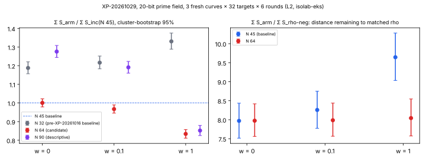

# N 64 against the N 45 prime-field baseline at 20 bits (XP-20261029), 2026-10-29

This is the run of the frozen protocol [`backlog/XP-20261029-p20-large-n/PROTOCOL.md`](../../backlog/XP-20261029-p20-large-n/PROTOCOL.md)
(commit `97321bf`, no amendments). It tests the one candidate that
[XP-20261016](../prime_base_oracle_tuning_20261029/README.md) left open, "Shallow train minimum".
That candidate is the factor-base size N 64, against the 20-bit baseline N 45. The oracle is the same,
`mitm:negation_folded=1`, and the curves are fresh.

## Decision (§6): unresolved inside the band; the N 45 baseline is kept

`Σ S_n64 / Σ S_inc` over 576 matched pairs (3 curves × 32 targets × 6 rounds), with cluster-bootstrap 95% intervals. These are *recorded*: `ecbench compare --weight W`, the `ops` block of `analysis/compare-inc__n64-w*.json`.

| w | n64 / inc | n90 / inc (descriptive) | n32 / inc (descriptive) |
|:--|:--|:--|:--|
| 0 | **1.001 [0.979, 1.022]** | 1.276 [1.245, 1.309] | 1.188 [1.157, 1.221] |
| 0.1 | 0.967 [0.946, 0.990] | 1.191 [1.160, 1.223] | 1.217 [1.183, 1.252] |
| 1 | 0.834 [0.811, 0.857] | 0.852 [0.825, 0.879] | 1.331 [1.289, 1.375] |

- **§6.1 instrument: holds.**
  - The session audit is `ok`: 4,704/4,704 records verified and regraded, and 4,032/4,032 measured replays are identical.
  - The L2 gate accepted all 4,704 executions.
  - `inc-aa/inc` and `rho-neg-aa/rho-neg` are exactly 1.000 at every weight.
  - The worker's `input-spec.json` equals the frozen `spec-holdout.json`.
- **§6.2 completeness: holds.** All 576 measured runs of each arm are verified, with 0 censored pairs.
- **§6.3 ratio: fails at w = 0.** The interval contains 1 there. The upper bound is below 1 at w = 0.1 and w = 1.
- **§6.4 band:** per curve, `ecbench band --ranks` gives `n64 < inc` on `icv1-fp20-tm1319-e428a267` and `icv1-fp20-tm39-90315544`. On `icv1-fp20-tm979-7535758a` it gives "unresolved inside the band".

So by the frozen table the outcome is **unresolved inside the band**, and N 45 stays the baseline. This is not a relabelling: the total does not fall at w = 0 and rise at w = 1. Charged work is unchanged within ±2.2% at w = 0, and native work falls. At every w > 0 that was measured, N 64 is at least as good as N 45. The rule needs a resolved gain at all three weights, and w = 0 does not have one.

Pre-registered predictions (§7):

- **Prediction 1 holds:** n64/inc < 1 at w = 1.
- **Prediction 2 holds:** n64/inc is near 1 at w = 0, so the outcome is unresolved.
- **Prediction 3 holds:** n32/inc > 1 at every weight.
- **Prediction 4 holds:** n90/inc > n64/inc at w = 0.

Figure. Left: the paired ratio of each arm to the N 45 baseline. Right: the gap to matched rho. Both use cluster-bootstrap 95% intervals. The values are copied from `analysis/compare-*.json`; [`figures/plot.py`](figures/plot.py) does layout only.

## What else the run shows (descriptive, not decision-bearing)

- **The XP-20261016 result replicates on new curves.** `n32/inc` is 1.188 / 1.217 / 1.331, that is, N 45 costs 0.842 / 0.822 / 0.751 of N 32. That run used one curve, 96 pairs and an Intel L0 host. This one used three new curves, 576 pairs and an AMD L2 host, and it lands within a few percent of the original 0.818 / 0.798 / 0.726.
- **Larger bases flatten the band.** See the table below.
- **Per-curve means** are in [`analysis/band.md`](analysis/band.md). Rho stays ahead by about 8× on every curve and at every weight; that gap is the distance remaining.

The distance to matched rho, `Σ S / Σ S_rho-neg` (`analysis/compare-rho-neg__*.json`):

| w | inc (N 45) / rho-neg | n64 / rho-neg |
|:--|:--|:--|
| 0 | 7.97 [7.52, 8.44] | 7.97 [7.56, 8.42] |
| 0.1 | 8.26 [7.78, 8.75] | 7.99 [7.57, 8.44] |
| 1 | 9.64 [9.03, 10.28] | 8.04 [7.57, 8.55] |

With N 64 the gap barely moves across the band (7.97 to 8.04), so a smaller share of its cost is native work. At N 90 the charged cost rises by 28% at w = 0, so the w = 0 minimum lies at or below N 64.

## What ran

- **Spec:** `spec-holdout.json`, identical to the frozen file.
  - Spec id `ECS1h780563dd45d7`; session `ECBS1h33c033ce9c88`; plan sha256 `acfd67b6…`.
  - 7 arms; 3 fresh `prime_search` 20-bit curves; 32 public targets per curve; 1 warm-up and 6 measured rounds in `alternate` order.
- **Route:** isolab-eks, AWS launcher. Card [`launch/card.md`](launch/card.md) (CARD-XP-20261029-p20-large-n-01, sha256 `0be2094c…`) was written by the experiment director and run unchanged by the mechanical executor.
  - Request [`launch/request.json`](launch/request.json), sha256 `5f509f8d…0ca0cb`; the launcher stored [`launch/validated-request.json`](launch/validated-request.json), request sha256 `e8bc572b…`.
  - Launcher build `isolab-experiment-launcher:050d5702-8283-4801-9dc8-7cad8a991b16`, state `succeeded`.
  - Job UID `225d6e6d-e729-4f29-a1e4-645751a82fac`, Pod UID `7404322e-ea48-4db4-bbf0-ae1da872573a`.
- **Host:** EKS Spot c8a.2xlarge, AMD EPYC 9R45, cpuset 1-4, L2, env class `ECBENV2h3a51beea0bc2`. The session took 88 s.
- **Binary:** ecbench sha256 `583e62f0…c6a5a9`, built from source `cb2ec6873f30` (image built 2026-10-19).
- **Results:** `s3://isolab-results-104186811093-us-east-2/runs/p20-large-n-20261029/7404322e-ea48-4db4-bbf0-ae1da872573a/`, copied to `eks-results/`. All 19 files verify against `SHA256SUMS`. `session/records.jsonl` (sha256 `f4ca3d55…8255`) and the other large files are in the artifact store.

## Limits

- **Engineering class:** one parameter at one size. No exponent claim, and no claim at other sizes.
- **Counted unit only:** ecbench GAE with §5a pricing. Wall times are L2 records but are not analysed.
- **Older binary:** the image's ecbench (`cb2ec687`) does not emit the newer bitop/v1 `work` fields. The decision uses only S and the band, which it does emit.
- **No validator pass and no leaderboard change.** The outcome keeps the baseline, so no row moves and no `benchmarks/` row is added (validation gate). The `n32/inc` replication is descriptive; it does not re-promote anything.
- **Next lever, not tested here:** the gain at w > 0 comes from fewer native operations at the same charged cost. A change that lowers the w = 0 charged cost at N 64 would turn it into a gain across the whole band. Choosing N per weight would be relabelling, so that is not an option.
