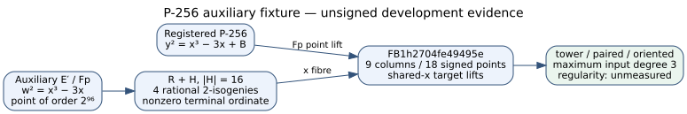

# Aligned auxiliary P-256 factor-base construction

The implemented candidate uses an auxiliary curve over the **actual P-256
field**, not a toy curve. Development fixture `FB1h2704fe49495e` has nine
negation-folded columns/eighteen signed points; its complete structured
relation-system exports have maximum input degree3 versus same-base dense
degree9. These are producer-local observations, not a measured degree of
regularity or speedup. Claim `PCC-20261114-4a3ab6` has no signed verdict
and remains unverified [pcc:unverified].



## Construction and exact scope

Target: `icv1-fp256-t89188191154553853111372247798585809583-f188c491`.
Auxiliary: `icv1-fp256-t0-5593c5e9`, model `w^2=x^3-3x` over the same
prime p, with proposed full order p+1. Since p=3 mod4, the quadratic
characters of f(x)=x^3-3x and f(-x)=-f(x) cancel; f(0)=0, so the character
sum is0 and the point count is p+1. This argument is not a Lean proof or
a signed PCC theorem [pcc:unverified].

The constant p+1 has 2-adic valuation96. The native certificate records a
point K96 with [2^96]K96=O and [2^95]K96!=O, checked by GMP and OpenSSL.
Its odd cofactor is
`1461501636990620551361974531767172749817708281857`. The **subgroup** is
2-smooth; the report does not assert smoothness of the whole group order.
The fixture uses H=<[2^92]K96>, |H|=16 [pcc:unverified].

For a rational 2-torsion point (r,0) on a short model, set delta=3r^2+A.
Each normalized step is

```
x' = x + delta/(x-r)
w' = w*(1-delta/(x-r)^2)
A' = A-5*delta; B' = B-7*r*delta.
```

The implementation checks the exact cleared-denominator polynomial
identity, kernel order, nonsingular codomain, exceptional points and every
materialized coset point. Choose R with phi(R) finite and terminal ordinate
nonzero, then enumerate R+H. Their x coordinates are distinct: if P and -P
were in that coset then 2R would lie in H, contradicting 2phi(R)!=O.
Target lifts retain both signs in sorted columns. Each membership step is
`(x_next-x)*(x-r)-delta=0`; delta!=0 excludes a pole automatically.
These arguments/certificate checks are unsigned producer evidence
[pcc:unverified].

This is a **shared-x fibre definition**, not a homomorphism carrying target
logs to the auxiliary curve. PKM auxiliary-isogeny bases and j=1728 curves
are prior art. Alignment with the target gives y^2-w^2=B, hence uv=B with
u=y+w,v=y-w. The specific deterministic fixture and its presentations are
candidates; global novelty has not been established.

## Matched presentations

The table copies emitted native system metadata for the d4 fixture. It
reports input degree, not structured regularity. Every arm includes all
five addition charts, explicit nonzero denominators, canonical infinity,
and Boolean branch selectors; no inactive slope/inverse is left free.
Clearing the slope denominator directly keeps the doubling chart cubic
[pcc:unverified].

| m | Arm | Maximum input degree | Variables | Equations |
| --- | --- | ---: | ---: | ---: |
| 2 | dense | 9 | 13 | 44 |
| 2 | tower | 3 | 19 | 50 |
| 2 | paired | 3 | 23 | 54 |
| 2 | oriented | 3 | 29 | 62 |
| 7 | dense | 9 | 83 | 274 |
| 7 | tower | 3 | 104 | 295 |
| 7 | paired | 3 | 118 | 309 |
| 7 | oriented | 3 | 139 | 337 |

The paired arm has two auxiliary signs per target point, hence 2^m cover
copies for an ordered relation. The oriented arm adds the cubic equations
`w_next*(x-r)^2-w*((x-r)^2-delta)=0`, fixing the terminal ordinate and
selecting one lift per x. This trades copies for more variables/equations;
no runtime benefit is inferred [pcc:unverified].

Comparison is of **Fp-rational solution sets**, not identical
algebraic-closure ideals. Auxiliary abscissae that do not lift on the
target over Fp can acquire target ordinates over extensions; pay for those
solver outputs and rational-root rejection. The auxiliary/sign cover
changes the algebraic problem and may raise its cost. Separate Semaev S3
chain exports are marked incomplete at infinity and are never treated as
complete relation searches.

## Evidence and reproduction

Start pin: `0c2cc1b408e33a43e55ee31cb75307e90df9d619`.
Sources, compiler, dependency versions and binary hashes are retained in
[evidence](evidence). All JSON/point manifests are deterministic. Use fresh
output directories; both scripts preserve failed attempts:

```sh
research/p256_aux_smooth_20261114/run_checks.sh /tmp/aux-native-001
research/p256_aux_smooth_20261114/run_adapter_checks.sh /tmp/aux-adapter-001
```

Observed native checks: complete d1 domains for m2..7 and complete d2
domains for m2..4, planted and hash-selected unplanted targets, exact
exhaustive/MITM ordered-set comparison, every returned relation replayed
by GMP/OpenSSL and evaluated in all four polynomial encodings. There are
also forced general/doubling/inverse/left-/right-infinity cases, reverse
auxiliary-sign tests, and order/map/dump/witness corruption rejection.
Unit-scale domains are explicitly small; these tests do not establish
natural yield at a larger base [pcc:unverified].

The native Magma adapter emits 48 scripts, m2..7 x planted/unplanted x
four arms, with fixed sorted-name grevlex order. It reads all original
polynomials and uses `GroebnerBasis` then `Variety` over GF(p). It emits
the **affine output-basis degree**, which is not regularity or maximum
F4 degree, and exact point projections. The native reader rejects invalid
coordinates, wrong factor-base membership, wrong sums, mismatched headers,
counts and truncation; it distinguishes CAS solutions, ordered tuples and
nonzero projected rows. Synthetic reader tests and byte-identical static
export passed; **Magma itself was not run**. Claim
`PCC-20261114-91d75d` is unsigned/unverified [pcc:unverified].

To qualify a real CAS run after admission, compile `magma_adapter.cpp`
with the same flags/libraries as the core, export the chosen depth and
run the exact hashed `.m` script under the frozen caps. Replay the original
log using:

```sh
magma_adapter replay 4 2 planted solver.log --producer-unverified
```

CAS syntax and successful full solving still need execution against the
licensed solver. A completion marker by itself is not independent proof
of exhaustive enumeration. Do not time synthetic logs or generic MITM as
an algebraic solver result. Construction counters in the certificate count
native API calls including checks; they are not field-equivalent cost.

## Status against the owner's request

| Requirement | Status | Remaining evidence |
| --- | --- | --- |
| New same-field smooth auxiliary base | Implemented; unsigned construction checks | independent certificate/proof standing; novelty search |
| Repository ICV1/FB1 wide format | Implemented; canonical target model hash and byte replay checked | independent compatibility review |
| Actual P-256 m2..7 systems and replay | Implemented; bounded native checks | real CAS qualification and complete references at admitted depth |
| Baseline on intended depth8 base | Not run | freeze actual d8 FB1/input hashes, complete solver and admitted run |
| Matched >=2x stage gain | Not measured | prospective matched L2 panel in protocol |
| Lower structured degree of regularity | Not measured | definition/order/homogenization and complete rank/degree evidence |
| Novel factor-base mechanism | Unestablished | prior-art/KB and mathematical review |

Checkpoint gate exited1: no AWS profile/upload token was available. The
current GitHub EKS build bundle packages ecbench/fresh-owner and does not
package this CAS adapter. No EKS job or timed experiment was launched.
Root `cargo test --release --lib` could not start (exit127, cargo absent);
there is no new root-library compiler-defect claim. See raw receipts and
the [named solver/admission gap](../../problems/p256-aligned-auxiliary-solver.md)
[pcc:unverified].

The next discriminating comparison is **tower versus paired versus
oriented on identical d8 queries**, paying for extra variables and sign
copies and preserving every censored cell. Run the original m2..7 matrix
once admission and CAS qualification are available; a successful smaller
unit check is not its replacement. The original 2x target remains open.

## Sources and reporting

- Petit–Kosters–Messeng, PKC2016, sections3.1,3.4,3.5,
  [primary PDF](https://people.maths.ox.ac.uk/petit/files/16PKC_primeECDLP.pdf).
- Existing source at the start pin:
  `src/cryptanalysis/ic_framework/prime_tower.rs`,
  `src/cryptanalysis/p256_dickson_factor_base.rs`,
  `src/cryptanalysis/curve_id.rs`, `ecbench/canonical.rs`.
- Magma handbook: [Groebner basis interface](https://magma.maths.usyd.edu.au/magma/handbook/text/1314),
  [Variety](https://magma.maths.usyd.edu.au/magma/handbook/text/1325).
- KB unavailable: no exposed KB MCP tools, CLI wrapper exits127. Fallback
  sources above; this is not evidence of absence or novelty.
- Source-linked [PDF](report.pdf), [diagram source](construction.dot),
  [prospective protocol](PROTOCOL.md), [resume state](HANDOFF.md).
  This is not a performance-results publication; no benchmark/dashboard
  leaderboard was promoted. Existing canonical performance graphs were
  left unchanged because there is no new qualified timing measurement.
